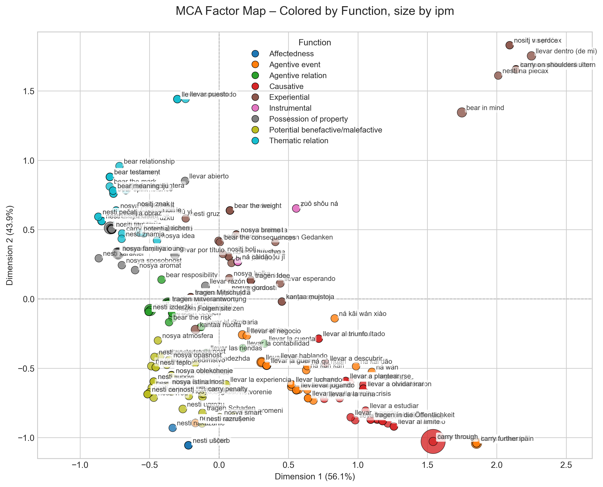
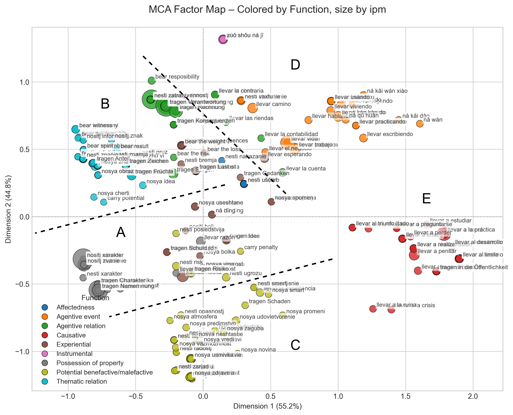
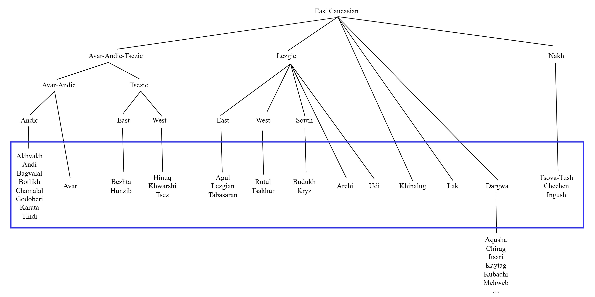
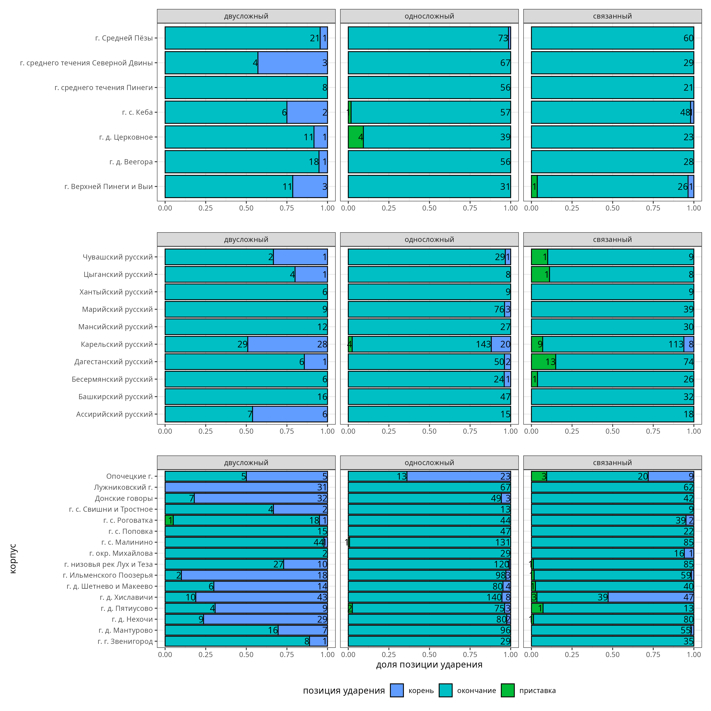
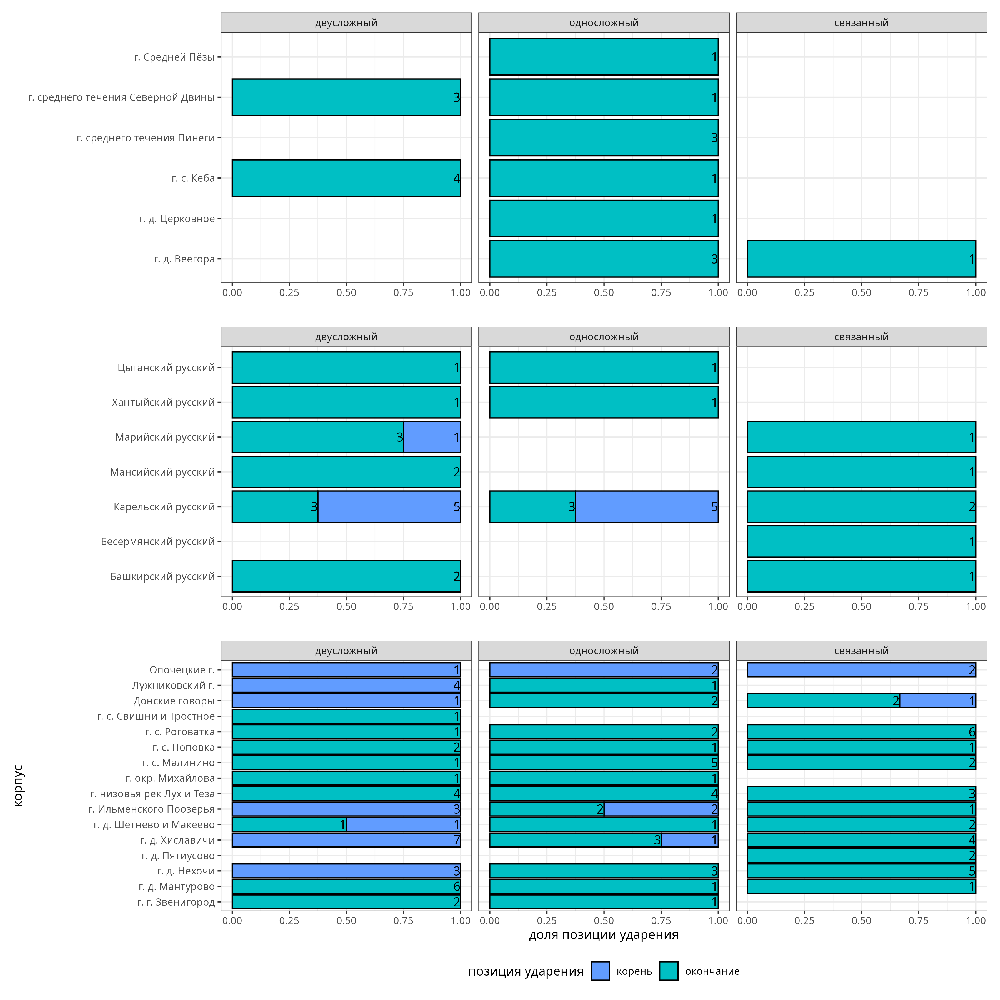

```{r}
#| include: false

library(tidyverse)
library(lingglosses)
options("lingglosses.italic_transliteration" = FALSE)
```

# конлаб

## Легкие глаголы ношения: типологическое корпусное исследование семи языков Евразии

Исследование посвящено проблеме легких глаголов как особых языковых единиц, занимающих промежуточное положение между полнозначными лексическими единицами и грамматическими показателями на примере глаголов ношения (нести, носить и их аналогов в других языках). Легкие глаголы активно обсуждаются в современной лингвистической литературе последних двух десятилетий. Данные единицы демонстрируют промежуточное поведение между лексическими и грамматическими единицами. С одной стороны, они в какой-то степени сохраняют лексическую и морфосинтаксическую сочетаемость, свойственную их исходным полнозначным употреблениям, с другой, они приобретают новую грамматическую функцию, которая проявляется в сочетании с другими элементами сложной предикативной конструкции. Кроме того, легкие глаголы отличаются значительной семантической и морфосинтаксической вариативностью и вносят различный вклад в событийную и аргументную структуру конструкции. При этом, несмотря на большое количество исследований отдельных языков, типологические сопоставления легких глаголов пока представлены недостаточно широко. Глаголы ношения в этой связи представляют собой особый интерес, поскольку демонстрируют высокую степень вариативности, ср. в русском пациентивное нести убытки/потери/урон, агентивное нести вахту/дежурство/службу и экспериенциальное нести тяжесть/бремя/груз. Подобная вариативность не может быть реализацией одного и того же значения ношения, поэтому требует подробного изучения.

Объектом исследования являлись легкие употребления глаголов ношения в семи языках Евразии. Для сравнения можно привести полнозначное употребление глагола нести в «Иван несет чемодан на станцию» и легкое употребление в «Иван несет вахту в школе». Во втором употреблении по сравнению с первым у глагола «нести» отсутствует исходный смысл каузированного движения, и выражается новое значение, близкое к «выполнять». Предметом исследования являлись семантические функции, морфосинтаксические характеристики и межъязыковая вариативность конструкций с легкими глаголами ношения. Анализ проводился на двух уровнях: на уровне отдельных коллокаций, представляющих собой конкретные сочетания глаголов с различными лексемами, а также на уровне конструкций как обобщенных морфосинтаксических моделях, объединяющих такие коллокации.

Целью исследование было выявление типологически значимых закономерностей устройства и функционирования легких глаголов ношения, определение и системное описание их основных семантических функций, морфосинтаксических особенностей и лексической сочетаемости и установление отношений между этими функциями. Данная цель предполагала последовательное решение следующих основных исследовательских задач:

- Разработать рабочее определение легкого глагола, применимое для межъязыкового сопоставления.
- Сформировать корпусную выборку легких употреблений глаголов ношения в семи языках.
- Определить семантические, синтаксические и морфосинтаксические характеристики выявленных конструкций и разработать их функциональную классификацию.
- Выявить закономерности полифункциональности отдельных глаголов и определить степень пересечения их функций.
- Построить концептуальное пространство функций легких глаголов ношения и установить закономерности их распределения.

Основные вопросы исследования можно сформулировать следующим образом:

- Как легкий глагол и лексическая часть совместно формируют значение и морфосинтаксическую структуру предикатного комплекса? Данный вопрос исходит из допущения, что легкий глагол не является семантически пустым средством вербализации конструкции, а сохраняет либо трансформирует во взаимодействии исходное значение и набор валентностей во взаимодействии с предикативным лексическим компонентом конструкции.
- Как варьируются легкие глаголы ношения в различных конструкциях одного языка и между языками? Данный вопрос подразумевает анализ лексической и морфосинтаксической сочетаемости глаголов в каждой конструкции и установлении межъязыковых соответствий в наблюдаемых паттернах.
- Какие функции реализуются легкими глаголами ношения, как эти функции связаны друг с другом и насколько полифункциональны отдельные глаголы? Данный вопрос предполагает получение содержательных обобщений о функционировании конструкций в виде общих значений и моделей управления, выделение ключевых аспектов, объединяющих выделенные функции и построение общей модели полифункциональности.

### Теоретические основания исследования

#### Понятие легкого глагола

Исследование опиралось на концептуальный аппарат, разработанный в литературе по легким глаголам. Термин «легкий глагол» восходит к работе Есперсена [@jespersen1942], где под ним понимается финитный глагол в составе составного сказуемого, предикативное значение которого выражается именем существительным или именем существительным с предлогом. В современной лингвистике термин «легкий глагол» применяется к нестандартным употреблениям финитных глаголов в различных морфосинтаксических контекстах, часто обозначаемых как «конструкции с легкими глаголами». Во-первых, под «легким глаголом» понимается финитный глагол (или вспомогательный глагол) в составе сложного предиката, где второй компонент также является глаголом, как, например, lıkh li- «полностью написать» ('писать' + 'брать') или bɑna di- «построить для кого-либо» ('строить' + 'давать') в урду [@butt2010: 51]. Во-вторых, этим термином обозначается финитный глагол, выполняющий функцию обобщенного вербализатора в сочетании с чистыми (голыми) глагольными основами, как в некоторых языках Австралии, например, roowil -nya- «идти» ('идти' + 'поднимать, хватать'), garr -boo- «тереть (что-либо), чтобы снять боль» ('тереть' + 'ударять') в языке барди [@bowern2008: 19]. В-третьих, и это наиболее релевантно для нашего исследования, данный термин описывает глагольные компоненты в соединениях «глагол + неглагольный элемент», например, take shower (принять душ), give a smile (улыбнуться); ср. также частое употребление легких глаголов в так называемых «глагольно-именных оборотах» (Funktionsverbgefüge) --- глагольных соединениях с именной или предложной группой в немецком языке, как в unter Druck stehen «находиться под давлением» (@helbig1984; @vanpottelberge2001; @harm2021). Легкие глаголы были подробно изучены в отдельных языках, включая германские (особенно немецкий и английский), романские (особенно испанский и итальянский), а также персидский, китайский (путунхуа) и японский, назовем лишь некоторые; см. новейшие сборники под редакцией (@pompei2023; @riccio2025). Эти исследования сосредоточены на различных аспектах легких глаголов: варьировании значения, синтаксисе, аспектуальности (например, лексическом виде, совместном выражении аспектуального значения), актантной структуре (например, повышении и понижении валентности, совместном использовании актантов), лексикализации и грамматикализации, проблеме семантической полноты/пустоты в сравнении с простыми предикатами и т. д. Для определения легкого глагола использовались три критерия: 1) наличие синхронно связанного полнозначного употребления, 2) образование сложного предиката и 3) выполнение грамматической или квазиграмматической функции. Данное определение исключает из рассмотрения копулы, модальные и фазовые глаголы, и, что особенно существенно в контексте глаголов ношения, метафорические употребления глагола. Все рассматриваемые в работе легкие употребления глаголов ношения соответствуют принятому определению, за исключением отдельных периферийных случаев, которые обсуждаются отдельно.

#### Исходная семантика глаголов ношения и границы выборки

В своем полнозначном употреблении глаголы ношения обозначают каузированное движение с сопровождением, направленное, как в случае нести, либо ненаправленное, как в случае носить. Движение подразумевает перемещение субъекта движения из исходного пункта в конечный по некоторой траектории. Движение имеет место под воздействием каузатора, который придает импульс субъекту движения и сопровождает его на всем протяжении пути. В некоторых случаях в глаголе движения лексикализуется способ перемещения (например, везти и вести) и дейксис (ср. финское tuoda ‘принести’ и viedä ‘унести’). В легких употреблениях глагол ношения десемантизируется, отношение между каузатором и субъектом переосмысляются как посессивное, экспериенциальное или аффективное, компонент движения метафоризируется. В целях сужения задачи исследуемый класс был существенно ограничен. В сферу рассмотрения были включены непроизводные глаголы ношения с невыраженной дейктической спецификацией, имеющие легкие употребления. Первый параметр исключает из рассмотрения глаголы, в которых компонент пути выражен не в корневом элементе, а в ориентационном префиксе, превербе или глагольной частице. Дейксис чаще всего на материале изучаемых языков выражается при помощи подобных элементов, чем обусловлено второе ограничение.

### Материал исследования и методика его обработки

#### Типологическая выборка языков

В языковую выборку исследования вошли семь языков, в каждом из них было выбрано от одного до двух глаголов ношения, перечень представлен в таблице -@tbl-conlab-1.

| Язык       | Языковая группа / семья | Исследуемые глаголы |
|------------|-------------------------|---------------------|
| Английский | Германская              | carry, bear         |
| Немецкий   | Германская              | tragen              |
| Испанский  | Романская               | llevar              |
| Русский    | Славянская              | нести, носить       |
| Болгарский | Славянская              | нося                |
| Финский    | Уральская               | kantaa              |
| Китайский  | Синитская               | ná (拿)             |

: Языковая выборка исследования. {#tbl-conlab-1}

Материал извлекался из веб-корпусов Aranea, функционирующих на технологической основе NoSketch Engine (@rychly2007; @kilgarriffetal2014). Для обеспечения сопоставимости был выбран вариант Maius объемом около 1,25 млрд токенов. Ограничение ресурса состоит в том, что он представляет преимущественно письменную интернет-коммуникацию и не сбалансирован по жанрам, стилям и сферам употребления. При составлении выборки учитывались следующие критерии: представленность нескольких языковых семей, возможно сравнения генетически близких языков, наличие внутри одной группы языков с различающимися грамматическими характеристиками, возможность сопоставления германских и славянских языков между собой и с представителями других семей и наличие сходных по наполнению корпусов достаточно объема. В русском и английском языках было взято по два глагола, в равной степени используемых в изучаемых конструкциях, что позволило сопоставить лексемы, различающиеся по исходному значению и спектру легких употреблений в рамках одного языка. Для каждого языка задавались ключевые глаголы ношения; поиск коллокаций выполнялся в окне от −3 до +3 токенов относительно ключевого слова. Поскольку объем корпусов несколько различался, сырые частоты нормализовались и выражались в ipm (instances per million --- число вхождений на миллион токенов). Для всех языков применялся порог 0,2 ipm. Итоговая выборка включила 278 коллокаций.

### Семантическая и морфосинтаксическая классификация легких глаголов ношения

Сочетание семантики лексической части и валентной рамки позволяет выделить девять функций. Ниже каждая функция описывается по единой схеме: значение конструкции, тип лексического компонента, роли участников, межъязыковая распространенность и характерные коллокации.

В экспериенциальных конструкциях субъект концептуализируется как экспериенцер, переживающий психическое или эмоциональное состояние. Лексическая часть выражает отношение, свойство или, реже, событие; дополнительно может присутствовать телесный локатив, концептуализируемый как вместилище переживания. Функция засвидетельствована во всех семи языках. Наиболее характерны существительные, представляющие переживаемое состояние как ношу: англ. bear burden ‘нести бремя’, carry weight; ‘нести вес’ нем. Schuld tragen ‘нести вину’; рус. нести бремя, носить боль. Стимул может выражаться зависимым родительным или предложным компонентом, но часто остается имплицитным.

В функции обладание свойством субъект является темой, которой приписывается определенное свойство; лексическая часть обычно выражена существительным со значением имени, названия, титула, статуса или характера. Субъект может быть одушевленным или неодушевленным. Функция обнаружена во всех исследуемых языках, кроме китайского. Типичные сочетания: англ. bear a name ‘носить имя’, нем. Titel tragen ‘носить титул’; рус. носить имя, носить характер. Имя или свойство может уточняться зависимым компонентом: например, через родительное определение, прилагательное или именную группу.

Тематическое отношение сходно с обладанием свойством тем, что субъект является темой, однако лексическая часть обозначает не качество субъекта, а его отношение к другому участнику --- ориентиру (Ground). Ориентир может быть выражен эксплицитно или оставаться имплицитным. Функция наиболее широко представлена в английском, болгарском и русском языках, но зафиксирована также в испанском и немецком. Типичные сочетания:

carry meaning ‘нести значение’, bear witness ‘нести свидетельство’, рус. нести отпечаток, нем. Zeichen tragen. Ориентир оформляется косвенным падежом или предложной группой. Особый испанский тип образуют сочетания llevar + причастие, например llevar asociado и llevar incorporado.

Функция потенциальных бенефактива и малефактива близка к обладанию свойством, но дополнительно вводит участника, для которого описываемая ситуация потенциально создает положительный или отрицательный эффект. Субъект конструкции выступает темой, лексическая часть обозначает свойство, отношение или событие, а бенефициант/малефициант оформляется косвенным падежом либо остается имплицитным. Эффект является потенциальным: конструкция характеризует ситуацию как способную повлечь определенные последствия, не утверждая, что они уже реализовались. Типичные примеры: болг. нося полза ‘нести пользу’, нося радост ‘приносить радость’, рус. нести вред, нести угрозу; фин. kantaa riskin ‘нести риск’. Получатель эффекта кодируется доступными в языке падежными и предложными средствами.

В конструкции агентивного отношения субъект получает роль агенса, однако само действие непосредственно не выражается: оно подразумевается как потенциальное, ожидаемое или связанное с обязанностью субъекта. Центральная группа коллокаций включает существительное «ответственность»: англ. carry responsibility, bear responsibility; нем. Verantwortung tragen; рус. нести ответственность; болг. нося отговорност; фин. kantaa vastuun. К близким употреблениям относятся рус. нести обязанность, нести обязательство, а также конструкции со значением затрат и последствий --- нести расходы, ср. нем. tragen Kosten.

Агентивное событие представляет собой динамический вариант агентивного отношения. Лексическая часть обозначает событие или процесс, а субъект интерпретируется как агенс. Функция особенно широко представлена в испанском языке: llevar dieta ‘быть на диете’, llevar guerra ‘вести войну’. В русском обнаружены сочетания нести вахту, нести службу, нести послушание, нести дежурство; они обозначают выполнение определенной службы и могут включать локатив, указывающий место ее осуществления. Особую продуктивную модель испанского языка образует llevar + герундий, ср. llevar trabajando ‘работать’ (букв. нести работая) Она обозначает продолжающееся действие с указанием на его длительность.

В каузативной функции субъект является каузатором, прямое дополнение --- темой, а лексическая часть обозначает событие или состояние, к которому направлено изменение. Тем самым конструкция представляет ситуацию как вызывание или доведение темы до определенного результата. Функция почти исключительно представлена в испанском языке: llevar a la práctica ‘реализовывать на практике’, llevar al cambio ‘приводить к изменениям’. В испанском также существует продуктивная модель llevar a + инфинитив, например llevar a pensar ‘заставлять думать’ и llevar a hacer ‘заставлять делать’.

Функция затронутости засвидетельствована только в русском языке. Ее реализуют сочетания нести потери, нести убытки, нести ущерб и нести наказание. Лексическая часть обозначает неконтролируемое событие или неблагоприятное воздействие, а субъект выступает затронутым участником, а не агенсом. Конструкция приобретает пассивоподобное значение: субъект не инициирует событие, а испытывает его последствия.

Инструментальная функция обнаружена в китайском языке, где ná (拿) употребляется как коверб, маркирующий инструмент при основном глаголе действия. К соответствующим сочетаниям относятся ná dāo и ná jiàn в контекстах использования ножа или меча, а также ná zhe shǒu jī --- ‘держать телефон’. В конструкциях типа ná jiàn ōudǎ ‘избивать мечом’ инструментальный компонент предшествует глаголу, обозначающему основное действие. Эта функция периферийна по отношению к принятому определению легкого глагола: ná не образует сложный предикат с именной группой в том же смысле, что остальные конструкции, а выступает в составе ковербной конструкцией.

Ниже в таблице -@tbl-conlab-2 представлена сводная таблица классификации функций легких глаголов ношения:

| Функция                | Лексическая часть      | Валентностная рамка |
|------------------------|------------------------|------------------------|
| Экспериенциальная      | OBJ отношение, свойство или событие, или OBL телесный локатив | S экспериенцер, (OBJ/OBL стимул) |
| Обладание свойством | OBJ свойство | S тема, (OBL/ADJ свойство, специфицированное) |
| Тематическое отношение | OBJ отношение | S тема, (OBL ориентир) |
| Потенциальный бенефактив/малефактив | OBJ свойство, отношение или событие | S каузатор, OBL бенефактив/малефактив |
| Агентивное отношение | OBJ отношение | S агенс |
| Агентивное событие | OBJ или V событие, или ADV направление | S агенс, (OBL локатив) |
| Каузативная | OBL или V событие | S каузатор, OBJ тема |
| Затронутость | OBJ событие | S затронутый участник |
| Инструментальная | --- | OBJ инструмент |

: Классификация функций легких употреблений глаголов ношения. {#tbl-conlab-2}

Функции возникают в результате взаимодействия исходной семантики глагола, значения лексической части и валентной структуры конструкции. Изменение одного из этих компонентов может сопровождаться переосмыслением семантической роли субъекта и способом кодирования дополнительных участников.

### Концептуальное пространство функций

Для описания отношений между функциями использовался множественный анализ соответствий (МКА; @greenacre2007; @glynn2014). Данный метод визуализирует отношения между наблюдениями и категориями переменных в двумерном пространстве. Близкое расположение наблюдений указывает на сходство по совокупности параметров, но не означает тождества функций или наличия жестких дискретных классов. В анализе использовались шесть категориальных переменных; на графиках цвет точки обозначал функциональную группу, а размер --- частоту соответствующей коллокации в ipm.

Общий график, представленный на рисунке -@fig-conlab-1, выявляет центральный кластер, в котором тематическое отношение и обладание свойством переходят через экспериенциальную функцию и агентивное отношение к агентивному событию и каузативным употреблениям. Это распределение можно интерпретировать как движение от пациентивного к агентивному полюсу. Потенциальный бенефактив/малефактив вместе с затронутостью образует отдельную группу. Инструментальные коллокации располагаются вблизи экспериенциальных, тогда как часть каузативных и адвербиальных конструкций оказывается на периферии из-за особого формального устройства.

{#fig-conlab-1}

Для содержательного обобщения распределение было разделено на пять приблизительных зон, представленных на рисунке -@fig-conlab-2. Зона A, зона свойства, объединяет конструкции с лексической частью, обозначающей свойство; в ней преобладает обладание свойством, но представлены также отдельные экспериенциальные и потенциально бенефактивные употребления. Зона B, зона отношения, включает тематические и агентивные отношения, а также отдельные экспериенциальные и аффективные коллокации. Зона C, бенефактивная, состоит преимущественно из потенциальных бенефактивных и малефактивных конструкций. Зона D, динамическая, объединяет агентивные события, инструментальные конструкции и более динамичные разновидности агентивного отношения. Зона E, каузативная, содержит конструкции, выражающие каузацию изменения состояния.

{#fig-conlab-2}

Зоны представляют собой аналитическое упрощение многомерного распределения, а не систему взаимоисключающих классов. Их расположение позволяет сформулировать общий континуум: C (бенефактив) → A/B (свойство и отношение) → D (динамика) → E (каузатив). Центральное положение занимают более статические и сравнительно простые по актантной структуре конструкции; динамические и валентно более сложные модели расположены ближе к периферии. Немецкий tragen представляет исключение из этой последовательности: у него обнаружена каузативная коллокация при отсутствии промежуточных употреблений зоны D.

### Межъязыковая вариативность и полифункциональность

Специализированных глаголов, выражающих только одну из выделенных функций, в выборке не обнаружено. Каждый исследуемый глагол выражает как минимум три функции, но ни один не охватывает их полного набора. Затронутость обнаружена только в русском языке, инструментальная функция --- только в китайском. Полифункциональность отдельных глаголов образует повторяющиеся комбинации зон концептуального пространства, что позволяет выделить шесть основных моделей, см. таблицу -@tbl-conlab-3 ниже.

Первая модель охватывает зоны A и B и представлена русским носить и английским bear. Вторая модель объединяет зоны A, B и C и представлена болгарским нося. Третья модель, A–B–C–D, представлена русским нести. Четвертая модель, A–B–D, представлена китайским ná. Пятая модель характеризуется широким функциональным диапазоном и включает испанский llevar и английский carry. Шестая, исключительная модель, относится к немецкому tragen: глагол охватывает зоны A, B и C и имеет отдельную каузативную коллокацию из зоны E, но не демонстрирует промежуточных динамических употреблений зоны D.

| Глагол | A (свойство) | B (отношение) | C (бенефактив) | D (динамика) | E (каузатив) |
|------------|------------|------------|------------|------------|------------|
| Рус. носить | \+ | \+ | --- | --- | --- |
| Рус. нести | \+ | \+ | \+ | \+ | --- |
| Англ. bear | \+ | \+ | --- | --- | --- |
| Англ. carry | \+ | \+ | \+ | \+ | \+ |
| Болг. нося | \+ | \+ | \+ | --- | --- |
| Фин. kantaa | \+ | \+ | \+ | --- | --- |
| Кит. ná | \+ | \+ | --- | \+ | --- |
| Исп. llevar | \+ | \+ | \+ | \+ | \+ |
| Нем. tragen | \+ | \+ | \+ | --- | \+ |

: Модели полифункциональности легких функций глаголов ношения. {#tbl-conlab-3}

Таблица представляет собой схематическое обобщение распределения функций по зонам. В отчете желательно сопровождать ее примечаниями, поясняющими исключительные случаи и особенности отдельных коллокаций. Данные в таблице отражают зоны, представленные в функциональном репертуаре каждого глагола, и является обобщенной схемой: отдельные функции внутри зоны могут быть представлены неравномерно. В целом полифункциональность развивается не как произвольный набор значений, а как охват смежных областей концептуального пространства. Исключением остается немецкий tragen, для которого наблюдается разрыв между бенефактивной и каузативной зонами.

## Расчлененность причинных союзов, образованных от сочетания указательных местоимений и союза ‘что’, в славянских языках

Во многих славянских языках есть причинные союзы, образованные из сочетания указательного местоимения с падежным или адложным маркированием и союза, используемого для введения сентенциальных актантов, ср. (@ex-1)–(@ex-2).

(@ex-1) Польский
```{r}
gloss_example(transliteration = "dla-tego, że",
              glosses = "для-DEM что",
              free_translation = "because")
```

(@ex-2) Болгарский
```{r}
gloss_example(transliteration = "за-това че",
              glosses = "к-DEM что",
              free_translation = "потому что")
```

Подобная внутренняя структура известна из типологических работ (@kortmann1997: 71–74; 113–118; @zaika2019: 12–13) и характерна также для значительно более широкого круга сложных союзов, ср. русские *кроме того что*, *несмотря на то что* и мн. др. Внутренняя структура таких выражений предполагает, что в их исходной структуре указательное местоимение относится к главной клаузе, однако во многих случаях неочевидно, относится ли оно синхронно к главной или зависимой клаузе. Этот вопрос часто обсуждается в литературе в связи с противопоставлением т. н. расчлененных и нерасчлененных союзов (@zaza1958, -@zaza1962; @bauer1960: 290–292; @paducheva1977; @kobozeva2010; @inkovaru2011; @inkovafr2011; @pekelis2024). ср. русское *потому, что* (с запятой) и *потому что* (без запятой). Практически исследования расчлененности обычно основываются на данных пунктуации, однако, как правило, предполагается, что эти данные в некоторой мере отражаются интонационное противопоставление --- с границей интонационных единиц (интонационных групп, ЭДЕ и др. --- в зависимости от теоретического подхода) до или после указательного местоимения.

В основе настоящего исследования лежит следующая гипотеза: склонность союза к пунктуационному расчленению количественно ассоциирована с его семантической прозрачностью и синтаксическими свойствами, указывающими на его неполную лексикализацию. Для расчлененности непосредственное сопоставление данных между языками сопряжено с рядом сложностей, в особенности в случае исследования пунктуационной расчлененности, поэтому для исследования было выбрано следующее методологическое решение. В выборку включены только такие языки, в которых есть не менее двух причинных союзов, соответствующих критериям исследования. Для каждой пары таких союзов рассматривается, совпадает ли внутри языка их иерархизация по трем критериям --- семантической прозрачности, склонности к пунктуационной расчлененности и склонности к синтаксическим проявлениям неоднословности.

### Материалы и методы

В таблице -@tbl-conlab-4 перечислены языки, вошедшие в часть исследования, представленную в разделе -@sec-3. Для сопоставления со славянскими данными в исследование была включена также небольшая выборка неславянских языков, отвечающих условиям исследования --- латышский, мокшанский и эстонский языки.

В разделе -@sec-4 используется меньшая выборка, поскольку исследуемые конструкции представлены в тексте сравнительно редко, из-за чего для многих языков в доступных корпусах отсутствует достаточное количество примеров. В разделе -@sec-4 представлены данные по русскому, украинскому, македонскому, чешскому и хорватскому.

::: {#tbl-conlab-4 .list-table}
Языки и корпусы

- - Выборка
  - Группа
  - Язык
  - Корпус/Подкорпус

- - []{rowspan=8} Основная выборка (славянские)
  - []{rowspan=3} Восточнославянские
  - русский
  - [@nkrya] (с 1951)

- - белорусский
  - [@nkrya] (параллельный подкорпус, только непереводные тексты)

- - украинский
  - НКРЯ (параллельный подкорпус, только непереводные тексты); [@ukten]

- - []{rowspan=3} Южнославянские
  - болгарский
  - [@arbul]

- - македонский
  - [@classla]

- - хорватский
  - [@nhk]

- - []{rowspan=2} Западнославянские
  - польский
  - [@arpol]

- - чешский
  - [@synv]

- - []{rowspan=3} Дополнительная выборка (неславянские)
  - индоевропейские, балтийские
  - латышский
  - [@lvk]
  
- - []{rowspan=2} уральские, финно-угорские
  - мокшанский
  - Статьи газеты [@mokpravda]
  
- - эстонский
  - [@ares] [@benko2014]

:::

В таблице -@tbl-conlab-5 для каждого языка перечислены союзы, вошедшие в выборку.

::: {#tbl-conlab-5 .list-table}
Союзы в выборке

- - Язык
  - Союз

- - []{rowspan=3} русский
  - *потому что*

- - *оттого, что*

- - *из-за того, что*

- - []{rowspan=4} белорусский
  - *таму, што* (`r add_gloss("DEM")`.`r add_gloss("DAT")` что)

- - *ад таго, што* (от `r add_gloss("DEM")` что)

- - *праз тое, што* (через `r add_gloss("DEM")` что)

- - *з-за таго, што* (из-за `r add_gloss("DEM")` что)

- - []{rowspan=4} украинский
  - *тому, що* (`r add_gloss("DEM")`.`r add_gloss("DAT")` что)

- - *за-тим, що* (behind-`r add_gloss("DEM")` что)

- - *від того, що* (от `r add_gloss("DEM")` что)

- - *через те, що* (через `r add_gloss("DEM")` что)

- - []{rowspan=3} болгарский
  - *за-това че* (к-`r add_gloss("DEM")` что)

- - *от това, че* (от `r add_gloss("DEM")` что)

- - *поради това, че* (из-за `r add_gloss("DEM")` что)

- - []{rowspan=2} македонский
  - *за-тоа, што* (за-`r add_gloss("DEM")` что)

- - *поради тоа, што* (из-за `r add_gloss("DEM")` что)

- - []{rowspan=3} хорватский
  - *za-to što* (за-`r add_gloss("DEM")` что)

- - *s-toga što* (с-`r add_gloss("DEM")` что)

- - *zbog toga što* (из-за `r add_gloss("DEM")` что)

- - []{rowspan=3} польский
  - *przez to, że* (через `r add_gloss("DEM")` что)

- - *wskutek tego, że* (из-за `r add_gloss("DEM")` что)

- - *dla-tego, że* (для `r add_gloss("DEM")` что)

- - []{rowspan=2} чешский
  - *kvůli tomu, že* (из-за `r add_gloss("DEM")` что)

- - *pro-to-že* (для-`r add_gloss("DEM")`-что)

- - []{rowspan=2} латышский
  - *tā-dēļ ka* (`r add_gloss("DEM")`-из-за что)

- - *tā-pēc ka* (`r add_gloss("DEM")`-после что)

- - []{rowspan=2} мокшанский
  - *ся-нкса, мес* (`r add_gloss("DEM")`-`r add_gloss("CSL")` почему)

- - *ся-с мес* (`r add_gloss("DEM")`-`r add_gloss("ILL")` почему)

- - []{rowspan=2} эстонский
  - *se-st et* (`r add_gloss("DEM")`-`r add_gloss("EL")` что)

- - *selle-pärast, et* (`r add_gloss("DEM")`-после что)


:::

```{r}
#| eval: false
my_abbreviations <- data.frame(gloss = c("CSL", "N1", "N2", "WHEN"),
                               definition_en = c("causal", "neuter 1", "neuter 2", "when"))
```

### Семантическая прозрачность {#sec-3}

В настоящем исследовании при исследовании семантической прозрачности причинных союзов используются следующие критерии. Наиболее семантически прозрачными признаются те и только те союзы, в которых именное маркирование допустимо в контекстах непрямой каузации, --- это верно, например, для русского составного союза *из-за того, что.* Остальные союзы в выборке для языка упорядочиваются от более семантически прозрачных к менее семантически прозрачным на основании того, насколько продуктивен именной причинный маркер в причинном значении. Так, например, именной показатель причины *от* признается более продуктивным для русского языка в сравнении с показателем *по*, поскольку второй ограничен небольшим количеством устойчивых сочетаний (*по этой причине*, *по глупости*), тогда как первый широко употребляется с различными существительными, включая недавние заимствования. В соответствии с этим разделением причинный союз *оттого что* признается более семантически прозрачным, чем *потому что*.

Опора на контексты непрямой каузации связана с тем, что для именных причинных маркеров противопоставление причинных показателей прямой и непрямой каузации является типологически распространенным [@sayetalms], в то время как для дистрибуции полипредикативных причинных конструкций этот параметр обычно не описывается как релевантный [@zaika2019]. Как следствие, можно предположить, что при грамматикализации причинного союза типично расширение семантики относительно семантики именного причинного маркера --- а значит союзы, исходно содержащие именные показатели прямой каузации претерпевают бо́льшие семантические изменения.

### Пунктуационная расчлененность {#sec-4}

В таблице -@tbl-conlab-6 представлены данные о частотности расчлененных вариантов причинных союзов. Число в скобках соответствует доле пунктуационно расчлененных вхождений, столбцам соответствует внутриязыковой ранг по семантической прозрачности. Как видно из таблицы, в большинстве случаев данные соответствуют гипотезе: для более семантически прозрачных союзов более характерно пунктуационное расчленение; исключение составляет хорватский союз *zbog toga što*.

| язык        | ранг сп 1                                | ранг сп 2          | ранг сп 3        |
|-------------|------------------------------------------|--------------------|------------------|
| Русский     | из-за того, что (1,0)                    | оттого, что (0,9)  | потому что (0,3) |
| Русский     | з-за таго, што (1,0) праз тое, што (1,0) | ад таго, што (1,0) | таму, што (0,8)  |
| Украин­ский  | через те, що (1,0)                       | від того, що (1,0) | тому, що (0,8)   |
| Украин­ский  |                                          |                    | затим, що (0,7)  |
| Болгар­ский  | поради това, че (0,9)                    | от това, че (1,0)  | затова, че (0,8) |
| Хорват­ский  | zbog toga što (0,0)                      | stoga što (0,02)   |                  |
| Хорват­ский  |                                          | zato što (0,01)    |                  |
| Македон­ский | поради тоа, што (1,0)                    | затоа, што (1,0)   |                  |
| Польский    | przez to, że (0,9)                       | dlatego, że (0,7)  |                  |
| Польский    | wskutek tego, że (0,8)                   |                    |                  |
| Чешский     | kvůli tomu, že (1,0)                     | protože (0,2)      |                  |
| Латышский   | tādēļ, ka (1,0)                          | tāpēc, ka (0,9)    |                  |
| Эстонский   | sellepärast, et (0,9)                    | sest et (0,1)      |                  |
| Мокшанский  | сянкса, мес (1,0)                        | сяс мес (0,2)      |                  |

: Семантическая прозрачность и пунктуационная расчлененность {#tbl-conlab-6}

### Синтаксические корреляты расчлененности

В рамках настоящего исследования в качестве синтаксического критерия расчлененности рассматривается сравнительная частотность при сочинении частичного повторения союза (@ex-3) и полного повторения союза (@ex-4).

<!--
Тут мне кажется lingglosses и не нужны... тут нет глосс
-->

(@ex-3)
*Умираю оттого, что заразилась, и еще оттого, что все люди подлецы* ***и что*** *жить очень гадко.* \[А. И. Куприн. Яма (1909–1915)\]

(@ex-4)
*Умираю … оттого, что все люди подлецы* ***и оттого, что*** *жить очень гадко.*

Для всех языков, для которых корпусы содержат достаточное количество данных, полное повторение более характерно для союза, который демонстрирует меньшую семантическую прозрачность и/или меньшую склонность к пунктуационному расчленению.

Так, в русском языке союз *оттого, что* семантически более прозрачен и для него более обычно пунктуационное расчленение, чему соответствует и большая частотность частичного повторения союза (см. таблицу @tbl-conlab-7). Различие статистически значимо (критерий Барнарда, p \< 0,001).

|  |  |  |  |
|------------------|------------------|------------------|------------------|
| Союз | Частичное повторение | Полное повторение | Доля частичного повторения |
| *оттого, что* | 27 | 16 | 0,6 |
| *потому что* | 26 | 120 | 0,2 |

: Полное и частичное повторение причинных союзов при сочинении в русском [@nkrya] {#tbl-conlab-7}

То же верно для украинского союза *через те, що* (@ex-5) в сравнении с *тому, що* (@ex-6). Различие статистически значимо (критерий Барнарда, p \< 0,001), данные приведены в таблице -@tbl-conlab-8.

(@ex-5) Украинский
```{r}
#| results: asis

gloss_example(transliteration = "а забрали його тільки через те, що воно було моїм і що я хотів пристосувати його до себе",
              glosses = "и взяли его только через то что оно было моим и что я хотел приспособить его до себя",
              free_translation = "…и они забрали его только потому, что оно было моим и что я хотел приспособить его для себя", 
              line_length = 40)
```


(@ex-6) Украинский
```{r}
#| results: asis

gloss_example(transliteration = "І казала, що пише себе, тому що багато часу проводить насамоті, і тому що є тією темою, яку знає найкраще.",
              glosses = "и сказала что пишет себя потому что много времени проводит одна и потому что есть той темой которую знает лучше.всего",
              free_translation = "И она сказала, что она пишет о себе, потому что проводит много времени одна и потому что это тема, которую она знает лучше всего.", 
              line_length = 40)
```

|  |  |  |  |
|------------------|------------------|------------------|------------------|
| Союз | Частичное повторение | Полное повторение | Доля частичного повторения |
| *через те, що* | 49 | 44 | 0,5 |
| *тому, що*[^ukrain_example] | 18 | 82 | 0,2 |

: Полное и частичное повторение причинных союзов при сочинении в украинском [@ukten] {#tbl-conlab-8}

[^ukrain_example]: Для *тому що* в таблице представлены данные случайной выборки в 100 примеров.

Сходное распределение демонстрирует македонский союз *поради тоа, што* (@ex-7): в сравнении с *затоа што* (8) он более семантически прозрачен, более склонен к расчлененности и чаще демонстрирует частичное повторение (см. таблицу -@tbl-conlab-9). Различие статистически значимо (критерий Барнарда, p \< 0,001).

(@ex-7)  Македонский
```{r}
#| results: asis

gloss_example(transliteration = "Со зборови не можам да ја опишам среќата која ја чувствувам поради тоа што е пронајдена и што ни се врати.",
              glosses = "с словами не могу COMP ее опишу счастье которое ее чувствую из_за DEM что есть найдена и что нам REFL возвратить",
              free_translation = "Я не могу описать словами радость, которую я испытываю из-за того, что ее нашли и вернули нам.", 
              line_length = 40)
```

(@ex-8) Македонский
```{r}
#| results: asis

gloss_example(transliteration = "Немојте да ги менувате правилата само за-тоа што сте посилни и за-тоа што можете",
              glosses = "PROH.2PL COMP их меняете правила только для-DEM что быть.2PL сильнее и для-DEM что можете",
              free_translation = "Не меняйте правила только потому, что вы сильнее и можете это сделать.", 
              line_length = 40)
```

|  |  |  |  |
|------------------|------------------|------------------|------------------|
| Союз | Частичное повторение | Полное повторение | Доля частичного повторения |
| *поради тоа, што* | 42 | 39 | 0,5 |
| *затоа што*[^macedonian_example] | 10 | 90 | 0,1 |

: Полное и частичное повторение причинных союзов при сочинении в македонском [@classla] {#tbl-conlab-9}

[^macedonian_example]: Для *затоа што* в таблице представлены данные случайной выборки в 100 примеров.

Сходное различие демонстрируют чешские союзы *kvůli tomu* (@ex-9) и *protože* (@ex-10), см. таблицу -@tbl-conlab-10. Различие статистически значимо (критерий Барнарда, p \< 0,001).

(@ex-9) Чешский
```{r}
#| results: asis

gloss_example(transliteration = "Volala jsem vám kvůli tomu, že mám problémy ve škole, a že nemám kamarády.",
              glosses = "позвонила быть.1SG вам из_за того что имею проблемы в школе и что не.имею друзей",
              free_translation = "Я позвонила вам потому, что у меня проблемы в школе и потому, что у меня нет друзей.", 
              line_length = 40)
```

(@ex-10) Чешский
```{r}
#| results: asis

gloss_example(transliteration = "Plakala, protože ji tlačily boty a protože měla ošumělé a promáčené šaty…",
              glosses = "плакала потому.что ей жали ботинки и потому.что имела поношенную и промокшую одежду",
              free_translation = "Она плакала, потому что ей жала обувь и потому что ее одежда была поношенной и мокрой", 
              line_length = 40)
```

|  |  |  |  |
|------------------|------------------|------------------|------------------|
| Союз | Частичное повторение | Полное повторение | Доля частичного повторения |
| *Kvůli tomu, že* | 128 | 2 | 1,0 |
| *Protože*[^czech_example] | 2 | 98 | 0,0 |

: Полное и частичное повторение причинных союзов при сочинении в чешском [@synv] {#tbl-conlab-10}

[^czech_example]: Для *protože* в таблице представлены данные случайной выборки в 100 примеров.

В хорватском языке сходное различие демонстрируют союзы *stoga što* (@ex-11) и *zato što* (@ex-12), см. таблицу -@tbl-conlab-11.  Используемые критерии не позволяют установить между ними различий по семантической прозрачности, однако первый из них более склонен к пунуткуационной расчлененности и для него более характерно частичное повторение при сочинении, что соответствует общей тенденции.

(@ex-11) Хорватский
```{r}
#| results: asis

gloss_example(transliteration = "I to najviše stoga što šire krvne žile i što sadrže vitamin E…",
              glosses = "и это в.основном потому что расширяет кровеносные сосуды и что содержит витамин {E}",
              free_translation = "И это в основном потому, что он расширяет кровеносные сосуды и содержит витамин E…", 
              line_length = 40)
```

(@ex-12) Хорватский
```{r}
#| results: asis

gloss_example(transliteration = "Kuću je sagradio, zato što je zemlja njegova, zato što je sirotinja i zato što nema gdje živjeti.",
              glosses = "дом есть построил потому что есть земля его потому что есть бедный и потому что не.имеет где жить",
              free_translation = "Он построил дом потому, что земля принадлежит ему, потому что он бедный и потому, что ему негде жить.", 
              line_length = 40)
```

|  |  |  |  |
|------------------|------------------|------------------|------------------|
| Союз | Частичное повторение | Полное повторение | Доля частичного повторения |
| *Stoga što* | 10 | 1 | 0,9 |
| *Zato što* | 55 | 45 | 0,6 |

: Полное и частичное повторение причинных союзов при сочинении в хорватском [@nhk] {#tbl-conlab-11}

## Морфологические особенности возвратных местоимений в нахско-дагестанских языках

В настоящей работе рассматриваются основные особенности парадигмы возвратного местоимения третьего лица в языках нахско-дагестанской языковой семьи. К анализируемым особенностям относятся: падежный синкретизм (использование одной и той же формы для эргативного и абсолютивного падежей); использование различных стратегий для маркирования категории рода на возвратном местоимении, а также его маркирование в разных частях парадигмы (ни в одной из форм, во всех формах или только в части из них); супплетивизм (использование разных корней для различных форм возвратного местоимения в зависимости от падежа, числа или рода).

Работа представляет собой типологическое исследование всех языков семьи на основе доступных грамматик и словарей. Мы также постарались охватить диалектное разнообразие. Актуальность работы обусловлена тем, что ранее возвратные местоимения исследовались скорее с синтаксической точки зрения (@creissels2007; @kalyakin2023; @sumbatova2016; @testeletstoldova1998; @testelets2016), в то время как морфологов интересовали преимущественно личные местоимения (@corbett2005; @moskal2015; @siewierskabakker2013; @smithetal2019) и другие части речи. Так, в то время как синкретизм между эргативным и абсолютивным падежами был описан в личных местоимениях (@ganenkov2021; @politova2023), тот факт, что то же явление наблюдается и в возвратных местоимениях, оставался незамеченным; мы считаем, что возвратные местоимения представляют интерес и с морфологической точки зрения, и в настоящей работе приводим несколько их характеристик, заслуживающих внимания.

### Нахско-дагестанская языковая семья

Языки нахско-дагестанской языковой семьи распространены преимущественно в трех российских республиках --- Ингушетии, Чечне и Дагестане, --- но также в северных регионах Азербайджана и в восточных частях Грузии. Классификация языков семьи представлена на рисунке -@fig-conlab-3 (по [@ganenkovmaisak2021] с незначительными изменениями). Синий прямоугольник на схеме очерчивает уровень, который мы в рамках данной работы считаем собственно языками; в работах, посвященных нахско-дагестанским языках, существуют расхождения относительно статуса некоторых диалектов (см., например, (@koryakovsumbatova2007; @koryakov2021)).

{#fig-conlab-3}

Говоря об особенностях именной морфологии нахско-дагестанских языков, следует отметить существование почти во всех языках семьи категории рода, или класса. Глаголы, прилагательные и некоторые местоимения могут согласовываться с существительными по их грамматическому роду. Количество родов в языке варьируется от двух (в табасаранском) до восьми (в цова-тушинском); род полностью отсутствует в удинском, лезгинском и агульском языках. В единственном числе часто различаются мужской, женский и средний род, в то время как во множественном чаще разделение проходит между людьми и всеми остальными [@ganenkovmaisak2021].

Имена и местоимения в нахско-дагестанских языках имеют категории числа и падежа. Падежи можно подразделить на грамматические (которые, как правило, представлены абсолютивным, эргативным, дательным и родительным падежами) и пространственные. Абсолютивный падеж противопоставлен остальным (косвенным) падежам во множестве аспектов: например, косвенные падежи имен часто образуются от специальных (косвенных) основ. О склонении имен в нахско-дагестанских языках см., например, [@kibrikkodzasov1990].

### Синкретизм абсолютива и эргатива

Как уже было сказано выше, личные местоимения во многих нахско-дагестанских языках демонстрируют синкретизм между эргативным и абсолютивным падежами, то есть используют для них одну и ту же форму. См. примеры (@ex-13) и (@ex-14) из годоберинского языка с местоимением *den* `r add_gloss("1SG")`.

(@ex-13) по [@kibriketal1996: 271]
```{r}
#| results: asis

gloss_example(transliteration = "den hac’ábaquralá w=ac’-á-mu-wq’aƛì wãwã́di bac’-é",
              glosses = "1SG gatsabakurala M=get.to-PST-PART-WHEN howl.PST wolf-PL",
              free_translation = "Когда я добрался до Г., выли волки")
```

(@ex-14) по [@kibriketal1996: 271]
```{r}
gloss_example(transliteration = "den ħadúr ĩhi tamánčá",
              glosses = "1SG.ERG ready do.PST pistol",
              free_translation = "Я приготовил пистолет.")
```

Наличие такого синкретизма в личных местоимениях первого и второго лица активно изучалось [@politova2023]. Интересно, что и в возвратных местоимениях третьего лица может наблюдаться такой же синкретизм. Можно разделить языки нахско-дагестанской семьи на три группы по наличию синкретизма в них.

1) Наличие синкретизма и в единственном, и во множественном числе. К этому типу относятся языки нахской ветви (чеченский, ингушский, цова-тушинский), а также лакский язык. Так, в чеченском языке местоимения *šaː* `r add_gloss("REFL")`.`r add_gloss("SG")` и *šæš* `r add_gloss("REFL")`.`r add_gloss("PL")` используются и в абсолютивной, и в эргативной функциях [@nichols1994: 33–34]. То же верно и для лакских *cu* `r add_gloss("REFL")`.`r add_gloss("SG")` и *ciw* `r add_gloss("REFL")`.`r add_gloss("PL")` [@zhirkov1955: 69–71].

2) Наличие синкретизма только во множественном числе. Этот тип наблюдается также в четырех идиомах --- гинухском, цахурском, варташенском диалекте удинского и в северном диалекте табасаранского языка. Например, в варташенском удинском в единственном числе используются формы *ič* `r add_gloss("REFL")`.`r add_gloss("SG")`.`r add_gloss("ABS")` и *ič-en* `r add_gloss("REFL")`.`r add_gloss("SG")`-`r add_gloss("ERG")`, в то время как во множественном числе в обеих функциях используется форма *ič-ɣo-n* `r add_gloss("REFL")`-`r add_gloss("PL")`-`r add_gloss("ERG")`, маркированная эргативом [@schulze1982: 134–135].

3) Отсутствие синкретизма. Наконец, последний из типов представлен во всех остальных языках семьи, поскольку обычно эргативный и абсолютивный падежи в возвратных местоимениях всё же различаются. См. примеры в таблице -@tbl-conlab-12 для гунзибского [@vandenberg1995: 63–64] и в таблице -@tbl-conlab-13 для ботлихского [@gudava1967: 301–302].

: Возвратные местоимения\: гунзибский {#tbl-conlab-12}

|  | `r add_gloss("ABS")` | `r add_gloss("ERG")` |
| --- | --- | --- |
| `r add_gloss("SG")` | žu | žin-lo |
| `r add_gloss("PL")` | žu-ru | žide-l |


: Возвратные местоимения\: ботлихский {#tbl-conlab-13}

|  | `r add_gloss("ABS")` | `r add_gloss("ERG")` |
| --- | --- | --- |
| `r add_gloss("SG")` | `r add_gloss("M")`: hi-w<br>`r add_gloss("F")`: hi-j<br>`r add_gloss("N")`: hi-b | `r add_gloss("M")`: in-šːu-di<br>`r add_gloss("F")`: in-ɬːi-di<br>`r add_gloss("N")`: in-ɬːi-di |
| `r add_gloss("PL")` | hi-ol | in-du-di |

Отметим, что синкретизм в возвратных местоимениях нахско-дагестанской семьи менее распространен, чем в личных местоимениях. Кроме того, личные местоимения более разнообразны в выборе того, какие именно формы будут или не будут различать эргатив и абсолютив. Так, например, в цезском языке личные местоимения различают эргатив и абсолютив во множественном и не различают в единственном числе; подобного паттерна не наблюдается в возвратных местоимениях ни одного из языков семьи. Тем не менее наличие синкретизма в возвратных местоимениях хотя бы некоторых языков является примечательным и подлежит дальнейшему изучению.

### Выражение рода

Как было отмечено ранее, почти все языки нахско-дагестанской языковой семьи имеют категорию рода, и многие части речи в них согласуются по роду с именами существительными. Маркеры рода могут присутствовать и в возвратных местоимениях некоторых языков; см. таблицу -@tbl-conlab-13 для ботлихского языка, где в единственном числе видно различение форм возвратного местоимения в зависимости от рода соответствующего референта. По ряду признаков, таким как отсутствие антецедента (существительного) в ряде употреблений, но также и иногда супплетивное (вместо аффиксального) выражение категории рода в возвратных местоимениях, мы не можем считать это полноценным согласованием по роду, и впредь будем называть это именно маркированием, или выражением, категории рода на возвратных местоимениях.

Можно выделить следующие типичные характеристики выражения рода в возвратных местоимениях языков нахско-дагестанской семьи:

1. категория рода выражена;
2. категория рода выражена и в единственном, и во множественном числе;
3. категория рода выражена и в абсолютивном, и в косвенных падежах;
4. в абсолютиве род выражена аффиксально;
5. аффиксы, выражающие род в абсолютиве, являются суффиксами;
6. в косвенных падежах род выражен специальными (косвенными) маркерами;
7. в косвенных падежах единственного числа разделение проходит между мужским родом и всеми остальными;
8. в косвенных падежах множественного числа разделение проходит между людьми и всеми остальными.

Все эти восемь условий редко соблюдаются в языках одновременно, кроме как в нескольких андийских языках --- ахвахском, кванадинском багвалинском, чамалинском и каратинском. См. таблицу -@tbl-conlab-14 для кванадинского багвалинского [@kibriketal2001: 162–163].

: Возвратные местоимения\: кванадинский багвалинский {#tbl-conlab-14}

|  | `r add_gloss("ABS")` | `r add_gloss("ERG")` |
| --- | --- | --- |
| `r add_gloss("SG")` | `r add_gloss("M")`: e-w-da<br>`r add_gloss("F")`: e-j-da<br>`r add_gloss("N")`: e-b-da | `r add_gloss("M")`: in-šːu-r-da<br>`r add_gloss("F")`, `r add_gloss("N")`: in-ɬːi-r-da |
| `r add_gloss("PL")` | `r add_gloss("HPL")`: e-ba-da<br>`r add_gloss("NPL")`: e-r-da | `r add_gloss("HPL")`: in-du-r-da<br>`r add_gloss("NPL")`: in-diri-r-da |

Кратко перечислим основные исключения для каждого из восьми условий.

1) В некоторых языках категория рода в возвратных местоимениях отсутствует --- в удинском, лезгинском, агульском (где она отсутствует совсем), а также в табасаранском языке, во всех нахских языках (чеченском, ингушском, цова-тушинском), а также в трех цезских (бежтинском, гинухском, гунзибском).

2), 3) В некоторых языках семьи род маркирован в единственном числе, но не во множественном. К таким, например, относится ботлихский --- см. таблицу -@tbl-conlab-13. В арчинском род маркирован только в косвенных падежах ед. числа [@kibrik1977: 261--262]. Обратная ситуация наблюдается в хиналугском, где род маркирован везде кроме косвенных падежей ед. числа [@kibrikkodzasov1990: 226]. В последних двух языках род маркирован в косвенных падежах, но не в абсолютивном; см. таблицу -@tbl-conlab-15 для хиналугского.

: Возвратные местоимения\: хиналугский {#tbl-conlab-15}

|  | `r add_gloss("ABS")` | `r add_gloss("ERG")` |
| --- | --- | --- |
| `r add_gloss("SG")` | `r add_gloss("M")`: hæhu<br>`r add_gloss("F")`, `r add_gloss("N")`: hæhæ | hæhin-i |
| `r add_gloss("PL")` | `r add_gloss("HPL")`: hohoz<br>`r add_gloss("NPL")`: hæhed | `r add_gloss("HPL")`: hohoz-i<br>`r add_gloss("NPL")`: hæhnedir-i |

4) Хиналугский язык маркирует род с помощью некоторых модификаций основы. Кроме того, некоторые языки маркируют род супплетивно, о чем пойдет речь ниже.

5), 6), 7) Рутульский и цахурский используют для маркирования рода в абсолютиве префиксы. В них же для различения рода в косвенных падежах используется модификация основы, как и в хиналугском (см. таблицу -@tbl-conlab-15). Кроме того, в цахурском языке в косвенных падежах единственного числа различаются мужской, женский и средний род, а в рутульском языке --- люди и все остальные. См. таблицу -@tbl-conlab-16 для цахурского [@kibrik1999: 132] и таблицу -@tbl-conlab-17 для рутульского [@maxmudova2002: 204–205]. В цахурском эргатив отличается по маркированию от других косвенных падежей.

:Возвратные местоимения\: мишлешский цахурский {#tbl-conlab-16}

|  | `r add_gloss("ABS")` | `r add_gloss("ERG")` | `r add_gloss("DAT")` |
| --- | --- | --- | --- |
| `r add_gloss("SG")` | `r add_gloss("M")`: w-uǯ<br>`r add_gloss("F")`: j-iǯ<br>`r add_gloss("N1")`: w-uǯ<br>`r add_gloss("N2")`: j-iǯ | `r add_gloss("M")`: wu-ǯ-eː<br>`r add_gloss("F")`: ji-ǯ-eː<br>`r add_gloss("N")`: či-šeː | `r add_gloss("M")`: ǯu-s<br>`r add_gloss("F")`: ǯe-s<br>`r add_gloss("N")`: či-s |
| `r add_gloss("PL")` | `r add_gloss("HPL")`: ǯo<br>`r add_gloss("HPL")`: ji-ǯ-bɨ | `r add_gloss("HPL")`: ǯo<br>`r add_gloss("NPL")`: či-šeː | `r add_gloss("HPL")`: ǯo-s<br>`r add_gloss("NPL")`: či-s |


:Возвратные местоимения\: мухадский рутульский {#tbl-conlab-17}

|  | `r add_gloss("ABS")` | `r add_gloss("ERG")` |
| --- | --- | --- |
| `r add_gloss("SG")` | `r add_gloss("M")`: w-ɨǯ<br>`r add_gloss("F")`: r-iǯ<br>`r add_gloss("N1")`: w-iǯ<br>`r add_gloss("N2")`: j-iǯ | `r add_gloss("M")`: ǯu<br>`r add_gloss("F")`: ǯu<br>`r add_gloss("N")`: ǯi |
| `r add_gloss("PL")` | ǯwaˤr | ǯwaˤr / ǯwaˤr-še |

8) Наконец, в андийском языке различение во множественном числе проходит между мужским родом и всеми остальными [@cercvadze1965: 349].

Таким образом, выражение категории рода в возвратных местоимениях языков нахско-дагестанской семьи очень разнородно по целому ряду параметров.

### Супплетивизм

Супплетивизму в лингвистике посвящено огромное множество исследований. Тем не менее этот концепт не лишен теоретических проблем и противоречий; так, например, не всегда является очевидным, принадлежат ли две разные основы одной лексеме или же являются разными лексемами [@corbett2007]. С другой стороны, не очевидно, как сильно должны различаться два корня, чтобы считаться супплетивными, а не просто алломорфами. В настоящей работе я буду считать супплетивными две основы возвратного местоимения тогда и только тогда когда в них нет ни одного общего согласного; критерий кажется подходящим для целей данного исследования.

Основы возвратного местоимения в нахско-дагестанских языках могут быть супплетивными по ряду категорий --- по падежу, по числу или по роду.

1) Супплетивизм по падежу. Косвенные падежи в нахско-дагестанских языках часто образуются от косвенной основы, которая, в свою очередь, образуется довольно регулярно с помощью прибавления специальных аффиксов к основе абсолютивного падежа. Тем не менее, и в именах наблюдаются случаи супплетивизма --- ср. арчинские формы *abtːu* ‘father.`r add_gloss("ABS")`’ и *umːu* ‘father.`r add_gloss("ERG")`’ [@chumakinaetal2007: 30].

В местоимениях дагестанских языков супплетивизм по падежу наблюдается чаще [@wier2024]. В возвратных местоимениях он также относительно распространен --- см. приведенные выше примеры из ботлихского (@tbl-conlab-13) и багвалинского (@tbl-conlab-14). Этот вид супплетивизма наблюдается во всех без исключения андийских языках, а также в бежтинском. В ниджском удинском наблюдается интересная картина, когда супплетивизм происходит не между абсолютивным и всеми косвенными падежами, а между, с одной стороны, абсолютивным и эргативным, а с другой стороны --- всеми остальными падежами: в эргативе и абсолютиве используется основа *ič-*, а в остальных падежах --- основа *iz-* [@gukasyan1974: 279].

В ряде языков супплетивизм зависит от числа --- так, в хваршинском супплетивизм есть только в единственном числе [@khalilova2009: 161–-163], а в акушинском даргинском --- только во множественном; см. таблицу -@tbl-conlab-18 [@abdullaev1954: 140-–141].

: Возвратные местоимения\: акушинский даргинский {#tbl-conlab-18}

|  | `r add_gloss("ABS")` | `r add_gloss("ERG")` |
| --- | --- | --- |
| `r add_gloss("SG")` | `r add_gloss("M")`: sa-j<br>`r add_gloss("F")`: sa-r-i<br>`r add_gloss("N")`: sa-b-i | sune-ni |
| `r add_gloss("PL")` | `r add_gloss("HPL")`: sa-b-i<br>`r add_gloss("NPL")`: sa-r-i | ču-li |

2) Супплетивизм по числу. Этот вид супплетивизма наблюдается редко, но его можно также встретить в хваршинском и акушинском даргинском (см. таблицу -@tbl-conlab-18).

3) Супплетивизм по роду. Этот вид супплетивизма также редок. Один из примеров представлен крызским языком, где основами возвратного местоимения являются *ug-* (`r add_gloss("M")`), *iž-* (`r add_gloss("F")`, `r add_gloss("N")`), *gi-* (`r add_gloss("HPL")`) и *i-* (`r add_gloss("HPL")`) [@authier2009: 54–55].

Таким образом, супплетивизм по падежу в возвратных местоимениях нахско-дагестанских языков представлен довольно часто, реже можно встретить супплетивизм по числу и по роду. Категории также могут взаимодействовать друг с другом --- так, в цахурском языке (@tbl-conlab-16) особая основа используется для некоторых родов только в косвенных падежах, то есть супплетивизм зависит от падежа и рода.

Супплетивизм по падежу в возвратных местоимениях ранее не анализировался и представляет интерес с теоретической точки зрения. Как отмечалось в исследованиях ранее [@moskal2015], супплетивизм по падежу в существительных скорее не ожидаем, в отличие от супплетивизма по падежу в местоимениях, что может быть связано с морфологической “дефектностью” последних --- отсутствием у них полноценной основы. Возвратные местоимения в этом смысле представляют собой промежуточный случай, поскольку в большинстве языков обладают полноценной основой. В связи с этим супплетивизм в них примечателен и подлежит дальнейшему изучению, а в перспективе может иметь последствия для лингвистической теории супплетивизма.

Таким образом в настоящей работе мы рассмотрели некоторые морфологические особенности возвратных местоимений в языках нахско-дагестанской семьи. Первой особенностью является наличие в них синкретизма между эргативным и абсолютивным падежами, который ранее не анализировался. Второй особенностью является различное выражение категории рода в этих местоимениях, которое варьируется от языка к языку и может различаться по части способа выражения, места выражения в парадигме и конкретных родов, между которыми проводится разделение. Третьей рассмотренной особенностью является наличие супплетивизма между основами по падежу и по ряду других категорий, которое также нуждается в теоретической интерпретации.

Настоящее исследование показывает важность изучения возвратных местоимений не только с синтаксической, но и с морфологической точки зрения, поскольку в некоторых аспектах они могут демонстрировать поведение, промежуточное между поведением имен существительных и других местоимений, а в некоторых аспектах, таких как маркирование категории рода, также сближаться с прилагательными и другими аттрибутивизаторами.

## Вариативность ударения в речи билингвальных и диалектных носителей русского языка: глаголы прошедшего времени

Исследованию русского ударения посвящены многие работы. Так, оно рассмотрено со стороны исторической акцентологии [@zaliznyak2019], кодификации и нормы, акустики. Детальное описание истории русской акцентологии представлено во второй главе [@ukiah_stress_1996]. Данное же исследование посвящено вариативности русского словесного ударения.

Акцентная система стандартного русского языка лексическая: позицию ударения в случайном непроизводном слове тяжело предугадать. В стандартном русском языке ударные гласные отличаются от безударных: обычно они длиннее других гласных в слове и имеют более четкую артикуляцию, в то время как безударные гласные подвергаются редукции
[@avanesov1958; @knyazev2011; @timberlake_reference_2004]. Русское
словесное ударение свободно и подвижно: оно может падать на любой слог в
фонетическом слове, а также его позиция может изменяться в
словоизменительной парадигме. Кроме того, ударение некоторых слов
нестабильно и отличается вариативностью [@avanesov1958;
@vorontsova1979; @zaliznyak1985; @ukiah_variation_2001;
@Lehfeldt2006; @savinov2020 и другие]. Областью такой вариативности,
среди прочих, является особая группа глаголов прошедшего времени:
*брать, быть, вить, врать, гнать, дать, драть, ждать, жить, жрать,
звать, (со)здать, клясть, лгать, лить, пить, плыть, прясть, рвать,
слыть, спать, ткать, -ча-, -я- (-ня-), -мер-, -пер-, родить* и
производные от них глаголы [@vorontsova1979; @savinov2020]. Выделяют
разные предпосылки проявления вариативности ударения в таких глаголах:
парадигматическая аналогия [@ukiah_variation_2001; @vorontsova1979;
@savinov2020], фонетическая аналогия [@ukiah_variation_2001;
@savinov2020], степень освоенности слова
[@marklund_sharapova_implicit_2000; @savinov2020], фактор
ритмического равновесия [@ukiah_variation_2001; @savinov2020].
История слова является важным фактором, определяющем стабильность его
ударения. Так, [@vorontsova1979] предполагает, что в глаголах с исконно
одно- и двусложной сложной основой наблюдается разная интенсивность
вариативности ударения. Предыдущие исследования отмечают важность
социолингвистических факторов [@ukiah_variation_2001; @savinov2020;
@avanesov1958], особенно возраста говорящего и места его проживания.

Объектом данной работы является вариативность ударения в речи
билингвальных и диалектных носителей русского языка. В литературе
упоминаются примеры влияния первого языка (L1) билингва на постановку
ударения во втором языке (L2) [@altmann_perception_2006;
@broselow_second_2013; @archibald_acquisition_2014; @avanesov1958;
@janurik_erzyarussian_2017; @hart_traces_1998]. Вариативность
ударения в западных русских говорах была исследована
[@askarova_osobennosti_2024]. Среди прочих выводов, она отмечает влияние
литературной нормы на акцентные системы отдельных говоров.

Данная работа посвящена описанию акцентных систем нестандартных
(билингвальных и диалектных) разновидностей русского языка. Кроме того,
мы исследуем, какие факторы влияют на вариативность между и внутри
одного идиома.

### Методы и данные

В данной работе мы используем материалы устных корпусов, которые для
каждой поисковой выдачи предоставляют достаточную социолингвистическую
информацию об информанте, включая год и место рождения, а также дают
доступ к оригинальным записям для прослушивания высказываний. В работе
были использованы следующие корпуса:

- Билингвальные: корпус ассирийского русского [@assyr_2025],
    башкирского русского [@sokur_corpus_2019], бесермянского русского
    [@bes_2020], чувашского русского [@chuvrus_2018], дагестанского
    русского [@dobrushina_corpus_2018], карельского русского
    [@karelrus], хантыйского русского [@khantyrus], мансийского русского
    [@MansiRus], марийского русского [@MariRus], цыганского русского
    [@romarus]

- Диалектные: корпус г. среднего течения Северной Двины [@dvina], г.
    с. Кеба [@keba], г. д. Хиславичи [@khislavichi], г. низовья рек Лух
    и Теза [@lukhteza], Лужниковского г. [@luzhnikovo], г. с. Малинино
    [@malinino], г. д. Мантурово [@manturovo], г. среднего течения
    Пинеги [@pinega], г. окр. Михайлова [@mikhaylov], г. д. Нехочи
    [@nekhochi], г. Ильменского Поозерья [@novgorod], Опочецкие г.
    [@opochka], г. с. Поповка [@popovka], г. д. Пятиусово [@pyatiusovo],
    г. Средней Пёзы [@pyoza], г. с. Роговатка [@rogovatka], г. д.
    Шетнево и Макеево [@shetnevo], г. д. Церковное [@tserkovnoe], г.
    Верхней Пинеги и Выи [@vaduga], г. д. Веегора [@veegora], г. с.
    Свишни и Тростное [@yelets], Донских говоров [@don_rnd], г. г.
    Звенигород [@panova_corpus_2021].

{#fig-conlab-4}

Мы исследуем глаголы с подвижным ударением в формах прошедшего времени.
Списки таких глаголов приведены в (@vorontsova1979; @savinov2020):
*брать, быть, вить, врать, гнать, гнить, дать, драть, ждать, жить,
жрать, звать, (со)здать, клясть, лгать, лить, пить, плыть, прясть,
рвать, слыть, спать, ткать, -ча-, -я- (-ня-), -мер-, -пер-* и
производные от них. Вслед за предыдущими исследованиями, мы
ограничиваемся этим списком. Кроме того, в данной работе мы
останавливаемся на словоформах женского рода. Мы исключаем из
исследования глагол *быть* и производные от него. Данный глагол требует
индивидуального внимательного исследования функций каждой из его
словоформ и вариативности ударения в них, особенно в диалектных
разновидностях русского языка.

Мы строили датасет для исследования следующим образом. Сначала из
каждого корпуса автоматически были выкачаны все примеры с прошедшими
формами исследуемых глаголов. Далее были скачаны производные формы этих
глаголов с помощью регулярных выражений. Например, чтобы выкачать все
производные формы глагола *взять*, использовалась следующая формула: \[
lemma='.\*взять.\*'%c & tag='.\*past.\*'%c\]. Наконец, вручную были
отобраны примеры с релевантными формами. Так, например, запрос \[
lemma='.\*жить.\*'%c & tag='.\*past.\*'%c\] выдавал нерелевантные
примеры с формами глагола *положить*. Итак, в датасете остались
словоформы следующих лемм: *брать, взять, взяться, влить, впиться,
врать, гнать, дать, добрать, добраться, догнать, дожить, допить,
допиться, доплыть, драть, драться, ждать, жить, забрать, забраться,
загнать, задать, зажить, залить, залиться, замереть, занять, запереть,
запить, заспать, заткать, звать, зваться, издать, клясться, набрать,
набраться, наврать, нагнать, надорваться, нажить, нажиться, назвать,
назваться, налить, налиться, нанять, напиться, нарваться, наткать,
обдать, обдаться, облить, обнять, ожить, отдать, отжить, отжиться,
отлить, отнять, отобрать, отогнать, оторвать, отослать, перебраться,
переврать, передать, пережить, перелить, перенять, пить, плыть,
повыпить, погнать, подать, податься, поддаться, поджить, поднять,
подняться, подобрать, подобраться, подогнать, подождать, подозвать,
подсобрать, пожить, пожрать, позвать, поклясться, полить, политься,
помереть, поназваться, поналить, понять, пооторвать, попить, поплыть,
попрогнать, порвать, порваться, послать, поспать, поспаться, постлать,
прибрать, привить, приврать, пригнать, прижиться, призвать, принять,
приняться, приплыть, прислать, прогнать, продать, прождать, прожить,
пролить, развиться, раздать, разжиться, разобраться, разогнать,
разорвать, разорваться, рвать, рваться, свить, сдать, сдаться, слать,
снять, сняться, собрать, собраться, соврать, согнать, содрать, созвать,
сорвать, сорваться, спать, спиться, убрать, убраться, удаться, удрать,
украсть, умереть, уняться, упиться, уплыть*.

Примеры, порожденные интервьюерами, были отфильтрованы. В окончательном
варианте датасета насчитывается 4,516 строк.

Ударение в каждом из токенов было размечено вручную после прослушивания
аудио фрагментов, соответствующих примеру. В некоторых случаях позиция
ударения была неясна: например, аудио обрывалось на середине нужной
словоформы. Такие случаи были размечены меткой ‘неясно’. Распределение
меток разметки и примеры представлены в таблице -@tbl-conlab-19.

| метка (позиция ударения) | пример | число примеров в датасете |
|--------------------|----------------------|------------------------------|
| приставка | *он на́лил стакан* | 152 |
| корень | *А мы с мужем хорошо жи́ли* | 460 |
| окончание | *я эту корову сдала́* | 3,736 |
| неясно |  | 168 |

: Разметка ударения {#tbl-conlab-19}

Все примеры со словоформами с приставкой *вы-* были исключены из
дальнейшего анализа, так как во всех 98 примерах приставка была ударной.

### Ударение невозвратных словоформ

Вслед за предыдущими исследованиями, мы отдельно рассматриваем глаголы
разных типов основы (одно- и двусложные, глаголы со связанными корнями).
Рисунки -@fig-conlab-5, -@fig-conlab-6, -@fig-conlab-7 описывают акцентное поведение
невозвратных глаголов женского рода со связанными, односложными и
двусложными корнями. На каждом графике каждой точке --- корпусу –
соответствует график доли каждой позиции ударения в примерах из корпуса;
прописаны также абсолютные значения числа примеров для каждой доли. Доли
ударения на приставке закрашены зеленым, на корне --- синим, на окончании
– голубым. Компиляция данных из рисунков -@fig-conlab-5, -@fig-conlab-6, -@fig-conlab-7 представлена на рисунке
-@fig-conlab-8 в более удобном для чтения формате.

{#fig-conlab-5}

{#fig-conlab-6}

{#fig-conlab-7}

{#fig-conlab-8}

Рисунок -@fig-conlab-5 показывает, что в невозвратных глаголах со связанным корнем в большинстве корпусов доминирует ударение на окончании. В некоторых
лексемах (*умерла, поняла, приняла* являются наиболее показательными)
проявляется конкуренция ударения на приставке и окончании. Эта
вариативность встречается в некоторых билингвальных корпусах
(цыганского, карельского, дагестанского, чувашского, бесермянского
русского), а также в западных диалектных корпусах и в одном корпусе
архангельских диалектов Кроме того, в нескольких корпусах (особенно
отчетливо в Хиславичах, где представлено большое количество примеров
*поме́рла*) находится вариативность ударения на корне и окончании.

Похожая ситуация наблюдается среди невозвратных форм глаголов с исконно
односложной основой (@fig-conlab-6). Намного меньше примеров наблюдается с
ударением на приставке (часто это словоформы с приставкой *про-*);
появляется больше примеров корневого ударения. Отличается от других
корпусов Опочецкий говор, где доминирует корневое ударение (*да́ла,
ж́ила*).

Интересно поведение глаголов с исконно двусложной основой (@fig-conlab-7).
Вариативность в таких словоформах распределена географически. В более
западных корпусах доминируют формы с корневым ударением (*зва́ла*).
Примеры с “западным” ударением часто встречаются в корпусах карельского
и ассирийского русского, а также единично в других билингвальных
корпусах. В архангельских говорах тоже встречаются примеры накорневого
ударения, обычно в словоформах с приставкой *по-*.

Итак, мы можем сделать следующие выводы об акцентных системах в
исследуемых идиомах. В архангельских говорах наблюдается доминирование
ударения на окончании вне зависимости от типа основы глагола. За
исключением трех случаев (*зва́ла-зв́ала, ишь взя́ла*), корневое ударение
появлялось в словоформах с приставкой. Можно предположить, что
вариативность в таких случаях продиктована тенденцией к ритмическому
равновесию в фонетическом слове.

В говорах территории ДАРЯ и донских говорах проявляется географическое
разделение акцентных систем. Чем более западный говор, тем больше
заметна разница в акцентологическом поведении одно- и двусложных
глаголов. Так, односложные глаголы в таких говорах принимают ударение на
окончании (исключение --- Опочецкий г.), а двусложные --- как на основе, так
и на окончании. Многие примеры с ударением на окончании в двусложных
глаголах произнесены более молодыми носителями; так, можно заметить
влияние литературной нормы на акцентную систему этих говоров. Глаголы со
связанными корнями обычно принимают то же ударение, что и односложные
глаголы. Исключениями являются Опочецкий г. и г. д. Хиславичи.

В билингвальных корпусах акцентологические тенденции менее однородные. В
хантыйском, мансийском, бесермянском и башкирском русском нет
вариативности ударения, оно всегда флексионное. Отличается корпус
карельского русского, где накорневое встречается в формах с любым типом
основы, притом в двусложных глаголах, как и в ассирийском русском,
сильная вариативность корневого и флексионного ударения. Можно
предположить, что акцентная система в этих идиомах подверглась контакту
с акцентными системами говоров с акцентной системой западного типа.
Невозможно выявить убедительные примеры влияния акцентной системы L1 на
ударение в L2. Кроме того, акцентные тенденции в идиомах невозможно
сгруппировать по правилам постановки ударения в L1.

### Ударение возвратных словоформ

Возвратные формы глаголов менее частотны, поэтому составляют меньшинство
примеров датасета. Их распределение показано на рисунке -@fig-conlab-9. Несмотря на
ограниченное количество примеров для отдельных идиомов, можно заметить
общую тенденцию: не встречаются примеры с ударением на приставке. Это
является еще одним примером проявления тенденции к ритмическому
равновесию.

{#fig-conlab-9}

Таким образом, данная работа исследует вариативность ударения в глагольных словоформах
прошедшего времени женского рода в диалектных и билингвальных
разновидностях русского языка. Результаты исследования показали, что
некоторые источники вариативности, наблюдаемые для стандартного русского
языка, являются релевантными и для его разновидностей. Так, в разных
говорах наблюдается тенденция ритмического баланса, вследствие которой в
словоформах ударение может смещаться к центру слова.

Различие акцентного поведения лексем с исторически одно- и двусложными
основами проявляется и в стандартном русском, и в диалектах, и в речи
носителей русского как L2. В большинстве корпусов это различие
проявляется в менее стабильном ударении в глаголах с исторически
двусложной основой В западных говорах правила постановки ударения четко
различаются для исторически одно- и двусложных глаголов.

В акцентных системах русского языка и его разновидностей проявляется
влияние литературной нормы, особенно у молодых носителей.

```{r}
make_gloss_list()
```
