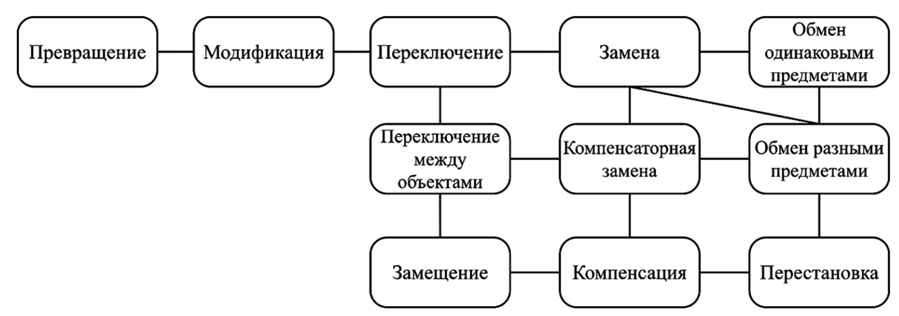
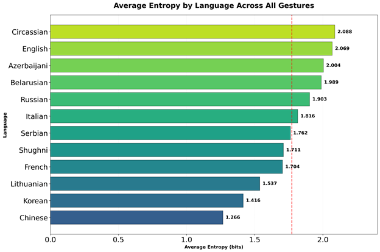

```{r}
#| include: false

library(lingglosses)
options("lingglosses.italic_transliteration" = FALSE)
```

# Корпусная

## Нестандартный русский язык: микродиахрония

Исследование в сфере микродиахронии русского языка посвящено семантическим сдвигам в употреблении русского глагола «броситься» в XIX-XXI вв. Современное его употребление отличается от функционирования в XIX веке. Контексты, включающие эту лексему, изменились. В исследовании показано, как постепенно архаизировались три конструкции с этим глаголом: во-первых, он перестал быть синонимом глагола «влезть» при обозначении попадания внутрь помещения (современное «броситься в окно» употребляется только для описания движения наружу); во-вторых, вне иронических и гиперболических контекстов глагол «броситься» стал слабо сочетаться в современной речи с глаголами требования и, в-третьих, он теперь не описывает ситуации попадания человека на поверхности малой площади (на стул, на табурет, в седло). Выбор этого глагола для обозначения движения человека раньше предполагал, что действие осуществляется под контролем исполнителя. В современной речи в некоторых из перечисленных случаев глагол *броситься* вытеснен глаголами *кинуться, вскочить, запрыгнуть, рвануться* и *ринуться*, в других осмысляется не вполне так, как осмыслялся читателями новеллы «Фаталист», из которой извлечены примеры для анализа (например, «броситься на постель» в речи современников М.Ю. Лермонтова было синонимично выражению «лечь спать»). Вероятно, изменения в семантике и сочетаемости глагола на протяжении XIX столетия были вызваны постепенным ослаблением влияния на русское «броситься» французского аналога *se jeter,* служившего основой для семантического калькирования в годы становления значения и типичной сочетаемости глагола. К XX веку глагол «броситься» потерял сему контроля, присущую *se jeter*, и поэтому практически утратил возможность свободно (вне идиоматики) сочетаться с глаголами требования и с наименованиями поверхностей малой площади; перестал обозначать осознанное движение внутрь помещения; сохранил идею скорости (утратил контексты неспешности); приобрел сочетаемость с эмоциональными стимулами; начал употребляться в контексте имен эмоциональных проявлений.

В повести «Фаталист» из романа М.Ю. Лермонтова «Герой нашего времени» глагол «броситься» встречается в пяти контекстах, не вполне тождественных нашим современным речевым практикам и в этом смысле для нас уже несколько архаичных. Два из них были рассмотрены в рамках специального исследования: *броситься к оружию* и *бросилось мне в глаза … лицо старухи*.

Рефлексив от глагола «бросить» в эпоху Лермонтова переживал стадию становления: формировал семантику и круг типичных контекстов. Сперва он тесно сближался с французским аналогом *se jeter*, но постепенно терял некоторые свойства кальки: утрачивал значение контролируемости действия субъектом, переставал выражать направленное движение внутрь помещения (*броситься в окно* перестало в наши дни передавать движение внутрь), утрачивал сочетаемость с глаголами приказа и с объектами цели движения малой площади (сегодня мы скорее *бросимся на землю*, чем *на стул*).

В лермонтовском примере с *оружием* нарушаются ограничения на ориентир, или цель движения, которая, как правило, должна быть более статична и массивна, чем движущийся к ней предмет. Это происходит под влиянием французского *courir aux armes*, букв. 'стремиться / бежать к оружию (любого рода, включая пушки)', видимо калькированного как военный термин и широко употребительного в XIX в. (но есть и более ранние примеры). При калькировании, особенно поначалу, использовался не только глагол *броситься*, как у Лермонтова, но и глагол *бежать* –-- и не только существительное *оружие*, но и *ружья* / *ружье* в абстрактном значении 'оружие', близком французскому *armes*.

Часто французские кальки уходят из русской речи или преобразуются уже в середине XIX в. --- в данном случае речь идет о своеобразной терминологизации кальки, поэтому произошла задержка на целых 100 лет: последние и редкие употребления такого рода встречаются в текстах середины XX в. И более того, эта нестандартная конструкция сохранилась в новом виде: в XXI в. нестандартным объектом-целью при *броситься* выступает *телефон***.** Понятно, что изначально (и очень недавно) телефон представлял собой стационарное устройство, часто с кабиной –-- и не нарушал распределения Фон-Фигура. Однако с появлением мобильных телефонов ситуация изменилась –-- а конструкция пока осталась старой.

*Броситься / бросаться в глаза*, вероятнее всего, является калькой с французского устоявшегося выражения *sauter aux yeux* 'быть очевидным, заметным' (букв. 'устремиться, метнуться, прыгнуть в глаза'), которое фиксируется в Le Dictionnaire de l'Académie française начиная с 1690 г. В этом смысле можно интерпретировать те русские примеры, которые встречаются в первой половине XIX в., –-- речь идет о метафорическом движении, очень быстром, какого-то конкретного предмета (обычно неподвижного) к говорящему: этот предмет настолько заметен среди других, что как бы запрыгивает наблюдателю в глаза. В русском такая сочетаемость поддерживается близкой конструкцией *бросить взгляд*, а также параллельной ей уже исчезнувшей *бросить глаза* со значением 'быстро, мельком взглянуть’. Начиная с середины XIX в. исходное значение быстрого движения стирается, и непредметные имена начинают вытеснять предметные. Происходит переосмысление и перестройка метафоры.

Вторым направлением в сфере исследования русской речевой микродиахронии стало исследование функционирования предлога *поперек*. Предлог *поперек*, по «Словарю русского языка» (МАС), указывает на направленность действия по ширине чего-либо. Ширина объекта обычно предполагает и его длину (а *поперек* противопоставляется *вдоль*), поэтому привычное употребление этого предлога связывается с объектами вытянутыми, при этом имеющими очевидное и значимое для наблюдателя измерение не только по длине, но и по ширине. Однако употребление с именами объектов, не характеризующихся выраженной шириной, вполне традиционно: *поперек струны, жилы, волокна*. Современный узус предлагает неканонические (относительно классического синхронного словарного толкования) употребления этого предлога, в диапазоне от соотнесения с объектами, не обладающими ни выраженным противопоставлением измерений, ни фиксированными границами, ни строгой формой (*поперек неба, моря, тайги, вселенной*), до контекстной замены предлога *вдоль* (*поперек ворот, дверей, въезда*). У проемов (порталов) в русской языковой картине мира нет измерения по длине, их основным измерением является ширина, и применительно к проемам *вдоль* и *поперек* оказываются соотнесены с одним и тем же положением в пространстве (*вратарь лежит поперек хоккейных ворот*, то есть в направлении от штанги к штанге; *ливневка идет вдоль ворот*, то есть в направлении от столба до столба). Разница часто заключается в положении объекта или наблюдателя внутри или снаружи очерченного пространства. Специфична сочетаемость противопоставленных в словарях предлогов со словом *лоб*: *вдоль лба пролегла глубокая морщина* и *человечек с широкой тесьмой поперек лба* (в обоих случаях речь идет о направлении по ширине тела, перпендикулярно росту человека). В исследовании показано, что русское *поперек* не всегда антонимично *вдоль* и не связано с необходимостью описывать исключительно объект, обладающий измерением по ширине.

## Нестандартный русский язык: билингвизм

В исследовании поведения русского предлога *через* рассматриваются модели, используемые казахско-русскими билингвами при употреблении русских инструментальных конструкций. Анализ инструментальных конструкций сопровождается документацией не только отклонения в речи билингвов, но и (сквозь призму речевых данных билингвов) вариативность, присущую нормам русского языка. Семантика предлогов трудно поддается описанию, и, как правило, большинство из них обладают обширной сетью значений. Именно абстрактные, метафорические значения вызывают трудности при усвоении, а не прототипические (пространственные) значения. Что касается конструкций, они развиваются от формул через низкоуровневые паттерны к более абстрактным схемам. Отправной точкой послужил анализ конструкций с через из казахского подкорпуса Russian Learner Corpus –-- собрания академических текстов, написанных на русском языке казахскими билингвами (180 000 слов, из которых было извлечено 29 инструментальных конструкций с предлогом через.). Для выявления особенностей казахских инструментальных конструкций, которые могут влиять на русское употребление, использовался Алматинский корпус казахского языка. Характер отклонения от русской нормы, а также микродиахроническая эволюция русских инструментальных конструкций оценивались с помощью Национального корпуса русского языка. Эти корпусные данные были дополнены лингвистическим опросом, проведённым среди казахско-русских билингвов (KAZ-RUS), русскоязычных жителей Казахстана (RUS-KAZ) и России (RUS). В опросе участвовали 90 человек (по 30 в каждой группе). Был проведён как качественный, так и количественный анализ корпусных данных и результатов опроса.

Во-первых, инструментальные конструкции с предлогом *через* в речи казахско-русских билингвов являются результатом влияния казахского как первого языка (L1) –-- конструкций с послелогом *arqyly*. Показано, что семантическая сеть через основана на понятии «промежуточной стадии» (которая может функционировать либо как «препятствие», либо как «связующее звено»), тогда как *arqyly* принципиально опирается только на идею о «связующем звене». Это различие концептуальных оснований объясняет несовпадение некоторых значений этих служебных слов, в том числе в сфере инструментальности.

Но и целом организация поля инструментальности следует в двух языках разным принципам. В русском инструментальность структурируется по принципу различения разных типов объектов (инструментов), что достигается с помощью различных предлогов (включая предлог через, периферийный для этой зоны). В казахском проводится различие между прямой каузацией, выражаемой инструментальным падежом, и косвенной каузацией, связанной с послелогом arqyly. Наблюдения над академическими текстами, включёнными в RLC, подтверждаются результатами лингвистического опроса: по сравнению с носителями русского языка (RUS-KAZ и RUS) казахско-русские билингвы (KAZ-RUS) значительно чаще выбирают через в инструментальных контекстах.

Во-вторых, было рассмотрено, насколько устойчиво или вариативно употребление этих инструментальных конструкций в русском языке в диахроническом и региональном измерениях. Как показывают данные Национального корпуса русского языка (НКРЯ), вариативность предложно-именных средств выражения инструментальности наблюдается и в самом русском языке. В частности, эволюция почтовой связи отражается в изменениях и конкуренции инструментальных конструкций (через почту вин. п., на почте предл. п., по почте дат. п., с почтой твор. п. и почтой твор. п.). Более того, наблюдения выявляют текущие тенденции региональной стратификации русского языка. Обновление инвентаря русских инструментальных конструкций происходит на фоне формирования региональных вариантов русского языка. Опрос демонстрирует умеренные расхождения в предложных предпочтениях между носителями русского языка, проживающими в Казахстане (RUS-KAZ), и носителями, проживающими в России (RUS). Предполагается, что эти различия проистекают из опосредованного воздействия, которое русский язык, на котором говорят носители казахского как L1, оказывает на русскоязычных жителей Казахстана. Таким образом, употребление предлога через в инструментальных конструкциях казахско-русскими билингвами находится на пересечении переноса и продолжающегося языкового изменения: нестандартное употребление, обусловленное L1, совпадает с нарождающимися тенденциями в L2.

## Нестандартный русский язык на фоне литературного стандарта: наложение конструкций.
В исследовании русского *гораздо* анализировалось поведение интенсификатора. Самый многочисленный тип конструкций –-- интенсификаторы (более 300 –-- по данным Русского Конструктикона) –-- изучался в контексте сравнительных конструкций неравенства, таких как Х больше Y —> Х гораздо больше Y. Сравнительные конструкции и интенсификаторы обычно изучаются отдельно, поскольку они принадлежат к двум различным семантическим полям. Однако взаимодействие двух конструкций –-- сравнительной и интенсифицирующей –-- нетривиально и имеет свои собственные правила. Помимо ожидаемых морфологических и синтаксических ограничений, засвидетельствованы и менее тривиальные ограничения, такие как аспектуальный класс глагола в сфере действия сравнительной конструкции. Было показано, каким образом эти две конструкции сливаются в новую сущность, которая также является конструкцией с собственными свойствами, не сводимыми к свойствам сравнительной и интенсифицирующей конструкций, взятых по отдельности. Поскольку интенсификаторы надстраиваются над другими значениями, они обязательно пересекаются с конструкцией, в сферу действия которой попадают. Существенно, что это пересечение не следует сводить к простому сочетанию двух значений (сравнения и интенсификации), а скорее анализировать как взаимодействие двух сложных конструкций: сравнительной конструкции и интенсифицирующей конструкции. Это взаимодействие проливает свет на внутренние свойства обеих конструкций и уточняет ограничения на их употребление. Помимо практической значимости для изучающих язык, этот материал имеет важное теоретическое измерение, поскольку демонстрирует эффекты, которые могут возникать в результате конструкционного взаимодействия. В этом отношении исследования конструкционных взаимодействий открывают новые перспективы для будущих исследований в рамках грамматики конструкций. Анализ интенсифицирующих конструкций, включённых в русскую сравнительную конструкцию неравенства, привёл нас к следующим выводам. Широкий диапазон интенсификаторов в русском языке объясняется их распределением по конструкциям с различной первичной семантикой. Интенсификаторы специализируются на конструкциях определённого семантического типа, поскольку они взаимодействуют с различными структурными и семантическими компонентами этих конструкций. Взаимодействие двух конструкций –-- не единственная возможность, которую предлагают интенсификаторы. Хотя возможно построить специальный интенсификатор над определённой конструкцией, возможно также интенсифицировать сам интенсификатор, тем самым объединяя не две, а три конструкции вместе. В то же время интенсификаторы, допускающие такую возможность, строго ограничены из-за сложной семантики, которой они обладают. Было показано, что одна конструкция может модифицировать свойства другой конструкции, накладывая ограничения на употребление обеих. Однако помимо наложения новых ограничений взаимодействие двух конструкций может также создавать новые возможные употребления этих конструкций. В частности, хотя сравнительные конструкции неравенства строго запрещают опущение эталона сравнения за пределами эллиптических контекстов, некоторые интенсификаторы могут отменять этот запрет, сегментируя ongoing процесс или длящуюся ситуацию на серию итеративно повторяющихся порций, которые сравниваются попарно. Результаты показывают, что взаимодействие двух конструкций создаёт новую конструкцию с собственными свойствами, отличными от тех, которыми обладают две конструкции по отдельности. Этот подход к конструкционным данным имеет значение как для теоретических разработок в рамках грамматики конструкций, так и для типологии конструкций в более широком смысле.

В исследовании конструкции *мало ли что* рассматривается полисемичная русская дискурсивная формула мало ли (что) в её отношении к исходным конструкциям и проводится сравнение её функций с корейскими эквивалентами. Цель исследования –-- дать систематическое описание полисемии мало ли (что) и выявить наиболее точные корейские некомпозициональные эквиваленты. Эмпирический материал составляет более 8 000 примеров мало ли (что) и а вдруг, извлечённых из открытых баз данных «Русский Конструктикон» и «Прагматикон», а также из Национального корпуса русского языка, охватывающих как письменные, так и устные жанры. Корейские данные, собранные из веб-ресурсов, использовались для контрастивного анализа на базе корпусов. Анализ показывает, что семантика и прагматика мало ли (что) могут быть правильно поняты только через анализ лежащих в их основе конструкций и контекстов употребления. Диахронический анализ выявляет два значения формулы. Одно значение, обозначающее «неопределённо большое количество», не соответствует критериям дискурсивной формулы и должно быть описано в Русском Конструктиконе как нетипичная эллиптическая конструкция. Другое значение, выражающее обесценивание предшествующего высказывания, удовлетворяет критериям дискурсивной формулы и должно быть включено в Прагматикон. Это разграничение позволяет устранить несоответствия в трактовке мало ли (что) в двух базах данных. Синхронное сравнение с а вдруг проясняет функциональные свойства мало ли (что) и раскрывает иллюзию их взаимозаменяемости, основанную на поверхностном сходстве. Анализ функциональных фреймов, в свою очередь, позволяет выявить соответствующие корейские дискурсивные формулы. Предлагаемый подход уточняет описание русских дискурсивных формул и обеспечивает надёжную основу для сравнения с типологически далёкими языками, такими как корейский.

## Грамматические ошибки сквозь призму моделей

Отдельное исследование было посвящено тому, как большие языковые модели исправляют сложные грамматические ошибки в академических учебных текстах на русском языке. В отличие от традиционных GEC-систем, которые руководствуются принципом минимального исправления, большие языковые модели (LLM) часто применяют генеративные стратегии переписывания, которые могут улучшить восприятие текста, однако появляется риск гиперкоррекции структуры и семантических изменений. В работе был представлен новый экспертный бенчмарк, основанный на русском учебном корпусе из 3,1 млн слов, и продемонстрирована оценочная система, аннотированная по типу ошибки и уровню сложности. Авторы предлагают систему оценивания, основанную на экспертных суждениях и сочетающую количественный анализ, исследование изменения структуры и слепое попарное сравнение. Результаты выявляют баланс между минимальными исправлениями и генеративным подходом LLM. Это оказывает прямое влияние на оценивание, так как референсные метрики могут недооценивать структурную гиперкоррекцию и не учитывать разницу в подходах к исправлению.

## Фольклорный текст как особый узус

Позиционный глагол «сидеть» развивает целый ряд значений, в том числе ‘находиться где-л. длительное время’ по Малому академическому словарю, которое, согласно современным исследованиям, в XI-XVII вв. в варианте ‘пребывать, находиться где-л.’ отмечалось значительно чаще, чем в современном языке. Представляется, что именно это значение легло в основу многих устойчивых употреблений, в т.ч. в пословицах и поговорках («сидеть в девках», «сидеть на бобах» и др.) и наблюдается в фольклорных текстах. Наблюдения над собранным корпусом фольклорных обрядовых и необрядовых текстов показали, что действие «сидеть» редко оказывается значимым, этот глагол достаточно редко фигурирует в фольклорных текстах (в необрядовых песнях, по результатам нашего анализа, всего в 5% текстов), однако использование этого глагола всегда не случайно, оно маркирует определенную ситуацию. Соответственно, в обрядах действие «сидеть» тоже может выступать как маркированное, предписанное традицией. Целью было исследовать условия, при которых употребляется глагол «сидеть», семантику этого глагола и действие в фольклоре. Авторы опирались на этнолингвистические методы, рассматривали обряд как семиотический комплекс и своего рода «текст» на многих языках и предполагали, что изучение семантики и прагматики глагола и действия «сидеть» в фольклоре позволит уточнить и расширить научные представления о глаголе и концепте «сидеть» как в традиционной культуре, так и в языке.

Было предложено описание семантики и прагматики действия «сидеть» в нескольких русских обрядах (во вьюнишном (свадебном) обряде, в обряде отправки в дорогу) и исследованы функции сидения в необрядовых лирических и обрядовых песнях и выявлены направления развития семантики глагола «сидеть» в русской традиционной культуре. Для анализа был собран корпус описаний обрядов, сделанных в Костромской и Нижегородской областях, интервью с жителями Костромской области и Московского региона; источниками послужили опубликованные работы и экспедиционные данные фольклорного архива НИУ ВШЭ. Кроме того, был составлен корпус необрядовых и обрядовых песен, в тексте которых содержится глагол сидеть.

В качестве семантической доминанты глагола «сидеть» выступает значение фиксированного положения, неизменного, неподвижного состояния. При этом особенностью русского «сидеть» (в сравнении с нидерландским» оказывается положение в некотором локусе, который концептуализируется как среда, а «сидение» - как погружение в среду.

В мифологических текстах действие по глаголу «сидеть» входит в оппозицию с действиями и глаголами «стоять» и «лежать» (по признаку положения в пространстве) и «ходить» по признаку движения или его отсутствия. Касаясь семантики «сидения» в мифологических текстах, В.Н. Топоров отмечает, что сидение ассоциируется в них с семенем, зерном, которое сидит в земле, т.е. с началом жизни, потенциалом роста.

В славянской традиционной культуре сидение –-- это неотъемлемая часть праздничного застолья. Оно связывается с совместным пребыванием, пребыванием внутри своей социальной среды –-- семьи, рода, деревенской общины, в том числе живых и умерших родственников (особенно во время поминальной или праздничной трапезы). Во Владимирской области фиксируется свадебный термин «сидение»: так называли гуляние и застолье в доме у невесты накануне свадьбы –-- то есть накануне накануне решающего события: поездки невесты и жениха к венцу.

При этом обрядовая традиция противопоставляет сидящих за свадебным столом совместно родственников –-- и не приглашенных на свадьбу жителей деревни или случайных людей, которых называли «глядельцы». Они приходят посмотреть на свадьбу и их тоже угощают –-- но у порога, стоя (они не могут сидеть за столом во время праздника, поскольку не включены в родовую общность).

В традиции костромских деревень Макарьевского района (Юрово, Большие Рымы) сидение обнаруживается как маркированное действие во вьюнишном обряде. Вьюнишный обряд, или окликание молодых –-- величание молодоженов в воскресенье после Пасхи (Радошно воскресенье, Красная горка и др.) замужними или даже пожилыми жителями села –-- совершалось как символ включения молодой пары в сельскую общину, завершение свадьбы как обряда перехода и окончательное формирование новой семьи. В традиции названных деревень, как показывают экспедиционные (архивные) данные, во время прихода окликальщиков молодожены должны были сидеть. Окликающие ходили вокруг них и пели вьюнишную песню. Затем окликавшие садились за стол, родители молодоженов и сами молодожены угощали их.

Круговой обход в этом обряде символизировал закрепление определенного состояния, выделение круга своих, сохранение молодой семьи. Однако примечательно, что молодые должны были сидеть в присутствии старших, пожилых и уважаемых жителей села. Семантика обряда свидетельствует о том, что сидение было принципиально важно, оно обозначало то состояние, в котором молодые должны были закрепиться в ходе обряда. Очевидно, что это совместное пребывание внутри семьи, рода.

Отправление в дорогу повсеместно осмысливается как кризисная ситуация, поскольку путешествие связывалось с опасностью, требовало выхода из освоенного пространства дома и деревни. Поэтому отправление в дорогу ритуализовано. В разных традициях принят различный набор апотропейных действий, среди которых, вероятно, одно из самых распространенных –-- обряд «посидеть на дорожку». Обряд предполагает, что все, кто отправляется в путь и кто присутствует в доме непосредственно перед отправкой в одном пространстве (не в разных помещениях) должны сесть и некоторое время находиться сидя, вместе, в молчании. Представляется, что молчание, которое нередко маркирует переход в другое состояние, служит оберегом перед вхождением в чужое пространство, здесь, помимо этого, поддерживает статическое положение участников, обозначая отсутствие всякого действия, в том числе вербального. Учитывая семантику «сидения» как фиксированного положения внутри определенного локуса (это семантическая доминанта глагола «сидеть»), обряд фиксирует закрепленность человека в пространстве дома и рода, его связь с домом и семьей, но самое примечательное то, что это делается непосредственно перед выходом из своего пространства в чужое. Таким образом, нарочитое сидение маркирует и закрепляет связь человека с домом и семьей –-- и отмечает границу пребывания дома перед отправкой в дорогу.

В связи с этим А.Б. Мороз указывает, что на Севере обычай посидеть на дорожку связан с традицией застолья, поскольку отправляющийся в путь обычно выходил в дорогу прямо из-за стола, где вместе с ним собиралась вся семья.

Заметим, однако, что устойчивость и широкое распространение обряда в настоящее время вне всякого застолья говорят о том, что сидение имеет здесь собственные функции и это обусловлено семантикой этого действия.

В народной песне «сидеть» всегда употребляется в прямом значении –-- физического действия. Представляется неслучайным тот факт, что глагол не отмечен в конкордансах и словарях языка фольклора, поскольку глагол называет обыденное действие и, казалось бы, не обладает символической нагруженностью.

Как уже говорилось, глагол на удивление редко встречается в текстах песен. Из 400 песен собранного корпуса глагол фигурировал в 21 тексте (т.е. в 5% от всех песен). Примечательно, что пребывание в одном месте –-- это значение характерно для «сидеть» –-- описывается в песнях другими глаголами: гулять, ходить по терему и др.

Анализ песенного материала позволил выделить контексты, в которых употребляется глагол. Среди них преобладают любовные и свадебные.

Совместное сидение как форма ухаживания, общения молодых (ср. термины молодежные «посиделки», «поседки»). Сидят рядом или против друг друга невеста с женихом («Ты садись подле меня –-- будешь верная жена» (Гор. № 21), «Не садися против меня… Люди скажут –-- любишь меня» (Гор. № 23), «Вы не сказывайте в доме матерям, что который со которою сидел, что который со которой говорил» (Гор. №193), «Куда поприсести живу рыбу чистити? Сяду-поприсяду к зеленому саду, мил не обойдет, посадит в саночки» (Гор. №261). Вариантом того же контекста представляется и сидение чечетки-лебедки, которую посадили за решеточку, где она родила семь дочерей и сына № 176)

Одинокое сидение в ожидании замужества: сидит невеста в ожидании жениха (№ 145 сидит и прядет; № 230, 254 –-- сидит у окна, также песня «Сидела Катюшенька день до вечера (вар: в светлой горенке) одна» [Соб., т. 7]. Также сидят в девушках (Гор. № 283). Ср. в подблюдной песне: «У окошка сижу, долги нитки вожу. Я еще посижу, я еще повожу» (девушка ждет замужества).

Сидящим может представляться и жених: Старый и ровня сидят во беседе, тревожат сердце девушки (Гор. № 168). Ср.: в игровой песне «Сидит олень» (Гор. № 115) парень-олень выбирает невесту.

Сидит птица на дереве, кусте, траве (Гор. № 39, 93). В некоторых песнях птица явным образом символизирует девушку (Гор. 270, 218).

Сидение может знаменовать начало нового состояния: «сядем и поедем домой» (Гор. 245), «сядем и споем» (Гор. 390).

Подобную же функцию, как кажется, сидение выполняет в новой балладе «Морячка»: «На берегу сидит девица, она платок шелками шьет»: далее начинается развитие сюжета.

Встречаются и устоявшиеся в языке употребления в других значениях: «сажать на корабль» и «сесть на корабль», «сажать хлеб на лопату» и в печь (вероятно, тоже связанные с семантикой смены/начала состояния).

Таким образом, в народных песнях сидение обозначает совместное пребывание девушки и парня, жениха и невесты, семьи или пребывания в ожидании (обычно замужества), а также состояние непосредственно накануне изменений, начала действия («Сидела Катюшенька», «Морячка»), само начало нового состояния (сядем и поедем, сядем и споем).

Специальное упоминание сидения встречается в тех случаях, когда нужно либо маркировать статическое положение перед началом изменений, указать на переход в другое состояние, либо выделить отсутствие изменений в ситуации, в которой изменения ожидались.

Таким образом, в рассмотренных жанрах фольклора действие и глагол «сидеть» опираются на общую семантическую доминанту этого глагола –-- неизменное, постоянное пребывание внутри определенного локуса и на этом основании развивают семантику пребывания в определенном состоянии (которая, впрочем, наблюдается и в обыденном языке, ср. «они еще сидят работают») и принадлежности к определенной общности. Прагматика сидения в фольклорных текстах включает фиксацию стабильного состояния и маркирование перехода. Глагол и действие становятся обязательными, если персонаж только что пережил изменения и необходимо закрепиться в определенном положении, общности (молодые в свадебном обряде) или персонажу предстоят изменения и необходимо сохранить связь с исходным положением, общностью (девушка на выданье, девушка-героиня песенного сюжета, человек, отправляющийся в дорогу). Конкретные функции такого маркирования с помощью глагола и действия «сидеть» различны в разных жанрах.

## Русский учебный корпус

В отчетном году исследования были продолжены в трех направлениях, связанных с анализом лексических и макроструктурных характеристик русскоязычных и англоязычных текстов, а также с сопоставлением языковых стратегий человека и больших языковых моделей.

Первое направление продолжает начатое в предыдущем отчетном периоде исследование замечаемости и исправляемости лексических ошибок в Русском учебном корпусе (RLC). В текущем году акцент был перенесен с влияния дополнительных ошибок в контексте на сопоставление стратегий людей и языковой модели, а также на количественную оценку факторов, определяющих обнаружение и точное исправление лексической ошибки.

Второе направление посвящено макроструктурному анализу академических текстов стандартных и нестандартных носителей русского и английского языков с использованием концептуальных графов.

Третье направление объединяет два взаимосвязанных эксперимента по изучению лексической приемлемости и предсказуемости: исследование восприятия несуществующих дериватов и сопоставление человеческих cloze-норм с вероятностными распределениями токенов в таких дериватах у больших языковых моделей.

### Влияние корпусных метрик на замечаемость и исправляемость лексических ошибок

В рамках направления было продолжено исследование факторов, влияющих на обнаружение и исправление лексических ошибок. В отличие от предыдущего этапа, где основное внимание уделялось влиянию дополнительных ошибок в предложении и различиям между типами лексических нарушений, в текущем году был проведен сравнительный анализ поведения непрофессиональных аннотаторов и языковой модели.

Материалом послужили те же 32 стимульных предложения с лексическими ошибками из Русского учебного корпуса, для которых экспертами ранее был сформирован «золотой стандарт» исправления. В новом анализе использовались данные 89 непрофессиональных аннотаторов и ответы модели YandexGPT 5.1 Pro. Для модели было получено 384 наблюдения при четырех значениях температуры и трех повторных запусках. В качестве предикторов рассматривались сила коллокационной связи LogDice, семантическая близость ошибочной единицы и исправления по word2vec, часть речи и паронимия. Статистический анализ включал смешанные логистические регрессии, корреляцию Спирмена и расчет энтропии Шеннона.

Сравнение людей и модели выявило принципиально разные профили выполнения задания. Непрофессиональные аннотаторы значительно чаще обнаруживали лексическую ошибку: доля замеченных ошибок составила 75% у людей и 52% у модели. Однако при условии, что ошибка уже была обнаружена, модель YandexGPT чаще предлагала исправление, совпадающее с экспертным «золотым стандартом»: 77% против 67% у людей.

Корпусные и семантические показатели по-разному связаны с двумя этапами обработки ошибки. Сила коллокационной связи LogDice на уровне тенденции повышала вероятность обнаружения ошибки людьми, но снижала ее у модели. Семантическая близость не показала значимого влияния на сам факт обнаружения ошибки, однако оказалась одним из ключевых предикторов точного исправления как у людей, так и у YandexGPT. Таким образом, замечаемость и исправляемость представляют собой связанные, но не тождественные процессы и могут определяться разными характеристиками контекста.

Дополнительно была проверена гипотеза об утомлении аннотаторов по мере заполнения формы. Она не подтвердилась: к концу задания вероятность обнаружения ошибки, напротив, возрастала. Этот результат интерпретируется как эффект «разогрева», при котором участники постепенно адаптируются к задаче и начинают лучше распознавать целевой тип нарушения.

Анализ вариативности ответов показал еще одно отличие между человеком и моделью. В zero-shot режиме YandexGPT демонстрировала полную детерминированность: энтропия ответов была равна нулю. У людей энтропия варьировалась от 0 до 2.10, отражая естественное разнообразие языковой интуиции и стратегий исправления. Расширенные результаты исследования были представлены в рамках международных конференций.

### Макроструктурный анализ академических текстов с помощью концептуальных графов

Работа посвящена сравнению макроструктурных характеристик академической письменной речи стандартных и нестандартных носителей русского и английского языков. Основной целью стало создание интерпретируемого метода построения концептуальных графов текста и выявление связей между традиционными корпусными показателями и параметрами сложных сетей.

Исследование проводилось на материале четырех сопоставимых корпусов академических текстов: русскоязычных и англоязычных текстов, написанных стандартными и нестандартными носителями. Выборка была сбалансирована: каждый подкорпус включал 1000 текстов со средней длиной около 390 слов.

В работе был реализован основанный на правилах алгоритм построения концептуальных графов без использования нейронных сетей. Пайплайн включал морфологическую и синтаксическую разметку, а также алгоритм разрешения местоименной анафоры для восстановления кореферентных связей. Вершинами графа выступали именные группы, а ребрами –-- предикативные, атрибутивные и пространственные отношения.

Для каждого текста вычислялись две группы показателей. К классическим корпусным метрикам относились средняя длина слова, type-token ratio (TTR) и показатели коллокационной связанности. Графовое представление описывалось с помощью ассортативности, плотности, показателей центральности и характеристик кратчайших путей. Для сопоставления метрик применялись корреляционный анализ, методы снижения размерности и кластеризация.

Кластерный анализ показал, что на продвинутом этапе освоения языка тексты нестандартных носителей достигают уровня макроструктурной когерентности, который по исследованным сетевым параметрам практически не отличается от текстов стандартных носителей. Этот результат показывает, что различия между группами могут сохраняться на локальном лексико-грамматическом уровне, но существенно сокращаться на уровне глобальной организации академического текста. Промежуточные результаты исследования были представлены на 10-м Колмогоровском семинаре.

### Градуальность лексической приемлемости и предсказуемости: сравнительное исследование трех групп носителей русского языка (Л1, Л2, языковые модели)

Третье направление объединяет два эксперимента, посвященных вероятностной природе лексической обработки. В первом исследовании проверялось, является ли граница между существующими и несуществующими производными словами категориальной или градуальной. Во втором оценивалась возможность использовать распределения больших языковых моделей в качестве приближения к трудоемко собираемым человеческим cloze-нормам.

#### Восприятие несуществующих дериватов

Материалом первого исследования послужили деривационные ошибки из Русского учебного корпуса –-- прежде всего образования с продуктивными суффиксами -ость, -ание и -ация, –-- а также псевдослова, сгенерированные моделью Llama-3.1-8B на основе предложений из Russian Sentence Corpus. Всего использовалось 144 стимула.

В экспериментах участвовали носители русского языка разных возрастных групп, включая школьников 11–-17 лет и взрослых, а также 28 изучающих русский как иностранный на уровнях B1–-B2. Носители выполняли задание на нахождение и исправление деривационных ошибок, L2-участники –-- задачу лексического решения. Для сопоставления с человеческими оценками рассчитывалась нормализованная surprisal-метрика для моделей ruGPT3-large, mGPT, ruBERT и XLM-RoBERTa.

Результаты подтверждают градуальный характер границы между существующим и несуществующим словом (чрезвычайно низкочастотным и не зарегистрированном в словарях). Носители языка оценивали одни и те же формы неодинаково: например, дериват \*транспортация (ср. общеупотребительный транспортировка) приняли около половины участников –-- 600 из 1280. Точность обнаружения несуществующих дериватов возрастала с возрастом и языковым опытом (ρ = 0.429, p < 0.001). Кроме того, обнаружен положительный эффект частоты корректной основы (ρ = 0.499) и отрицательный эффект длины слова (ρ = −0.408).

Поведение изучающих русский язык заметно отличалось от поведения носителей. Была обнаружена инверсия чувствительности к деривационным суффиксам: дериваты на -ость, которые носители пропускали чаще, L2-участники отвергали увереннее всего (47.2% корректных негативных оценок), тогда как дериваты на -ание чаще казались существующими (26.2% корректных негативных оценок). Это указывает на различия в структуре морфологической чувствительности у носителей и изучающих язык.

Большинство исследованных моделей также оказалось чувствительно к морфологическим аномалиям: нормализованный эффект составил +0.78 для ruGPT3-large, +0.65 для mGPT и +0.70 для XLM-RoBERTa. Исключением стал ruBERT (−-2.57). Анализ показал, что такое поведение ruBERT связано с особенностями токенизации. В целом, оценки, данные моделью, оказались ближе к интуиции носителей, чем к поведению L2-участников, а способ токенизации оказался критически важным фактором при оценке surprisal и порождении словоформ. Исследование было представлено на конференциях «Русский язык в многоязычном мире 2026» и 22nd International Morphology Meeting.

### Сопоставление человеческих cloze-норм и вероятностных распределений LLM

Второе исследование было посвящено вопросу возможности замены трудоемкого сбора cloze-норм предсказаниями больших языковых моделей. В отличие от работ, сопоставляющих только наиболее вероятное продолжение контекста, здесь сравнивались полные вероятностные распределения на трех уровнях: лексическом, морфосинтаксическом и семантическом.

Исследование проведено на материале 144 предложений из Russian Sentence Corpus. Человеческая норма предсказуемости рассчитывалась по 6705 ответам; в зависимости от контекста участники давали от 1 до 63 уникальных продолжений. Целевые слова были сбалансированы по длине, частотности и части речи. В качестве моделей использовались GPT-4o-mini в zero-shot режиме через API и Llama 3.1 8B при локальном запуске. Для восстановления полного распределения был реализован модифицированный beam search без отсечения: ветви расширялись до границы слова или глубины в восемь токенов, после чего выполнялись дедупликация и фильтрация по критерию is\_russian.

На уровне вероятности целевого слова GPT-4o-mini демонстрировала высокое соответствие человеческим нормам: корреляция Пирсона составила r = 0.881 (p < 0.001), корреляция Спирмена --- ρ = 0.755. Для Llama соответствующие показатели были существенно ниже: r = 0.423 и ρ = 0.594.

На лексическом уровне модели демонстрировали разные профили покрытия человеческих ответов. Перекрытие с моделью GPT быстро выходило на плато и составляло около 25% уже при k = 20. Перекрытие с Llama росло более медленно и монотонно, достигая 49% при k = 400. Лемматизированное перекрытие у обеих моделей превышало поверхностное, что показывает существенный вклад морфологической вариативности в расхождение между человеком и моделью.

На морфосинтаксическом уровне GPT в 69% контекстов предсказывала наиболее ожидаемую людьми часть речи. Особенно высокими были корреляции распределений для предлогов (r = 0.83) и творительного (r = 0.846) и предложного (r = 0.832) падежей. Llama в целом уступала GPT, но лучше воспроизводила распределение временных форм глагола (0.429 против 0.256).

На семантическом уровне центроидное сходство для top-100 составляло 0.70 у GPT и 0.37 у Llama. GPT характеризовалась относительно высокой точностью (Precision = 0.60) при умеренной полноте (Recall = 0.39), тогда как Llama давала более широкий охват человеческих вариантов (Recall = 0.49), но крайне низкую точность (Precision = 0.04).

Анализ контекстной энтропии показал, что степень открытости контекста существенно влияет на качество приближения поведения модели к поведению человека. В наиболее закрытых контекстах (Q1) GPT достигала плато уже при k = 10, а Llama показывала там свои лучшие результаты (overlap = 0.584 при k = 100). В наиболее открытых контекстах (Q4) перекрытие распределения человеческих ответов и вероятностного распределения токенов у моделей оставалось низким для обеих выбранных LLM. Таким образом, GPT-4o-mini в целом существенно ближе к человеческим cloze-нормам, чем Llama 3.1 8B, однако ни одна из моделей не воспроизводит в полной мере семантическое разнообразие человеческих предсказаний.

В совокупности результаты отчетного года показывают, что большие языковые модели способны достаточно точно воспроизводить отдельные аспекты человеческой языковой интуиции, однако степень совпадения зависит от уровня анализа и типа задачи. В исправлении уже обнаруженной лексической ошибки модель может превосходить непрофессиональных аннотаторов, а при предсказании продолжения контекста GPT-4o-mini хорошо воспроизводит вероятности наиболее ожидаемых ответов. Вместе с тем человеческие ответы характеризуются большей вариативностью, а поведение изучающих русский язык может систематически отличаться как от носителей, так и от языковых моделей. Параллельно анализ концептуальных графов показывает, что на продвинутом уровне владения языком различия между стандартными и нестандартными носителями существенно сокращаются на уровне глобальной структуры академического текста.

## Изучение малых бесписьменных иранских языков шугнано-рушанской подгруппы

Исследования малых иранских языков в рамках проекта направлены на решение нескольких основных задач:

- сопоставительное описание малых близкородственных труднодоступных и слабо изученных языков на всех языковых уровнях на широком типологическом фоне;

- моделирование ситуации многоязычия в необычных социолингвистических условиях, когда носители говорят на нескольких, но близкородственных языках;

- разработка цифровых методов сбора, хранения и анализа данных малоресурсных языков, получаемых преимущественно в ходе полевой работы.

В 2026 году для решения этих задач велась активная работа с доступными словарными и корпусными данными, а также производился сбор нового полевого материала в четырех локациях на территории Горно-Бадахшанской автономной области Республики Таджикистан: г. Хорог (работа с носителями шугнанского и рошорвского языков); кишлак Нижний Бидиз (работа с носителями шахдаринского диалекта шугнанского языка); кишлак Сипондж (работа с носителями сипонджского диалекта бартангского и йемцкого диалекта рушанского языка); кишлак Басид (басидский диалект бартангского). Таким образом, в 2026 году фокус интересов научно-исследовательской группы сместился с самого крупного языка ареала –-- шугнанского –-- на сильно менее изученный и менее распространенный бартангский.

### Описание малых иранских языков на типологическом фоне

#### Морфология и синтаксис

На материале шахдаринского диалекта шугнанского языка были изучены:

- порядок слов в дитранзитивных конструкциях;

- структура сочинительных и подчинительных клауз;

- клитика =*aθ* в функции адвербиализатора.

На материале сипонджского диалекта бартангского языка было проведено пилотное исследование каузативных конструкций, а также изучены системы маркирования аргументов двухместных предикатов в сипонджском бартангском и в рушанском языках –-- в сопоставлении с ранее собранными шугнанскими и басидскими бартангскими данными.

##### Порядок слов в дитранзитивных конструкциях

Целью работы в поле было проверить, действуют ли в шугнанском языке закономерности, ранее выявленные для персидского языка: чем определённее прямое дополнение, тем левее оно располагается, и чем длиннее составляющая, тем больше она стремится к начальной позиции [@faghiri2014; @faghiri2016]. В опросе приняли участие 20 носителей шугнанского языка разного возраста. При широком фокусе, согласно [@parker2023: 442], ожидается порядок S(субъект)-IO(непрямое дополнение)-DO(прямое дополнение)-V(глагол), однако в контекстах с фокусом на всей глагольной группе был получен противоположный порядок DO-IO (69% вхождений). С ростом определённости DO возрастает вероятность его позиции левее IO: при нереферентных DO порядок IO-DO составил 87%, при неопределённых референтных –-- 58%, а при DO с указательным местоимением незначительно преобладал порядок DO-IO (57%). Контрастивный фокус на DO способствует порядку IO-DO (81%), так как в фокусе оказывается новый объект. Напротив, контрастивный фокус на IO сам по себе не передвигает DO влево: инверсия DO-IO (75%) возникает потому, что в таких контекстах DO практически всегда определённое.

##### Структура сочинительных и подчинительных клауз

В работе [@belyaevinprint] обсуждаются данные двух восточноиранских языков, осетинского и бартангского, а именно свойства союзов в этих языках. Согласно разным синтаксическим критериям, некоторые осетинские и бартангские союзы демонстрируют поведение как подчинительных, так и сочинительных показателей. Беляев предлагает объяснять наблюдаемые данные прошедшим процессом реанализа союзов под влиянием их конечной позиции в клаузе, и, возможно, близко расположенных языков, что подразумевает контактную природу исторического изменения. Данные очень интересны в том числе тем, что для иранских языков обычно не описываются подчинительные показатели, помещаемые в конце клаузы.

Мы провели аналогичное исследование для шугнанского языка, опираясь на синтаксические критерии, предложенные в работе О.И. Беляева, где рассмотрены такие союзы, как =*xu*, который проявляет подчинительные свойства, =*at*, который ведет себя скорее как сочинительный показатель, а также упомянуты союзы *di* и *ca*, которые несомненно являются маркерами подчинения. В нашем исследовании мы рассмотрели аналоги этих союзов в шугнанском: =*xu*, =*at*, *idi* и *ca*. Показатели =*xu* и =*at* присоединяются к концу клаузы; союз *idi*, наоборот, появляется в начале клаузы, а маркер *ca* должен быть в клаузе перед глаголом (который обычно стоит в конечной позиции).

Первый тест, демонстрирующий разницу между =*xu* и =*at* в бартангском, для шугнанского оказывается непоказательным. Тест заключается в возможности изменения порядка сочиненных/подчиненных клауз в предложении. При нейтральном порядке оба этих союза должны присоединяться к первой клаузе. В бартангском языке клауза, содержащая союз =*xu*, может быть переставлена на второе место без изменений в значении полного предложения, в то время как переставление клаузы с союзом =*at* не будет являться грамматичным. В шугнанском языке переставление как клауз, содержащих =*xu*, так и клауз, содержащих =*at*, неграмматично (см. примеры (@ex_1a), (@ex_1b), (@ex_2a) и (@ex_2b)). При этом переставить подчиненную клаузу с показателем *ca* возможно (см. примеры (@ex_3a), (@ex_3b)).

(@ex_1a)
```{r}
gloss_example('Uz=um tar čīd yat=xu х̌ovd=um',
  'PRN.1SG=1SG EQ дом прийти.PST=COORD1 спать.PST=1SG',
  'Я пришел домой и лёг спать.')
```

(@ex_1b)
```{r}
gloss_example(
  '*Х̌ovd=um, uz=um tar čīd yat=xu',
  'спать.PST=1SG PRN.1SG=1SG EQ дом прийти.PST=COORD1'
)
```

(@ex_2a)
```{r}
gloss_example(
  'Yu půnd tūyd=at čilim=i tīžd',
  'D3.M.SG дорога идти.PST=COORD2 сигарета=3SG тянуть.PST',
  'Он шел и курил сигарету.'
)
```

(@ex_2b)
```{r}
gloss_example(
  '*Čilim=i tīžd, yu půnd tūyd=at',
  'сигарета=3SG тянуть.PST D3.M.SG дорога идти.PST=COORD2'
)
```

(@ex_3a)
```{r}
#| results: asis

gloss_example(
  'Aga Ahmed=ta maδor ca yoδ-d uz=ta ošak wi-rd piʒ-um',
  'если А.=FUT ужин SUBD1 прийти-3SG.PRS PRN.1SG=FUT макароны D3.M.SG-DAT готовить-1SG.PRS',
  'Если Ахмед придет на ужин, то я приготовлю ему макароны.',
)
```

(@ex_3b)
```{r}
#| results: asis

gloss_example(
  "Uz=ta ošak Ahmed-ard piʒ-um aga yu=ta maδor ca yoδ-d",
  "PRN.1SG=FUT макароны A.-DAT готовить-1SG.PRS если D3.M.SG.=FUT ужин SUBD1 прийти-3SG.PRS",
)
```

Другой критерий –-- это возможность использования союза в ответе на вопрос, состоящем из одной клаузы. Вопрос при этом содержит пропозицию второй клаузы, которая в ответе оказывается опущена. В бартангском языке недопустим ответ клаузой, использующей союз =*at*. При этом можно ответить с помощью клаузы с союзами =*xu*, *di* или *ca*. В шугнанском также невозможно ответить клаузой с союзом =*at*, а суждения носителей по поводу возможности ответа клаузой с союзом =*xu* разнятся (см. примеры (@ex_4a)--(@ex_4b)). При этом ответ, использующий союз *ca*, так же, как и в бартангском, абсолютно грамматичен (см. пример (@ex_5a)--(@ex_5b)).

(@ex_4a)
```{r}
gloss_example(
  "Cawaxt=at xu zār čūd?",
  "когда=2SG REFL раненый делать.PST",
)
```

(@ex_4b)
```{r}
gloss_example(
  "Uz=um biyor weхt(*=xu)",
  "PRN.1SG=1SG вчера падать.PST(=COORD1)",
  '%: —Когда ты поранился? –-- Я вчера упал и [поранился]',
)
```

(@ex_5a)
```{r}
gloss_example(
  "Čidům kud=i ricost?",
  "какая собака=3SG сбежать.PST",
)
```

(@ex_5b)
```{r}
gloss_example(
  "Х̌aх̌aθ=i ca ǰaqt",
  "сильно=3SG SUBD1 лаять.PST.F",
  '— Какая собака сбежала? –-- Которая громко лаяла.',
)
```

 Еще один тест используется в качестве проверки на сочинённость. Предполагаемые сочиненные клаузы необходимо поместить в сферу действия некоторого показателя. При сочинении показатель должен появиться либо в обеих клаузах, либо только в последней. При подчинении показатель возможен только в главной клаузе. Вслед за [@belyaevinprint] мы использовали маркер *ca* как показатель условия. Как и в случае с первым тестом, в шугнанском =*at* и =*xu* ведут себя одинаково и допускают появление *ca* как в обеих соединенных клаузах, так и только во второй из них.

Последний тест является тестом на подчиненность, и он также не обнаруживает разницы в поведении =*at* и =*xu*. Тест заключается в проверке способности присоединения вопросной частицы к «главной» клаузе. Для *idi* и *ca* в шугнанском такое возможно, а для =*at* и =*xu* –-- нет.

Таким образом, результаты тестов отличаются от полученных для бартангского, где =*xu* демонстрирует свойства скорее подчинительного союза, а =*at* –-- сочинительного. Соответствующие союзы в шугнанском не демонстрируют явных различий и не могут быть однозначно охарактеризованы как подчинительные или сочинительные.

#### Клитика *=aθ* в функции адвербиализатора

Энклитика *=aθ* в шугнанском языке интересна своей необычной полисемией. Согласно [@karamshoev1988: 29], она объединяет функции адвербиализатора и усилительной частицы, при этом, во-первых, не во всех контекстах эти функции легко разграничить, а во-вторых, правила ее появления в различных контекстах до сих пор неясны.

В 2026 году на полевом материале изучались ее употребления в функции адвербиализатора, в частности, проверялась возможность использования клитики в конструкциях с различными типами вторичной предикации по [@himmelmann2006]: с предикативами, комплементативами и депиктивами (субъектными и объектными). Было выявлено, что энклитика =*aθ* не может маркировать комплементативы и предикативы, но устойчиво маркирует депиктивы. Это касается в равной степени как субъектных депиктивов, так и объектных. Отличий между субъектными и объектными депиктивами при присоединении энклитики *=aθ* выявлено не было.

#### Каузативные конструкции

В грамматике [@parker2023] для шугнанского языка описан как морфологический, так и синтаксический каузатив. Для шугнанского языка характерно несколько стратегий образования морфологического каузатива. Эти стратегии кратко суммированы ниже:

1. аблаут (*firāp*- ‘прибывать’ –-- *firêp*- ‘доставлять, доводить’)
2. суффиксация
  - нерегулярная: *nax̌fiθ*- ʽвыдернутьсяʼ vs *nax̌fen*- ʽвыдергивать, вырыватьʼ;
  - регулярная: *warv*- ‘кипеть, вариться’ vs *warven*- ‘кипятить, варить’
3. лабильные инфинитивы (*piðidow* ‘гореть, зажигать’)

Морфологический каузатив в шугнанском языке не очень продуктивен. Каузативизация с помощью суффикса -*en*- / -*ůn*- –-- модель, заимствованная из таджикского языка, в котором соответствующие каузативы более продуктивны [@parker2023: 125, @sokolova1967].

Основные стратегии образования синтаксического каузатива представлены ниже:

1. каузативы с предложными группами (*pi nīwd vīdow* ‘заставлять плакать’)
2. “coercion causatives” (*rimêdow* ‘приказывать’, *maǰbūr čīdow* ‘заставлять’)
3. локативный каузатив с =*ti*

Первые два типа представляют собой более канонический перифрастический каузатив, тогда как тип (iii), представляя пример синкретизма инструментального и каузативного значения без явной каузативной морфологии (локативный =*ti* маркирует Causee), не подпадает под классическую дихотомию “морфологический каузатив –-- перифрастический каузатив” [@parker2023].

В ходе полевой работы с бартангским языком мы преимущественно фокусировались на морфологическом казутиве и его продуктивности (прежде всего, речь идёт о суффиксальной каузативизации), на синтаксическом каузативе с *maǰbur čegow* ʽзаставлять, вынуждатьʼ (к вопросу о продуктивности суффиксации и семантическому разделению на прямую / непрямую каузацию), а также каузативе на =*tör* (аналог шугнансокго =*ti*) и его семантических ограничениях.

Как и в шугнанском языке, в бартангском представлен суффиксальный каузатив на -*on* (ср. шугн. -*en*- / -*ůn*-). По нашим данным, этот “новый” таджикский каузатив достаточно продуктивен в сравнении с шугнанским. Более того, для ряда бартангских глаголов доступны каузативные суффиксальные формы, не представленные в словаре Д. Карамшоева для шугнанских глаголов того же происхождения –-- среди них, например, барт. глагол *xegow* ‘есть (еду)’ (vs кауз. *xar-on-tow* ‘кормить’), *žêx̌tow* ‘бегать’ (vs *žazontow* ‘заставлять бегать’ ).

Наши полевые данные подтверждают также, что синтаксический каузатив допускает только прочтения с непрямой каузацией (по крайней мере, для исследуемого нами набора глаголов). Как и в шугнанском языке [@parker2023], в бартангском с  *maǰbur čegow* допустимы как финитные (@ex_6), так и нефинитные клаузы (@ex_7). В первом случае предикат, обозначающий каузируемое событие (*xegow* ‘есть’), стоит в форме инфинитива, во втором случае –-- в финитной форме (*paniw-d* от *paniwdow* ‘надевать’).

(@ex_6)
```{r}
#| results: asis

gloss_example(
  'nān=i az xo razen palov xegow maǰbur=i ču-g / ramo-d=i',
  'мать=3SG OBL REFL дочь плов есть обязанный=3SG делать-PST / приказывать-PST=3SG',
  'Мать заставила дочь / приказала дочери съесть плов [вербально] (элицитация)'
)
```

(@ex_7)
```{r}
#| results: asis

gloss_example(
  'nān=i az xo puc maǰbūr č ǰemper paniw-du',
  'мать=3SG EL REFL сын обязанный делать.PST джемпер надеть-PST',
  'Мать заставила сына надеть джемпер (элицитация)'
)
```

Конструкция с *=tör* почти ни разу не была нами получена в качестве первой реакции на соответствующий русский стимул анкеты, однако она всё же распознаётся носителями при прямом предъявлении.

Бартангские данные показывают, что “инструментальная” интерпретация, о которой К. Паркер пишет на материале шугнанского языка, далеко не всегда доступна в бартангском. Мы полагаем, что это может быть связано с прагматическими факторами. Кроме того, формальные ограничения на конструкцию, по нашим пилотным данным, могут заключаться в том, что она плохо сочетается с непереходными глаголами (ср. ‘бегать’, ‘плавать’, ?’петь песни’ и др.). Мы полагаем, что описываемое каузируемое событие должно включать фазу результата, а объект, над которым совершает действие каузируемый, не должен быть непосредственно связан ни с каузатором, ни с каузируемым (не должен быть «неотчуждаем») (ср. ‘помыть посуду вместо кого-то’ vs ?‘пробежать марафон вместо кого-то’), однако эта гипотеза еще нуждается в проверке.

##### Маркирование аргументов двухместных предикатов

Типологическая анкета, состоящая из 130 предикатных значений и типичных контекстов их реализации, разработанная в рамках проекта BivalTyp [@nikolaevsay2026], в подотчетный период была заполнена для сипонджского бартангского и рушанского языков. Этот материал дает возможность для системного сопоставления переходных и непереходных конструкций в языках ареала. Прежде всего обращает на себя внимание разнообразие стратегий маркирования основных участников в переходной клаузе в условиях распада падежной системы. В целом в языках ареала различение субъекта и объекта происходит за счет порядка слов (более или менее фиксированного SOV), но допустимы также две дополнительные стратегии, распространенные в языках, как показывают наши данные, в разной степени: 1) использование в прошедших временах клитики 3 лица, которая согласуется с субъектом; 2) использование в качестве маркера объекта показателя *az*, совпадающего с маркером элатива. Распределение этих стратегий по языкам представлено в таблице -@tbl-argument-marking.

|  | шугнанский | рушанский | сипонджский бартангский | басидский бартангский |
| --- | --- | --- | --- | --- |
| *az* как маркер прямого объекта | –-- | факультативно | + | + |
| субъектная клитика | + | + | + | –-- |

: Стратегии маркирования участников в переходной конструкции в нескольких языках шугнано-рушанской группы. {#tbl-argument-marking}

#### Лексика

Особое внимание в подотчетный период было уделено пополнению словаря бартангского языка на разработанной участниками проекта платформе pamiri.online. Изначально на платформе был размещен только словарь [@sokolova1960], включающий порядка 5000 слов. В ходе полевой работы было обнаружено большое количество лексем и отдельных значений, в этом словаре не упоминающихся. Кроме того, были зафиксированы отличия современных словоизменительных парадигм ряда простых глаголов от тех, что приводятся в [@sokolova1960]. Все эти расхождения регистрировались в процессе полевой работы и постепенно вносятся на платформу с пометой “добавлено редакцией”. Всего было собрано порядка 200 существительных, не представленных в словаре, и проверены наборы значений и грамматических форм для 50 простых глаголов.

Помимо этого, отдельно были собраны стословные списки базисной лексики М. Сводеша у носителей сипонджского бартангского, рушанского и рошорвского языков. Расхождения между языками шугнано-рушанской группы немногочисленны.

#### Фонетика

В подотчетный период фонетические исследования проводились на расширенном материале, собранном в ходе работы с носителями шахдаринского диалекта шугнанского языка в кишлаке Нижний Бидиз.

Были получены следующие основные результаты:

- Фонетика и фонология ударения. Подтверждено, что ключевыми и наиболее устойчивыми акустическими коррелятами шугнанского ударения являются длительность гласного (в среднем 150 мс у ударных против 112 мс у безударных) и частота основного тона (ЧОТ/F0). Интенсивность гласного играет вторичную роль. Было проанализировано фонологическое поведение ударных и безударных элементов (энклитики =*en*, =*et*, =*um*, префиксы *mā*-, *na*-).

- Интонационное описание синтаксических конструкций. Проанализированы просодические характеристики и контуры ЧОТ для широкого, узкого и коррективного фокуса (в частности, фокусная просодия в именных группах), а также для простых повествовательных предложений, вокативных конструкций, императивов/прохибитивов и сложных клауз (сочинительных с союзами =*xu*, =*at*, =*atā* и зависимых с союзами *ca*, *di*, *lāk*, *aga*).

- Стратегии реализации зияния. На материале лексем типа *čāčahā* (*čāčaā*), *maalaq*, *baadab*, *ba*-*aqli*, *bemaal*, *naang* описаны индивидуальные стратегии носителей при реализации сочетаний одинаковых гласных: от сохранения слогоделения и стяжения до эпентезы (гортанная смычка, фарингализация).

### Исследование ситуации многоязычия

В подотчетный период эта проблематика исследовалась с чисто лингвистической точки зрения: оценивалась степень влияния таджикского языка на шугнанский и бартангский на разных языковых уровнях. В дополнение к этому собирались точечные сведения о том, какими языками владеют жители кишлаков Сипондж и Нижний Бидиз. В следующем году планируется дополнить эти наблюдения полноценным социолингвистическим опросом.

В целях оценки количества и характера заимствований в микродиахронической перспективе был проанализирован текст шугнанской сказки “Оуйи сафедак” («Белый киик»), записанный И. И. Зарубиным в 1958 году.

Малые бесписьменные языки Памира на протяжении долгих лет подвергались серьезному влиянию официального государственного языка –-- таджикского. Все жители ГБАО, кроме своего родного языка, обязательно владеют таджикским, поскольку это язык СМИ, документооборота, преподавания в школах и университетах. Многовековое языковое взаимодействие привело к тому, что во все языки региона проникло большое количество таджикских заимствований, посчитать которые не представляется возможным из-за их массивности. Было показано, что культурное влияние таджикоязычного окружения сказывается не только на лексике и грамматике малых языков, но и на построении текста, использовании таджикских вводных слов и различных элементов, например, сказочных зачинов, организующих текст. Большое количество таджикских заимствований в текстах сказок объясняется тем, что они создавались и создаются до сих пор на двух языках –-- на одном из памирских и таджикском.

В тексте сказки «Белый киик» практически в каждом предложении есть заимствованные таджикские слова и выражения, это могут быть существительные, как конкретные, так и абстрактные (ср. *nasiāt* ʽнаставление, назидание, поучение; советʼ из тадж. *насиҳат* ʽнаставление, нравоучение; совет; назиданиеʼ, *ǰo(y)* ʽместо, местонахождение и пр.ʼ из тадж. *ҷо(й)* ʽместо, помещение, жилище и пр.ʼ; *čax̌mazor* ʽместо, изобилующее ручьями, источникамиʼ из тадж. *чашмасор* ʽместо, богатое источниками, родникамиʼ, где *чашма* ʽисточник; родник, ключʼ), прилагательные (*safed* ʽбелыйʼ из тадж. *сафед* ʽбелыйʼ; *sof* ʽчистый, прозрачный, ясный; совсем, целиком, полностью, начистоʼ из тадж. *соф* ʽчистый, ясный, прозрачный; кн. ‘целиком, совсем, полностьюʼ), простые и сложные глаголы (ср. *diwentow / dawentow* ʽгнать, погонять; заставлять бежать, скакатьʼ из тадж. каузативного глагола *давон(и)дан* ʽзаставлять бежать, гнать, погонятьʼ).

Встречаются случаи заимствования таджикской глагольной формы в качестве застывшего формульного выражения, ср., например, форму императива с отрицанием *nabiyomurzax̌*. В таджикском эта глагольная форма буквально значит ʽпусть ему не отпустят грехиʼ, от глагола *омурзидан* ʽпрощать, миловать; отпускать грехиʼ. В шугнанском эта форма интересна сочетанием двух префиксов, которые в литературном таджикском языке не сочетаются: *na*- (глагольное отрицание) и *bi*- (показатель сослагательного или повелительного наклонения). Такое сочетание внутри глагольной формы было возможно в классическом персидском языке, но не допускается в современном персидском и таджикском.

Сказочное повествование начинается с формульного зачина, целиком состоящего из таджикских именных сочетаний, с сохранением таджикского изафета: *Dar soloyi sol, dar vaqtoyi vaqt*, который, соответствует русскому «давным-давно, в стародавние времена». Однако здесь интересно отметить, что в таджикских сказках зачин *дар солҳои сол дар вақтҳои вақт* не встречается, и его источник нам не известен.

Кроме того, в тексте встречаются маркеры регуляции дискурса, заимствованные из таджикского. Так, например, *xêr* –-- часто используемая в повествовании эмоциональная частица побуждения, выразительности, удивления –-- встречается в тексте не менее 30 раз. По всей видимости, это заимствованная тадж. частица *хайр* ʽхорошо, ладно, пустьʼ. В тексте сказки эта частица маркирует последовательности действий (обычно рутинные) и –-- реже –-- используется в качестве маркера важного поворота сюжета или возврата к основной сюжетной линии. Другой часто встречаемой дискурсивной единицей стало вводное слово *alqissā* ʽитак, таким образом; наконец; короче говоря, словомʼ из тадж. *алқисса* ʽкороче говоря, одним словом, итакʼ (8 вхождений).

Отдельную группу таджикских заимствований в шугнанском составляет культурная лексика. Ср., например, *ob-at xok* ʽмогилаʼ, сложное слово, где таджикские по происхождению существительные (шугн. *ob* ʽводаʼ из тадж. *об* ʽводаʼ и шугн. *xok* ʽземля, почва; место погребения, могилаʼ из тадж. *хок* ʽземля, почва, грунтʼ) соединены шугнанским союзом *-at* ʽиʼ. В таджикском языке имеется несколько словосочетаний с существительным *хок*, образующих значение ʽмогилаʼ, но аналогичного шугнанскому *ob-at xok* нет.

### Разработка цифровых инструментов

В 2026 году была продолжена разработка разного рода цифровых инструментов для малоресурсных иранских языков.

- Обновление и пополнение бартангского словаря на платформе pamiri.online.

- Пополнение шугнанского и бартангского корпусов текстов. Всего за подотчетный период было расшифровано и отглоссировано порядка 2 ч. аудиозаписей на шугнанском языке; записано, расшифровано и отглоссировано порядка 30 мин. аудиозаписей на бартангском языке.

- Для работы с текстами на бартангском языке был адаптирован разработанный ранее для шугнанского токенизатор.

- Были продолжены начатые в прошлом году эксперименты по разработке систем машинного перевода для малоресурсных памирских языков. К разработанной ранее модели шугнанско-русского двустороннего перевода добавлены модели для рушанского, бартангского, ваханского и сарыкольского.

## Типологические исследования лексики

В 2026 году типологические исследования лексики фокусировались на трех основных семантических зонах: семантических полях ‘искать’ и ‘найти’; семантическом поле ‘менять’; зоне конструкций движения частей тела. Все три направления предполагали анализ материала различных языков с особым фокусом на русских данных, а также при работе со всеми семантическими зонами особое внимание уделялось взаимодействию лексической семантики и грамматических особенностей рассматриваемых единиц. Все исследования лексики проводятся в рамках методологии фреймового подхода к лексической типологии [@rakhilinareznikova2013].

### Семантические поля ‘искать’ и ‘найти’

Особый интерес этого фрагмента семантического пространства связан с аспектуальной структурой этих ситуаций. На первый взгляд может показаться, что поиск и находка соотносятся стандартным образом как процесс и его результат. Однако это не совсем так: процесс поиска может не привести к какому бы то ни было результату, а находка может произойти без всякого подготовительного действия.

По-видимому, этой логической независимостью двух ситуаций объясняется особенность их лингвистической концептуализации в сопоставлении с прототипическими процессуально-результативными парами. В стандартном случае (ср. ‘рисовать’-‘нарисовать’ или ‘пить’-‘выпить’)результат описывается тем же глаголом, что и процесс, или же –-- как в случае русской видовой системы –-- его дериватом. Между тем зоны поиска и находки и в русском, и во многих других языках устроены иначе: для «результата» здесь имеется отдельная лексема, не производная от наименования процесса, ср. рус. *искать* vs. *найти*, а также англ. *look for* и *find*, франц. *chercher* и *trouver* и мн. др. И тем не менее, как свидетельствуют, в частности, материалы базы данных CLICS3 (крупнейшей типологической коллекции колексификаций, т.е. моделей совмещения разных смыслов в одной лексеме, см. [@rzymskietal2020]), концепты ‘искать’ и ‘находить’ все-таки могут выражаться общим глаголом. Однако CLICS3 только фиксирует связи между концептами, не проясняя их природу. При этом для семантической теории и понимания принципов эволюции значений важно еще и описать механизмы подобных связей. Таким образом, основной задачей в рамках типологического исследования семантической зоны поиска и находки стало выявление принципов колексификации исследуемых смыслов.

В процессе решения этой задачи были получены следующие результаты:

- Разработана типологическая анкета для изучения способов выражения смыслов ‘искать’ и ‘находить’ в языках мира.

- Собран и проанализирован материал по лексификации смыслов ‘искать’ и ‘находить’ на материале более 25 языков разных семей, в том числе индоевропейской (белорусский, сербский, чешский, исландский, английский, шведский, немецкий, французский, итальянский, испанский, литовский, персидский, шугнанский); уральской (нганасанский, хантыйский), нахско-дагестанской (агульский, годоберинский), абхазо-адыгской (адыгейский, абазинский), тунгусо-маньчжурской (нанайский, ульчский), тюркской (казахский), чукотско-камчатской (чукотский), сино-тибетской (мандаринский китайский), японо-рюкюской (японский), а также австралийского не-пама-ньюнгского языка кунбарланг. При анализе использовались как данные, полученные непосредственно в ходе проекта, так и материалы, собранные в ходе нашего пилотного исследования [@ryzhovaetal2018].

- Описана фреймовая структура для полей ‘искать’ и ‘найти’.

Для поля ‘искать’ значимыми, по данным нашего анализа, являются следующие фреймы:

- поиск референтного объекта (‘Мама ищет ключи’);

- поиск нереферентного объекта (‘Мама ищет репетитора по французскому’);

- поиск, осуществляемый животным (‘Зверь ищет добычу’);

- поиск, сфокусированный на пространстве (‘Мама обыскала всю комнату’ <чтобы найти нужную книгу>).

В русском для трех первых фреймов может использоваться глагол искать, а поиск, профилирующий пространство, выражается дериватом основного глагола –-- обыскать. Но и первые три ситуации могут задействовать более специфические лексические средства, позволяющие выделить каждый из типологически релевантных фреймов. Так, к референтности объекта «чувствительны» некоторые приставочные производные искать: подыскивать специализируется на поиске нереферентного объекта (ср. подыскивать подходящую квартиру), а разыскивать, напротив, описывает референтную ситуацию (ср. разыскивать пропавшего знакомого). Внутри фрейма «звериного» поиска русский лексически выделяет ситуации с одним конкретным типом субъекта, ср. глагол рыскать, описывающий поведение волка в поисках добычи.

Для противопоставлений, которые русский язык кодирует словообразовательными средствами, в некоторых языках имеются специализированные лексемы, не связанные деривационными отношениями. Так, в агульском используются разные лексемы в зависимости от референтности объекта: arucas выражает референтную ситуацию, а *ǯik'arq'as* –-- нереферентную. В хантыйском специальный глагол *laliti* описывает поиск с фокусом на пространстве, тогда как общую ситуацию ‘искать’ (профилирующую объект) покрывает глагол *kănši*.

Для поля ‘найти’ были выявлены следующие типологически релевантные фреймы:

- обнаружение потерянного объекта в результате поиска (‘Мама нашла потерянные очки’);

- обнаружение нового объекта в результате поиска (‘Мама нашла для тебя интересную игру’);

- случайное обнаружение неодушевленного объекта (‘Мама нашла на улице 100 рублей’);

- случайное обнаружение одушевленного объекта (‘Мама случайно встретила друга в кафе’);

«непосессивное» обнаружение, т.е. ситуация, которая –-- в отличие от прототипического случая –-- не предполагает, что субъект вступает в посессивное отношение с найденным объектом или взаимодействует с ним еще каким-то образом (‘За поворотом Анна обнаружила поляну’).

В русском для первых трех ситуаций используется глагол *найти*, однако он недопустим при описании случайного обнаружения одушевленного объекта (этот фрейм задается лексемой встретить) или непосессивного обнаружения (здесь функционирует прежде всего обнаружить). В других языках фреймы, которые русский колексифицирует, могут различаться. Так, в годоберинском случайная находка (*bisã*) противопоставлена находке в результате поисков, которая выражается каузативом от *bisã* –-- *bisani*. В нанайском обнаружение пропавшего объекта выражается рефактивом *baogo* от основы *bā*, кодирующей обнаружение нового объекта. И наоборот, ситуации, различаемые в русском, в типологической перспективе могут колексифицироваться, ср. глагол *ŋətə-* в нганасанском, который охватывает случайное обнаружение не только неодушевленных, но и одушевленных объектов (т.е. объединяет смыслы ‘найти’ и ‘встретить’).

Выявлены механизмы колексификации поиска и находки. В базе данных CLICS фиксируется возможность совмещения концептов ‘искать’ и ‘находить’, однако результаты нашего описания свидетельствуют о том, что ни ‘искать’, ни ‘находить’ не представляют собой единые концепты, так что говорить о совмещении смыслов ‘искать’ и ‘находить’ в целом не вполне корректно –-- в этом отношении материалы CLICS требуют уточнения. Совмещаться могут не любые подзоны, а только поиск, осуществляемый человеком, и обнаружение как результат поиска. Специализированные глаголы поиска животным (рус. *рыскать*, яп. *asaru*) или обследования пространства (рус. *обыскать*, кит. *sou*) не переходят в зону находки; точно так же глаголы непосессивного или случайного обнаружения не распространяются на ситуацию поиска.

Помимо уточнения границ понятий, для которых возможна колексификация, мы описали «грамматическую технику» такой колексификации. По нашим данным, она может развиваться в двух противоположных направлениях: либо у глагола находки появляется процессуальное значение поиска (ср. агульский каузативный дериват *ǯik'arq'as* от базового глагола ‘найти’ *ǯik'as*, который в презенсе описывает поиск нереферентного объекта, а в перфекте находку в результате поисков); либо глагол поиска приобретает результативное значение находки под действием результативных или перфективных показателей (ср. китайск. *zhǎo* ‘искать’, который в сочетании с результативным показателем *dào* дает значение ‘найти’; аналог этого процесса можно обнаружить и в славянских префиксальных дериватах типа русского *отыскать*).

Выявлены дополнительные свидетельства близости зон поиска и находки. К ним относится, во-первых, нейтрализация различий между ‘искать’ и ‘найти’ в модальных контекстах, которая проявляется как во внутриязыковой, так и в межъязыковой перспективе, ср. Он обещал поискать/найти эту книгу. Вероятно, подобная квазисинонимия характерна и для других представителей класса конативных глаголов (см. [@maslov1984, @plungian2001]), однако эта гипотеза требует дополнительной проверки.

Во-вторых, близость исследуемых зон проявляется в общности источников, на базе которых развиваются смыслы ‘искать’ и ‘находить’. Возможность проследить источники для изучаемых глаголов связана с их особыми семантическими свойствами, а именно, с их недоспецифицированностью, см. [@geeraerts1993]. Недоспецифицированные лексемы задают лишь некоторый общий аспект ситуации –-- например, ее цель или результат, но не специфицируют конкретный способ достижения этой цели или получения результата. Так, глаголы со значением ‘искать’ предполагают определенную цель действия –-- найти объект, но не выражают, как именно ведется поиск. Точно так же ‘найти’ описывает, что объект был получен, но не специфицируют, как именно это случилось. На лингвистическом уровне недоспецифицированность зачастую проявляется в этимологических свойствах соответствующих лексем: они восходят к единицам, описывающим конкретный способ совершения действия –-- в ходе эволюции эта конкретная семантика стирается, и лексема распространяется на любой способ достижения цели, ср. английский предикат look for ‘искать’, исходно ограниченный идеей зрительного поиска (look).

Подобные источники тоже свидетельствуют о близости ситуаций ‘искать’ и ‘найти’: они оказываются во многом типологически общими для обоих полей. Прежде всего здесь выделяются глаголы движения и восприятия, ср. в русском в зоне находки конструкцию, состоящую из глагола с приставкой на- в сочетании с предлогом на, в которую могут встраиваться разные глаголы движения: набрести на, налететь на, наскочить на, ср. [@rakhilinareznikova2021]. Ее семантика подразумевает внезапное обнаружение. Собственно, основной глагол находки в русском –-- найти –-- исторически тоже восходит к данной модели. В то же время глаголы движения –-- но уже в процессуальном значении –-- выступают и в качестве источников для поиска, ср. агульский arucas ‘ходить’, который в сочетании с существительным в постлативе (т.е. букв. ‘ходить за чем-л.’) выражает семантику поиска референтного объекта. Аналогичные параллели наблюдаются и для глаголов восприятия.

Собранный языковой материал был систематизирован и помещен в базу данных, разработанную в рамках проекта. В нее были включены сведения о каждой изученной лексеме выборки: о покрываемых ею фреймах, о семантическом источнике (если лексема является семантически производной), а также о ее переносных употреблениях и синтаксических свойствах.

По результатам исследования была подготовлена и опубликована статья в журнале Lingua.

### Семантическое поле ‘менять’

В это поле входит широкий набор ситуаций, которые на первый взгляд заметно отличаются друг от друга, однако имеют общие семантические компоненты и регулярно выражаются одними и теми же лексическими единицами. Среди таких ситуаций можно перечислить изменение свойств объекта, замену одного объекта другим, замещение участника и обмен. Поле ‘менять’ не сводится к одному физически наблюдаемому действию, как, например, события деления объекта на части [@majid2007] или помещения и изъятия предметов [@narasimhan2012]. Один и тот же глагол употребляется в контекстах, где реальные действия участников почти не совпадают: заменить лампочку, сменить врача, выменять корову на овцу. Вместе с тем это значение нельзя считать полностью абстрактным: оно предполагает различие между исходным и последующим состоянием. Глагол обычно не уточняет способ изменения состояния, а нередко оставляет неопределённым и его результат –-- изменяется ли свойство предмета, его функция, занимаемое место или отношение обладания. Недоспецифицированность процесса и результата позволяет отнести поле к промежуточной зоне между конкретной и абстрактной лексикой. Поля с подобными промежуточными значениями до сих пор подробно не описаны и представляют большой интерес для исследования лексики.

В подотчетный период было завершено исследование и описание этой зоны; в специальном выпуске журнала “Acta Linguistica Petropolitana” опубликована статья с типологическими обобщениями. Материалом послужили данные 37 языков, относящихся к индоевропейской, уральской, тюркской, сино-тибетской, австронезийской, афразийской, нахско-дагестанской, абхазо-адыгской и ряду других семей. Выборка даёт возможность сопоставить как родственные глагольные системы, так и независимо сложившиеся способы категоризации одной семантической области.

В основу типологического сопоставления положены четыре базовых фрейма. Модификация предполагает объект или субъект и объект; в результате действия изменяются внутренние характеристики объекта: ‘Жизнь сильно изменилась’ или ‘Повар изменил рецепт, чтобы блюдо получилось менее острым’. Идентичность объекта при этом сохраняется, иным становится значение одного или нескольких его параметров.

В ситуации Замены участвует субъект и два объекта: прежний объект перестаёт использоваться в определённой функции, а его место занимает другой –-- ‘Я заменил перегоревшую лампочку’. При Замещении субъект сам выступает замещающей единицей: ‘Он играет так хорошо, что никто не может его заменить’. Различие между фреймами заключается в распределении ролей: при Замене исходный объект и объект-2 представлены самостоятельными участниками, при Замещении роль объекта-2 совмещается с ролью субъекта.

Обмен предполагает двух субъектов и два объекта и связан с взаимным изменением посессивных отношений: ‘Мы обменялись открытками’, ‘Я выменял корову на овцу’. Внутри фрейма различаются реципрокальный обмен однотипными предметами и обмен разными объектами, однако для обобщённого сопоставления эти фреймы учитывались совместно.

Возможные варианты колексификации фреймов представлены в таблице -@tbl-lexicalization.


|  | Модификация | Замена | Обмен | Замещение |
| --- | :---: | :---: | :---: | :---: |
| Доминантные: сербский, японский, саамский, карельский, севернохантыйский, амхарский, осетинский, персидский | + | + | + | + |
| Квазидоминантные: русский, финский, сокотри | ++ | ++ | ++ | |
| Квазидистрибутивные (1): китайский | | ++ | ++ | + |
| Квазидистрибутивные (2): индонезийский, казахский | | ++ | + | ++ |
| Квазидистрибутивные (3): адыгейский | ++ | ++ | + | |
| Дистрибутивные: норвежский, польский | | + | ++ | +++ |

: Стратегии лексикализации поля. Одинаковым количеством плюсов внутри строки обозначены колексифицированные фреймы. {#tbl-lexicalization}


Модель с четырьмя основными фреймами описывает ядро для сравнения, но не исчерпывает всю область. При анализе конкретных систем учитывались также фреймы Превращения, Переключения, Компенсаторной замены, Компенсации и Перестановки. Эти ситуации примыкают к разным частям ядра либо остаются на периферии поля. Помимо числа актантов, на выбор лексемы влияют добровольность или вынужденность изменения, его регулярность, продолжительность и обратимость. Поэтому одинаковый набор участников не гарантирует использования для описания ситуации одной лексемы, а различие в количестве синтаксических актантов не исключает колексификации. Связи между центральными и периферийными фреймами представлены на семантической карте, где соседство отражает возможность их объединения одним лексическим средством (см. рисунок -@fig-corpuslab-01).

{#fig-corpuslab-01}

## Конструкции движения частей тела

Еще одним направлением исследований в 2026 году стал анализ способов описания движений частей тела (ср. ‘скрестить на груди руки’, ‘вытянуть ноги’, ‘закинуть руки за голову’ и под.) в русском и ряде других языков. Изучались возможные стратегии лексикализации такого рода движений, факторы, влияющие на выбор наименований задействованных частей тела, а также степень внутри- и межъязыковой вариативности в этой семантической зоне.

Пятнадцать различных движений и поз, представленных в формате gif-изображений, использовались в качестве стимулов для носителей 13 языков (английского, французского, итальянского, русского, белорусского, сербского, литовского, азербайджанского, корейского, китайского, шугнанского, адыгейского и кабардино-черкесского), которых просили описать каждое изображение одной фразой. Для каждого языка было получено от 10 до 30 ответов. Затем способы описания каждого стимула в каждом языке классифицировались по типу использованной конструкции и далее считались значения абсолютной энтропии Шеннона для каждого стимула в каждом языке и усредненные значения энтропии для каждого стимула по всем языкам и для каждого языка по всем стимулам.

Проведенный анализ позволил ранжировать языки относительно степени вариативности в выбранной группе конструкций. Наименьшую вариативность, т.е. большую склонность к идиоматизации выражений движения частей тела продемонстрировал изолирующий китайский, наибольшую вариативность –-- полисинтетические адыгские языки (см. рисунок -@fig-corpuslab-02).


{#fig-corpuslab-02}


При этом очевидно, что описания разных движений в разных языках тоже характеризуются разной степенью гомогенности, что говорит о разной степени идиоматизации соответствующих выражений. Так, например, в русском языке для вариантов описания движения ‘скрестить на груди руки’ вычисляется значение энтропии 1.21 (из 23 опрошенных 17 использовали вариант *скрестить руки (на груди)*, 2 –-- *скрестить руки перед собой*, 3 –-- *сложить руки на груди* и 1 –-- *сложить руки перед собой*), в то время как в шугнанском языке значение энтропии для того же жеста –-- 2.25 (из 12 опрошенных 6 не предложили никакого варианта, а 6 оставшихся предложили 5 разных версий), из чего следует, что в шугнанском языке, в отличие от русского, нет сколько-нибудь устойчивой конструкции для описания такого рода смены позы (хотя, безусловно, есть для ряда других). Очевидно, что это пилотные результаты, для подтверждения или опровержения которых требуется увеличение числа опрошенных.
