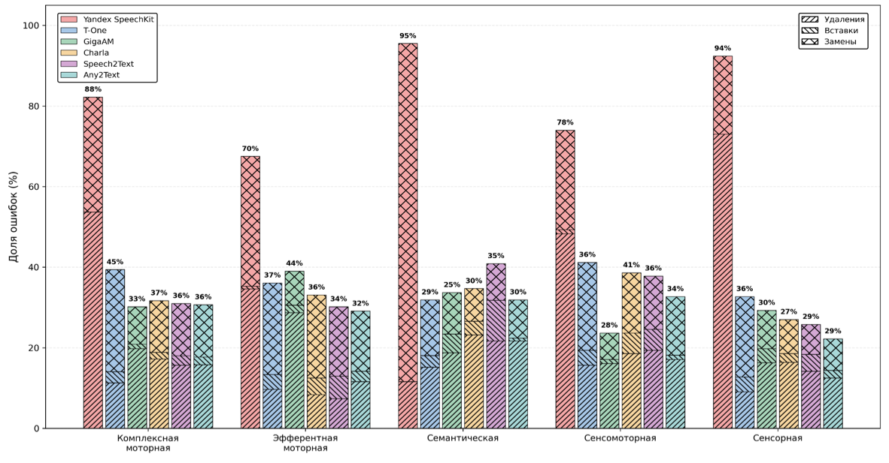
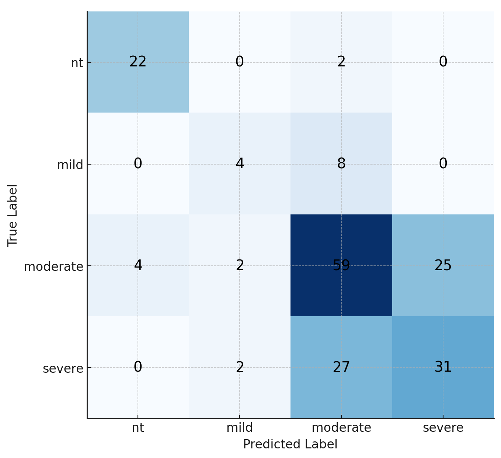
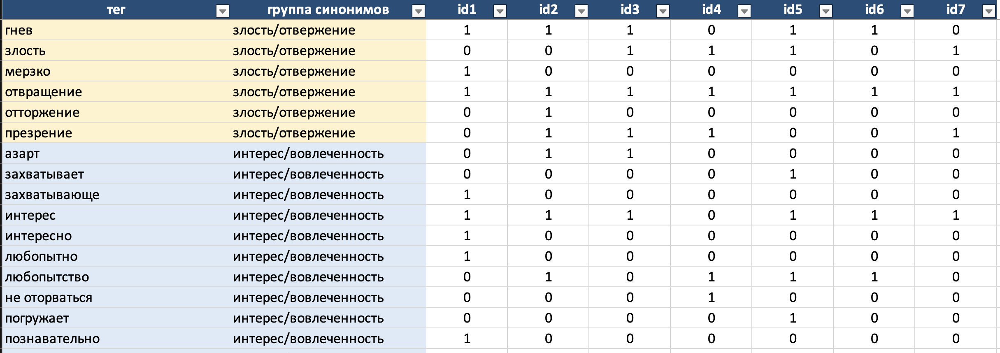
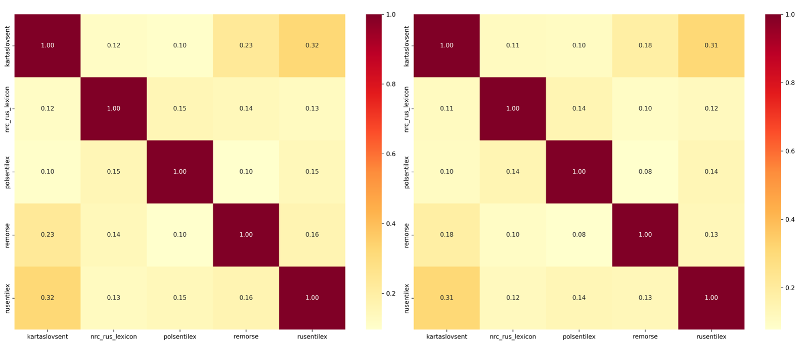
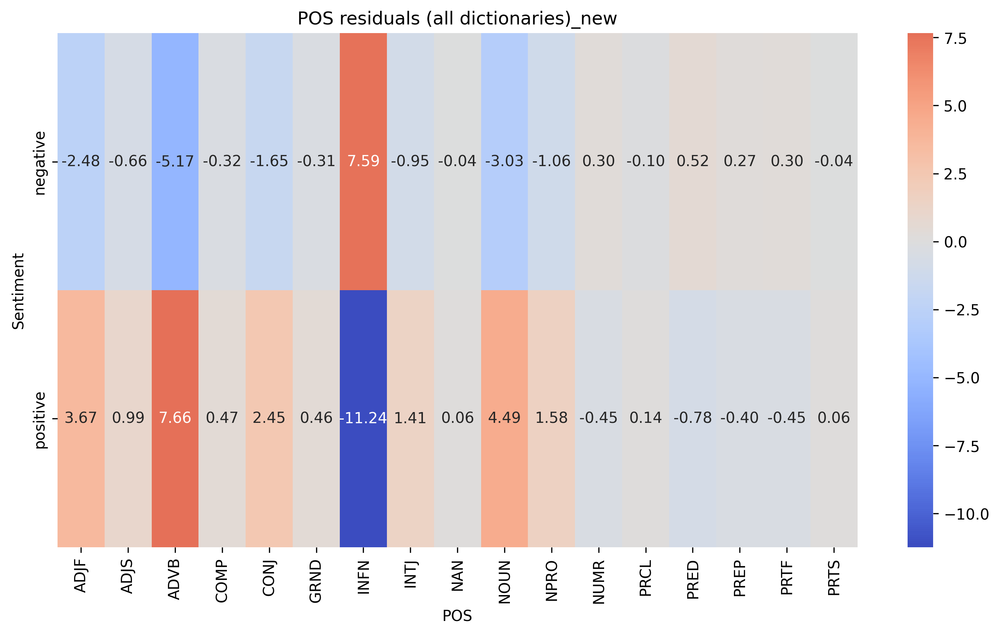
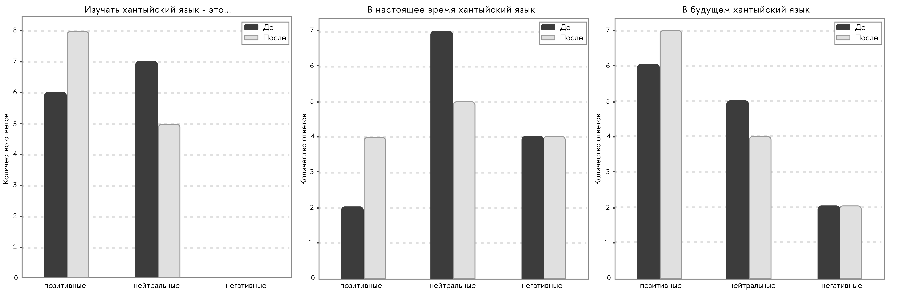
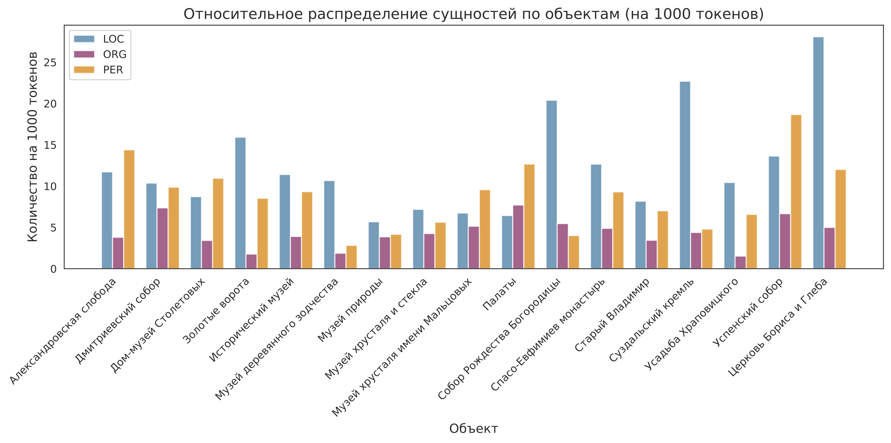
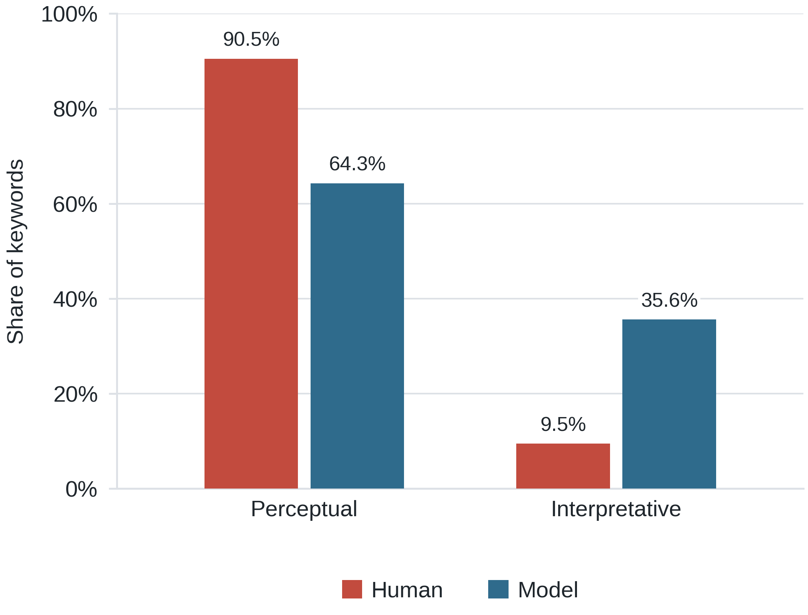
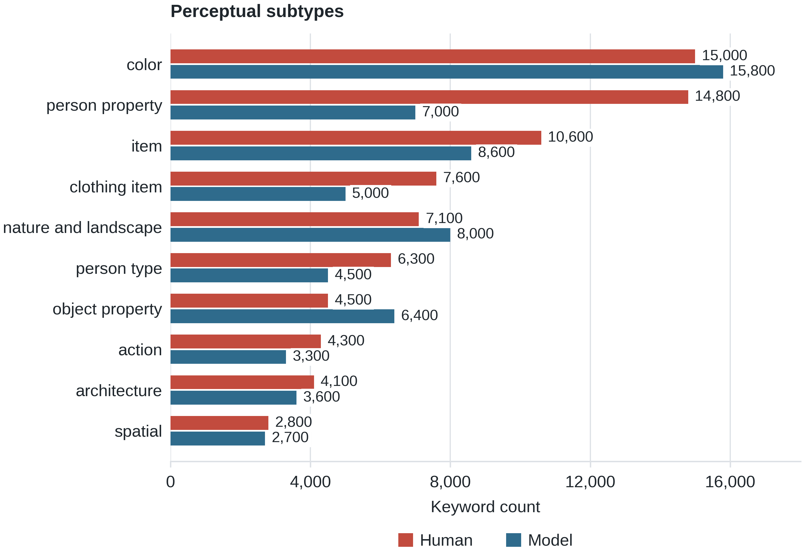

# Петербург

## Методы компьютерной лингвистики в разработке аддитивных технологий распознавания речи и генерации текстовых данных для носителей русского языка с расстройствами речи

### Бенчмарк для оценки качества русскоязычных моделей автоматического распознавания речи (ASR) в задаче распознавания речи пациентов с афазией

В 2025 году в рамках данного проекта был создан датасет RuAphasiaBank[^RuAphasiaBank], в котором представлены 5 из 7 типов афазий по А.Р. Лурии, три степени тяжести заболевания (легкая афазия, средняя и тяжелая), а также разные типы речи (монологи, диалоги, пересказы текстов, чтение текстов и слогов) у более, чем 70 носителей русского языка (женщин и мужчин) от 26 до 80 лет. Более детальные характеристики датасета описаны в статье [@kolmogorova2026services]. Датасет объединяет аудиозаписи и их эталонные расшифровки, проверенные 3-мя лингвистам.

[^RuAphasiaBank]: RuAphasiaBank : база данных фонограмм речи пациентов с афазией: № 2025623465 / А. В. Колмогорова, Е. В. Явшиц, М. О. Сергеева, А. Х. Сугян; правообладатель: Федеральное государственное автономное образовательное учреждение высшего образования «Национальный исследовательский университет „Высшая школа экономики»» (RU). --- Зарегистрировано в Реестре баз данных 22 авг. 2025 г. --- Заявка № 2025623048 от 08 июля 2025 г. --- Электрон. ресурс.

В отчетном периоде на датасете RuAphasiaBank проведено систематическое сравнение метрик качества распознавания афазической речи шести ASR-систем для русского языка [@kolmogorova2026shorten]. В результате проведенных экспериментов решены 2 взаимосвязанные задачи:

1.  Создан бенчмарк для оценки качества русскоязычных моделей (далее –-- ASR-модели) в задаче распознавания речи пациентов с афазией.

2.  Проведен лингвистический анализ коммуникативных искажений ASR-моделей для афазической речи.

В сравнительный анализ в рамках бенчмарка были включены 6 моделей ASR, в документации которых указано, что при их обучении использовались данные на русском языке и что модель предназначена в том числе для анализа данных на русском языке: GigaAM, T-One, Yandex SpeechKit, Any2text, Charla, Speech2Text. Основной методологией стала оценка качества распознавания при помощи стандартных метрик WER (Word Error Rate) [@morris2004] и CER (Character Error Rate) [@thennal2024], а также подсчета долей удалений, вставок и замен на выборках а) разных типов афазий, б) разных степеней выраженности нарушений, в) разных типов речи.

Сравнение значений WER при распознавании записей речи пациентов с разными типами афазий демонстрирует @fig-spb-01, что наиболее успешные по данной метрике модели меняются в зависимости от типа афазии, а аутсайдер неизменен –-- это Yandex SpeechKit, хотя и его поведение нестабильно: в случае семантической афазии лидируют замены, а при сенсорной –-- удаления. GigaAM показывает наилучшие значения WER при комплексной моторной, семантической и сенсомоторной афазии, но при этом, так же, как и аутсайдер, предпочитает удалять непонятое.

{#fig-spb-01}

Поскольку в датасете представлены записи и нейротипичных информантов (монолог и диалог), то при анализе результатов обработки записей с разной степенью выраженности речевого нарушения заметен четкий градиент: все модели показывают рост WER от нейротипичных записей к тяжелой афазии. Исключение –-- Yandex SpeechKit.

Если мы обратимся к сравнению по типам речи, медианные значения WER для всех моделей, за исключением Yandex SpeechKit, на уровне слов демонстрируют ожидаемую тенденцию: самые низкие показатели ошибок наблюдаются при распознавании нейротипичных записей, тогда как самые высокие –-- при обработке пересказов у пациентов с афазией (далее –-- ПА).

Выявлено три различные стратегии моделей при распознавании речи в условиях неопределенности, в нашем случае --- при обработке афазической речи. Yandex SpeechKit использует «паническое укорачивание» –-- агрессивное сжатие распознанного текста по сравнению с оригиналом. T-One старается сохранить лексическое наполнение в ущерб точности на уровне символов. GigaAM, Any2Text и Charla демонстрируют «стабильную» стратегию, при которой длина выходного текста практически не зависит от снижения качества речевых данных (например, при усугублении грубости речевого нарушения у говорящего). Speech2Text занимает промежуточное положение: его стратегия укорачивания ухудшает распознавание почти во всех условиях, кроме лёгкой афазии и монологов. Формально по профилю ошибок GigaAM тяготеет к стратегии панического укорачивания (высокая доля удалений при минимальных вставках и заменах), однако, в отличие от Yandex SpeechKit, это укорачивание не разрушает распознавание: GigaAM сохраняет лучший общий WER и наибольшую устойчивость по всем условиям, что сближает её со стабильной стратегией Any2Text и Charla. Итоговые значения метрик представлены в таблице -@tbl-spb-01.

|  |  |  |  |  |  |  |
|----|----|----|----|----|----|----|
| Модель ASR | Yandex SpeechKit | T-One | GigaAM | Charla | Speech2Text | Any2Text |
| Пациенты с афазией |  |  |  |  |  |  |
| WER | 88% | 43% | 32% | 37% | 35% | 34% |
| CER | 69% | 23% | 21% | 23% | 23% | 23% |
| Нейротипичные информанты |  |  |  |  |  |  |
| WER | 89% | 28% | 17% | 21% | 17% | 20% |
| CER | 72% | 15% | 11% | 13% | 10% | 13% |

: Агрегированные метрики WER и CER, полученные на фонограммах датасета RuAphasiaBank  {#tbl-spb-01}

Оценка с помощью формальных метрик WER и CER, а также с помощью подсчета долей вставок, удалений и замен от общего количества изменений в выходных транскриптах по сравнению с эталонными расшифровками продемонстрировала как общее низкое качество распознавания, так и наличие специфической стратегии реагирования каждой из моделей на ситуацию стресс-теста.

Результаты бенчмарка ASR-моделей нуждаются в лингвистическом и социально-этическом анализе для определения того, как именно искажается речь пациента при автоматическом распознавании его речи. Для этого введено понятие коммуникативной предвзятости ASR-моделей (communicative bias) --- это свойство системы, при котором в условиях неопределенности (атипичная речь, шум, паузы) модель заполняет лакуны на основе паттернов, усвоенных из своих обучающих данных, а не на основе актуального коммуникативного намерения говорящего, что приводит к систематическому искажению воспринимаемого коммуникативного стиля пользователя-говорящего. В результате лингвистического анализа корпуса транскриптов от ASR-моделей мы описали специфику коммуникативной предвзятости каждой из моделей, использованных для бенчмарка.

Качественный анализ транскриптов позволил обнаружить тот факт, что каждая из моделей, совершая вставки, замены и удаления, определенным образом «навязывает» атипичному говорящему некоторый коммуникативный образ, который изначально не был ему присущ: от коммуниканта, тяготеющего к просторечию, до говорящего, имеющего когнитивные нарушения или демонстрирующего агрессию в поведении. Выявленный феномен коммуникативной предвзятости моделей создает определенные риски при их использовании пациентами с афазией для получения услуг и информации в тех учреждениях, для взаимодействия с которыми обычно используются технологии распознавания речи.

### Разработка мультимодального фреймворка для классификации степени тяжести афазии у носителей русского языка

Следующее направление работы в рамках отчетного проекта связано с задачей автоматической классификации степени тяжести речевого нарушения у пациентов с афазией: нейротипичные (норма), лёгкая степень, умеренная степень, тяжёлая степень.

В рамках отчетного периода проекта работа велась на основе датасета RuAphasiaBank [@kolmogorova2026multimodal].

В отчетном периоде было предложено применить дуально-эмбеддинговый мультимодальный фреймворк, объединяющий комплементарные представления речи –-- моторно-акустическое (на основе эмбеддингов `wav2vec` 2.0) и когнитивно-лингвистическое (на основе энкодера `Whisper`) –-- посредством раннего слияния признаков (фузирования) с последующей классификацией методом градиентного бустинга ``XGBoost`` в схеме кросс-валидации, независимой от диктора. Для совместного анализа как низкоуровневых моторно-речевых нарушений, так и высокоуровневых когнитивно-лингвистических дефицитов, связанных с афазией, для каждой речевой записи были построены два комплементарных представления, соответствующих акустико-моторному и семантико-лингвистическому измерениям нарушения. Акустическое представление было получено путем извлечения 768-мерного эмбеддинга из последнего скрытого слоя предобученной модели `wav2vec 2.0 Base` [@baevski2020]. Эти эмбеддинги, в первую очередь, кодируют независимые от языка свойства речевого сигнала, такие как стабильность артикуляции, просодический контроль, темп речи и временная регулярность. Данные признаки особенно информативны для обнаружения моторно-речевых нарушений, которые часто сопровождают средние и тяжелые формы афазии. Параллельно строилось семантическое представление путем подачи тех же записей в энкодер модели `Whisper Large` [@radford2022] и извлечения 1280-мерного эмбеддинга. На основе двух указанных модальностей были оценены три конфигурации модели. Базовая модель только с акустическими признаками использует классификатор ``XGBoost`` [@chen2016], обученный исключительно на эмбеддингах `wav2vec` 2.0 и ориентированный на моторно-речевые характеристики. Базовая модель только с семантическими признаками использует ту же архитектуру классификатора, но работает исключительно на эмбеддингах энкодера Whisper, фокусируясь на когнитивно-лингвистических нарушениях. Наконец, мультимодальная модель слияния объединяет оба представления посредством раннего слияния путем конкатенации акустического и семантического векторов признаков в единый высокоразмерный вход: X_combined = \[X_acoustic; X_semantic\]. Это объединенное представление затем используется в качестве входа для классификатора ``XGBoost``. Все модели обучались и оценивались на одном и том же корпусе из 186 записей от 90 уникальных дикторов. Чтобы приблизиться к реалистичному сценарию клинического внедрения, была применена групповая 5-фолдовая кросс-валидация, где идентификатор диктора использовался в качестве группирующей переменной. Следовательно, все записи, произведенные данным пациентом, назначались либо в тренировочное, либо в тестовое множество в каждом фолде, но никогда в оба. Степень тяжести афазии кодировалась как порядковая переменная с четырьмя уровнями (нейротипичный, легкий, средний, тяжелый). Поскольку метки образовывали упорядоченную шкалу, а не набор независимых категорий, в качестве основной метрики оценки использовалась средняя абсолютная ошибка (MAE) между истинными и предсказанными уровнями тяжести, в дополнение к стандартным метрикам классификации.

Для смягчения дисбаланса классов во всех трех моделях применяется обучение с весами классов путем присвоения образцам весов, обратно пропорциональных частоте классов.

Сначала было проведено сравнение конфигураций моделей по общей точности предсказания степени тяжести. Во всех наборах признаков `XGBoost` стабильно превосходит бейзлайны Random Forest (оцененные в предварительных экспериментах) и достигает более низкого MAE с уменьшенной дисперсией по фолдам. Среди унимодальных настроек семантические признаки, полученные из Whisper, превосходят чисто акустические представления, что свидетельствует о том, что лексическая и структурная информация особенно информативна для оценки тяжести. Однако наилучшие показатели качества достигаются мультимодальной моделью слияния с ``XGBoost`` (MAE = 0,431), улучшая оба унимодальных бейзлайна `XGBoost` (0,452 для Whisper и 0,569 для `wav2vec` 2.0). Для Random Forest, напротив, слияние не дает улучшения: наименьший MAE получается с признаками Whisper (0,457), в то время как объединенный набор признаков достигает 0,484.

Результаты показывают, что семантические признаки Whisper сами по себе являются более сильным предиктором тяжести афазии, чем акустические признаки `wav2vec` 2.0. Однако объединение обеих модальностей дает дополнительный прирост, подтверждая гипотезу о комплементарности акустических и семантических представлений.

Для лучшего понимания поведения модели по клиническим подтипам был проведен дальнейший анализ ошибок предсказания, стратифицированный по типу афазии (см. @fig-spb-02). Частота ошибок существенно различается между диагностическими категориями: наименьший MAE наблюдается для нейротипичных говорящих и тотальной афазии, более высокие значения ошибки –-- для сенсорной и семантической афазии. Эти паттерны согласуются с клиническими ожиданиями.

{#fig-spb-02}

В таблице -@tbl-spb-02 представлены точность, полнота и F1-мера по классам для модели слияния. Метрика качества наиболее высока для классов нейротипичных дикторов (F1 = 0,88) и страдающих афазией средней степени тяжести (F1 = 0,63), которые хорошо представлены в корпусе (24 и 90 записей соответственно). В отличие от них, категория легкой степени афазии остается основным узким местом (F1 = 0,40): большинство ошибок соответствуют смешению со средней степенью тяжести. Это указывает на то, что модель надежно обнаруживает нарушения, но испытывает трудности с различением ранних или тонких дефицитов от более выраженных случаев при недостатке размеченных примеров. Класс тяжелой степени нарушения показывает F1 = 0,53 для 60 записей, что также отражает сложность точного разграничения тяжелой и средней степени.

|                        |           |        |          |                     |
|------------------------|-----------|--------|----------|---------------------|
| Класс                  | Precision | Recall | F1-Score | Количество примеров |
| Нейротипичные          | 0.85      | 0.92   | 0.88     | 24                  |
| Легкая степень афазии  | 0.50      | 0.33   | 0.40     | 12                  |
| Средняя степень афазии | 0.61      | 0.66   | 0.63     | 90                  |
| Тяжелая степень афазии | 0.55      | 0.52   | 0.53     | 60                  |
| Взвешенное среднее     | 0.62      | 0.62   | 0.62     | 186                 |

: Оценка эффективности модели классификации на основе слияния признаков»  {#tbl-spb-02}

Матрица ошибок модели слияния (см. @fig-spb-02) выявляет два клинически важных паттерна. Во-первых, система ведет себя как надежный инструмент скрининга: ни один пациент с тяжелой степенью не был ошибочно классифицирован как здоровый представитель контрольной группы, и только два здоровых диктора были ошибочно отмечены как пациенты с речевой патологией. Эта асимметрия говорит о том, что модель консервативна в отношении ложноотрицательных результатов на тяжелом конце спектра, что предпочтительно в контексте скрининга. Во-вторых, основным узким местом качества модели является категория легкой степени афазии, которая достигает F1 = 0,40 всего при 12 примерах. Большинство ошибок для этого класса соответствуют ошибочной классификации легкой степени как средней, что указывает на то, что модель надежно обнаруживает наличие нарушения, но с трудом отделяет тонкие случаи от более выраженных дефицитов при недостатке размеченных данных.

Прямое сравнение полученных метрик, в частности, F1 в диапазоне от 40% до 88% с результатами предыдущих исследований, сообщавших о F1 = 78–97% [@wagner2023], [@nivedha2023], [@qin2020], должно учитывать ключевые методологические различия в исследованиях. В то время как цитируемые работы решали более узкие задачи –-- такие как классификация на три типа афазии или бинарная классификация тяжести (тяжелая vs. легкая) –-- на корпусах других языков, текущее исследование является первым, которое решает комплексную задачу мультиклассовой классификации на русскоязычном речевом корпусе. Это закономерно увеличивает сложность задачи и объясняет несколько более низкие абсолютные значения качества классификации.

Результаты показывают, что раннее слияние акустических эмбеддингов `wav2vec` 2.0 с семантическими представлениями на основе Whisper позволяет более комплексно моделировать патологическую речь, совместно захватывая ее моторно-акустические и когнитивно-лингвистические измерения. Предложенный мультимодальный подход продемонстрировал робастность, приемлемое качество работы и превысил базовый уровень классификации, особенно в различении средней афазии от других уровней тяжести.

### Автоматическое упрощение текстов для пациентов с афазией: «меньше значит больше»

В рамках отчетного периода было проведено исследование, посвященное разработке и клинической валидации методики автоматического упрощения текстов для пациентов с афазией. Целью работы стала оценка эффективности использования больших языковых моделей (LLM) для многоуровневого упрощения текстов на русском языке. Исследование сфокусировалось на пациентах с комплексной моторной афазией, составляющих большинство (67%) в партнерском нейрореабилитационном центре. Специалистами (логопедами) были разработаны правила упрощения для трех уровней тяжести нарушения: легкого, легкого-среднего и среднего (в соответствии со шкалой Л.И. Вассермана [@vasserman1997]. На основе этих правил был создан параллельный корпус, включающий 134 текста (1010 предложений), отобранных с учетом читательских предпочтений целевой возрастной группы (55--65 лет) [@kolmogorova2023]. Восемь аннотаторов-филологов создали по три эталонные упрощенные версии для каждого предложения. Для автоматизации процесса применялась стратегия few-shot prompting (обучение на нескольких примерах) с использованием четырех LLM. Лучшие результаты по итогам ручного скрининга показали модели Llama Storm и Gemma.

Анализ лингвистических метрик (ASL, TTR, FRE GL, SMOG) показал, что few-shot prompting позволяет моделям генерировать тексты, близкие по сложности к эталонным версиям, созданным людьми. Модели продемонстрировали способность сохранять градиент сложности между уровнями. Оценка BERTScore [@zhang2020] подтвердила высокую семантическую близость автоматически упрощенных текстов к эталонам (значения 0.76--0.81), что свидетельствует о сохранении смысла оригинала.

Коллекция автоматически упрощенных текстов была валидирована с участием 12 пациентов с комплексной моторной афазией. Сравнение с «золотым стандартом» (текстами из классических логопедических пособий [@bein1962] показало, что автоматические тексты не уступают им по объективным метрикам сложности. Интересный результат был получен при оценке субъективных ощущений пациентов. Несмотря на то, что автоматические тексты были оценены как более сложные для чтения (p=0.010), они получили более высокие оценки по параметру «интересность». Это указывает на то, что использование персонализированного контента (из газет и журналов, интересных пациенту) может повышать мотивацию к чтению, даже если текст кажется сложнее стандартного учебного материала.

Исследование подтвердило гипотезу о том, что промпт-инжиниринг в режиме few-shot является эффективным и менее ресурсоемким методом по сравнению с дообучением моделей (fine-tuning), которое в условиях ограниченного корпуса показало неудовлетворительные результаты.

Разработанная методика позволяет создавать репозитории текстовых стимулов, стратифицированных по типу нарушения и уровню тяжести, что открывает новые возможности для персонализации речевой терапии. Дальнейшая работа будет направлена на расширение выборки пациентов для повышения статистической мощности и refinement критериев для третьего уровня упрощения.

## Методы автоматического анализа эмоций в текстовых данных на русском языке

### Разработка процедуры эмоциональной разметки читательских рецензий на книги

В рамках направления по разработке алгоритмов автоматического анализа эмоций в устных и письменных текстах на данном этапе проекта в качестве материала были рассмотрены тексты не изученного нами ранее домена –-- тексты книжных рецензий массовых читателей, размещенные на тематических онлайн-площадках. Автоматический анализ эмоциональной составляющей рецензий на литературные произведения позволит описать когнитивные особенности восприятия читателями текстов разных жанров, эпох, тематики.

Цель исследования заключалась в разработке системы эмоциональной разметки текстов рецензий, которая, с одной стороны, наиболее полно отражает эмоции, выраженные автором текста, с другой –-- является пригодной для дальнейшей автоматизации (LLM разметка).

Были решены следующие задачи: выработка критериев отбора материала для датасета с партнером и заказчиком исследования --- ООО «Живая библиотека»; предобработка полученных от заказчика данных; обзор существующих систем эмоциональной разметки; анализ лингвистических особенностей выражения эмоций в текстах рецензий; разработка системы эмоциональной разметки и составление списка эмоциональных маркеров (тегов), выбор из нескольких альтернативных вариантов; ручная разметка тестового набора рецензий, оценка согласованности нескольких разметчиков.

От партнера-заказчика данного исследования были получены данные –-- тексты рецензий читателей, размещенные на портале [livelib.ru](http://livelib.ru) в объеме 1 129 573 рецензий. После предобработки в датасет вошло 884 056 рецензий. Из общего объема были отобраны две тестовые выборки --- 56 и 300 текстов –-- в качестве образцов для апробации различных подходов к разметке эмоций.

Корпус текстов представляет собой яркий пример пользовательской (читательской) интернет-рецензии с доминированием субъективно-эмоционального начала. Лексика и синтаксис подчинены задаче выразить личное впечатление и воздействовать на выбор других потенциальных читателей литературного произведения, которому посвящена рецензия. Тематический диапазон широк, но фокус смещен на эмоциональное восприятие, а не на объективный литературоведческий анализ.

Среди тематических фокусов выделяются сюжет и его динамика («сюжет захватывающий», «сюжет провисает», «динамично», «затянуто»); персонажи, их правдоподобие, глубина, симпатия/антипатия («герои картонные», «персонажи живые», «героиня раздражала»); авторский стиль и язык («слог лёгкий», «язык витиеватый», «простой язык», «богатый язык»); общее эмоциональное воздействие («книга вызвала восторг», «оставила равнодушным», «довела до слез»); сравнение с другими произведениями (литературой, кино) («напоминает „Игру Эндера”», «как в бразильском сериале», «отсылки к Властелину колец»); социальные и философские проблемы, поднятые в книге («буллинг», «инклюзия», «экология», «рабство», «война», «смысл жизни»); личный читательский опыт («я такое не люблю», «это не мой автор», «перечитаю ещё раз»).

На этапе разработки системы разметки первой задачей было формирование списка эмоциональных меток, которые будут описывать эмоции в рецензиях. Этот процесс проходил итеративно: сначала 7 участников рабочей группы проанализировали тестовую выборку из 56 рецензий и составили индивидуальные списки из эмоций, которые, по их мнению, встречались в текстах. Затем эти списки анализировались и сравнивались: были выявлены эмоции, которые использовали все разметчики, половина из них, а также индивидуальные теги. Далее все теги объединялись в синонимические ряды (см. @fig-spb-03). Для каждого разметчика (id1 –-- id7) маркировалось, использовал ли он данный тег.

Следующим шагом стал анализ семантических различий тегов внутри синонимических групп и выявление эмоций, наиболее релевантных в контексте описания аффективных впечатлений от литературного произведения. На основе такого анализа был составлен список из 35, а затем 26 тегов, которые и были использованы для тестирования различных схем разметки.

Анализ текстов рецензий позволил заметить, что большинство из них содержит 5 тематических фокусов, а именно описание сюжета/содержания, описание героев, комментарии о стиле автора, впечатления от автора как от личности и описание собственного субъективного впечатления от прочитанного. Именно с этими аспектами книги связан эмоциональный отклик читателя.

{#fig-spb-03}

Принимая во внимание эту особенность исследуемого материала, мы предложили для текстов рецензий аспектно-ориентированную разметку эмоций. Подобный подход разрабатывается в рамках задачи анализа тональности и подразумевает извлечение пар «позитивная/негативная оценка» –-- «объект оценки». Наш подход подразумевает оценку 5 фиксированных аспектов --- сюжет (содержание), герои, авторский стиль, позиция автора, субъективные впечатления –-- и присвоение каждому из аспектов эмоциональных меток, которые показывают, во-первых, эмоцию, которую читатель испытал и выразил в своей рецензии, во-вторых, источник этой эмоции.

Разметка любых данных как правило выполняется несколькими аннотаторами, после чего их мнения усредняются и выводится эталон разметки. Разметка эмоций субъективна. Индивидуальность обработки эмоциональной окраски текста может приводить к тому, что один разметчик выделяет эмоциональный тег, а другой разметчик нет. Это не может автоматически считаться ошибкой. Для учета вариативности восприятия эмоциональной составляющей рецензии предложено агрегировать теги, расставленные разными разметчиками, присваивая тегам «веса» в зависимости от того, какая доля из всех размечающих их выбрала. Так, тег, который выбрали 3 разметчика из 3, будет иметь наибольший вес, в то время как индивидуальные выборы –наименьший.

На основе предложенной системы была проведена краудсорс-разметка выборки из 300 рецензий. Были отобраны рецензии на книги 20 наиболее представленных в датасете жанров (по 15 на жанр) длиной от 100 до 300 слов. В половине рецензий книге был присвоен рейтинг от 0 до 5 звезд, в половине –-- от 6 до 10. Была сформулирована подробная инструкция для разметчиков. В разметке приняли участие 3 разметчика.

Подсчет согласованности для подобного рода задачи представляет сложность в силу большого количества классов эмоций (у нас –-- 26), возможности выбора нескольких классов для одного текста, а также деления по аспектам. В связи с этим нами предлагается формула, которая позволит измерить согласованность конкретно в нашей задаче.

Формула построена на следующей логике: согласованным выбором тега считается его постановка хотя бы 2 из 3 разметчиков. Индивидуальные выборы тегов считаются рассогласованным выбором. Для каждой рецензии и каждого аспекта были рассчитаны:

::: {#eq-spb_conlab1}

T = 3U + 2M + S –-- суммарное число «голосов» аннотаторов за эмоции в аспекте.

U –-- число эмоций, выбранных 3 разметчиками --- полное единогласие.

M –-- число эмоций, выбранных 2 разметчиками –-- частичное согласие / большинство.

S –-- число эмоций, выбранных 1 разметчиком –-- индивидуальный выбор / расхождение.

:::

На основе этих параметров был рассчитан коэффициент agreement_vote_share = (3U + 2M) / T, который показывает долю тегов, которые не являются одиночными (то есть выбраны 2 или 3 разметчиками). Распределение этого показателя по аспектам представлено в таблице -@tbl-spb-03.

Можно заметить (см. таблицу -@tbl-spb-03), что 50–85% тегов были выбраны 2 или 3 разметчиками, что говорит о хорошей согласованности с учетом сильной вариативности поставленной задачи. Наибольшая согласованность наблюдается в аспекте «позиция автора». Это может быть обусловлено более редким обращением рецензентов к этой тематике и, соответственно, более редким выделением ее как источника эмоционального впечатления разметчиками –-- из 6220 тегов, поставленных тремя разметчиками, только 947 пришлось на аспект «позиция автора» (15,2%), в то время как в аспекте c наименьшей согласованностью («субъективные впечатления») количество выборов было наибольшим –-- 1547 тегов. Снижение согласованности при повышении множественности выбора является предсказуемым, однако в то же время указывает на необходимость доработки формулы подсчета согласованности в части чувствительности к общему количеству тегов.

|  |  |  |
|----|----|----|
| аспект | agreement_vote_share | T (общее кол-во тегов в аспекте) |
| герои | 0,628 | 1403 |
| сюжет | 0,563 | 1237 |
| позиция автора | 0,852 | 947 |
| авторский стиль | 0,642 | 1086 |
| субъективные впечатления | 0,51 | 1547 |

: Метрика agreement_vote_share и индекс T, рассчитанные для 5 аспектов разметки на выборке из 300 рецензий {#tbl-spb-03}

Таким образом, разработана система разметки эмоций в текстах рецензий, созданы формулы оценивания качества разметки и номенклатура кастомзированных именно под данную задачу тегов.

### Экспериментальное сравнение качества автоматического детектирования эмоций на основе данных корпуса устной речи молодежи и студентов (КУРС)

В исследованиях, проводимых в 2026 году на материале Корпуса устной речи молодежи и студентов (КУРС), особое внимание уделялось возможностям и ограничениям автоматического выявления эмоциональной составляющей спонтанного речевого общения. В повседневной устной речи выражение эмоций тесно связано с текущей коммуникативной ситуацией, то есть является контекстно обусловленным. При этом реплика может одновременно содержать оценку обсуждаемого события, выражать отношение к собеседнику и выполнять некоторую функцию в поддержании речевого взаимодействия. В связи с этим положительная или отрицательная тональность отдельных слов не может рассматриваться как непосредственный показатель эмоционального состояния говорящего.

Проведены эксперименты по сравнению автоматической и экспертной разметки эмоций и тональности в репликах говорящих (на основе текстовых расшифровок устной спонтанной речи, представленных как часть корпуса КУРС). Объем исследовательской выборки составляет 326527 словоупотреблений (26137 реплик), полученных в результате автоматического распознавания речи в 226 макроэпизодах общей длительностью в 80 часов. Реплики были аннотированы по следующей схеме: для каждой реплики независимо от контекста соседних реплик оценивалась выраженность шести эмоций --- отвращения, радости, грусти, удивления, страха и злости --- по шкале от 0 до 2 (0 --- эмоция не выражена, 1 --- выражена слабо, 2 --- наиболее выраженная эмоция). Дополнительно каждой реплике присваивалась оценка сентимента по шкале от −2 до 2, отражающей общую эмоциональную окраску реплики: от очень негативной до очень позитивной, включая нейтральную (0).

В результате апробированы 4 модели, две из которых предполагают классификацию по эмоциям (RuBERT-base-cased-russian-emotion-detection с fine-tuning при помощи датасетов cedr и переведенного на русский GoEmotions), 2 –-- по сентименту (RuBERT-base-cased для сентимент-анализа и Dostoevsky (Social network model)). Автоматически назначенные моделями лейблы были сравнены с выполненной вручную аннотацией тремя людьми, чтобы оценить таким образом качество предсказания. В качестве метрик использовались accuracy, precision, recall и F1. Результаты сравнения с эталонным датасетом приведены в таблицах -@tbl-spb-04 и -@tbl-spb-05.

|              |           |        |        |        |          |        |
|--------------|-----------|--------|--------|--------|----------|--------|
|              | precision |        | recall |        | f1-score |        |
|              | cedr      | ru-go  | cedr   | ru-go  | cedr     | ru-go  |
| joy          | 0.3008    | 0.2805 | 0.5208 | 0.0262 | 0.3814   | 0.0480 |
| sadness      | 0.0914    | 0.3929 | 0.4227 | 0.0284 | 0.1503   | 0.0529 |
| disgust      | \-        | 0.2632 | \-     | 0.0187 | \-       | 0.0348 |
| surprise     | 0.4237    | 0.1863 | 0.3062 | 0.0219 | 0.3555   | 0.0391 |
| fear         | 0.0569    | 0.3333 | 0.5578 | 0.0272 | 0.1033   | 0.0503 |
| anger        | 0.2070    | 0.0769 | 0.2063 | 0.0081 | 0.2066   | 0.0148 |
| neutral      | 0.7864    | 0.7327 | 0.6523 | 0.9780 | 0.7131   | 0.8378 |
| macro avg    | 0.3110    | 0.3237 | 0.4443 | 0.1584 | 0.3183   | 0.1540 |
| weighted avg | 0.6653    | 0.5942 | 0.5745 | 0.7179 | 0.6088   | 0.6209 |

: Качество эмоциональной разметки реплик моделями seara/rubert-base-cased-russian-emotion-detection-ru-go-emotions и seara/rubert-base-cased-russian-emotion-detection-cedr {#tbl-spb-04}

|              |            |        |            |        |            |        |
|--------------|------------|--------|------------|--------|------------|--------|
|              | precision  |        | recall     |        | f1-score   |        |
|              | dostoevsky | rubert | dostoevsky | rubert | dostoevsky | rubert |
| negative     | 0.3748     | 0.2186 | 0.2680     | 0.6497 | 0.3125     | 0.3271 |
| neutral      | 0.8408     | 0.8745 | 0.8950     | 0.6571 | 0.8670     | 0.7504 |
| positive     | 0.4371     | 0.5176 | 0.3638     | 0.3653 | 0.3971     | 0.4283 |
| macro avg    | 0.5509     | 0.5369 | 0.5089     | 0.5574 | 0.5255     | 0.5020 |
| weighted avg | 0.7448     | 0.7619 | 0.7672     | 0.6254 | 0.7540     | 0.6680 |

: Качество определения тональности реплик трехклассовыми моделями blancherfort/rubert-base-cased-sentiment и Dostoevsky {#tbl-spb-05}

Сравнение результатов показывает, что модели для сентимент-анализа значительно лучше воспроизводят эталонную разметку, чем модель распознавания эмоций. Для моделей сентимент-анализа был получен macro F1-score от 0.502 до 0.525, тогда как для моделей детекции эмоций этот показатель варьировался в пределах 0.154--0.318. Вероятной причиной является более высокая субъективность и неоднозначность выделения конкретных эмоциональных категорий по сравнению с определением общей тональности высказывания. Кроме того, качество модели ru_go_emotions могло снизиться в связи с необходимостью агрегировать исходный 28-классовый список тегов до ограниченного набора категорий, используемого в исследуемом корпусе.

### Словарь эмоциональной лексики XX века rEmoRSe

На основе опыта эмоционального аннотирования Корпуса русского рассказа была составлена теоретическая база для подготовки к публикации словаря эмоциональной лексики XX века –-- rEmoRSe.

Осуществлено сравнение словаря, полученного на основе Корпуса русского рассказа, с другими представительные ресурсами для русского языка –-- RuSentiLex [@lukashevich2016] и PolSentiLex [@koltsova2020], КартаСловСент {kulagin2021}, переводным лексиконом NRC EmoLex (Russian) [@mohammad2013]. Сравнение структуры словарей показывает существенные различия как в объёме словарей, так и в соотношении тональных категорий (см. таблицу -@tbl-spb-06). Самым крупным по количеству единиц является словарь КартаСловСент, ориентированный на максимальное покрытие и включающий, как и PolSentiLex, также и нейтральную лексику. Остальные словари содержат в основном эмоционально окрашенную лексику, однако для rEmoRSe явно выделяется класс смешанных оценок (mixed) –-- в исходных списках такие слова имели несколько разных тегов, то есть меняли свою эмоциональность в зависимости от значения или контекста. В дальнейшем анализе нейтральный класс был проинтерпретирован как маркер отсутствия оценочного значения и, в отличие от смешанного, не учитывался.

На первом этапе производилась оценка лексической схожести разных словарей с использованием коэффициента Жаккара: 1) по леммам, 2) по леммам и тегам (то есть совпадением считалось наличие у слова одинаковых тегов в сравниваемых словарях). Чем ближе значение к 1, тем больше совпадение между двумя множествами, и наоборот. Согласно рисунку -@fig-spb-04, наиболее близкими по составу как с учетом полярности, так и без являются КартаСловСент и RuSentiLex (J ≈ 0,32 и 0,31 соответственно). Высокие показатели также наблюдаются для КартаСловСент и rEmoRSe (J ≈ 0,23), однако при учете тональности согласованность снижается (J ≈ 0,18).

|                      |      |       |       |       |       |
|----------------------|------|-------|-------|-------|-------|
| Теги Словарь         | POS  | NEG   | NEUT  | mixed | Итого |
| КартаСловСент        | 6215 | 11863 | 28049 | –--     | 46127 |
| NRC EmoLex (Russian) | 1726 | 2337  | 0     | 129   | 4192  |
| rEmoRSe              | 4318 | 6678  | 0     | 2251  | 13247 |
| RuSentiLex           | 2638 | 7669  | 153   | 318   | 10778 |
| PolSentiLex          | 855  | 1826  | 4864  | –--     | 7545  |

: Распределение однословных единиц тональных словарей по категориям {#tbl-spb-06}

В целом результаты показывают, что словари имеют относительно низкую степень пересечения, что подтверждает наличие значительного количества специфической для каждого ресурса лексики. При этом снижение коэффициентов при переходе к сравнению «лемма + тег» может объясняться методологическими различиями в принципах присвоения тональных категорий, на которые было указано ранее. Так, RuSentiLex демонстрирует наиболее стабильное пересечение с другими ресурсами, в то время как PolSentiLex –-- наименьшее. Интересно, что NRC EmoLex (Russian) тоже не обнаруживает выраженной близости ни к одному из словарей, что, возможно, объясняется тем, что он является переводным с английского.

Наиболее высокий показатель уникальности демонстрируют rEmoRSe и КартаСловСент. Для rEmoRSe (46,36%) таким образом подтверждаются особенности реализации эмоциональности в художественном дискурсе, а для КартаСловСент (40,78%) –-- специфичность ассоциативного определения эмоциональности лексемы. Значительно меньше уникальной лексики представлено в RuSentiLex (26%), NRC EmoLex (Russian) (24,69%) и PolSentiLex (11,45%), что является интересным результатом, поскольку сильного сходства с другими словарями для последних двух замечено не было. Это может говорить о скорее точечном и равномерном характере пересечений сразу с несколькими словарями.

{#fig-spb-04}

Перейдем к результатам морфологического анализа. В объединенном датасете (без учета тегов и с удалением дубликатов) наиболее представленными частями речи оказались существительные (NOUN) (41,5%), глаголы-инфинитивы (INFN) (33,3%), прилагательные (ADJF) (18,9%) и наречия (ADVB) (4,7%). Такое распределение позволяет сделать вывод о том, что тональная лексика русского языка представлена главным образом не, как могло ожидаться, словами, непосредственно описывающими качества объектов (прилагательными, наречиями), но обозначениями действий, предметов и явлений.

При этом выделяются и индивидуальные различия между словарями. Интересно, что PolSentiLex, ориентированный на анализ социальных медиа, содержит больше прилагательных, а rEmoRSe –-- глаголов. Так, распределение частей речи следующее: КартаСловСент –-- NOUN (43,28%) → INFN (37,47%) → ADJF (17,03%); NRC EmoLex –-- NOUN (54,29%) → ADJF (25,07%) → INFN (18,03%); PolSentiLex –-- ADJF (48,71%) → NOUN (30,1%) → INFN (17,53%); rEmoRSe –-- INFN (38,42%) → NOUN (30,87%) → ADJF (20,46%); RuSentiLex –-- NOUN (48,12%) → ADJF (26,12%) → INFN (23,69%). Анализ морфологического состава уникальных единиц подтверждает эту тенденцию.

Наличие информации о тональности также позволяет установить вклад частей речи в выражение той или иной оценочности. На этом этапе, чтобы рассмотреть более «чистую» полярность, мы удалили «конфликтные» лексемы, которые имели отличный тональный тег хотя бы в одном другом словаре. Критерий χ² выявил статистически значимые различия в распределении частей речи между словарями (χ²(16) = 337,20, p \<0,001) с небольшим размером эффекта (Cramer’s V ≈ 0,126). При этом анализ стандартизованных остатков (standardized residuals) (см. @fig-spb-05) показал, что наиболее выраженная связь с полярностью обнаружена для инфинитивов. Полученные значения (SR = 7,57 для отрицательной и SR = −11,22 для положительной) свидетельствуют о том, что отрицательная тональность в эмоциональных словарях существенно чаще репрезентируется глагольной лексикой. Вместе с тем положительная оценка сильнее ассоциирована с наречиями (SR = 7,69) и прилагательными (SR = 3,67).

Наконец, мы предприняли попытку оценить «эмоциональное ядро» русского языка, отфильтровав только ту лексику, которая встречается во всех словарях одновременно и не является «смешанной» или нейтральной с точки зрения тональности. Таких единиц оказалось 480, и в основном это существительные и прилагательные (по 44,8%), инфинитивы составляют только 10,4%. Что касается направления полярности, то в «ядре» отрицательная лексика (268 вхождений) преобладает над положительной (120), причем выражена эта тенденция вне зависимости от части речи (например, распределение для существительных имеет следующее выражение –-- 26% vs. 10,4%, для прилагательных –-- 22,1% vs. 13,5%.

{#fig-spb-05}

Проведенный анализ показал, что тональные словари русского языка представляют собой неоднородные ресурсы, и, несмотря на общность задачи, они демонстрируют ограниченное пересечение. Морфологический анализ в свою очередь позволяет отметить, что существенную роль в выражении оценки играют существительные и глаголы. При этом как на сходимость составов словарей, так и на частеречные распределения оказывает влияние предметная ориентация словаря. Кроме того, «эмоциональное ядро», некоторый устойчивый слой тональной лексики русского языка, который мы попытались выявить путем сопоставления словарей, сравнительно мало и негативно.

## Цифровая ревитализация казымского диалекта хантыйского языка

В рамках проекта был разработан инструмент для ревитализации казымского диалекта хантыйского языка.

Ревитализация малоресурсного языка связана с расширением сфер его использования и изменением отношения сообщества к родному языку [@grenoble2006]. Одним из ее ключевых условий является межпоколенческая передача языка в семье. Для казымского диалекта хантыйского языка актуальна задача включения аутентичных фольклорных материалов в доступные цифровые форматы, поддерживающие совместные занятия взрослых и детей. В исследовании была использована концепция языкового гнезда, предполагающая передачу языка и культурных практик детям через взаимодействие со старшими носителями [@hinton1994].

Целью исследования было разработать образовательный чат-бот на основе фольклорных сказок казымских хантов и оценить его потенциал как инструмента ревитализации языка. В социолингвистическом эксперименте проверялось, сопровождается ли взаимодействие с фольклорными текстами в мультимодальной среде изменением отношения представителей хантыйского сообщества к родному языку и его изучению.

Материалом послужил корпус, предоставленный Обско-угорским институтом прикладных исследований и разработок ХМАО Югры. В корпус вошли 19 аутентичных сказок на казымском диалекте с русскими переводами, всего 38 текстов. Объем на хантыйском языке составил 6151 токен, русском –-- 6257 токенов; продолжительность озвучки сказок носителем языка[^audio] –-- 83,85 минуты. Тематический анализ текстов выявил несколько лексических групп (лексику традиционного быта, природопользования, родства и т. д.), что в дальнейшем позволило автоматизировать тематическую классификацию лексических единиц по мере добавления новых текстов для чтения.

[^audio]: Аудиоматериалы, использованные в чат-боте, были предварительно обработаны с целью анонимизации: записи не содержат персональных данных, позволяющих прямо или косвенно идентифицировать диктора.

Был разработан Telegram-бот «Моњщәӈ бот» с модулями чтения, аудирования, лексики, грамматики, культурных комментариев, алфавита и тестирования. Параллельное представление хантыйского текста и русского перевода обеспечивало языковую опору для понимания сказки [@ertugruloglu2023]. Для каждой сказки были подготовлены словарик, грамматические справки и тест из 8 закрытых заданий. Всего создано 19 тестов, включавших в общей сложности 152 вопроса. Пользователь мог повторять попытки до правильного ответа и отслеживать прохождение сказок. Общий лингвистический модуль объединил тематическую лексику, грамматический справочник и алфавит из 29 графем с аудиосопровождением.

Для систематизации лексики была применена автоматическая тематическая классификация на основе векторных представлений слов и оценено ее качество по F1. Качество тематической классификации лексики различалось по категориям. Наиболее высокие значения F1 получены для групп «Числа и количества» (1,00), «Цвета и формы» (0,96) и «Растения» (0,92); наиболее низкие значения для «Рыбалка и охота» (0,40), «Люди и семья» (0,46), «Дом и быт» (0,56). Ограничения классификации были связаны с небольшим объемом обучающих данных и возможностью отнесения слова к нескольким тематическим группам.

В качестве методологической основы для исследования субъективной витальности языка был использован экспериментальный дизайн, предложенный О. В. Фельде и Т. Н. Журавель –-- техника незаконченных предложений [@felde2012], сопоставление ответов до и после работы с ботом и автоматический анализ их эмоциональной тональности.

В эксперименте участвовало 13 женщин, проживающих в ХМАО и идентифицирующих себя с хантыйским этносом. Семь участниц относились к возрастной группе 18–30 лет, три –-- 31–40 год; остальные –-- к группам старше 40 лет. Две участницы старше 40 лет указали свободное владение хантыйским языком. Остальные оценили владение языком на 1–2 балла по пятибалльной шкале. Десять участниц младше 41 года были обучающимися и/или преподавателями вузов и школ.

Сбор ответов осуществлялся через онлайн форму. Ссылка распространялась адресно. Сначала респондентам предлагалось завершить три предложения: «В настоящее время хантыйский язык…», «В будущем хантыйский язык…», «Изучать хантыйский язык –-- это…». Затем происходил переход в чат-бот по ссылке и взаимодействие с продуктом без ограничения времени. После взаимодействия с ботом респонденты повторно завершали те же предложения. На заключительном этапе респонденты сообщали свой пол, возраст, род деятельности и уровень владения языком.

Для автоматического определения тональности ответов была использована модель Llama 3.3 70B Versatile. Модели предлагалось классифицировать каждое высказывание как positive, negative или neutral. Дополнительно в той же группе было проведено пользовательское тестирование: респонденты оценивали удобство использования и готовность рекомендовать бот по шкале от 1 до 5, отмечали понравившиеся элементы и предлагали улучшения.

Результаты: у 10 из 13 участниц зафиксирован сдвиг языковых установок от отрицательных или нейтральных оценок к положительным после тестирования чат-бота. В ответах на каждый из трех стимулов после работы с ботом увеличилось число высказываний, классифицированных как положительные (fig-06). У молодых респондентов с низким уровнем владения языка формулировки об изучении языка как сложной, но необходимой деятельности сменялись оценками «интересно» и «очень интересно». Динамика не была одинаковой для всех: у двух респондентов суждения о настоящем и будущем языка не изменились, а у одного оценка будущего стала более пессимистичной.

Средняя оценка удобства использования составила 4,62 из 5, готовности рекомендовать бот –-- 4,77 из 5. Старшие участницы со свободным владением языком выделяли грамматические упражнения, а студентки с низким уровнем владения –-- культурологические материалы. Эти ответы показали востребованность разных компонентов ресурса в зависимости от языкового опыта пользователя.

{#fig-spb-06}

Апробация выявила положительную динамику отношения к языку у большинства участниц, однако малая, исключительно женская выборка и отсутствие контрольной группы ограничивают обобщение результатов. Исследование не устанавливало прирост языковой компетенции или устойчивость изменений во времени; полученные данные характеризуют непосредственную реакцию на взаимодействие с ресурсом.

## Компьютерные лингвистические технологии в музейном пространстве

### Методы тематического моделирования для анализа пользовательского опыта посетителей музеев

В рамках отчетного периода были продолжены исследования, связанные с анализом опыта посетителей объектов Владимиро-Суздальского музея-заповедника (далее –-- ВСМЗ). Экспертный анализ материала позволил выявить политематический характер пользовательского опыта, что послужило основанием для последующей работы.

Основой взаимодействия Лаборатории языковой конвергенции и ВСМЗ послужил договор о научном сотрудничестве, подразумевавший решение нескольких прикладных задач, связанных с выявлением составляющих мнения посетителей объектов музейной институции. Эта задача была успешно выполнена, и дальнейшая работа была произведена в исследовательском ключе. Особый интерес вызван разнообразием языковых конструкций и широтой охвата аудитории по различным демографическим характеристикам. Кроме того, существует проблема недостаточной исследованности отзывов на культурные институции в противовес отзывам на коммерческие товары и услуги, такие как рестораны, отели, магазины, книги, фильмы и др. [@candrea2025].

Цель данного направления исследований заключалась в описании пользовательского опыта посетителей музеев с использованием компьютерных методов, в частности тематического моделирования, аспектного сентимент-анализа и извлечения именованных сущностей.

Материалом является корпус (датасет) отзывов, собранных в ходе предыдущего этапа работы [@kolmogorova2025]. В общей сложности материал включает 18 737 текстов отзывов о 17 локациях ВСМЗ за период с 2020 по 2026 гг. Корпус несбалансирован по объектам и по годам, однако это не оказывает негативного влияния на полученные результаты, так как в ходе исследования мы используем относительные значения с поправкой на количество отзывов, а также в некоторых случаях изучаем общий пользовательский нарратив.

Основным методом выступило тематическое моделирование, реализованное в трех актуальных парадигмах: с применением латентного размещения Дирихле (LDA), BERTopic и большой языковой модели (Topic GPT).

Мы протестировали каждый из подходов на материале корпуса отзывов и выявили их сильные и слабые стороны для нашей задачи. Наилучшие по выбранным нами метрикам результаты показали LDA и Topic GPT, BERTopic оказался менее эффективен, что может объясняться сложной структурой исходных данных. Наилучшую интерпретируемость тем предоставляет Topic GPT, в то время как LDA требует наименьшего количества вычислительных ресурсов. Тем не менее, LDA обрабатывает данные только после препроцессинга (лемматизация, удаление стоп-слов, знаков препинания), в то время как BERTopic и Topic GPT, напротив, используют всю имеющуюся текстовую информацию для формирования тем.

Использованные методы выявили от 24 до 36 тем, при этом наибольшее количество тем сформулировал BERTopic (36), а наименьшее –-- Topic GPT (24), LDA определил 25 тем. Темы оказались связаны как с конкретными наиболее превалирующими в датасете локациями (например, Суздальский Кремль), так и с определенными наиболее часто вербализуемыми переживаниями (интерес к экскурсиям, размеры музеев и экспозиций, образовательная ценность, негативная оценка стоимости посещения и др.). Так, выявляются содержательные (основанные на объективной информации) и оценочные (связанные с субъективным восприятием, эмоциональностью) темы.

Дальнейшие эксперименты были проведены с применением алгоритма LDA, поскольку он обеспечивает баланс между качеством и вычислительными затратами. Развитием проекта стало изучение «палимпсеста памяти», актуализированного в языковом материале через рассуждения посетителей об исторической ценности экспозиций и построек сквозь века и годы, о роли исторических деятелей и связи прошлого с современностью, в том числе о проблемах культурного наследия.

Применение тематического моделирования в комплексе с другими вычислительными методами, такими как аспектный сентимент-анализ, количественно-качественный анализ и критический дискурс-анализ, позволили выявить три режима артикуляции памяти: символический (память как атмосфера и переживание), нарративный (память как знание и переосмысление исторических сюжетов) и аффективный (память как конфликт, реализующийся в негативной солидарности и «враждебном гостеприимстве»).

Реализация режимов связана в том числе с соотношением именованных сущностей в текстах отзывов на тот или иной объект ВСМЗ (см. @fig-spb-07).

{#fig-spb-07}

Распределение трех типов сущностей в отзывах по локациям демонстрирует, что посетители склонны при обсуждении одних музейных объектов использовать нарративизацию (доминирование антропонимов: *На территории монастыря похоронен князь Дмитрий Пожарский, который спас нас от Смуты!!!),* а в отзывах на другие –-- символизацию (доминирование топонимов: *Спасо-Евфимьев монастырь* –-- *место, которое является концентрацией всего того, что укладывается в понятие «Русь»*). Например, антропонимы доминируют в отзывах на такие локации, как Успенский собор, Палаты, музей хрусталя и стекла им. Мальцовых, Дом-музей Столетовых, Александровская слобода. Топонимы превалируют при обсуждении посетителями Золотых ворот, Исторического музея, Музея деревянного зодчества и др.

Аффективный режим реализует конфликт между символическим и/или нарративным слоями памяти и коммерческой реальностью музея-заповедника, и именно здесь возникают контексты негативной солидарности, где посетитель музея выступает не клиентом учреждения культуры, а хозяином, отчужденным от «своего» места (*Музей потерял душевность, превратясь в чисто коммерческий проект; Позор! Настоящая торговая лавка! А то, что здесь творится --- уму непостижимо, и это в цитадели христианства на Руси!*).

Таким образом, в ходе реализации проекта за отчетный период были проведены эксперименты с использованием трех методов тематического моделирования, определены их сильные и слабые стороны. Дальнейшие исследования были посвящены реализации выбранного метода (LDA) для успешной обработки политематичного языкового материала и формулирования тех специфических аспектов дискурса памяти, которые находят отражение в отзывах посетителей объектов ВСМЗ.

### Перцептивность и интерпретативность в описаниях картин, созданных людьми и мультимодальными языковыми моделями

Цель работы –-- выявить, как различаются человеческие и созданные мультимодальными языковыми моделями (VLM) описания картин с точки зрения соотношения перцептивной лексики, фиксирующей наблюдаемые признаки изображения, и интерпретативной лексики, выражающей выводы, оценки и приписывание смысла [@miklashevsky2018; @panofsky1939; @apresjan2004].

Исследование основано на корпусе описаний произведений искусства, включающем тексты людей и моделей[^rid] (по 2706). Использовались модели: Gemma-3-27b, Qwen3-VL-30B-Instruct, Yandex VLM (YandexResearch Team). Из описаний были автоматически извлечены семантически информативные ключевые слова вместе с локальным контекстом; наиболее общие предикаты, например «изображён» и «находится», исключались. Всего сформировано около 190 тыс. пар «ключевое слово –-- контекст».

[^rid]: База данных текстовых описаний и векторных представлений картин из Цифровой коллекции Государственного Эрмитажа. Колмогорова А.В., Налобина П.А.. Свидетельство о регистрации базы данных RU 2025622931, 09.07.2025. Заявка №2025622539 от 11.06.2025. Заявитель и правообладатель Федеральное государственное автономное образовательное учреждение высшего образования "Национальный исследовательский университет "Высшая школа экономики" (RU).

Лексические единицы распределялись по двум основным классам: перцептивному и интерпретативному. Для более подробного сравнения было выделено по 10 подтипов перцептивной и интерпретативной лексики, отражающих разные объекты наблюдения и способы интерпретации. Разметка полного корпуса выполнялась с помощью Mistral Small 3.2 24B; предварительная экспертная проверка и сопоставление нескольких моделей по метрикам согласованности использовались для оценки пригодности этой разметки для статистического анализа [@sokolova2009; @krippendorff2004]. Эти процедуры важны как методическая основа, но основной предмет эксперимента заключается в представлении различий между самими описаниями.

Интерпретативная лексика. Наиболее заметное различие связано с долей интерпретативной лексики. В человеческих описаниях 90,5% размеченных единиц относятся к перцептивному типу и 9,5% –-- к интерпретативному (см. @fig-spb-08). В описаниях, созданных моделями, перцептивная лексика составляет 64,3%, а интерпретативная –-- 35,6%. Таким образом, доля интерпретативной лексики в модельных описаниях примерно в 3,7 раза выше, чем в человеческих.

{#fig-spb-08}

При этом модели не просто чаще интерпретируют изображение, у них также отличается и характер интерпретации. В человеческих описаниях среди интерпретативных единиц чаще встречаются подтипы, связанные с социальными ролями (например, *военный в форме, дворянка с детьми*), религия (*возвышается распятие*), статусные маркеры (*золотые эполеты*, *дорогая перевязь*) и деятельность (*рисует картину, вышивает у окна*). Это свидетельствует о внимании информантов к изображенным людям, их общественному положению, культурному контексту и действиям.

В описаниях от модели интерпретативная лексика чаще связана с художественными свойствами (*образец позднего классицизма*), настроением (*дышит торжественностью*), деятельностью и эстетической оценкой (*поражает красотой*). Иными словами, модели чаще формулируют обобщённые характеристики художественного впечатления, тогда как люди чаще опираются на социальные и культурные прочтения изображённого. Данные тенденции описывают распределения в исследованном корпусе и не означают, что каждый текст обязательно следует такому шаблону.

Перцептивная лексика. В перцептивной части профили людей и моделей в целом сходны: в обоих случаях часто упоминаются цвет, свойства людей, предметы и элементы пейзажа (см. @fig-spb-09). Это показывает, что модели способны воспроизводить базовый слой описания видимого содержания картины. Однако акценты различаются: люди чаще обращают внимание на детали одежды, а модели относительно чаще выделяют предметы и элементы ландшафта или природы.

{#fig-spb-09}

Сложные случаи на границе наблюдения и интерпретации

Разграничение двух типов лексики зависит не только от самого слова, но и от контекста. Например, выражение «детская мазня» несёт имплицитное значение неопытности, поэтому слово «детская» может функционировать интерпретативно; «золотые погоны» могут выступать не просто описанием предмета одежды, но и статусным маркером. Такие случаи показывают, что переход от описания видимого к интерпретации связан с прагматическим и культурным смыслом контекста. Также необходимо отметить, что согласие экспертов и качество автоматической классификации снижались на более трудных примерах (производилась разметка трудности от 0 до 2, где 0 –-- пример легкий для анализа, 2–очень трудный), особенно при определении подтипов.

Главное различие между человеческими и модельными описаниями заключается не в наличии или отсутствии интерпретации, а в её относительной частоте и содержании. Люди преимущественно описывают воспринимаемые признаки изображения и реже используют интерпретативную лексику; модели чаще переходят к оценке художественных свойств и эмоционального впечатления. При этом обе группы описаний сохраняют сходный базовый перцептивный слой, хотя распределяют внимание между деталями неодинаково.

Результаты позволяют рассматривать описания VLM не как прямую замену человеческим описаниям, а как тексты с собственным профилем внимания и интерпретации. При использовании подтипов следует учитывать, что их классификация менее устойчива, чем бинарное различение перцептивного и интерпретативного, особенно в пограничных контекстах.

## Дополнение Корпуса русского рассказа

В отчетном периоде работа над Корпусом русского рассказа XX века была сосредоточена на расширении базы текстов и их многоуровневого аннотирования, а также подготовке ресурса Корпус-1000 к размещению в открытом доступе на сайте.

В 2026 году обработано 182 текста по сегментации речи автора и персонажей.

Выполнен эмоциональный анализ 241 текста. Разметка включает общую оценку рассказа и оценки выраженности шести эмоций: радости, грусти, отвращения, удивления, гнева и страха. Числовые оценки сопровождаются комментариями о восприятии произведений, их событий и персонажей. Собранные материалы позволяют сопоставлять эмоциональные характеристики рассказов и учитывать читательское восприятие при изучении художественной прозы.

Проведена тематическая разметка 51 текста. Аннотация включает характеристику повествования и композиции, описание содержания произведений и выделение тематических признаков.

Получено 89 документов, описывающих результаты работы по подготовке биографических материалов, проведен поиск сведений о 21 авторе. Подготовленные материалы включают структурированные таблицы, биографические сведения и ссылки на источники.

Найдено 63 новых рассказа для расширения основного корпуса и корпуса эмигрантской прозы. Начата работа по разметке найденных текстов.

Проведена инвентаризация материалов разметки, биографических карточек и результатов проектной работы. Сформированы реестры файлов и навигационный каталог из 76 ссылок на ресурсы разных этапов развития корпуса. Систематизированы материалы учебных практик и студенческих проектов, что позволило упорядочить результаты по видам выполненных работ.

При создании корпуса художественных текстов и подготовке его к открытой публикации необходимо учитывать не только исследовательские задачи, но и правовые ограничения, связанные с использованием произведений, охраняемых авторским правом, поэтому одним из приоритетных направлений работы стала проверка правового статуса текстов Корпуса-1000, который готовится к публикации, и определение условий их представления на сайте. Результаты оформлены в виде памятки.

Проверен правовой статус текстов Корпуса-1000. Для каждого из 1000 рассказов корпуса (1901–2000 гг., по одному рассказу каждого автора) по библиографическим источникам был установлен год смерти автора, и на его основе определен статус публикации. Год смерти удалось установить для 618 авторов. Публиковать полностью можно 272 рассказа (27,2%), 655 (65,5%) пока охраняются, статус 73 текстов (7,3%) определить не удалось. Неопределенный статус связан прежде всего с малоизвестными авторами, о которых нет биографических сведений. Для 69 из 73 таких авторов год смерти не найден, 27 известны только по фамилии и инициалам. Эти тексты требуют дополнительной проверки, в том числе с учетом нормы о псевдонимах.

Для обеспечения исследовательского доступа ко всем текстам предложено использовать модель, принятую в Национальном корпусе русского языка (НКРЯ): произведения, охраняемые авторским правом, будут представлены в режиме конкорданса –-- с выдачей отдельных фрагментов в ограниченном контексте, метаданных (автор, название, год, источник издания) и доступной разметки без предоставления полного текста для чтения и скачивания.

Помимо этого, на материале корпуса были решены и некоторые исследовательские задачи.

Задача автоматического извлечения информации о героях художественных произведений находится на пересечении нескольких дисциплин: компьютерной лингвистики, литературоведения и искусственного интеллекта. В цифровых исследованиях эта проблема приобретает прикладное измерение: некоторые подходы фиксируют только «агентных» персонажей (тех, кто говорит или действует), другие –-- всех упоминаемых фигур, включая эпизодических. В результате разметка зависит не только от возможностей алгоритма, но и от принятой исследовательской интерпретации.

На материале 30 рассказов 1900--1930 гг. было проведено сравнение экспертной разметки персонажей [@sherstinova2023] с двумя сценариями использования LLM: алгоритмом на базе DeepSeek и обработкой текстов через интерфейс ChatGPT-5. Целью эксперимента стала оценка применимости больших языковых моделей (БЯМ) в задаче извлечения информации о персонаже и выявление зон устойчивости/уязвимости по видам атрибутов. Кроме того, полученные результаты дополнительно рассматриваются как основание для сопоставления ручной и автоматической разметки с точки зрения различий в «интерпретации» персонажа и в критериях отнесения упоминаемых фигур к этой категории как таковой.

Общий пайплайн анализа включал:

-   подготовку и предварительную проверку текстов;
-   формулировку запросов (промптов) с перечнем характеристик персонажей (имя/упоминание персонажа, полное имя, пол, возраст, профессия (общая и частная), семейное положение, социальное происхождение, авторская характеристика, статус (главный/второстепенный));
-   применение LLM для получения структурированных данных;
-   сопоставление результатов с вручную размеченным опорным датасетом;
-   первичный анализ извлеченных данных.

В результате работы были получены две таблицы с автоматически обработанными персонажами. Эти данные в дальнейшем были сопоставлены с опорным датасетом, что позволило провести сравнительный анализ качества извлечения и выявить различия в полноте, точности и детализации заполнения характеристик. ChatGPT-5 показал более высокую полноту (0,964 против 0,837 у DeepSeek), но и большую долю перегенерации (37% против 15%). В датасете на основе ручной разметки выделено 138 персонажей, DeepSeek извлек 126, ChatGPT-5 199.

Анализ полученных датасетов показал, что наиболее надежно модели определяют пол и базовые социальные роли персонажей. Возраст, профессия и социальное происхождение извлекаются неполно или слишком обобщенно. Часть «лишних» персонажей при этом составляют эпизодические фигуры, которые эксперты не включали в разметку. Это говорит о том, что расхождения отражают не только ошибки моделей, но и разные границы самой категории «персонаж» при ручной и автоматической разметке. Полученные результаты показывают, что LLM могут существенно ускорить аннотирование персонажей во всем корпусе при условии явно заданных критериев включения и последующей экспертной проверки.

Литературные тексты занимают особое место в информационном поле как современности, так и прошлого, что делает их уникальным объектом для изучения изменений, происходивших в историко-культурном пространстве определенной эпохи. Внимания заслуживают не только трансформации, затрагивающие различные уровни языковой реальности, но также и те, что происходят непосредственно в художественном мире произведения. Целью другого исследования стало рассмотрение «звукового ландшафта» малой прозы XX века. В контексте интермедиальной проблематики [@wolf2015], в нашем фокусе оказывается диегетический звук –-- звук, который слышится персонажами произведения, то есть ««физически» воспроизводится и «непосредственно» воспринимается именно <в этом художественном мире>» [@delazari2023].

Материалом выступает Корпус русского рассказа [@sherstinova2023], а именно его аннотированная выборка, которая включает 240 рассказов, написанных в период с 1901 по 2000 гг. Предложенная разметка направлена на выполнение поставленных задач: так, были выделены 19192 леммы (7039 лексических типов), которые соответствуют различным лексемам звучания и маркерам контекста и интенсивности некоторых аудиособытий. Разработанная классификация позволила выделить следующие звуковые категории: естественные «человеческие» звуки, слова, вводящие прямую речь или характеризующие манеру говорения, звуки природы, звуки шума, механические звуки и, наконец, звуки музыки.

В рамках этой работы нас в первую очередь интересует последняя категория, представленная лексическими маркерами, которые денотируют музыкальные элементы повествования (такие как, например, пение, игра на музыкальных инструментах, выстукивание ритма и т. д.), а также разнообразие этих фрагментов как таковое. Полученные результаты демонстрируют, что в процентном соотношении звуками музыки представлено 1,85% от общего количества лексики, размеченной как относящейся к диегетическому звуку. При этом если обратить внимание на разнообразие выражений музыкального, то насчитывается 201 лексический тип с наиболее частотными леммами –-- петь (7,02%), музыка (6,46%), песня (6,18%), играть (4,49%), звук (3,65%), запеть (3,09%), голос (2,25%), мелодия (1,97%), напевать (1,69%), пение (1,40%). Прослеживаются и упоминания музыкальных инструментов (труба, гармония, скрипка, фортепиано, барабаны, баян, труба, флейта, ксилофон, контрабас и др.), а также бытовых электронных устройств и их атрибутов (пластинка, магнитофон, радио, радиола и др.).

Музыкальное в художественном тексте усматривается в трех планах выражения: лексические маркеры звучащей музыки (разметка диегетического звука), песенные вставные фрагменты и упоминания музыкальных произведений и исторических личностей. Указание на преимущественно скаузированную человеком музыкальность намечает одно из направлений исследования: продуктивным кажется рассмотрение и самих песенных фрагментов (в тех рассказах, где они представлены) с их последующей тематической характеристикой.

## Корпус устной речи молодежи и студентов

Корпус устной речи молодёжи и студентов (КУРС) –-- проект, «направленный на создание мультимедийного языкового ресурса, предназначенного для изучения русского языка повседневного общения на материале живой неподготовленной устной речи, которую мы используем в бытовой и профессиональной коммуникации» [@sherstinova2024]. КУРС основан на методике непрерывной записи речи, разработанной для корпуса «Один речевой день» (ОРД), запись которого велась с 2007 по 2016 год [@asinovsky2009].

В рамках создания ресурса первоочередной задачей остаётся увеличение объёма корпуса. За отчётный период корпус пополнился 402 часами исходных записей, и их общий объём достиг 2272,5 часов (прирост 22% к уровню прошлого года). К записи присоединились 32 новых информанта –-- 8 женщин и 24 мужчины (99 часов и 303 часа новых звукозаписей соответственно), всего в корпусе теперь 183 участника. В 2026 году продолжилась работа по сокращению гендерного дисбаланса: доля мужчин выросла с 23,2% до 32,2%.

Среди новых данных 8 полных речевых дней (записи от 8 часов без перерывов в течение одного дня) и 3 неполных –-- записей одного дня с перерывами или длительностью от 5 до 8 часов. Все остальные записи представляют собой записи отдельных эпизодов. Один новый информант в среднем предоставил 12 часов записей (медиана –-- 10 часов), что соответствует одному речевому дню. Самый большой вклад за год –-- 42 часа, самый маленький –-- 41 минута.

Средний возраст новых информантов –-- 22,5 лет; для большинства из них родной язык –-- русский. Среди новых информантов также есть один билингв, чьим родным языком, помимо русского, является болгарский. Студенты НИУ ВШЭ составляют 50% новых участников, из которых 39% приходится на филологов и лингвистов; среди остальных –-- востоковеды (16,67%), политологи и социологи (по 11,11%), историки и менеджеры (по 5,56%). 18,75% новых информантов являются студентами СПбГУ (когнитивные исследователи, историки и психологи). Среди остальных информантов –-- представители финансовой сферы, искусства и педагогики.

Статистика прироста корпуса в 2026 году представлена в таблице -@tbl-spb-07. Быстрому росту открытой части корпуса препятствует то, что большая часть записей –-- частные разговоры, и каждая из них перед публикацией требует внимания эксперта. Все материалы проходят обязательную анонимизацию; фрагменты, которые сами информанты отметили как конфиденциальные, в открытый доступ не передаются. Аудиозаписи корпуса не публикуются.

|  |  |  |  |
|----|----|----|----|
|  | 2026 | прирост 2026 | итог |
| количество информантов | 32 | 22% | 183 |
| женщины | 8 | 7% | 124 |
| мужчины | 24 | 69% | 59 |
| количество исходно записанных часов | 402 | 22% | 2272 |
| количество сегментированных часов | 213 | 22% | 957 |
| объём чистой речи, ч | 209 | 28% | 736 |
| количество макроэпизодов | 524 | 30% | 1760 |
| количество информантов (сегментация) | 52 | 42% | 125 |
| количество расшифрованных часов | 150 | 54% | 280 |
| количество расшифрованных эпизодов | 384 | 52% | 735 |
| количество токенов в автоматических расшифровках | 690 537 | 53% | 1 312 823 |

: Таблица 7 –-- Прирост Корпуса устной речи молодёжи и студентов за 2026 год {#tbl-spb-07}

В 2026 году оценена возможность ускорить анонимизацию с помощью инструментов распознавания именованных сущностей: формализована методика анонимизации, подготовлена машинно-читаемая спецификация: категория, триггер, формат замены, исключения, собраны данные для бенчмарка (тестирования) решения на основе уже имеющихся анонимизированных данных КУРС, отобраны кандидаты-сервисы NER: Natasha/SlovNet, spaCy (ru_core_news_lg), DeepPavlov, GLiNER, LLM API (для массовой разметки вычислительно затратно, но пригодно для генерации замен и трудных случаев), рассчитаны метрики полноты и точности.

Главный вывод по результатам тестирования: все рассмотренные инструменты по отдельности не могут использоваться для анонимизации без участия эксперта: наивысшее значение полноты, 0,856 для Natasha означает, что примерно каждое седьмое имя (138 из 957) пропускается, а каждый пропуск –-- потенциальная утечка персональных данных. Точность \~0,83 означает, что около 17% обнаружений –-- ложные срабатывания, т. е. при автоматической замене без проверки пострадала бы исследовательская ценность корпуса. Рекомендуемый пайплайн представляет собой последовательность следующих действий: подготовка словаря/регулярных выражений (обсценная лексика, номера) → NER → подготовка и учет правил (отображение категорий, фильтр знаменитостей) → слой замен (фиксированные словари, генератор новых имён, программно поддерживаемая согласованность внутри эпизода) → экспертная проверка только маркированных/сомнительных фрагментов.

Новое направление работы в 2026 году –-- морфологическая разметка устной речи. На выборке из КУРС (176 реплик, 2476 токенов) с ручной эталонной разметкой сравнены пять распространённых парсеров для русского языка: MyStem, pymorphy, Natasha, spaCy и Stanza. Наиболее устойчивые результаты показали Stanza и MyStem (точность определения части речи около 80%), у pymorphy и spaCy она около 55%; точность лемматизации большинства инструментов –-- 62–68%. Глаголы, существительные, предлоги и местоимения определяются надёжно, тогда как междометия, частицы и дискурсивные маркеры распознаются лишь в 12–49% случаев: модели, обученные на письменных текстах, трактуют такие единицы, как «а», «угу», «блин», по нормам кодифицированного языка, и формально корректная разметка оказывается неверной для устного дискурса. Таким образом, ни один из готовых инструментов не обеспечивает достаточной точности; на основе вручную размеченного подкорпуса КУРС ведётся адаптация морфологической разметки к спонтанной речи, результаты которой планируется встроить в поиск на сайте корпуса.

Также в отчетном году проводилось исследование эмоционально-оценочной лексики с использованием словарного подхода. Принципиальная особенность КУРС состоит в том, что его материал отражает не экспериментально вызванные эмоции, а естественное повседневное взаимодействие: беседы с друзьями и родственниками, общение в университете, разговоры в общественных местах, речь, обращенную к домашним животным или к самому себе. Благодаря метаданным макроэпизодов можно сопоставлять лексические показатели с социальными ролями участников и условиями коммуникации. В основу серии исследований легли экспертно выверенные расшифровки 135 макроэпизодов общей длительностью 59,75 часа (281 638 словоупотреблений, речь 79 говорящих). Таким образом, анализ проводился на достаточно большом массиве спонтанной студенческой речи.

Для выделения положительно и отрицательно окрашенных слов был апробирован воспроизводимый словарный подход. В качестве реферативного словаря был использован объединенный лексикон, в который вошли единицы из RuSentiLex, PolSentiLex и KartaSlovSent: после устранения дублей он содержал 19117 лемм. Однако первоначальный автоматический поиск показал, что в верхней части частотного списка появляются слова, оценочность которых в устном дискурсе неочевидна или сильно зависит от контекста, например «знать», «думать», «можно». Поэтому для уточнения состава реферативного словаря было решено учитывать представленность единицы в нескольких источниках и согласованность оценок ее тональности экспертами. В частности, слова с противоречивыми оценками полярности, нейтральные и неопределенные единицы было решено не включать; в окончательный исследовательский словарь вошли 9233 леммы.

Полученные частотные списки обнаружили содержательную асимметрию положительной и отрицательной оценки. Из 8436 выделенных словоупотреблений 4474 (53,0%) имели позитивную словарную полярность, 3962 (47,0%) –-- негативную. Напротив, на уровне словарного разнообразия доминировал негатив: 923 уникальные леммы против 492 позитивных. Оказалось, что положительное ядро образуют в первую очередь слова, связанные с пониманием, одобрением, благодарностью и межличностной близостью: «понимать», «понять», «хороший», «нравиться», «спасибо», «любовь», «дружить». Негативная часть включает общеоценочные слова с отрицательным значением («плохой», «ужасный», «бред»), обозначения неприятных состояний («бояться», «устать», «грустно»), а также экспрессивную, сниженную и обсценную лексику.

Для изучения ситуативной вариативности были сопоставлены шесть коммуникативных ролей: подруга, друг, однокурсник, дочь в общении с родителями, владелец домашнего животного и говорящий «сам с собой». Наиболее высокой относительная частота эмоционально-оценочной лексики оказалась в речи, обращенной к животным (4,46% всех словоупотреблений), далее следуют разговоры однокурсников (3,33%), друзей-мужчин (3,30%) и подруг (3,09%). Соотношение позитивных и негативных слов при этом было иным: в общении с однокурсниками позитивные единицы составляли 56,0%, с родителями –-- 55,6%, с животными –-- 53,6%, а в разговорах подруг и друзей –-- 49,7% и 47,9% соответственно. Статистический анализ подтвердил связь роли с полярностью (χ²(5) = 25,06; p \< 0,001), хотя величина эффекта была небольшой (V Крамера = 0,069).

Качественный анализ частотных списков помог уточнить смысл выявленных различий. Общение подруг включает лексику, отражающую проявление дружбы, поддержки и отношений, но также и эмоционально насыщенные оценки межличностных проблем; в разговорах друзей-мужчин значительная часть негативных слов относится к фильмам, играм и другим обсуждаемым сюжетам. Для общения с однокурсниками характерны оценки учебных материалов и обсуждаемых произведений, а также слова, связанные с сотрудничеством и взаимопомощью. В разговорах дочерей с родителями заметны семантические группы заботы, понимания, тревоги, болезни и запретов. Речь, обращенная к животным, насыщена ласковыми обращениями и похвалой, тогда как негативные единицы зачастую сопровождают реакцию на конкретное поведение питомца. В речи же, обращенной к себе, позитивные слова могут выполнять функцию самоподдержки, а негативные –-- фиксировать усталость или ошибку.

Дополнительно была исследована возможная связь лексической тональности с полом говорящего. Эта работа опиралась на другую подвыборку: 88 макроэпизодов продолжительностью 42,5 часа, 26 629 реплик с указанным полом говорящего и 167 928 словоупотреблений. Женская часть составила 122 924 слова, мужская –-- 45 004 слова. Выделено 5084 эмоционально-оценочных словоупотребления, или 2,97% женской и 3,18% мужской речи. Соотношение позитивных и негативных единиц в обеих группах оказалось практически одинаковым, статистически значимой связи с полом не выявлено.

Проведенное исследование показало, что перспективной является задача создания специализированного словаря эмоционально-оценочной лексики повседневной речи и сопоставление словарной разметки с экспертными характеристиками ситуаций, уже проаннотированными в КУРС.
