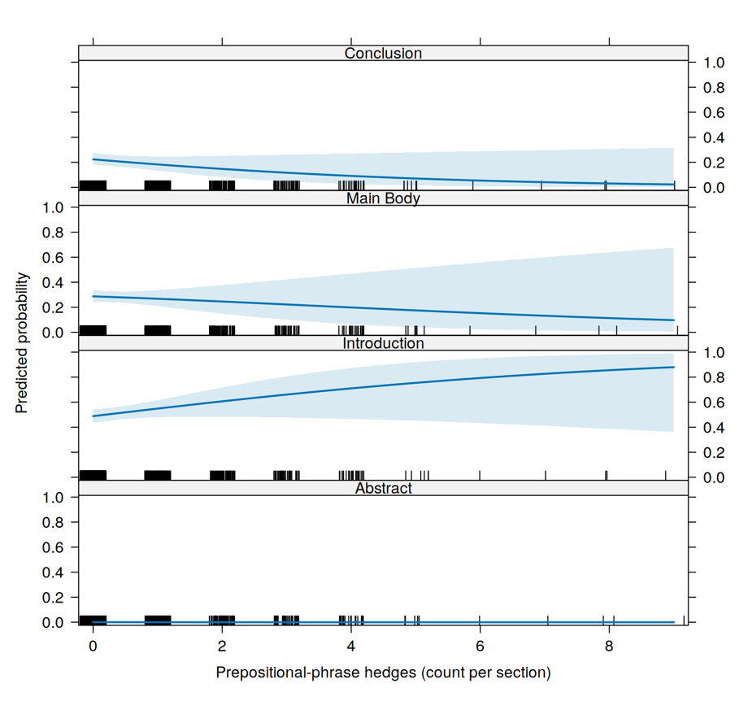
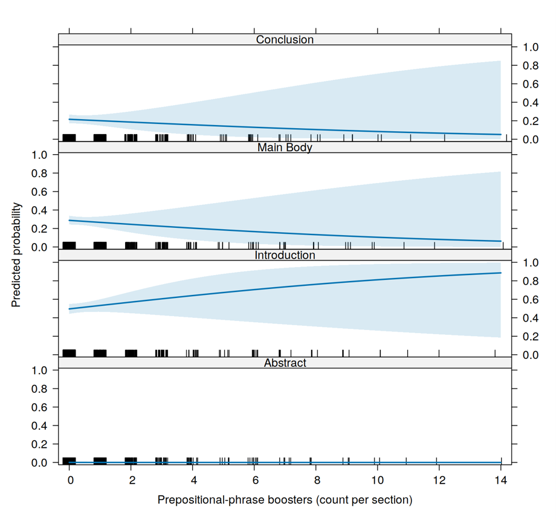
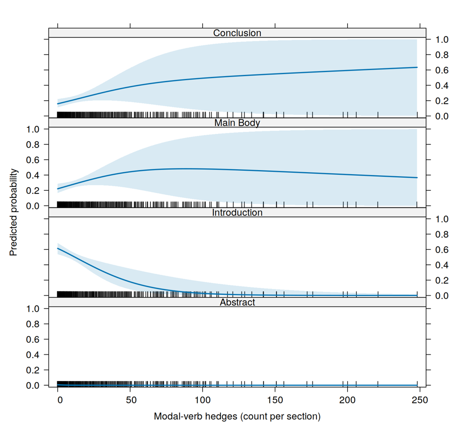
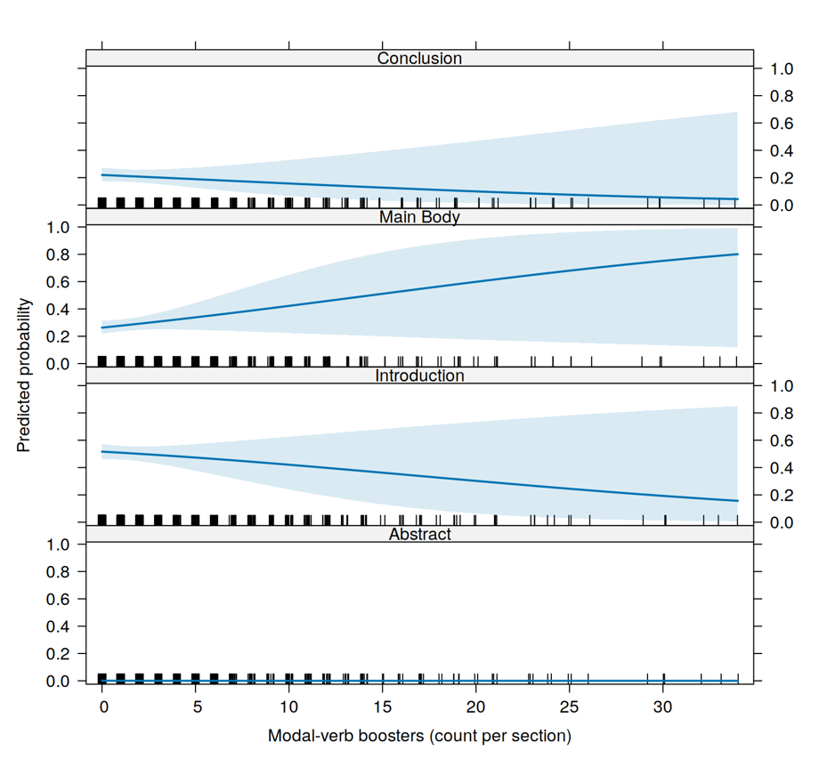
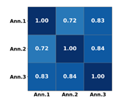

```{r}
#| include: false

library(tidyverse)
library(lingglosses)
options("lingglosses.italic_transliteration" = FALSE)
```

## Исследование и сравнительный анализ вариативности обозначения причинно-следственных связей в текстах обучающихся и экспертов, языковых особенностей и возможности орфокоррекции учебных текстов

### Новые корпусы ИИ-сгенерированных текстов

В рамках работы были созданы новые корпусы ИИ-сгенерированных текстов, которые послужат основой для дальнейших исследований лингвистических различий между текстами человека и ИИ.

#### Корпус аннотаций научных статей

Корпус текстов, написанных человеком, был составлен из аннотаций научных статей, опубликованных в ведущих международных журналах в 2016--2020 гг., то есть до широкого публичного и коммерческого внедрения генеративных ИИ-инструментов. Корпус был спроектирован для охвата широкого спектра академического дискурса: в него вошли публикации двух основных дисциплинарных семей -- точных и гуманитарных наук. Термины точные («hard») и гуманитарные («soft»), часто связываемые со Сторером [@Storer1967], используются для сравнения академических областей с точки зрения методологической точности, объективности и строгости. Хотя некоторые исследователи утверждают, что дихотомия hard/soft не всегда отражает вариативность знания (см., например, @BecherTrowler2001; @Nesi2002), она может использоваться как удобное условное обозначение при характеристике разнообразия академического дискурса [@Dang2018]. Наш подкорпус точных наук, на основе которого создавался ИИ-корпус, включает статьи по химии, физике, математике и инженерии; подкорпус гуманитарных наук- тексты в области менеджмента, истории, лингвистики и политологии.

Корпус ИИ-текстов состоит из такого же количества аннотаций, сгенерированных DeepSeek-V2 по следующему промпту: «Ты исследователь, который собирается отправить статью в авторитетный журнал, основываясь на тексте \[текст статьи без прилагаемой аннотации\], напиши аннотацию объемом примерно в XXX слов \[количество слов определено исходя из фактической длины оригинальной аннотации\], используй академический стиль изложения». Дата отсечения знаний модели --- июль 2024 г. Каждый промпт запускался в новой сессии. Размер и детали корпуса приведены в таблице -@tbl-corpora_lab_1.


```{r}
#| echo: false
#| warning: false
#| message: false
#| label: tbl-corpora_lab_1
#| tbl-cap: "Дизайн и размер корпуса аннотаций"

library(flextable)
library(officer)

# Section headings occupy ordinary body rows, merged below.
dat <- data.frame(
  subject = c(
    "ТОЧНЫЕ НАУКИ",
    "Химия",
    "Физика",
    "Математика",
    "Инженерия",
    "Всего",
    "СОЦИОГУМАНИТАРНЫЕ НАУКИ",
    "Экономика",
    "Лингвистика",
    "История",
    "Политология",
    "Всего"
  ),
  human_n = c(
    NA, 25, 27, 28, 21, 101,
    NA, 20, 22, 21, 25, 88
  ),
  human_words = c(
    NA, 4030, 3497, 3174, 3872, 14573,
    NA, 3158, 4032, 3614, 3952, 14756
  ),
  ai_n = c(
    NA, 25, 27, 28, 21, 101,
    NA, 20, 22, 21, 25, 88
  ),
  ai_words = c(
    NA, 4040, 3526, 3611, 3850, 15027,
    NA, 3057, 3690, 3575, 4293, 14615
  ),
  stringsAsFactors = FALSE
)

section_rows <- c(1, 7)
numeric_cols <- c("human_n", "human_words", "ai_n", "ai_words")

rule <- fp_border(color = "black", width = 0.6)

ft <- flextable(dat)

# Lower header row.
ft <- set_header_labels(
  ft,
  subject     = "Предметная\nобласть",
  human_n     = "Кол-во\nаннотаций",
  human_words = "Слов всего",
  ai_n        = "Кол-во\nаннотаций",
  ai_words    = "Слов всего"
)

# Upper header row: 1 ungrouped column + 2 pairs of columns.
ft <- add_header_row(
  ft,
  values = c(
    "",
    "Человеко-сгенерированные\nтексты",
    "ИИ-сгенерированные тексты"
  ),
  colwidths = c(1, 2, 2),
  top = TRUE
)

# Full-width section headings.
for (r in section_rows) {
  ft <- merge_at(
    ft,
    i = r,
    j = 1:5,
    part = "body"
  )
}

# Preserve integer formatting, with no thousands separator.
ft <- colformat_int(
  ft,
  j = numeric_cols,
  big.mark = "",
  na_str = ""
)

# Typography.
ft <- fontsize(ft, size = 11, part = "all")
ft <- bold(ft, bold = FALSE, part = "all")
ft <- color(ft, color = "black", part = "all")
ft <- bg(ft, bg = "white", part = "all")
ft <- valign(ft, valign = "center", part = "all")

# Alignments.
ft <- align(ft, align = "center", part = "all")
ft <- align(
  ft,
  j = "subject",
  align = "left",
  part = "body"
)
ft <- align(
  ft,
  i = 2,
  j = "subject",
  align = "left",
  part = "header"
)
ft <- align(
  ft,
  i = section_rows,
  j = 1:5,
  align = "center",
  part = "body"
)

# Compact spacing.
ft <- padding(
  ft,
  padding.top = 3,
  padding.bottom = 3,
  padding.left = 5,
  padding.right = 5,
  part = "all"
)

# Explicit widths, in inches; total width = 6.3 inches.
ft <- width(
  ft,
  j = 1:5,
  width = c(1.65, 1.00, 1.30, 1.00, 1.35)
)

ft <- set_table_properties(
  ft,
  layout = "fixed",
  align = "center",
  opts_word = list(
    split = FALSE,
    repeat_headers = TRUE
  ),
  opts_pdf = list(
    float = "none"
  )
)

# Remove default borders, then draw horizontal rules only.
ft <- border_remove(ft)

ft <- hline_top(ft, border = rule, part = "header")
ft <- hline(ft, i = 1, border = rule, part = "header")
ft <- hline_bottom(ft, border = rule, part = "header")

ft <- hline(ft, border = rule, part = "body")
ft <- hline_bottom(ft, border = rule, part = "body")

# Normalize borders around merged cells.
ft <- fix_border_issues(ft)

# Leave the flextable as the final expression for Quarto rendering.
ft
```

#### Корпус эссе

Этот корпус опирается на два существующих человеческих корпуса: LOCNESS [@Granger1998] и WriCLE [@RollinsonMendikoetxea2010]. Для каждого из них были созданы параллельные ИИ-подкорпусы с сохранением тем и количества текстов.

**LOCNESS_ai** состоит из аргументативных эссе, написанных носителями английского языка -- британскими (144 текста) и американскими (178 текстов) студентами. Темы охватывают широкий спектр социальных, политических и этических вопросов: от охоты на лис и генетики до эвтаназии и ядерной энергии.

Тексты LOCNESS_ai были сгенерированы на те же темы и в том же количестве с использованием двух моделей: (1) ChatGPT (GPT-5) от OpenAI через веб-интерфейс в период с ноября 2025 г. по февраль 2026 г. и (2) GigaChat (GigaChat 3.5 Ultra) от Сбера в сентябре 2026 г. Конкретные идентификаторы развёрнутых версий LLM не были публично доступны. Заявленная дата отсечения знаний ChatGPT -- примерно конец 2024 г., GigaChat -- начало 2026 г. В обоих случаях использовались одни и те же промпты.

**WriCLE_ai** [@RollinsonMendikoetxea2010] был составлен в Universidad Autónoma de Madrid. Он включает аргументативные эссе, написанные студентами с родным испанским языком, изучающими английский в рамках академического модуля письма; в корпус вошли работы студентов первого и третьего курсов. Уровень владения языком оценивался с помощью Oxford Quick Placement Test: баллы варьировались от 57 до 90, средний - 72 (уровни B1-C1 по CEFR). Темы эссе: аборт, анорексия, жестокое обращение с детьми, клонирование, домашнее насилие, однополые браки, оружейная политика, иммиграция, социальные проблемы, марихуана, пиратство ПО, проституция, религия, половое воспитание, закон против табака, испанское образование, терроризм, правила дорожного движения и дорожные проблемы.

Тексты WriCLE_ai были сгенерированы на те же темы и в том же количестве с использованием тех же моделей и в те же сроки: ChatGPT (GPT-5) через веб-интерфейс в ноябре 2025 г. -- феврале 2026 г. и GigaChat (GigaChat 3.5 Ultra) в сентябре 2026 г. Как и для LOCNESS_ai, конкретные версии моделей не были публично доступны; дата отсечения знаний ChatGPT -- конец 2024 г., GigaChat -- начало 2026 г.; использовались одинаковые промпты.

Генерация промптов для обоих корпусов включала два этапа. Сначала модели подавались несколько образцов эссе на соответствующую тему и промпт: «These are some samples of argumentative essays American university students had to write on the topic "XXX". What task were they given? Formulate the topic and 4-5 bullet points they had to cover in a concise way.» - для LOCNESS_ai; аналогичный промпт использовался для WriCLE_ai с указанием, что речь идет об эссе испанских студентов, изучающих английский как иностранный. Затем на основе ответа создавался итоговый промпт, который и использовался для генерации эссе.

Объем и состав корпусов представлены в таблице -@tbl-corpora_lab_2.


| **Корпус**             | **Кол-во текстов** | **Кол-во токенов** | **Ср. длина текстов** |
|------------------|------------------|------------------|------------------|
| LOCNESS_hum            | 322                | 230540             | 716                   |
| LOCNESS_ai_ChatGPT     | 322                | 213810             | 664                   |
| LOCNESS_ai_GigaChat    | 322                | 291413             | 905                   |
| WriCLE_hum             | 583                | 506235             | 868                   |
| WriCLE_ai\_ ChatGPT    | 583                | 585176             | 1004                  |
| WriCLE \_ai\_ GigaChat | 583                | 779730             | 1337                  |
: Дизайн и размер корпуса эссе {#tbl-corpora_lab_2}

Созданные корпусы образуют сопоставимую базу для дальнейшего анализа лингвистических различий между текстами человека и ИИ, в том числе с учетом дисциплинарной принадлежности и языкового бэкграунда авторов.

### Количественный и качественный анализ выражения авторской позиции в различных структурных частях академических текстов

Для сравнения текстов, написанных студентами на английском языке, и особенностей оригинальных научных статей, написанных его носителями, было проанализировано то, как авторская позиция выражается в различных структурных частях этих научных статей. В фокусе внимания исследования в 2026 году были хеджи и бустеры --- ключевые маркеры эпистемической осторожности и уверенности, которые позволяют авторам позиционировать себя по отношению к своим утверждениям, читателям и дисциплинарному сообществу [@Hyland1998]. Существующие работы здесь часто ограничены одной дисциплиной или рассматривают эти маркеры как широкие категории, не учитывая их грамматические реализации. Проведенное предлагает крупномасштабный анализ двенадцати грамматических категорий хеджей и бустеров в четырех разделах научных статей: аннотации, введении, основной части и заключении.

Корпус исследования включает 576 статей из ведущих международных журналов, индексируемых в Scopus и опубликованных в 2022--2024 гг. Статьи представляют двенадцать дисциплин, сгруппированных в четыре области: искусство и гуманитарные науки (история, философия, литература), социальные науки (лингвистика, право, политология), науки о жизни (химия, медицина, биология) и физические науки (астрономия, геология, физика). Общий объем корпуса составляет около 4,6 млн слов (см. таблицу -@tbl-corpora_lab_3). Все нелингвистические элементы (таблицы, рисунки, формулы, ссылки) были удалены. Разделы выделялись на основе авторских заголовков; всё, что находилось между введением и заключением (обзоры литературы, методы, результаты, обсуждения), было агрегировано в «основную часть», которая служит внутренним базисом для сравнения. Такой подход обусловлен значительной вариативностью структуры статей в разных дисциплинах: даже эмпирические статьи редко следуют канонической последовательности IMRD [@LinEvans2012], а гуманитарные работы часто организованы тематически.

```{r}
#| echo: false
#| warning: false
#| message: false
#| label: tbl-corpora_lab_3
#| tbl-cap: "Размер корпуса"

library(flextable)
library(officer)

subjects <- c(
  "Гуманитарные\nисследования",
  "Социология",
  "Науки о жизни",
  "Физика",
  "Итого"
)

dat <- data.frame(
  section = c(
    rep("Аннотация", 4), "",
    rep("Введение", 4), "",
    rep("Основная часть", 4), "",
    rep("Заключение", 4), "",
    "Итого"
  ),
  subject = c(
    rep(subjects, 4),
    ""
  ),
  texts = c(
    rep(c(144, 144, 144, 144, 576), 4),
    2304
  ),
  tokens = c(
    35009, 31819, 47670, 33136, 147634,
    174970, 168338, 110136, 131431, 584875,
    950047, 1175402, 607149, 844665, 3577263,
    113173, 113628, 32483, 64250, 323534,
    4633306
  ),
  stringsAsFactors = FALSE
)

subtotal_rows <- c(5, 10, 15, 20)
grand_total_row <- 21

rule <- fp_border(color = "black", width = 0.6)

ft <- flextable(dat)

ft <- set_header_labels(
  ft,
  section = "Раздел",
  subject = "Предм. область",
  texts   = "Кол-во\nтекстов",
  tokens  = "Кол-во токенов"
)

# Merge each section name across its four subject rows.
# Subtotal rows remain outside the merged cells.
for (start in c(1, 6, 11, 16)) {
  ft <- merge_at(
    ft,
    i = start:(start + 3),
    j = "section",
    part = "body"
  )
}

# Integer formatting with comma thousands separators.
ft <- colformat_int(
  ft,
  j = c("texts", "tokens"),
  big.mark = ",",
  na_str = ""
)

# Base typography.
ft <- fontsize(ft, size = 11, part = "all")
ft <- bold(ft, bold = FALSE, part = "all")
ft <- italic(ft, italic = FALSE, part = "all")
ft <- color(ft, color = "black", part = "all")
ft <- bg(ft, bg = "white", part = "all")

# Text columns left-aligned; numeric columns right-aligned.
ft <- align(
  ft,
  j = c("section", "subject"),
  align = "left",
  part = "all"
)
ft <- align(
  ft,
  j = c("texts", "tokens"),
  align = "right",
  part = "all"
)

# Section labels and multiline cells align to the top.
ft <- valign(ft, valign = "top", part = "all")

# Italicize the subtotal label and its two numbers.
ft <- italic(
  ft,
  i = subtotal_rows,
  j = c("subject", "texts", "tokens"),
  italic = TRUE,
  part = "body"
)

ft <- padding(
  ft,
  padding.top = 3,
  padding.bottom = 3,
  padding.left = 5,
  padding.right = 5,
  part = "all"
)

# Widths in inches; total width = 6.3 inches.
ft <- width(
  ft,
  j = 1:4,
  width = c(1.55, 2.00, 1.25, 1.50)
)

ft <- set_table_properties(
  ft,
  layout = "fixed",
  align = "center",
  opts_word = list(
    split = FALSE,
    repeat_headers = TRUE
  ),
  opts_pdf = list(
    float = "none"
  )
)

# Begin with no borders.
ft <- border_remove(ft)

# Top border and rule under the header.
ft <- hline_top(ft, border = rule, part = "header")
ft <- hline_bottom(ft, border = rule, part = "header")

# Full-width rules immediately above the first three subtotals.
ft <- hline(
  ft,
  i = c(4, 9, 14),
  j = 1:4,
  border = rule,
  part = "body"
)

# In the source image, the final subtotal has a short rule
# above its label, rather than a full-width rule.
ft <- hline(
  ft,
  i = 19,
  j = "subject",
  border = rule,
  part = "body"
)

# Bottom border beneath the grand total.
ft <- hline(
  ft,
  i = grand_total_row,
  j = 1:4,
  border = rule,
  part = "body"
)

ft <- fix_border_issues(ft)

ft
```

Маркеры позиции отбирались на основе списков из [@Hyland2005] с дополнениями из других исследований и были сгруппированы по грамматической форме: именные группы, предложные группы, прилагательные, наречия, лексические глаголы и модальные глаголы. Частоты сравнивались как количество вхождений на 1000 слов, поскольку секции существенно различаются по длине.

Для ответа на исследовательский вопрос о вариативности хеджей и бустеров по секциям применялись тесты хи-квадрат. Сначала проводились омнибусные тесты для каждой категории, затем попарные сравнения каждой секции с основной частью с использованием %DIFF в качестве размера эффекта. Результаты омнибусных тестов (см. таблицу -@tbl-corpora_lab_4) показали, что частотность большинства категорий зависит от секции. Исключение составили именные, предложные и адъективные хеджи, а также именные бустеры. Среди хеджей значимая вариативность ограничена модальными глаголами, лексическими глаголами и наречиями; среди бустеров --- всеми категориями, кроме именных.


```{r}
#| echo: false
#| warning: false
#| message: false
#| label: tbl-corpora_lab_4
#| tbl-cap: "Омнибусные тесты секционной вариативности по категориям хеджей и бустеров (*df* = 3)"

library(flextable)
library(officer)

dat <- data.frame(
  category = c(
    "Все хеджи",
    "Хеджи в именных группах",
    "Хеджи в предложных группах",
    "Хеджи в прилагательных",
    "Хеджи в наречиях",
    "Хеджи в глагольных группах",
    "Хеджи с модальными глаголами",
    "Все бустеры",
    "Бустеры в именных группах",
    "Бустеры в предложных группах",
    "Бустеры в прилагательных",
    "Бустеры в наречиях",
    "Бустеры в глагольных группах",
    "Бустеры с модальными глаголами"
  ),
  chi_sq = c(
    171.51, 7.79, 5.08, 2.25, 11.33, 97.47, 238.01,
    85.57, 0.80, 15.69, 25.64, 137.06, 35.56, 35.61
  ),
  significance = c(
    "***", "ø", "ø", "ø", "*", "***", "***",
    "***", "ø", "**", "***", "***", "***", "***"
  ),
  stringsAsFactors = FALSE
)

rule <- fp_border(color = "black", width = 0.6)

ft <- flextable(dat)

ft <- set_header_labels(
  ft,
  category = "Категория",
  chi_sq = "χ²",
  significance = "Значимость"
)

# Fixed caption; do not also supply a Quarto tbl-cap.


# Typography.
ft <- fontsize(ft, size = 11, part = "all")
ft <- bold(ft, bold = FALSE, part = "all")
ft <- color(ft, color = "black", part = "all")
ft <- bg(ft, bg = "white", part = "all")
ft <- valign(ft, valign = "center", part = "all")

# Retain two decimal places, including trailing zeros.
ft <- colformat_double(
  ft,
  j = "chi_sq",
  digits = 2,
  decimal.mark = ".",
  big.mark = ""
)

# Alignments.
ft <- align(ft, j = "category", align = "left", part = "all")
ft <- align(ft, j = "chi_sq", align = "right", part = "all")
ft <- align(
  ft,
  j = "significance",
  align = "center",
  part = "all"
)

ft <- bold(
  ft,
  j = "significance",
  bold = TRUE,
  part = "body"
)

# Spacing.
ft <- padding(
  ft,
  padding.top = 3,
  padding.bottom = 3,
  padding.left = 5,
  padding.right = 5,
  part = "all"
)

# Widths in inches; total width = 6.3 inches.
ft <- width(
  ft,
  j = 1:3,
  width = c(3.85, 1.00, 1.45)
)

ft <- set_table_properties(
  ft,
  layout = "fixed",
  align = "center",
  opts_word = list(
    split = FALSE,
    repeat_headers = TRUE
  ),
  opts_pdf = list(
    float = "none"
  )
)

# Horizontal rules only.
ft <- border_remove(ft)
ft <- hline_top(ft, border = rule, part = "header")
ft <- hline_bottom(ft, border = rule, part = "header")

# Preserve the internal separator shown in the source.
ft <- hline(
  ft,
  i = 6,
  border = rule,
  part = "body"
)

ft <- hline_bottom(ft, border = rule, part = "body")
ft <- fix_border_issues(ft)

ft
```

*Примечание.* \* *p* \< .05 (χ² \> 7.815); \*\* *p* \< .01 (χ² \> 11.345); \*\*\* *p* \< .001 (χ² \> 16.266); **∅** = значимость отсутствует.

Попарные сравнения общих частот (см. таблицу -@tbl-corpora_lab_5) выявили, что в аннотациях и введениях как хеджи, так и бустеры встречаются примерно на 10--13% реже, чем в основной части. Заключения, напротив, демонстрируют противоположную тенденцию: в них на 13% больше хеджей и на 9% больше бустеров, что делает их наиболее насыщенной маркерами позиции секцией. Однако это справедливо не для всех областей: в искусстве и гуманитарных науках заключения содержат меньше хеджей и бустеров, чем основная часть.


```{r}
#| echo: false
#| warning: false
#| message: false
#| label: tbl-corpora_lab_5
#| tbl-cap: "Результаты попарного сравнения частотности хеджей и бустеров в аннотациях, введениях и заключениях с основной частью"

library(flextable)
library(officer)

dat <- data.frame(
  category = c(
    rep("Все хеджи", 3),
    rep("Все бустеры", 3)
  ),
  section = rep(
    c("Аннотация", "Введение", "Заключение"),
    2
  ),
  pct_diff = c(
    -12.96, -9.88, 12.53,
    -10.80, -10.91, 8.50
  ),
  ci = c(
    "−17.1,\n−8.6",
    "−12.1,\n−7.6",
    "9.2, 15.9",
    "−16.1,\n−5.2",
    "−13.7,\n−8.0",
    "4.4, 12.8"
  ),
  chi_sq = c(
    31.39, 65.19, 60.45,
    13.47, 49.26, 17.27
  ),
  significance = rep("***", 6),
  stringsAsFactors = FALSE
)

rule <- fp_border(color = "black", width = 0.6)

ft <- flextable(dat)

ft <- set_header_labels(
  ft,
  category = "Категория",
  section = "Раздел",
  pct_diff = "%DIFF",
  ci = "95% CI",
  chi_sq = "χ²",
  significance = "значимость"
)

# Merge category labels across their three section rows.
ft <- merge_at(
  ft,
  i = 1:3,
  j = "category",
  part = "body"
)

ft <- merge_at(
  ft,
  i = 4:6,
  j = "category",
  part = "body"
)

# Preserve two decimal places.
ft <- colformat_double(
  ft,
  j = c("pct_diff", "chi_sq"),
  digits = 2,
  decimal.mark = ".",
  big.mark = ""
)

# No font family or size is specified.
ft <- bold(ft, bold = FALSE, part = "all")

# Alignments.
ft <- align(
  ft,
  j = c("category", "section"),
  align = "left",
  part = "all"
)

ft <- align(
  ft,
  j = c("pct_diff", "chi_sq"),
  align = "right",
  part = "all"
)

ft <- align(
  ft,
  j = c("ci", "significance"),
  align = "center",
  part = "all"
)

# Keep category names at the top of their merged cells.
ft <- valign(ft, valign = "top", part = "all")

ft <- bold(
  ft,
  j = "significance",
  bold = TRUE,
  part = "body"
)

# Cell spacing.
ft <- padding(
  ft,
  padding.top = 4,
  padding.bottom = 4,
  padding.left = 5,
  padding.right = 5,
  part = "all"
)

# Widths in inches; total width = 6.5 inches.
ft <- width(
  ft,
  j = 1:6,
  width = c(1.25, 1.40, 0.80, 1.20, 0.75, 1.10)
)

ft <- set_table_properties(
  ft,
  layout = "fixed",
  align = "center",
  opts_word = list(
    split = FALSE,
    repeat_headers = TRUE
  ),
  opts_pdf = list(
    float = "none"
  )
)

# Horizontal rules only.
ft <- border_remove(ft)

ft <- hline_top(ft, border = rule, part = "header")
ft <- hline_bottom(ft, border = rule, part = "header")

# Separator between hedges and boosters.
ft <- hline(
  ft,
  i = 3,
  border = rule,
  part = "body"
)

ft <- hline_bottom(ft, border = rule, part = "body")

ft <- fix_border_issues(ft)

ft
```

*Note.* %DIFF = процентная разница в нормализованной частоте по отношению к основной части (отрицательные значения: реже, чем в основной части); 95% CI = доверительный интервал для %DIFF, выводится из соотношения. *df* = 1; \* *p* \< .05 (χ² \> 3.841); \*\* *p* \< .01 (χ² \> 6.635); \*\*\* *p* \< .001 (χ² \> 10.828).

Для ответа на исследовательский вопрос о том, насколько категории маркеров позиции могут служить прокси для идентификации разделов, была построена модель многомерной логистической регрессии. Зависимая переменная -- раздел (аннотация, введение, основная часть, заключение), референсная категория -- аннотация. Исходная модель включала все двенадцать категорий; после обратного исключения по AIC осталось девять предикторов (см. таблицу -@tbl-corpora_lab_6). Модель классифицировала 64,0% секций правильно, что выше случайного уровня (25%). Однако сравнение с моделью, основанной только на длине секции (см. таблицу -@tbl-corpora_lab_7), показало, что только длина классифицирует секции точнее (69,4%). Добавление плотности маркеров позиции к длине улучшает модель значимо, но умеренно (72,8%). Таким образом, маркеры позиции несут достоверную, но ограниченную информацию о принадлежности к секции. Наиболее ценными оказываются модальные глаголы-хеджи и бустеры (различают заключения), лексические глаголы-бустеры и адъективные хеджи (различают основную часть), а также лексические глаголы-хеджи (редки во введениях).

```{r}
#| echo: false
#| warning: false
#| message: false
#| label: tbl-corpora_lab_6
#| tbl-cap: "Результаты мультиномиальной логистической регрессионной модели"

library(flextable)
library(officer)

predictors <- c(
  "Свободный член",
  "Хеджи с именными группами",
  "Хеджи с прилагательными",
  "Хеджи с наречиями",
  "Хеджи в глагольных группах",
  "Хеджи с модальными глаголами",
  "Бустеры с именными группами",
  "Бустеры с наречиями",
  "Бустеры в глагольных группах",
  "Бустеры с модальными глаголами"
)

dat <- data.frame(
  section = rep(
    c("Введение", "Основная часть", "Заключение"),
    each = 10
  ),
  predictor = rep(predictors, 3),
  b = c(
    # Введение
    -1.700, 0.892, 0.275, 0.172, 0.017,
     0.214, 1.270, 0.417, 0.214, 0.529,

    # Основная часть
    -5.420, 0.706, 0.597, 0.153, 0.161,
     0.253, 1.120, 0.407, 0.385, 0.597,

    # Заключение
    -1.146, 0.574, 0.053, 0.028, 0.054,
     0.256, 1.126, 0.511, 0.116, 0.516
  ),
  se = c(
    # Введение
    0.109, 0.333, 0.157, 0.043, 0.050,
    0.037, 0.555, 0.113, 0.035, 0.132,

    # Основная часть
    0.237, 0.368, 0.172, 0.046, 0.054,
    0.038, 0.570, 0.115, 0.038, 0.139,

    # Заключение
    0.101, 0.337, 0.160, 0.044, 0.050,
    0.037, 0.555, 0.112, 0.035, 0.131
  ),
  significance = c(
    # Введение
    "***", "**", "∅", "***", "∅",
    "***", "*", "***", "***", "***",

    # Основная часть
    "***", "∅", "***", "***", "**",
    "***", "*", "***", "***", "***",

    # Заключение
    "***", "∅", "∅", "∅", "∅",
    "***", "*", "***", "***", "***"
  ),
  stringsAsFactors = FALSE
)

rule <- fp_border(color = "black", width = 0.6)

ft <- flextable(dat)

ft <- set_header_labels(
  ft,
  section = "Раздел",
  predictor = "Предиктор",
  b = "b",
  se = "SE",
  significance = "Значимость"
)

# Merge each section label across its ten predictor rows.
for (start in c(1, 11, 21)) {
  ft <- merge_at(
    ft,
    i = start:(start + 9),
    j = "section",
    part = "body"
  )
}

# Preserve three decimal places, including trailing zeros.
ft <- colformat_double(
  ft,
  j = c("b", "se"),
  digits = 3,
  decimal.mark = ".",
  big.mark = ""
)

# No font family or size is specified.
ft <- bold(ft, bold = FALSE, part = "all")
ft <- italic(ft, italic = FALSE, part = "all")

# Italic statistical symbols in the header.
ft <- italic(
  ft,
  j = c("b", "se"),
  italic = TRUE,
  part = "header"
)

# Text columns left-aligned; numeric columns right-aligned.
ft <- align(
  ft,
  j = c("section", "predictor"),
  align = "left",
  part = "all"
)

ft <- align(
  ft,
  j = c("b", "se"),
  align = "right",
  part = "all"
)

ft <- align(
  ft,
  j = "significance",
  align = "center",
  part = "all"
)

# Position merged section labels at the top of each block.
ft <- valign(ft, valign = "top", part = "all")

# Compact spacing for the 30-row table.
ft <- padding(
  ft,
  padding.top = 3,
  padding.bottom = 3,
  padding.left = 5,
  padding.right = 5,
  part = "all"
)

# Widths in inches; total width = 6.5 inches.
ft <- width(
  ft,
  j = 1:5,
  width = c(1.20, 2.85, 0.65, 0.65, 1.15)
)

ft <- set_table_properties(
  ft,
  layout = "fixed",
  align = "center",
  opts_word = list(
    split = FALSE,
    repeat_headers = TRUE
  ),
  opts_pdf = list(
    float = "none"
  )
)

# Horizontal rules only.
ft <- border_remove(ft)

ft <- hline_top(ft, border = rule, part = "header")
ft <- hline_bottom(ft, border = rule, part = "header")

# Separators between the three section blocks.
ft <- hline(
  ft,
  i = c(10, 20),
  border = rule,
  part = "body"
)

ft <- hline_bottom(ft, border = rule, part = "body")

ft <- fix_border_issues(ft)

ft
```

*Примечание.* *N* = 2,304 разделов; предикторы показаны по количеству разделов. *b* = значение (изменение логарифмических коэффициентов раздела относительно реферата на единицу увеличения количества); *SE* = Стандартная ошибка. Значимость получена по z-тесту Уолда (*z* = *b*/*SE*): \* *p* \< .05; \*\* *p* \< .01; \*\*\* *p* \< .001; **∅** = значимость отсутствует.

| Модель                                    | Точность | Точность кросс-валидации | McFadden *R*² | AIC    |
|---------------|---------------|---------------|---------------|---------------|
| Исходные данные по девяти категориям      | 63.9%    | 63.1%                    | .399          | 3896.3 |
| Только длина раздела (лог-маркеры)        | 69.4%    | 69.4%                    | .465          | 3428.1 |
| Расценки на 1000 слов в девяти категориях | 40.8%    | 40.5%                    | .058          | 6073.9 |
| Длина раздела + расценки                  | 72.8%    | 72.2%                    | .509          | 3203.8 |
:Классификация по моделям без длины раздела и с ней (все поля; *N* = 2,303) {#tbl-corpora_lab_7}

*Примечание.* Модели мультиномиальной логистической регрессии с девятью категориями итоговой модели; одно из заключений нулевой длины было исключено. Точность = по текстам; Точность кросс-валидации = 10-кратная кросс-валидация с группировкой по статьям; вероятность = 25%. Длина с вероятностями против только длины: χ²(27) = 278.30, *p* \< .001.

Графики (-@fig-corpora_lab_1)--(-@fig-corpora_lab_4) иллюстрируют предсказанные вероятности секций в зависимости от частоты отдельных категорий.

{#fig-corpora_lab_1}

{#fig-corpora_lab_2}

{#fig-corpora_lab_3}

{#fig-corpora_lab_4}

Например, с ростом предложных хеджей (см. рисунок @fig-corpora_lab_1) и предложных бустеров (см. рисунок @fig-corpora_lab_2) растёт вероятность того, что раздел является введением. Модальные глаголы-хеджи (см. рисунок @fig-corpora_lab_3) показывают наиболее контрастную картину: с увеличением их частоты вероятность принадлежности к введению резко падает, а вероятность того, что текст относится к заключению и основной части растёт. Модальные глаголы-бустеры (см. рисунок @fig-corpora_lab_4) ассоциированы с повышением вероятности принадлежности к основной части и снижением вероятности того, что текст является введением.

Полученные результаты уточняют существующие представления о вариативности позиции в научных статьях. Во-первых, вариативность является формо-специфичной: для хеджей секционные различия почти полностью обеспечиваются глаголами, тогда как именные, предложные и адъективные хеджи остаются стабильными. Бустеры, напротив, варьируются почти во всех формах. Во-вторых, аннотация и введение оказываются менее насыщенными маркерами позиции, чем основная часть, а заключение в большинстве областей -- наиболее насыщенным, прежде всего за счёт модальных глаголов-хеджей. В-третьих, при контроле длины секции маркеры позиции оказываются слабыми прокси для определения секции, что важно учитывать при разработке автоматических инструментов анализа академического текста.

Таким образом, проведенный количественный и качественный анализ показал, что выражение авторской позиции в научной статье распределено неравномерно и формо-специфично. Введения менее насыщены маркерами позиции, чем аргументативное ядро, а заключение в большинстве областей становится наиболее насыщенной секцией, прежде всего за счёт модальных глаголов-хеджей. Эти результаты вносят вклад в теоретическое описание жанра научной статьи и создают эмпирическую основу для обучения академическому письму и разработки инструментов автоматического анализа.

### Согласование в текстах носителей и неносителей английского языка

В профессиональной академической письменной речи вариативность согласования подлежащего и сказуемого по числу особенно заметна у существительных, у которых грамматическое и понятийное число расходятся: собирательных (group, team), неисчисляемых (research), существительных латинского происхождения с немаркированной формой множественного числа (data, media) и существительных на -s (series, dynamics). Одним из ключевых факторов, потенциально влияющих на выбор формы глагола, является языковой фон автора -- принадлежность к носителям (NS) или не-носителям (NNS) английского языка.

Анализ корпуса исследовательских статей (4,4 млн слов, 2022--2024 гг.) показал, что различия между NS и NNS носят преимущественно описательный характер и лишь в редких случаях достигают статистической значимости.

При собирательных существительных (group, team; 113 контекстов) носители демонстрировали несколько большую вариативность. В текстах NS доля множественного согласования оказалась выше, особенно в гуманитарных науках. Коэффициент φ для фактора «нативность» составил 0,151 (p = 0,1947), что соответствует слабому и незначимому эффекту (см. таблицу -@tbl-corpora_lab_8).

```{r}
#| echo: false
#| warning: false
#| message: false
#| label: tbl-corpora_lab_8
#| tbl-cap: "Собирательные существительные"


library(flextable)
library(officer)

dat <- data.frame(
  predictor = c(
    "Принадлежность к носителям\n(NS против NNS)",
    "Принадлежит (NS)",
    "Не принадлежит (NNS)",
    "Дисциплины (точные против\nсоциогуманитарных)",
    "Точные науки",
    "Социогуманитарные науки"
  ),
  plural = c(NA, 9, 2, NA, 3, 8),
  singular = c(NA, 58, 44, NA, 65, 37),
  phi = c(NA, 0.151, NA, NA, -0.221, NA),
  p_value = c(NA, 0.1947, NA, NA, 0.0251, NA),
  stringsAsFactors = FALSE
)

rule <- fp_border(color = "black", width = 0.6)

ft <- flextable(dat)

ft <- set_header_labels(
  ft,
  predictor = "Предиктор",
  plural = "мн.согл. (1)",
  singular = "ед. согл.\n(0)",
  phi = "Φ (phi)",
  p_value = "P-value"
)

# Fixed caption matching the source.
# Do not also add a Quarto tbl-cap for this version.

# Integer counts, with empty cells for missing values.
ft <- colformat_int(
  ft,
  j = c("plural", "singular"),
  big.mark = "",
  na_str = ""
)

# Preserve the precision shown in the source.
ft <- colformat_double(
  ft,
  j = "phi",
  digits = 3,
  decimal.mark = ".",
  big.mark = "",
  na_str = ""
)

ft <- colformat_double(
  ft,
  j = "p_value",
  digits = 4,
  decimal.mark = ".",
  big.mark = "",
  na_str = ""
)

# No font family or size is specified.
ft <- bold(ft, bold = FALSE, part = "all")
ft <- italic(ft, italic = FALSE, part = "all")

# Alignments.
ft <- align(
  ft,
  j = "predictor",
  align = "left",
  part = "all"
)

ft <- align(
  ft,
  j = c("plural", "singular", "phi", "p_value"),
  align = "center",
  part = "all"
)

ft <- valign(ft, valign = "top", part = "all")

# Cell spacing.
ft <- padding(
  ft,
  padding.top = 3,
  padding.bottom = 3,
  padding.left = 5,
  padding.right = 5,
  part = "all"
)

# Widths in inches; total width = 6.5 inches.
ft <- width(
  ft,
  j = 1:5,
  width = c(2.65, 1.10, 1.00, 0.85, 0.90)
)

ft <- set_table_properties(
  ft,
  layout = "fixed",
  align = "center",
  opts_word = list(
    split = FALSE,
    repeat_headers = TRUE
  ),
  opts_pdf = list(
    float = "none"
  )
)

# Horizontal rules only, matching the source.
ft <- border_remove(ft)

ft <- hline_top(ft, border = rule, part = "header")
ft <- hline_bottom(ft, border = rule, part = "header")
ft <- hline(ft, border = rule, part = "body")
ft <- hline_bottom(ft, border = rule, part = "body")

ft <- fix_border_issues(ft)

ft
```

Этот результат частично согласуется с данными [@Fernández-Pena2017], отмечавшей региональную и внутриязыковую вариативность согласования с собирательными существительными.

Существительное research (488 контекстов) почти всегда сочеталось с формой единственного числа. Единственные случаи множественного согласования отмечены в гуманитарных науках, преимущественно у NNS. Из-за крайне низкой частоты плюральных форм полноценный статистический анализ факторов, включая нативность, провести не удалось.

Существительное media (19 контекстов, только гуманитарные науки) показало противоположные предпочтения: носители преимущественно использовали единственное число, неносители -- множественное. Это наблюдение согласуется с выводом [@Morallo2022] о «переклассификации» носителями как существительного единственного числа, но расходится с данными Лонгманской грамматики, где плюральное согласование считалось доминирующим [@Biber1999].

Наиболее частотным и информативным оказалось существительное data (847 контекстов). В гуманитарных науках доля единственного согласования у NNS была выше, чем у NS (29 % против 25 %); аналогичная тенденция наблюдалась и в точных науках. Однако в итоговой логистической регрессионной модели фактор «нативность» не достиг значимости (оценка коэффициента −0,2730, p = 0,1496; см. таблицу -@tbl-corpora_lab_9). Доминирующим предиктором оказалась дисциплина, а не языковой фон автора.


| Значения        | Оценка  | Ст. ошибка | Z-value | Pr(\>    | z      |
|-----------------|---------|------------|---------|----------|--------|
| Свободный член  | -2.1494 | 0.4002     | -5.37   | \<0.0001 | \*\*\* |
| носитель=NS     | -0.2730 | 0.1895     | -1.44   | 0.1496   |        |
| дисциплина=bio  | -0.3385 | 0.5063     | -0.67   | 0.5038   |        |
| дисциплина=chem | 1.0531  | 0.5002     | 2.11    | 0.0353   | \*     |
| дисциплина=geo  | -0.9214 | 0.5332     | -1.73   | 0.0840   | .      |
| дисциплина=hist | 1.0365  | 0.5116     | 2.03    | 0.0428   | \*     |
| дисциплина=law  | 0.7717  | 0.4253     | 1.81    | 0.0696   | .      |
| дисциплина=ling | 0.8609  | 0.4223     | 2.04    | 0.0415   | \*     |
| дисциплина=lit  | 3.7232  | 0.8703     | 4.28    | \<0.0001 | \*\*\* |
| дисциплина=med  | 0.9935  | 0.4263     | 2.33    | 0.0198   | \*     |
| дисциплина=phil | 2.0402  | 0.8570     | 2.38    | 0.0173   | \*     |
| дисциплина=phys | 1.3788  | 0.5020     | 2.75    | 0.0060   | \*\*   |
| дисциплина=pol  | 0.3755  | 0.4810     | 0.78    | 0.4350   |        |
| пре-модальность | 0.4016  | 0.1069     | 3.76    | 0.0002   | \*\*\* |
| экзистивность   | 0.5484  | 0.1948     | 2.81    | 0.0049   | \*\*   |
| каузатив        | -1.5056 | 1.0338     | -1.46   | 0.1453   |        |
:Результаты финальной регрессионной модели {#tbl-corpora_lab_9}

Для существительных на -s (series, dynamics; 85 контекстов) картина также неоднородна. Носители чаще использовали единственное число с series, тогда как неносители -- с dynamics. Коэффициент φ для нативности составил всего 0,047 (p = 0,662), что указывает на полное отсутствие статистически значимой связи (см. таблицу -@tbl-corpora_lab_10).

```{r}
#| echo: false
#| warning: false
#| message: false
#| label: tbl-corpora_lab_10
#| tbl-cap: "Формы единственного числа, оканчивающиеся на -s"

library(flextable)
library(officer)

dat <- data.frame(
  predictor = c(
    "Принадлежность к носителям\n(NS против NNS)",
    "Принадлежит (NS)",
    "Не принадлежит (NNS)",
    "Дисциплины (точные против\nсоциогуманитарных)",
    "Точные науки",
    "Социогуманитарные науки"
  ),
  plural = c(NA, 24, 32, NA, 26, 30),
  singular = c(NA, 11, 18, NA, 22, 7),
  phi = c(NA, 0.047, NA, NA, 0.281, NA),
  p_value = c(NA, 0.662, NA, NA, 0.009, NA),
  stringsAsFactors = FALSE
)

rule <- fp_border(color = "black", width = 0.6)

ft <- flextable(dat)

ft <- set_header_labels(
  ft,
  predictor = "Предиктор",
  plural = "мн.согл.\n(1)",
  singular = "ед. согл. (0)",
  phi = "Φ (phi)",
  p_value = "P-value"
)

# Integer counts; missing values appear as blank cells.
ft <- colformat_int(
  ft,
  j = c("plural", "singular"),
  big.mark = "",
  na_str = ""
)

# Three decimal places for both statistical columns.
ft <- colformat_double(
  ft,
  j = c("phi", "p_value"),
  digits = 3,
  decimal.mark = ".",
  big.mark = "",
  na_str = ""
)

# Use existing flextable font defaults.
ft <- bold(ft, bold = FALSE, part = "all")
ft <- italic(ft, italic = FALSE, part = "all")

# Alignments.
ft <- align(
  ft,
  j = "predictor",
  align = "left",
  part = "all"
)

ft <- align(
  ft,
  j = c("plural", "singular", "phi", "p_value"),
  align = "center",
  part = "all"
)

ft <- valign(ft, valign = "top", part = "all")

# Cell spacing.
ft <- padding(
  ft,
  padding.top = 3,
  padding.bottom = 3,
  padding.left = 5,
  padding.right = 5,
  part = "all"
)

# Widths in inches; total width = 6.5 inches.
ft <- width(
  ft,
  j = 1:5,
  width = c(2.65, 1.00, 1.10, 0.85, 0.90)
)

ft <- set_table_properties(
  ft,
  layout = "fixed",
  align = "center",
  opts_word = list(
    split = FALSE,
    repeat_headers = TRUE
  ),
  opts_pdf = list(
    float = "none"
  )
)

# Horizontal rules only.
ft <- border_remove(ft)

ft <- hline_top(ft, border = rule, part = "header")
ft <- hline_bottom(ft, border = rule, part = "header")
ft <- hline(ft, border = rule, part = "body")
ft <- hline_bottom(ft, border = rule, part = "body")

ft <- fix_border_issues(ft)

ft
```

В целом результаты подтверждают наблюдения предыдущих исследований: носители чаще опираются на семантические и контекстуальные подсказки, тогда как неносители в большей степени ориентируются на формальные правила, усвоенные в ходе обучения [@Al-Shaer2005; @Tsang2017]. Вместе с тем в профессиональном академическом дискурсе, прошедшем редакторскую и рецензионную обработку, эти различия существенно сглаживаются. Дисциплинарные конвенции и синтаксическое окружение оказываются более сильными предикторами, чем языковой статус автора.

Таким образом, фактор нативности проявляется преимущественно на уровне тенденций и не является определяющим при выборе формы глагола в исследованных классах существительных.

### Различия между устным и письменным дискурсом изучающих английский язык

Материалом исследований послужили корпусы, собранные в 2025 году в ходе предыдущего этапа работ, а именно корпус устной речи защит проектов ВКР на английском языке студентов НИУ ВШЭ-Пермь образовательной программы "Иностранные языки и межкультурная коммуникация в бизнесе" и «зеркальный» корпус письменных работ этих же студентов.

#### Авторское присутствие в устных и письменных текстах на английском языке русскоговорящих студентов

Исследование авторского присутствия в английской академической речи русскоговорящих студентов опирается на сопоставимые корпусы проектных предложений и их устных защит (по 57 текстов в каждом подкорпусе). Анализ охватывал местоимения первого лица (I, me, my, we, us, our) и именную группу the author. Статистическая значимость различий оценивалась с помощью критерия хи-квадрат и точного теста Фишера; различия считались высокозначимыми при p ≤ 0,001.

Количественные результаты демонстрируют резкое преобладание средств авторского присутствия в устной речи. Наиболее показательные данные приведены в таблице -@tbl-corpora_lab_11.


```{r}
#| echo: false
#| warning: false
#| message: false
#| label: tbl-corpora_lab_11
#| tbl-cap: "Частотность употребления маркеров авторского присутствия в письменном и устном подкорпусах"

library(flextable)
library(officer)

dat <- data.frame(
  pronoun = c(
    "I", "Me", "My", "We", "Us", "Our", "The\nauthor"
  ),
  written_mentions = c(
    "25 / 0.2",
    "3 / 0.02",
    "23 / 0.17",
    "74 / 0.56",
    "43 / 0.33",
    "44 / 0.33",
    "4 / 0.03"
  ),
  written_works = c(7, 2, 7, 18, 20, 17, 2),
  spoken_mentions = c(
    "433 / 13.16",
    "13 / 0.4",
    "220 / 6.7",
    "116 / 3.53",
    "27 / 0.82",
    "46 / 1.4",
    "0"
  ),
  spoken_works = c(56, 12, 48, 26, 17, 16, 0),
  p_value = c(
    rep("≤ 0.001", 6),
    "0.59035"
  ),
  stringsAsFactors = FALSE
)

rule <- fp_border(color = "black", width = 0.6)

ft <- flextable(dat)

# Lower header row.
ft <- set_header_labels(
  ft,
  pronoun = "",
  written_mentions = "Число\nупоминаний/ nf",
  written_works = "Число работ\n(из 57)",
  spoken_mentions = "Число\nупоминаний/ nf",
  spoken_works = "Число работ\n(из 57)",
  p_value = "p-value"
)

# Upper header row:
# blank label column + two written columns +
# two spoken columns + blank p-value cell.
ft <- add_header_row(
  ft,
  values = c("", "Письменный", "Устный", ""),
  colwidths = c(1, 2, 2, 1),
  top = TRUE
)

# Preserve integer counts.
ft <- colformat_int(
  ft,
  j = c("written_works", "spoken_works"),
  big.mark = "",
  na_str = ""
)

# Use existing font defaults; bold headers only.
ft <- bold(ft, bold = FALSE, part = "all")
ft <- bold(ft, bold = TRUE, part = "header")

# Alignments.
ft <- align(ft, align = "center", part = "all")
ft <- align(
  ft,
  j = "pronoun",
  align = "left",
  part = "body"
)

ft <- valign(ft, valign = "top", part = "all")

# Cell spacing.
ft <- padding(
  ft,
  padding.top = 5,
  padding.bottom = 5,
  padding.left = 4,
  padding.right = 4,
  part = "all"
)

# Widths in inches; total width = 6.5 inches.
ft <- width(
  ft,
  j = 1:6,
  width = c(0.65, 1.40, 1.20, 1.40, 1.05, 0.80)
)

ft <- set_table_properties(
  ft,
  layout = "fixed",
  align = "center",
  opts_word = list(
    split = FALSE,
    repeat_headers = TRUE
  ),
  opts_pdf = list(
    float = "none"
  )
)

# Horizontal rules only.
ft <- border_remove(ft)

ft <- hline_top(ft, border = rule, part = "header")
ft <- hline(
  ft,
  i = 1,
  border = rule,
  part = "header"
)
ft <- hline_bottom(ft, border = rule, part = "header")

ft <- hline(ft, border = rule, part = "body")
ft <- hline_bottom(ft, border = rule, part = "body")

ft <- fix_border_issues(ft)

ft
```

Местоимение I в письменных текстах встречается лишь 25 раз (0,2 на тысячу) и только в семи работах, тогда как в устных выступлениях его частота достигает 433 случаев (13,16) и фиксируется у 56 из 57 студентов. Аналогичный контраст характерен для my (0,17 против 6,7) и we (0,56 против 3,53). Именная группа the author полностью отсутствует в устной речи, что объясняется коммуникативной ситуацией живого выступления.

Дополнительным подтверждением служит распределение «безличных» текстов: в письменном подкорпусе 16 студентов из 57 полностью избежали исследуемых маркеров, тогда как в устном подкорпусе ни одно выступление не обошлось без самоупоминаний. Эти различия статистически высокозначимы и напрямую связаны с характером двух форм коммуникации. Письменный текст допускает редактирование и минимизацию авторского присутствия, тогда как устная защита, обладая повышенной интерактивностью, делает полное устранение фигуры говорящего практически невозможным [@Biber1999].

Качественный анализ наиболее частотных кластеров с местоимением I в устной речи показывает, что самоупоминания преимущественно выполняют служебные функции. Доминируют конструкции организации дискурса (I'm going to present, I would like to mention, I would like to start, I'm going to talk) и коммуникативные формулы приглашения к вопросам (I'm ready to answer, I'm happy to answer). Ни одна из них не направлена на усиление авторской авторитетности или заявление о научном вкладе. Студенты активно используют местоимение первого лица, однако делают это механически, не реализуя в полной мере риторический потенциал самоупоминаний [@DontchevaNavrátilová2013].

Сопоставление с предыдущими исследованиями позволяет уточнить специфику русскоязычных учащихся. Низкая частотность маркеров в письменных текстах согласуется с данными о склонности неносителей из культур с традицией обезличенного научного стиля избегать эксплицитного авторского присутствия [@Щемелева2013; @Walková2018; @Hryniuk2018]. Резкий рост частотности в устной речи свидетельствует о способности студентов адаптировать стратегии самопрезентации к требованиям ситуации. Эта адаптация, однако, остается поверхностной: маркеры появляются, но их функциональный репертуар остается узким и в значительной степени шаблонным.

Таким образом, полученные результаты показывают, что авторское присутствие в английской академической речи русскоговорящих студентов существенно зависит от канала коммуникации. В письменных текстах оно остаётся сдержанным и нередко минимальным, отражая влияние родной академической традиции и жанровых конвенций. В устной речи самоупоминания становятся практически обязательными, но используются преимущественно в организационных и коммуникативных целях, не работая на усиление убедительности и авторитетности позиции. Эти наблюдения подчеркивают необходимость целенаправленного обучения осознанному управлению авторским присутствием как в письменных, так и в устных академических жанрах.

#### Референциальная когерентность в письменной и устной академической речи русскоговорящих студентов

Анализ различий в реализации когерентности включал номинативную, глагольную и наречную анафору. Статистическая значимость различий оценивалась с помощью log-likelihood test (LL ≥ 3,84 при p \< 0,05; LL ≥ 6,63 при p \< 0,01) и показателя %DIFF.

Основные количественные результаты представлены в таблице -@tbl-corpora_lab_12.

```{r}
#| echo: false
#| warning: false
#| message: false
#| label: tbl-corpora_lab_12
#| tbl-cap: "Частотность анафорических средств в письменном и устном корпусах (на 1000 слов)"

library(flextable)
library(officer)

dat <- data.frame(
  category = c(
    rep("Личные местоимения", 2),
    rep("Указательные местоимения", 3),
    rep("Притяжательные\nприлагательные", 2),
    "Глагольная анафора",
    rep("Наречная анафора", 2)
  ),
  form = c(
    "they", "it",
    "this", "that", "these",
    "its", "their",
    "did",
    "here", "there"
  ),
  written = c(
    0.88, 0.01,
    5.18, 0.34, 1.76,
    1.95, 1.58,
    0.07,
    0.04, 0.02
  ),
  spoken = c(
    0.20, 0.13,
    9.38, 3.72, 2.90,
    0.82, 2.85,
    0.96,
    0.32, 0.36
  ),
  pct_diff = c(
    "−77.27", "+186.00",
    "+44.79", "+168.24", "+39.20",
    "−82.05", "+44.62",
    "+169.49",
    "+177.78", "+190.91"
  ),
  ll = c(
    "68.34***", "11.52***",
    "102.31***", "324.87***", "23.15***",
    "132.56***", "20.74***",
    "98.41***",
    "13.84***", "19.32***"
  ),
  stringsAsFactors = FALSE
)

rule <- fp_border(color = "black", width = 0.6)

ft <- flextable(dat)

ft <- set_header_labels(
  ft,
  category = "Категория",
  form = "Форма",
  written = "Письм.",
  spoken = "Устн.",
  pct_diff = "%DIFF",
  ll = "LL"
)

# Merge category cells across their corresponding forms.
for (rows in list(1:2, 3:5, 6:7, 9:10)) {
  ft <- merge_at(
    ft,
    i = rows,
    j = "category",
    part = "body"
  )
}

# Retain two decimal places, including trailing zeros.
ft <- colformat_double(
  ft,
  j = c("written", "spoken"),
  digits = 2,
  decimal.mark = ".",
  big.mark = ""
)

# Use existing font defaults; bold headers only.
ft <- bold(ft, bold = FALSE, part = "all")
ft <- bold(ft, bold = TRUE, part = "header")

# Text columns left-aligned.
ft <- align(
  ft,
  j = c("category", "form"),
  align = "left",
  part = "all"
)

# Numerical columns right-aligned.
ft <- align(
  ft,
  j = c("written", "spoken", "pct_diff", "ll"),
  align = "right",
  part = "body"
)

ft <- align(
  ft,
  j = c("written", "spoken", "pct_diff", "ll"),
  align = "center",
  part = "header"
)

# Category labels sit at the top of their merged cells.
ft <- valign(ft, valign = "top", part = "all")

# Cell spacing.
ft <- padding(
  ft,
  padding.top = 5,
  padding.bottom = 5,
  padding.left = 4,
  padding.right = 4,
  part = "all"
)

# Widths in inches; total width = 6.5 inches.
ft <- width(
  ft,
  j = 1:6,
  width = c(2.45, 0.70, 0.65, 0.65, 0.95, 1.10)
)

ft <- set_table_properties(
  ft,
  layout = "fixed",
  align = "center",
  opts_word = list(
    split = FALSE,
    repeat_headers = TRUE
  ),
  opts_pdf = list(
    float = "none"
  )
)

# Horizontal rules only.
ft <- border_remove(ft)

ft <- hline_top(ft, border = rule, part = "header")
ft <- hline_bottom(ft, border = rule, part = "header")

# Preserve the internal separators shown in the image.
ft <- hline(
  ft,
  i = c(2, 5, 8),
  border = rule,
  part = "body"
)

ft <- fix_border_issues(ft)

ft
```

Номинативная анафора в целом преобладает в письменной речи (в среднем 5,87 против 4,36 на 1000 слов). Особенно ярко это проявляется в использовании they (почти в четыре раза чаще в письменных текстах) и its (более чем вдвое чаще). Высокая частотность its напрямую связана с активным употреблением номинализаций, характерных для академического письма (the model --- its accuracy), которые формируют четкие референциальные цепи, необходимые при отсутствии интонации и жестов [@Charles2007].

Устная речь демонстрирует резкое преобладание контекстно-зависимых средств. Указательные местоимения this и особенно that встречаются значительно чаще (that --- в 11 раз). Глагольная анафора did почти исключительно характерна для устных выступлений (0,96 против 0,07), где она служит экономичной заменой глагольных групп и позволяет поддерживать темп речи. Наречная анафора here и there резко доминирует в устной модальности, что объясняется опорой на визуальный контекст во время презентации.

Эти различия отражают две различные стратегии построения связности. Письменный дискурс ориентирован на эксплицитность и однозначность: точные притяжательные и личные местоимения обеспечивают надежное отслеживание референтов на протяжении всего текста. Устная речь опирается на интерактивность, совместное внимание аудитории и ситуативный контекст, используя указательные слова, глагольные заместители и наречия как когнитивно менее затратные средства [@Biber1999; @Crompton2017]. Формы he, she, him, her встречаются крайне редко в обеих модальностях, что соответствует общей тенденции академического дискурса к деперсонализации.

Таким образом, гипотеза о наличии значимых различий в использовании средств референциальной когерентности между письменной и устной академической речью русскоязычных студентов подтверждена. Наблюдаемые паттерны представляют собой не недостаток компетенции, а функциональный выбор, обусловленный условиями коммуникации, жанровыми ожиданиями и когнитивными требованиями каждой модальности. Письменный текст требует плотных и однозначных референциальных цепей, тогда как устная презентация успешно использует контекстно-зависимые заместители, снижая когнитивную нагрузку говорящего.

### Диахроническая вариативность эпистемической позиции в аннотациях грантовых заявок

Изучение выражения авторской позиции, описанное в разделе 2, было продолжено на материале другого жанра -- аннотации заявки на научный грант. Этот жанр формируется под действием двух тенденций: общего роста продвигающего (промоционального) компонента в научном письме и специфических риторических условий грантового конкурса, в которых заявитель представляет не завершенное исследование, а проект, существующий пока только в виде обещания [@Mauranen1999; @Hyland2023]. Поскольку хеджи и бустеры способны делать утверждение более осторожным или, напротив, более категоричным, динамика их частотности позволяет проверить распространенное положение о том, что язык науки становится все менее осторожным и все более рекламным [@Millar2020; @HylandJiang2021].

Материалом исследования послужил корпус аннотаций поддержанных заявок, поданных в Национальный научный фонд США (NSF) с 1987 по 2024 г. Объем корпуса --- 99,4 млн слов; он представляет семь дирекций фонда, соответствующих крупным дисциплинарным группам: биологические науки (BIO), компьютерные и информационные науки (CSE), инженерные науки (ENG), науки о Земле (GEO), математические и физические науки (MPS), социальные, поведенческие и экономические науки (SBE), а также образование в области STEM (EDU). Выбор 1987 г. в качестве начальной точки обусловлен неполнотой и дисциплинарной несбалансированностью данных за более ранние годы. Аннотации извлекались из портала NSF и обрабатывались специально написанным скриптом на Python, который преобразовывал исходные файлы JSON в простой текст, отбирал только исследовательские гранты, удалял дубликаты и очищал данные от артефактов разметки.

Перечень анализируемых единиц был взят из работы [@Millar2026], посвященной эпистемической позиции в аннотациях медицинских статей: модальные глаголы (10 единиц), хеджи (69 единиц) и бустеры (57 единиц). Этот список опирается на приложение к [@Hyland2005B], достаточно полон и сопровождается процедурой снятия неоднозначности, что обеспечивает сопоставимость результатов. Модальные глаголы рассматривались как отдельная категория, поскольку они пересекают противопоставление уверенности и осторожности, а изменения в отдельном модальном глаголе интерпретируемы только на фоне модальной системы в целом. Для каждого года и каждого подкорпуса вычислялись нормализованные частоты (на миллион слов); направление и устойчивость изменений оценивались с помощью тау Кендалла, величина эффекта -- через коэффициент линейной регрессии и коэффициент детерминации R² [@HilpertGries2009]. Тренд считался устойчивым при \|тау\| \> 0,4 и p \< 0,01; дополнительно остатки регрессии проверялись на автокорреляцию по статистике Дарбина--Уотсона.

Результаты не подтверждают ожидаемого сдвига в сторону большей категоричности. В корпусе в целом частотность бустеров и хеджей снижается параллельно, причем более устойчивым оказывается тренд для бустеров (тау --0,66 против --0,51), тогда как среднегодовое снижение больше у хеджей. Модальные глаголы также демонстрируют падение суммарной частотности, которое почти целиком обеспечено высокочастотной формой will, однако ни категория в целом (тау --0,35), ни will в отдельности (тау --0,29) не удовлетворяют принятому критерию устойчивости, поэтому этот результат интерпретируется как значимая величина эффекта, а не как устойчивый тренд.

Дисциплинарный анализ показал, что изменения распределены неравномерно. Хотя по меньшей мере один устойчивый и статистически значимый тренд обнаружен в шести из семи дисциплинарных групп, их содержание различается: в BIO, SBE и GEO снижаются и бустеры, и хеджи, в MPS --- модальные глаголы, в CSE --- бустеры. Единственный рост, отвечающий критериям устойчивости, --- увеличение частотности бустеров приблизительно на 18 слов на миллион в год в образовании (EDU). Инженерные науки не дают ни одного тренда, проходящего порог, однако это не означает отсутствия изменений: хеджи здесь падают на 14,59 слова на миллион в год при тау --0,39, то есть лишь немного ниже порогового значения.

На уровне отдельных единиц картина оказывается более дифференцированной. Наиболее устойчивое снижение демонстрирует should (тау --0,94), причем во всем корпусе и в каждой из семи дисциплинарных групп; заметно падают также хедж possible и бустер very. Среди растущих единиц выделяется бустер evidence в подкорпусе образования (около 31 слова на миллион в год --- максимальный прирост в корпусе), а также highlight и realize, особенно в математических и физических науках. Из высокочастотных единиц устойчиво растет модальный глагол can (тау +0,70, около 23 слов на миллион в год), что зеркально дополняет падение should. Анализ чувствительности, при котором из списка удалялись десять наиболее многофункциональных бустеров, подтвердил устойчивость категориальных трендов в четырнадцати из шестнадцати проверенных сочетаний «категория --- дисциплина»; оба исключения касаются бустеров, тренд которых в EDU меняет знак (с +18,25 на --7,07), а в ENG из незначимого становится значимым (--15,76).

Полученные данные позволяют предложить интерпретацию, отличную от гипотезы о нарастающем «хайпе». Параллельное снижение бустеров и хеджей свидетельствует скорее о конвергенции --- общем сокращении эксплицитной маркировки эпистемической позиции, --- чем о смещении к одному из полюсов. Дополнительные подсчеты показывают, что продвигающие прилагательные (novel, innovative, significant) в большинстве дисциплин растут заметно и последовательно, тогда как самоупоминание устойчивого тренда в этом жанре не обнаруживает. Вероятно, работа по продвижению исследования перераспределяется от однословных хеджей и бустеров к оценочной лексике и способам рамочной подачи результата, что согласуется с наблюдениями на материале других жанров [@Yao2023]. Переход от should к can, в свою очередь, представляет собой перемещение между модальными сферами --- от деонтической оценки ожидаемого результата к динамическому обозначению возможностей проекта --- и соответствует установке современного грантового дискурса на осуществимость и практический эффект.

Таким образом, тезис о росте промоциональности научного письма не переносится автоматически на жанр грантовой аннотации и на подсистему эпистемической позиции. Изменения в этой области оказываются зависимыми от жанра и дисциплины, а эксплицитные маркеры уверенности и неуверенности частично уступают место средствам, выдвигающим на первый план возможности, охват и релевантность исследования, а не степень эпистемической приверженности.

### Отрицание в аннотациях грантовых заявок: частотность, динамика и функциональный профиль

Еще одним направлением работы на материале корпуса аннотаций NSF стало исследование отрицания. Отрицание диалогично по своей природе: отвергая некоторое положение, пишущий сначала вызывает к жизни альтернативу, а затем закрывает ее [@MartinWhite2005]. В отечественной когнитивной и функциональной лингвистике отрицание также описывается как реактивная, вторичная категория, которая действует на фоне предшествующего утверждения или ожидания и тем самым организует альтернативные мыслительные пространства [@Болдырев2011; @Падучева2013]. Благодаря этому отрицание способно обслуживать один из центральных риторических шагов заявки --- создание исследовательского пространства через указание на то, что еще не изучено или понято недостаточно [@Swales1990]. Вместе с тем отрицание в аннотациях грантовых заявок до сих пор не описывалось: существующие работы выполнены на материале аннотаций статей, разделов диссертаций и рецензий, то есть жанров, которые сообщают о завершенном исследовании [@JiangHyland2022; @SunCrosthwaite2022; @Yuan2025].

Корпус включает все аннотации поддержанных исследовательских заявок семи дирекций NSF за 1987--2024 гг.: 326 091 текст и 97,1 млн слов. Вслед за [@JiangHyland2022] анализировалось клаузальное, а не морфологическое отрицание, то есть отрицание, отвергающее целое пропозициональное содержание; поиск велся по тем же семнадцати маркерам (not, no, few, little, never, neither, none, nor, nothing, no one, nowhere, nobody, seldom, rarely, hardly, scarcely, barely) без учета регистра, причем no one отыскивалось до no во избежание двойного подсчета. Частоты нормализовались на 10 000 слов для трендовой статистики и дополнительно на 1000 слов для сопоставления с предшествующими работами. Устойчивость тренда оценивалась по тем же критериям, что и в исследовании эпистемической позиции (\|τ\| ≥ 0,4 при p(τ) и p(β) \< 0,01).

Поскольку сплошная функциональная аннотация примерно 28 000 контекстов невыполнима, функциональный анализ проводился на стратифицированной случайной выборке из двух подкорпусов, определяющих общую динамику, --- BIO и SBE --- с ограничением в три строки конкорданса на ячейку «год × маркер»: 1318 и 1316 строк соответственно. Разметка выполнялась по межличностной модели отрицания [@JiangHyland2022], которая различает интерактивное измерение, организующее текст для читателя (Сравнение, Добавление, Следствие), и интеракционное измерение, передающее позицию автора (Хеджирование, Усиление, Аффект). Аннотирование проводилось вручную автором и ассистентом при согласии экспертов 96%; контексты, в которых искомые формы не выражали отрицания (например, few в составе a few или NO как обозначение оксида азота), помечались как посторонние и исключались, составив 5,8% в BIO и 5,4% в SBE.

Всего в корпусе выявлено 171 281 употребление отрицания, то есть 1,76 на 1000 слов. Это существенно ниже показателей, установленных для аннотаций научных статей (4,22; [@JiangHyland2022]), разделов об ограничениях в диссертациях (7,54; [@SunCrosthwaite2022]) и рецензий (8,46--9,57; [@Yuan2025]). Вероятное объяснение состоит в том, что жанр заявки предполагает более утвердительный способ самопрезентации, соответствующий его промоциональной направленности. Как и во всех предшествующих исследованиях, доминирует not (62,2% всех случаев, 1,10 на 1000 слов), за ним следуют no (0,21), few (0,18) и little (0,16). Дисциплинарные различия значительны: наиболее насыщен отрицанием подкорпус SBE (2,69 на 1000 слов), наименее --- EDU (1,12), промежуточное положение занимают CSE (2,02) и BIO (2,00). Лидерство социальных наук согласуется с наблюдением о большей плотности отрицания и метадискурсивных средств вовлечения в гуманитарных дисциплинах [@Zolfaghari2023], которое в отечественных работах связывается с выраженной аргументативностью этого типа дискурса [@Хутыз2018].

За 38 лет частотность отрицания значимо снизилась, однако при умеренной величине эффекта (тау --0,45, p \< 0,001; beta --0,098 на 10 000 слов в год; R² = 0,43): нормализованная частота упала на 29,1% -- с 1,88 на 1000 слов в 1987 г. до 1,34 в 2024 г. Дисциплинарный анализ показывает, что это снижение не является общекорпусным. Практически целиком оно обеспечено двумя группами: BIO (тау --0,67) и SBE (тау --0,74), где тренды устойчивы, высокозначимы и объясняют большую часть межгодовой дисперсии (R² выше 0,75). В SBE частотность отрицания снизилась на 46,8% (с 3,64 до 1,94 на 1000 слов), в BIO --- на 40,4% (с 2,45 до 1,46), тогда как в остальных пяти дирекциях изменения статистически незначимы. Снижение имеет широкий лексический охват: в SBE значимо падают десять из семнадцати маркеров, в BIO --- одиннадцать. Единственное последовательное исключение --- рост мягких отрицаний rarely, hardly и scarcely, отмеченный во всех семи дисциплинарных подкорпусах, что согласуется с наблюдением о сдвиге к смягченному отрицанию, сохраняющему критическое содержание, но снижающему категоричность [@JiangHyland2022].

Функциональный профиль отрицания в заявках противоположен профилю, установленному для аннотаций статей. В последних преобладало интерактивное измерение (70,2%), причем на организующее текст Следствие приходилось 41,7%, а Аффект был самой редкой функцией (1,96%). В аннотациях NSF преобладает интеракционное измерение (67,5% в BIO и 62,8% в SBE), а наиболее частой функцией оказывается именно Аффект (35,6% и 32,9%). Далее следуют Хеджирование (около 18% в обеих дисциплинах), Добавление (16--18%), Следствие (15--17%) и Усиление (12--14%); Сравнение редко (1,6--2,3% против 14,1% в аннотациях статей). Аффективное отрицание в этом жанре практически всегда обслуживает конструирование лакуны: оно отрицает существование, достаточность или ясность имеющихся исследований, открывая тем самым место для предлагаемого проекта. Повторяющейся формулой этой стратегии является little / no / few + is known / understood / studied («Morphological plasticity is little known among vertebrates»), что представляет собой вариант шага «выявление ниши» [@Swales1990] и сближает жанр заявки с введениями диссертаций [@SunCrosthwaite2022].

При заметном снижении общей частотности функциональный состав отрицания остается устойчивым. Разбиение выборки на четыре десятилетних интервала показывает, что доля интеракционного отрицания в BIO колеблется в пределах 64--70%, а доля Аффекта -- 34--36%; в SBE значения столь же стабильны (60--66% и 31--38%). Иными словами, аннотации в этих дисциплинах используют отрицание реже, но сохраняют его прежнее функциональное распределение. Это расходится с данными о функциональном перевзвешивании отрицания в аннотациях статей и может означать, что риторическая работа отрицания в заявке, прежде всего построение лакуны, настолько существенна для жанра, что его функциональная структура устойчива к изменениям. Само же снижение, ограниченное наиболее насыщенными отрицанием подкорпусами, допускает объяснение через регрессию к среднему: дисциплины, которым было что терять, приблизились к умеренной норме физических и инженерных наук.

Итак, отрицание не является однородной характеристикой академического письма, а настраивается жанром и дисциплиной: те же маркеры, которые в аннотации статьи выполняют преимущественно текстоорганизующие функции, в аннотации заявки служат оценке состояния области как недостаточного и обоснованию необходимости вмешательства. Для преподавания английского языка в целях научных исследований и публикаций это означает целесообразность целенаправленной работы с аффективным отрицанием как средством обозначения лакуны, а также с мягкими отрицаниями типа rarely и seldom, которые позволяют указать на пробел без категоричного отвержения.

### Маркеры важности в аннотациях научных статей, написанных человеком и сгенерированных ИИ

Третье направление примыкает к работе по созданию корпусов ИИ-сгенерированных текстов, описанной в разделе 1, и посвящено тому, в какой мере генеративный ИИ воспроизводит продвигающий компонент жанра аннотации научной статьи. Исследования последних лет фиксируют рост продвигающей лексики в научных текстах, объясняемый конкуренцией за внимание читателя, за финансирование и за публикационные возможности [@HylandJiang2021; @Millar2022]. Внутри этого класса средств особое место занимают маркеры важности --- «лексико-грамматические средства, эксплицитно обозначающие важность, релевантность или значимость сообщаемого» [@Deroey2015: 52]. Вопрос состоял в том, подчеркивает ли ИИ значимость исследования в той же мере, что и автор-человек, и различаются ли два типа текстов по частотности, распределению и лексическому оформлению этих маркеров.

Для исследования были составлены два параллельных корпуса. Корпус текстов, написанных человеком (HUMabs), включает 218 аннотаций научных статей, опубликованных в 32 ведущих журналах по восьми дисциплинам --- четырем точным и четырем гуманитарным --- в 2016--2020 гг., то есть до широкого распространения генеративных инструментов. Параллельный корпус (AIabs) был сгенерирован в августе 2025 г. с помощью Microsoft 365 Copilot Chat на базе GPT-4. Все статьи предварительно преобразовывались в простой текст, из которого удалялись имена авторов, исходная аннотация, список литературы и служебные разделы; каждый текст загружался в отдельный чат с запросом «Напиши аннотацию для подачи статьи в \[название журнала\]». Использовалась корпоративная лицензия с защитой данных, исключающая применение загруженных материалов и ответов для обучения моделей.

Список маркеров важности опирается на работу [@Wang2025], выполненную на корпусе презентаций Three Minute Thesis, и был дополнен по другим исследованиям продвигающей лексики [@Hyland2005; @Millar2022] и по тезаурусам. В список включались единицы, обозначающие именно важность, а не иные положительные свойства исследования, такие как новизна или полезность; единицы, не встретившиеся в корпусах, были удалены. Итоговый перечень насчитывает 72 единицы: 10 глаголов, 20 существительных, 32 прилагательных и 10 наречий. Группировка по частям речи соответствует трактовке маркеров важности как лексической реализации авторской позиции и позволяет сопоставлять типичные грамматические модели их употребления. Многозначные единицы (gravity, matter, stress, material, value, effect, influence, import, leading), способные выступать в качестве терминов, проверялись вручную в контексте, и неоценочные употребления исключались из подсчетов.

Сопоставление частот показало, что в ИИ-сгенерированных аннотациях маркеры важности встречаются почти на 45% чаще, чем в написанных человеком. Различие сосредоточено в прилагательных и наречиях, тогда как по существительным и глаголам значимых расхождений нет. Наиболее резкий контраст дают наречия: в AIabs они более чем втрое частотнее, чем в HUMabs; прилагательные встречаются примерно на две трети чаще. При раздельном анализе точных и гуманитарных наук значимые различия обнаруживаются только для прилагательных, наречий и совокупности маркеров. Наиболее показательно поведение наречий: в HUMabs они существенно частотнее в гуманитарных дисциплинах, чем в точных (1108 против 218 слов на миллион), тогда как в AIabs соответствующее различие меньше и статистически незначимо (2380 против 1646). Анализ распределения подтверждает тот же эффект сглаживания: коэффициент вариации в AIabs ниже, а доля аннотаций без маркеров важности неизменно меньше, то есть ИИ распределяет такие маркеры по текстам более равномерно.

На уровне отдельных единиц ИИ отдает предпочтение более специализированной и интенсифицированной лексике. Из единиц, присутствующих в обоих корпусах, наиболее переупотребляемы ИИ прилагательные significant и fundamental (в 14,6 и 6,4 раза чаще, чем у авторов-людей); только в AIabs встречаются principal, notably, pivotal и fundamentally. Напротив, семантически более широкие и менее категоричные important и main частотнее в HUMabs в 13,5 и 3,5 раза; единиц, встречающихся исключительно в корпусе человеческих текстов, не обнаружено. Контекстный анализ выявил две повторяющиеся модели. Первая --- наречие важности в начале предложения (notably, crucially), предписывающее читателю отнестись к утверждению как к примечательному еще до того, как оно сделано; в HUMabs такие употребления единичны и дисциплинарно локальны, в AIabs они частотнее и распределены по обеим дисциплинарным группам. Вторая модель --- накопление маркеров важности в пределах одного предложения: в AIabs насчитывается 92 предложения с двумя и более маркерами против 55 в HUMabs, причем в ИИ-корпусе они рассредоточены по 72 текстам против 42. Репертуар атрибутивных сочетаний также шире: восемь различных сочетаний «прилагательное + существительное важности» (fundamental importance, critical importance, significant influence и др.) против двух в корпусе человеческих текстов.

Таким образом, ИИ воспроизводит продвигающую функцию аннотации, но делает это более однородно, настойчиво и формульно: маркеры важности употребляются чаще, распределяются ровнее, сглаживая дисциплинарную вариативность, и оформляются повторяющимися оценочными конструкциями, представляющими исследование как более значимое, фундаментальное и следственно весомое. Различия между двумя типами текстов, следовательно, носят не только количественный, но и риторический характер. С практической точки зрения это означает, что черновики аннотаций, подготовленные с помощью генеративных инструментов, требуют внимательной авторской правки, направленной на устранение преувеличений и на сохранение дисциплинарных норм подачи значимости результата.

### От методов убеждения к прагматическим механизмам: анализ языка пропаганды в английском языке

Для того, чтобы сравнить риторические структуры, используемые студентами, изучающими английский язык, для мотивации свой точки зрения со структурами, встречающимися в текстах, исходно написанных в английском языке, было принято решение углубить анализ новостных текстов. Заметим. что новостные тексты могут использоваться как для бесстрастного изложения фактов, так и для изложения собственной точки зрения, излагающей сдвинутую позицию или несуществующие факты (фейковые новости). Помимо этого,в новостной повестке может стоять задача пропаганды определенных позиций, связанная с однобоким или неполным изложением фактов, замалчиванием части имеющейся риторики по выбранному вопросу.

В связи с этим исследовались два феномена. Первый из них --- стиль изложения фейковых новостей в англоязычных СМИ. Второй из них --- искажения в отображении материала для получения выгодного для одной из сторон отражения ситуации. По второму вопросу были выбраны хорватские Интернет-СМИ, освещающие вопрос глобального потепления в основном лишь с официальной точки зрения Евросоюза о необходимости реакции на него. Именно хорватский язык был выбран в связи с тем, что глубокое изучение только явлений английского языка может привести к смещению акцентов и нивелированию некоторых явлений, присущих другим языкам. Сравнение материалов двух языков может расширить область применения полученных выводов.

В дальнейшем собранный теоретический материал может быть использован для поиска подобных искажений в текстах эссе студентов, изучающих иностранные языки.

Итак, в первой части данного исследования рассматривался язык убеждения в особом типе фейковых новостей --- пропаганде, которая зачастую использует скрытые приемы, чтобы ввести людей в заблуждение. Пропаганда хорошо поддается прагматическому анализу: можно выявить механизмы, с помощью которых аудиторию склоняют к принятию определенной идеологии или картины мира. Наша цель --- систематически определить эти прагматические механизмы и языковые формы, в которых они воплощаются, используя корпус текстов Fakespeak-ENG. Здесь мы опираемся на существующую теоретическую модель убеждения, принимая ее за отправную точку для анализа текстов, и дополняем ее новым аналитическим уровнем, который уделяет более пристальное внимание собственно языковым средствам. Результаты показывают, что наиболее распространенными приемами убеждения в исследованных нами пропагандистских текстах являются использование эмоционально окрашенной лексики, апелляция к авторитету и апелляция к фактору времени; они характеризуются, соответственно, наличием слов с негативной эмоциональной окраской, глаголов со значением передачи информации и временных дейктических маркеров. Кроме того, необходимо подчеркнуть роль манипулятивных приемов: использования образных выражений, ложных импликатур и пресуппозиций, а также типографического выделения --- все это служит для более или менее тонкого воздействия на адресата. Детальный разбор этих языковых стратегий дополняет имеющиеся исследования языка фейковых новостей в целом и пропаганды в частности, а также имеет практическое значение для разработки систем автоматического обнаружения пропаганды и развития медиаграмотности.

В данном поисковом корпусном исследовании ставилась задача найти ответы на два исследовательских вопроса: во-первых, о частоте использования приемов убеждения в пропагандистских текстах на английском языке, а во-вторых --- о лингвистических формах и прагматических механизмах, лежащих в основе этих приемов. В рамках первого вопроса было выявлено 1018 фрагментов, содержащих приемы убеждения. При этом обнаружилось явное преобладание «манипулятивной лексики» и ее разновидности --- «эмоционально-оценочной лексики», что согласуется с результатами исследования Да Сан Мартино и соавторов [@DaSanMartino2019]. Частотность остальных приемов оказалась иной, чем в работе Да Сан Мартино и соавторов; отчасти это может быть связано с различиями в методах сбора данных: если их корпус формировался на основе репутации источников, то в нашем исследовании каждый новостной материал классифицировался как пропагандистский на основе строгих критериев (подробнее об ограничениях первого подхода см. в работе [@Põldvere2023]). Наш лингвистический анализ был сосредоточен на пяти наиболее часто встречающихся приемах --- помимо «эмоционально-оценочной лексики», к ним относятся «апелляция к авторитету», «апелляция к фактору времени», «посеивание сомнений» и «апелляция к страху или предрассудкам». Впрочем, в ходе дальнейшего обсуждения были отмечены схожие закономерности, характерные для остальных, менее распространенных приемов.

Отвечая на второй исследовательский вопрос, необходимо разграничивать эксплицитные (явные) и имплицитные (скрытые) лингвистические формы убеждения. С одной стороны, пропаганда обнаруживает сходство с другими видами недостоверной информации (фейковых новостей) --- дезинформацией и непреднамеренным искажением фактов (misinformation). Для них, как правило, характерны сильная эмоциональность, выражение оценочного отношения и авторской позиции, а также частое использование лексики, передающей эмоциональную окраску (см., например, @Markowitz2014; @Pérez-Rosas2018). В исследованных нами пропагандистских текстах эмоциональный фон был преимущественно негативным, что подтверждается примерами использования «эмоционально-оценочной лексики», а также ощущением безотлагательности, создаваемым с помощью временных дейктических маркеров (например, слова «сейчас» в рамках приема «апелляция к фактору времени»). Помимо лексических средств, выражающих эмоции и субъективность, выявлены ряд приемов убеждения, реализация которых зачастую опирается на использование определенных грамматических классов слов --- например, модальных глаголов в приеме «апелляция к фактору времени». В разделе 4 не упоминаются прилагательные, используемые для преувеличения (например, «буквально навоз»), глаголы в составе лозунгов (например, #FinishTheWall --- «завершите строительство стены»), а также существительные или именные группы, служащие для навешивания ярлыков (например, «доморощенный белый националистический террор»). В наших данных также встречаются другие явные языковые средства --- союзы и союзные слова, выражающие дискурсивные отношения; к ним относятся, в частности, условные конструкции, используемые в приемах, направленных на возбуждение страха или предрассудков (обычно они опираются на довольно ограниченный набор грамматических и лексических средств). В разделе 4 (см. дополнительные материалы в сноске 1) также не рассматриваются маркеры временных, причинных и уступительных отношений, характерные для таких приемов, как «указание на лицемерие» (для выражения уступки; ср.: «Они говорят о переменах, но купить боевое оружие по-прежнему проще, чем бутылку пива»).

С другой стороны, вполне ожидаемо, что пропаганда содержит множество более скрытых форм убеждения, поскольку ей свойственно скорее «умалчивать», чем «провозглашать». Выделим три основные группы прагматических механизмов и способов расширения значений, которые лежат в основе убеждающего воздействия в пропаганде: использование образных выражений, ложные импликатуры и пресуппозиции, а также типографическое выделение. Во-первых, эффективность образных выражений --- таких как метафора или гипербола --- в ситуациях, когда авторы избегают прямого обмана, может объясняться их промежуточным статусом: это уже не совсем правда, но еще и не откровенная ложь [@Claridge2018: 371]. Гипербола служит действенным механизмом преувеличения. Рассмотрим неопределенные местоимения в примере (ex-coprus_lab_1).

(@ex-coprus_lab_1) ... the Biden administration sent a clear signal that our border is open for **anyone** and **everyone** "...администрация Байдена послала четкий сигнал о том, что наша граница открыта для **всех** и **каждого**..."

Утверждая, что граница между США и Мексикой открыта «для всех и каждого», автор предоставляет слушателю возможность самому --- на основе контекста --- решить, как воспринимать это высказывание: как преувеличение или как ложь. При этом, если слушатель сделает неверный вывод, он рискует оказаться введенным в заблуждение. Кроме того, одна из причин привлекательности образных выражений заключается в их эмоциональном воздействии, которое «может оставить след, даже если мы отвергаем использованные слова как ложные» [@Claridge2018: 381], что усиливает их потенциал для введения в заблуждение.

Во-вторых, еще один эффективный способ намекнуть на ложность утверждения --- не высказывая ее прямо, --- это использование импликатур и пресуппозиций. K ним относится и «чрезмерное упрощение причинно-следственных связей» Обратимся к союзу «до того как» (before) в примере (ex-coprus_lab_2).

(@ex-coprus_lab_2) *До того как президент Байден вступил в должность, США доминировали в сфере производства энергоресурсов в мировом масштабе.*

В предложении (@ex-coprus_lab_2) союз «до того как» (before) по умолчанию воспринимается в своем временном значении («до наступления события p произошло событие q»). Однако при определенных условиях это временное значение может порождать так называемый «наведенный вывод» (invited inference) [@Traugott2002: 39] о наличии причинно-следственной связи между частями высказывания (то есть о том, что утрата США доминирующих позиций в энергетике произошла исключительно по вине Байдена). В данном случае временной союз «до» (before) позволяет использовать причинно-следственную связь в манипулятивных целях. Если автору укажут на это, он может заявить, что вовсе не собирался прямо обвинять Байдена, а лишь констатировал простой временной факт. В связи с этим мы согласны с [@АпресянОрлов2022: 92], которые отмечают, что «вводящие в заблуждение импликатуры нельзя считать ложью, поскольку они представляют собой не утверждения, а имплицитные допущения, которые можно опровергнуть (отменить)».

Подобная «отменяемость» не свойственна пресуппозициям. Тем не менее, на наш взгляд, это ничуть не снижает их эффективности в пропагандистских целях. Помимо стратеги «порождения сомнений» существует еще одна разновидность этого приема --- «искажение позиции», которая буквально изобилует ложными пресуппозициями и допущениями: реальный субъект подменяется вымышленным, чтобы исказить суть аргумента --- в данном случае мысли, желания, намерения, взгляды или действия третьего лица. Например, реакция на слова Берни Сандерса: «Когда ты белый, ты не знаешь, каково это --- быть бедным». Используя маркер пресуппозиции (глагол «перестать» --- \*stop\*), автор навязывает представление о Сандерсе как о человеке, который активно действует во вред американскому народу.

(ex-coprus_lab_3) **STOP DIVIDING** US. **STOP PITTING** US **AGAINST** EACH OTHER. "**ХВАТИТ РАЗДЕЛЯТЬ** НАС. **ХВАТИТ СТАЛКИВАТЬ** НАС ДРУГ С ДРУГОМ."

В данном случае пресуппозиция служит для навязывания определенного взгляда на кого-либо --- без открытой дискуссии или критической оценки, что вполне соответствует предвзятой природе пропаганды.

В-третьих, под типографическим выделением (см. @Maia2018) мы понимаем использование графических средств оформления текста для управления вниманием читателя. Может показаться неожиданным, что эти приемы не были включены в категорию явных средств, упомянутых выше; однако необходимо подчеркнуть, что интерпретация истинного значения типографических символов требует от читателя выполнения значительного объема логических выводов. Ранее было показано, например, как кавычки могут менять прагматическое значение слов --- как в случае с выражением «slip up» («оплошность»): без кавычек это слово вряд ли можно было бы классифицировать как пример эмоционально окрашенной лексики. Кроме того, в раньше не упоминалось использование прописных букв (для усиления эмоциональности в случаях преувеличения или использования «заряженной» лексики), а также знаков препинания (для создания эффекта запутывания, намеренной неопределенности или внесения неясности --- например, «ну и о чем это тебе говорит...»), цель которых --- вызвать у читателя замешательство или сомнение.

Разграничение явных и неявных средств убеждения, а также способность их распознавать, имеют важное значение для развития двух основных направлений борьбы с фейковыми новостями: автоматического обнаружения и повышения медиаграмотности. Явные маркеры относительно легко выявляются автоматическими методами, основанными на технологиях обработки естественного языка --- таких как анализ тональности, определение частей речи и синтаксический разбор. Да Сан-Мартино и соавторы [@DaSanMartino2019: 5643], опираясь на концепцию Пискорского и соавторов [@Piskorski2023], достигли F-меры (комплексного показателя точности и полноты) в 60,98%, используя векторные представления слов. Добавление в подобные модели заранее определенных лингвистических данных может значительно повысить точность их работы и, что немаловажно, их объяснительную способность --- за счет настройки модели на выявление связи между конкретными приемами убеждения и определенными языковыми средствами. Выводы, полученные в ходе данного исследования, могут служить основой для дальнейшей разработки моделей, предназначенных для обнаружения пропаганды. Однако выявленные в этом исследовании неявные сигналы требуют слишком много прагматических выводов, общих точек соприкосновения и знаний о мире для обработки современными алгоритмами. Даже такая, казалось бы, простая техника убеждения, как «Апелляция ко времени», редко упоминает свою ключевую концепцию --- ВРЕМЯ. Наши результаты будут полезны в программах повышения медиаграмотности и предотвращения дезинформации, направленных на развитие у аудитории лингвистической осведомленности, необходимой для распознавания и противодействия манипулятивным сообщениям, включая более неявные формы убеждения. Для достижения лучших результатов дополнительный лингвистический слой, выявленный в этом исследовании, может быть использован в сочетании с более сложными техниками убеждения, разработанными в работе [@Piskorski2023].

Таким образом, читатели могут сначала задаться вопросом: «Не представлен ли в тексте кто-либо в негативном свете?», а затем поискать маркеры пресуппозиций, которые могут несправедливо способствовать формированию такого образа (см. [@Németh2025]). Подобное внимание к деталям и к тому, как осуществляется манипуляция посредством языка, поможет нам лучше понять пропаганду, ее истинные цели и механизмы.

В части исследования, посвященного освещению климатического кризиса в хорватских интернет-СМИ, анализируются категории субъектности (agency) и новостной значимости (news values) в вербальных и визуальных компонентах хорватских интернет-новостей, посвященных климатическому кризису; рассматривается то, как именно в них представлено изменение климата. Изучение критериев новостной значимости, визуальное фреймирование и метафоры, связано с понятиями субъектности и ответственности. Кроме того, в работе прослеживается, как различные типы субъектности формируют новостную значимость --- как в метафорических, так и в неметафорических микроконтекстах.

Для достижения поставленных целей нами используется четыре теоретических подхода: модель транзитивности Халлидея и Маттиссена [@HallidayMatthiessen2014]; теорию концептуальной метафоры [@LakoffJohnson1980], с последующими дополнениями [@Forceville2008; @Steen2010; @Hart2017]; анализ новостной значимости [@BednarekCaple2017]; а также концепцию визуального фреймирования изменения климата [@ONeill2013].

Результаты исследования демонстрируют противоречивую картину. Хорватские интернет-СМИ преимущественно вызывают чувство тревоги, что подкрепляется такими критериями новостной значимости, как «воздействие» и «негативность», а также частым изображением человечества в роли «объекта воздействия» --- как в текстах, так и в визуальных материалах. Метафорическое фреймирование строится по четкой схеме: отдельные люди представлены как жертвы, противостоящие более сильным противникам, в то время как абстрактные сущности --- такие как климатический кризис или изменение климата --- изображаются как злонамеренные субъекты в рамках доминирующего сценария «войны». В новостных материалах крайне редко освещаются инициативы, способные укрепить ощущение собственной субъектности (способности к действию). В большинстве статей изменение климата подается как глобальная проблема, а в качестве иллюстраций используются изображения мест, далеких от Хорватии или лишь косвенно с ней связанных. В итоге формируется нарратив, который воспринимается как нечто отстраненное и недостаточно значимое для рядового читателя.

Наш анализ субъектности и новостных критериев --- как в метафорическом, так и в буквальном дискурсе о климатическом кризисе в хорватских интернет-СМИ --- позволил сделать следующие выводы.

Освещение изменения климата в хорватских онлайн-новостях отличается определенной непоследовательностью. Оно по большей части вызывает тревогу, что усиливается такими новостными критериями, как «воздействие» и «негативность» --- закономерность, выявленная Даль и Флоттум [@DahlFløttum2017] при изучении изданий The Guardian и Daily Mail. Кроме того, человечество в текстах и изображениях неизменно предстает в роли «объекта воздействия».

Метафорическое осмысление в текстовой части публикаций строится по следующей схеме: климатический кризис и изменение климата --- абстрактные сущности --- наделяются чертами злонамеренных субъектов в рамках доминирующего сценария «войны», где люди оказываются в положении жертв, противостоящих более сильному противнику. Подобная репрезентация отодвигает на второй план действия людей и их ответственность за возникновение кризиса. Другие метафоры (например, представление кризиса как объекта, поддающегося манипуляциям) также искажают понимание того, как можно противостоять этой проблеме. Изменение климата и климатический кризис крайне редко описываются как антропогенные явления; вместо этого в материалах люди --- и места их проживания --- чаще изображаются как пассивные жертвы, которым угрожают климатические процессы.

В большинстве статей изменение климата подается как глобальная проблема, иллюстрируемая изображениями мест, далеких от Хорватии. Поскольку такие новостные критерии, как «близость» и «созвучность», задействуются редко, угроза воспринимается как нечто отстраненное.

Лишь на немногих изображениях можно увидеть Адриатическое море или Хорватию, и лишь в единичных статьях Средиземноморье (частью которого является Хорватия) упоминается как «горячая точка» изменения климата. Недостаточное внимание к локальным, личностно-ориентированным историям свидетельствует о том, что позитивные действия и гражданская активность обычных людей остаются на периферии. В проанализированных нами материалах крайне редко отражались конкретные повседневные действия простых граждан; в новостях почти не освещались инициативы, способные укрепить у людей чувство собственной субъектности [@DeMeyer2020]. Эта закономерность согласуется с выводами Башич, Грубишич и Веселицы-Майхут [@Bašić2020], которые показали, что в 2018 году три хорватских интернет-ресурса представляли изменение климата как нечто расплывчатое и в значительной степени внешнее по отношению к стране. Она также перекликается с результатами исследования Калайджич и соавторов [@Kalajžić2022], согласно которым в 2019 году в хорватских онлайн-источниках преобладал сенсационный подход к освещению изменения климата, тогда как практические меры по смягчению его последствий или адаптации к ним со стороны рядовых граждан Хорватии обсуждались крайне редко.

Как было отмечено в предыдущих исследованиях, посвященных другим странам (например, [@Kramar2023]), в проанализированных нами материалах лишь в очень немногих текстах ответственность за климатическую катастрофу возлагается на конкретных субъектов --- например, правительства или корпорации. В текстах доминируют голоса представителей элиты --- политиков, ученых и сотрудников СМИ, --- которые фокусируются прежде всего на угрозах. Поскольку в таких материалах практически отсутствует элемент «персонализации», само повествование воспринимается как нечто далекое и, следовательно, недостаточно значимое для рядового читателя.

Метафорические представления климатического кризиса/изменения относительно редки в устных данных, и большинство из них условны. Наши выводы о вербальной образности согласуются с Башичем, Грубишичем и Веселикой-Майхутом [@Bašić2020: 19], которые сообщают, что «риторические стратегии, используемые для привлечения внимания читателей», были редки в их выборке хорватских онлайн-новостей за 2018 год. Аналогичная тенденция наблюдается и в наших данных, где образные представления также ограничены. Метафорических представлений в визуальных образах еще меньше. Несколько метафорических изображений намеренно составлены, отфотошоплены и появляются в основном в образовательных контекстах, намекая на их убедительный потенциал, однако в целом визуальные эффекты редко используют метафору для мотивации аудитории или стимулирования действий.

Ведущей идеей этого исследования является предположение о двунаправленной связи между дискурсом и социальным действием: дискурс может отражать социальное действие, но он также может формировать, легитимировать и мотивировать его. Основной теоретический вклад этого исследования заключается в применении лингвистических теорий для понимания того, как общественное восприятие экологического кризиса и социальные реакции на него формируются посредством вербальных и визуальных репрезентаций в средствах массовой информации. Кроме того, были добавлены новые категории к модели визуального оформления О'Нила, чтобы лучше отразить специфику хорватского повествования об изменении климата. Хотя эти дополнения отражают особенности конкретного национального контекста, новые категории могут быть применимы и в других национальных условиях.

Кроме того, применение теоретических основ, изложенных на протяжении всего исследования, дает более широкие эмпирические результаты за пределами хорватского контекста, в частности, повторяющееся конструирование человечества как жертвы в сценарии войны, символизирующей последствия изменения климата.

### Разметка и анализ ошибок интерференции в корпусе REALEC

#### Работа с разметкой

В текущем году была предложена новая система разметки ошибок интерференции в корпусе REALEC [@Kharlamova2026; @KharlamovaProskurina2026]. Система опирается на анализ языковой интерференции У. Вайнрайха [@Weinreich1979]. В версии, опубликованной на LREC 2026, она различает пять типов ошибок, за которыми стоит влияние русского языка.

- Copying Expression: дословный перевод русских выражений и коллокаций. В предложении *A big bath was prepared for every of us* слово в слово передано «для каждого из нас», хотя нужно *for everyone*.
- Synonyms: автор передаёт многозначное русское слово, которому в английском соответствуют разные лексемы, и выбирает не ту. В примере *The distance can be overcame by the train* на месте *cover* оказался *overcome*, потому что в русском оба глагола переводятся как «преодолеть».
- Tense Semantics: английское время выбрано под влиянием русской грамматической формы. При описании графиков русский язык допускает настоящее время для прошлых событий, отсюда *In 1999 the share decreases* вместо *decreased*; сюда же относится *will* в условных придаточных.
- Transliteration: русское слово, записанное латиницей, например *cassa* («касса») вместо *cashier*.
- Word Form Transmission: перенос грамматической категории из русского, как в *The primary cost was \$5 billions*, где множественное число пришло из сочетания «5 миллиардов долларов».

Каждый участник получил инструкцию по разметке предложений. Три аннотатора разметили 500 примеров, а в конце сверили метки, чтобы оценить согласие. Основную массу разметки составили метки Синоним, Копирование, Перенос глагола и Перенос существительного.. Остальные классы встречаются заметно реже: Ошибка выбора предлога набирает десятки примеров, а Ошибка произношения и Транслитерация единичны. По итогам разметки было рассчитано согласие аннотаторов: попарная каппа Коэна составила от 0,72 до 0,84 (см. рисунок -@fig-corpora_lab_5), что говорит о высокой согласованности.

{#fig-corpora_lab_5}


После этого рабочая группа рассмотрела и приняла предложение изменить классификацию ошибок: новая версия должна покрывать более широкий спектр случаев и годиться для разметки ошибок интерференции в других корпусах и на типологически более разнообразном материале. Главная идея состоит в том, чтобы развести ошибки по уровню: глагол и имя, отдельное слово, выражение целиком.

Глагол и имя

- **Verb-level morphology transmission**: перенос русской глагольной модели. Сюда входят временная семантика (в пятитеговой системе ей соответствовал класс Tense Semantics), форма глагола после *if* и остальные ошибки времени и глагольной формы.
- **Noun-level morphology transmission**: перенос русской именной модели. Сюда относятся номинализация того, что по-русски выражено глаголом, притяжательное *'s*, число (как в *\$5 billions*) и артикли.

Лексические ошибки

- **Transliteration** можно разделить на два класса. Real-world spelling errors дают существующее английское слово с другой семантикой: *fabrics* в значении «фабрики», *auditory* в значении «аудитория». Обычная транслитерация порождает несуществующее слово на русских корнях, вроде *pereferia* или *cassa*.
- **Synonyms** тоже можно разделить, на этот раз по направлению колексификации: одному английскому слову соответствует несколько русских или, наоборот, одному русскому слову несколько английских. В разметке это уже намечено как Synonyms 1 и Synonyms 2, но второй подкласс пока почти пуст, и границу между ними ещё предстоит провести на всём массиве.
- **Wrong preposition** объединяет все ошибки предлога: неверный, лишний или пропущенный предлог.

Ошибки выше уровня слова

- **Copying expression**: исправление нельзя свести к замене одного слова, менять приходится всё выражение. Таковы кальки *give use to society*, *stand on the current place* или *the most large number*.

#### Приложение с автоматической обратной связью: разработка и подготовка эксперимента

Было создано новое приложение для короткой обратной связи при тренировке навыков описания графиков. В данном приложении преподаватель создаёт задания на описание графиков, диаграмм и таблиц и приглашает студентов по коду, а студент пишет текст и сразу получает автоматическую обратную связь. Исправления порождает модель T5, которая использует сигнал детектора ошибок на основе ELECTRA [@Yuan2021]. Первая версия была разработана в ходе предыдущих этапов работ весной 2025 года; упражнения в ней подбирались из базы размеченных предложений REALEC. С августа по октябрь 2026 года приложение было глубоко переработано, чтобы его можно было использовать на реальных занятиях и в эксперименте.

Упражнения из базы уступили место практическим сессиям на собственных ошибках студента. Сначала студент переписывает предложение, пока оно не совпадёт с исправленным вариантом модели или преподавателя. Затем для каждого исправленного фрагмента он придумывает новое предложение, где этот фрагмент употреблён без ошибок (если фрагмент требовалось удалить, нужно сохранить структуру вокруг пропуска). Новое предложение проверяет та же модель, и найденные в нём ошибки встают в очередь следующих раундов. Сессию можно начать с предложения из своей работы, по заданию преподавателя или с собственного предложения, ошибки в котором студент разметил сам. В раундах с новым предложением модель DeepSeek подсказывает три примера, а если сервис недоступен, все работает и без них.

Подсветку ошибок строит разница между текстом студента и его исправлением, типизированная инструментом ERRANT, так что подсвечивается ровно то, что изменили модель или преподаватель. Все правки попадают в журнал ошибок, отдельно для заданий и для практики. Преподаватель правит исправления модели, ставит оценку от 0 до 10, отмечает предложения для практики, комментирует текст и видит статистику каждого студента: время на задания (учитывается только активное), оценки, практику и распределение типов ошибок по месяцам.

- Подготовка к эксперименту. При регистрации студент видит форму информированного согласия, а в профиле может указать возраст, пол, родной язык и уровень английского. Эксперимент сравнивает два формата домашней работы при обучении академическому письму: стандартный, по учебным пособиям, и с программой автоматической обратной связи. Учебные группы участвуют как контрольные или экспериментальные; в начале и в конце курса студенты пишут описание графика в программе, а после финального тестирования заполняют анкету. Данные студента, отказавшегося от участия, в анализ не попадают, хотя приложением он пользуется как обычно.
- Надёжность и развёртывание. Пакетная генерация исправлений ускорила анализ эссе вдвое без изменения результата, а ограничение числа потоков PyTorch подняло пропускную способность в 1,84 раза. Одновременно идёт не больше трёх анализов, до 60 работ ждут в очереди, а сверх этого студент получает вежливое сообщение о загруженности сервера. В контейнере с четырьмя ядрами 60 работ, отправленных одновременно, обработались за 82 секунды, а пока в очереди стояли 57 работ, обычные страницы открывались за 10 мс. Приложение работает в трёх Docker-контейнерах (nginx, приложение с моделями, PostgreSQL), для администраторов написана инструкцию по развёртыванию, ключевые сценарии покрыты автотестами. В октябре 2026 года эксперимент запущен, а платформа доступна по адресу [<u>https://langfeedback.fikl.ru/</u>](https://langfeedback.fikl.ru/).

#### Новая версия корпуса REALEC и его использование для автоматической коррекции ошибок

Была подготовлена новая версия корпуса REALEC с поиском на платформе ANNIS.

Сначала были проведены проверки, совместимы ли с данными REALEC внешние инструменты: конвертер annatto (CoNLL-U с GraphML) и система аннотирования INCEpTION. Пилотный прогон был проведен на «золотом» подкорпусе 2014--2019 годов с ручной разметкой: 6009 документов (1538512 токенов) прошли весь конвейер и загрузились в graphANNIS, причём число токенов в ANNIS точно совпало с ожидаемым. Именно на этом масштабе всплыли ошибки, невидимые на отдельных файлах: предложения, переходящие через границу абзаца, и пустые леммы. Нашлась и ошибка в таксономии: метки note и suggestion считались результатом автоматической разметки, хотя их вручную ставили аннотаторы. После исправления число ложных «автоматических» аннотаций в золотом подкорпусе снизилось с 4338 до одной. Затем юыл конвертирован весь корпус 2014--2020 годов. Данные 2020 года частично разметила нейросетевая модель Heptabot, которая делит ошибки на 6 укрупнённых типов, поэтому конвейер определяет происхождение разметки (ручная или автоматическая) для каждой аннотации отдельно, а не для файла целиком. Проверка подтвердила, что в 77,7% документов 2020 года оба вида разметки смешаны. Из 18 708 документов были намеренно исключены из конвертации 51 (0,27%), потому что границы разметки ошибок в них не совпадают с токенизацией: в 27 случаях размечена часть токена, в 24 у фрагмента вообще нет морфологического токена.

Был развернут поисковый движок graphANNIS и браузерный интерфейс ANNIS (korpling/ANNIS) и исправлены проблемы, найденные при практической работе с интерфейсом. Поиск по тегу ошибки возвращал почти вдвое больше совпадений, чем нужно (105879 вместо 53539), пробелы и метаданные отображались неверно, а неудачные визуализаторы заменены собственным HTML-визуализатором ошибок. Профилировщик указал на узкое место: стандартный запрос ANNIS на открытие документа выполнялся около 30 секунд. После добавления в разметку каждого токена идентификатор документа и дополнили исходный код ANNIS небольшим патчем документ стал открываться быстрее -- примерно за 0,03 секунды.

Была проведена очистка кода, написана документация по развертыванию и API, сделан Docker-образ, который опубликован Docker Hub. Система состоит из четырёх сервисов в Docker Compose: поискового движка graphANNIS, браузерного интерфейса ANNIS UI с двумя патчами, сервиса query-api на Flask, который выдает результаты поиска в удобном для чтения виде (полное предложение, вся разметка, исправления и комментарии аннотаторов), и обратного прокси Caddy с автоматическим HTTPS. Корпус распространяется отдельным Docker-образом, поэтому для установки на сервер достаточно двух команд, docker compose pull и docker compose up -d, без исходного кода, сборки и ручной настройки. Серверу нужно около 4 ГБ оперативной памяти и около 10 ГБ диска, а пересборка корпуса из исходных данных занимает менее часа на отдельной машине с 14 ГБ памяти.

Итоговый корпус включает 18 657 эссе 2014--2020 годов, 4 819 695 токенов и около 356 тысяч аннотаций ошибок, из них 234 421 ручная и 121 803 автоматические; документы сгруппированы в подкорпусы по годам. Веб-интерфейс служит только для поиска и просмотра, без редактирования. Пользователь может искать на языке AQL по словоформам, леммам и частям речи (UPOS и CLAWS5), по типу ошибки, по происхождению разметки и по сочетанию этих условий; фильтровать документы по метаданным (год, уровень CEFR, задание, тип работы, курс, IELTS, пол, факультет, дата); видеть цветную подсветку фрагментов с ошибками, где при наведении курсора появляется исправление; постранично просматривать документы целиком. Освоиться помогают вкладки «About» (о корпусе), «Error Types» (справочник типов ошибок с реальными примерами, который создается автоматически из таксономии) и «Example Queries».

Также была начата работа над адаптацией материалов из статьи «Grammar error diagnosis using graph convolutional networks with knowledge graph integration» J. Zhang и Y. Ma [@Zhang2026].

Данная статья предлагает диагностировать грамматические ошибки в английских текстах, объединив графовые свёрточные сети (GCN) с предметным графом грамматических знаний. Предложение представляется графом синтаксических зависимостей с дополнительными рёбрами между соседними словами, которые страхуют от ошибок парсера; признаки узлов дают эмбеддинги BERT, а три слоя GCN с остаточными связями и механизмом внимания распространяют информацию вдоль зависимостей.

Граф знаний (2 847 сущностей и 15 623 отношения) связывает грамматические понятия, типы ошибок, диагностические правила, стратегии исправления и учебные ресурсы отношениями вроде «нарушение понятия ведёт к ошибке» или «ошибка диагностируется правилом». Авторы собрали его из грамматик (в том числе Quirk et al. и Huddleston & Pullum) и руководства по разметке FCE и проверили силами трёх экспертов (каппа Флейса 0,81 для сущностей и 0,76 для отношений). Для каждого слова модель извлекает до пяти близких сущностей графа, объединяет их эмбеддинги TransE с признаками GCN и одновременно находит ошибочные токены и определяет тип ошибки. По данным авторов, модель с 12,8 млн параметров достигает F1 0,6484 на CoNLL-2014, 0,6719 на JFLEG и 0,6367 на BEA-2019 и опережает GECToR на CoNLL-2014 на 0,044; лучше всего она справляется с согласованием подлежащего и сказуемого и с временами глагола, хуже всего с коллокациями. Для образовательных задач подход интересен тем, что граф позволяет не только найти ошибку, но и объяснить её через нарушенное правило.

Работа над воспроизведением разделилась на несколько этапов. На первом этапе данные и были переведены в форматы, совместимые с исходным кодом экспериментов. Для полноценного воспроизведения потребовалось также восстановить составленные авторами графы знаний, и эту задачу осложнило отсутствие части исходных данных, без которых нельзя убедиться в воспроизводимости эксперимента. Дальше предстоит построить эмбеддинги для текстов корпуса REALEC, оценить качество по предложенным авторами метрикам и сравнить его с результатами на CoNLL-2014 и BEA-2019.

Также была решена задача обнаружения ошибок интерференции в эссе русскоязычных студентов и представляет RILEC, корпус из 18830 предложений, в котором экспертную разметку REALEC дополняют синтетические примеры.

Ядро корпуса составляет подкорпус REALEC-L1: 6086 предложений, в каждом из которых есть хотя бы одна ошибка интерференции. Чтобы расширить его, нами проведено испытание четырех способов генерации ошибок.

1) Генерация с оптимизацией PPO. Модель DistilGPT2, дообученная на REALEC, была оптимизирована для каждого типа ошибок, а вознаграждение выдавали бинарные классификаторы на основе RoBERTa, распознающие нужный тип. Ручная проверка показала, что с Tense Semantics и Transliteration генератор не справляется (не создаёт контекста для ошибочной формы глагола или выдаёт случайные наборы букв), поэтому способ дал 6547 примеров для трёх других типов.

2) Вставка ошибок по правилам. Слова в Tense Semantics преобразовывались в Present Simple глагол в сгенерированных предложениях с указанием года, а для Transliteration заменяли случайные существительные их транслитерацией из Google Translate. Так появились 1748 и 895 примеров.

3) Замены по образцу GECToR. Словари возможных ошибочных замен были собраны из исправлений REALEC-L1 и предсказаний XLM-RoBERTa и меняли по одному слову в правильных предложениях. Этот способ дал 5900 примеров.

4) Генерация с помощью LLM. Лучше всех переносил ошибки в новые контексты Claude 2 (38 удачных генераций из 40 по оценке эксперта), а для разметки лучше всех подошла Mistral (40 верных аннотаций из 40 в проверочной выборке); GPT-3.5 ошибочных предложений не породил вовсе. Из 800 предложений Claude 2, размеченных Mistral, в корпус вошли 794.

В итоге на каждый тип ошибок пришлось около 4000 предложений, а метрики разнообразия (Self-BLEU, MAUVE, новизна триграмм) показали, что синтетические данные обогащают исходное распределение. Классификатор (RoBERTa-base в конвейере классификации фрагментов spaCy) был оценен на тестовой части REALEC-L1. Модель, обученная на всём RILEC, достигла среднего F1 73,95 против 55,66 у базовой модели, обученной только на REALEC-L1. Лучше всего она распознаёт Transliteration (96,55) и Word Form Transmission (90,48), хуже всего Copying Expression (33,33) и Synonyms (69,39). Данные нейросетевой генерации оказались полезнее правиловых, хотя последних было больше. Ручная проверка с лингвистом подтвердила картину: на 100 тестовых предложениях модели на RILEC и на данных PPO достигли точности 0,73--0,74 против 0,66 у базовой, а на 70 случайных предложениях REALEC модель RILEC нашла 19 верных ошибок против 6. Корпус и лучшая модель выложены в открытый доступ.

На том же материале была проведена проверка гипотезы о том, сохраняется ли эффективность сигнала автоматического обнаружения грамматических ошибок (GED) для их исправления (GEC) при переходе к ресурсоэффективной архитектуре. Исходная работа [@Yuan2021] предполагает обучение двух полноразмерных энкодеров с нуля. Тогда как нами была проведена проверка, воспроизводится ли заявленный прирост с адаптерами LoRA поверх предобученных чекпойнтов на одной GPU.

Для этого были использованы данные корпуса REALEC. Его исходная разметка содержит более сорока категорий ошибок, и часть из них представлена слишком малым числом примеров для обучения модели. Поэтому нами использована двухфакторная схема: каждая правка получает тип операции (Missing, Replacement, Unnecessary) и тип ошибки из двенадцати категорий (по мотивам системы ERRANT). Исходные теги преобразованы в новую схему автоматически и детерминированно, так что дополнительная разметка не понадобилась.

Было установлено, что, во-первых, операция и тип ошибки варьируются независимо друг от друга: ошибка в артикле может быть пропуском, заменой или лишним элементом. Полное пространство меток, таким образом, представляет собой направленный ациклический граф, а не дерево, и в обучающей выборке встречаются все 36 возможных сочетаний. Во-вторых, размеченные интервалы перекрываются: 27 511 токенов обучающей выборки покрыты более чем одной аннотацией, максимум пятью одновременно, поэтому задача детекции ошибок поставлена как многометочная (multi-label) классификацию.

Распределение по классам осталось сильно несбалансированным даже после объединения категорий. Мы отказались от генерации синтетических данных, поскольку она могла исказить естественный профиль ошибок.

Базовым решением для проверки качества детекции послужила ELECTRA-base с плоским классификационным слоем, обученная раздельно на трёх уровнях детализации (бинарный, операции, типы ошибок); это воспроизведение решения Yuan et al. (2021). Наше решение сочетает DeBERTa-v3-large с LoRA и сеть когерентной иерархической многометочной классификации (C-HMCNN), которая обеспечивает структурную согласованность предсказаний по построению. Ни в одном запуске иерархия не нарушилась.

Проведено сравнение трех подходов к несбалансированности классов: функцию потерь со взвешиванием по эффективному числу примеров, перенос порогов принятия решения и раздельное обучение представления и классификатора. Лучший результат дало раздельное обучение: 0,624 F0.5 при бинарном обнаружении против 0,608 у переноса порогов и 0,596 у взвешенной функции потерь. По макроусреднённой метрике разрыв заметно больше (0,270 против 0,078 и 0,147 соответственно), и это отражает различие в сохранении редких типов ошибок. Все три системы превзошли базовую (0,541--0,551) и лучше перенеслись на набор MultiGED-2023.

В части, посвящённой исправлению ошибок, проверено четыре способа передачи сигнала обнаружения в модель исправления: без сигнала, сериализацию меток в виде строки (по [@Yuan2021]), выровненную передачу наиболее вероятной метки и выровненную передачу полного распределения. Прирост дал только последний вариант.

Далее были последовательно вносены архитектурные изменения: постепенное введение сигнала (annealing), поэлементную функцию гейта, совместное обучение адаптеров и параметров слияния, обогащение декодера информацией о локализованных ошибках. Наилучшая конфигурация достигла 0,5913.

На этой конфигурации было проведено контролируемое сравнение по двум факторам: наличию сигнала обнаружения и выбору исходного чекпойнта (t5-base против модели, предобученной на cLang-8). Сигнал обнаружения дал прирост 0,059 F0.5 для t5-base и 0,048 для предобученного варианта, что сопоставимо с 0,030, заявленными в исходной работе для существенно более дорогой архитектуры. Предобучение на cLang-8 преимуществ не дало.

Замена предсказанных меток эталонными повысила качество исправления до 0,7113 F0.5. Значит, архитектура способна извлечь из сигнала значительно больше, чем обеспечивает реальный детектор, и ограничивает её именно качество обнаружения, а не механизм передачи сигнала.

Для количественной оценки зависимость, была проведена серия запусков, в которых с вероятностью α подменялись предсказанные метки эталонными и напрямую измерялось качество получившегося сигнала. Зависимость оказалась приблизительно линейной с небольшой выпуклостью: последовательные приращения качества обнаружения дают растущую отдачу, от +0,030 до +0,048. Следовательно, порога, который детектор должен преодолеть, не существует, но наибольшие выигрыши сосредоточены вблизи эталонного качества, то есть там, где улучшение даётся труднее всего.

Основные сравнения проводились на нескольких случайных инициализациях. В контролируемом сравнении три запуска дали 0,6240, 0,6280 и 0,6327 с сигналом обнаружения против 0,5648, 0,5669 и 0,5665 без него. Диапазоны не пересекаются, парная разность составляет 0,0622 при 95-процентном доверительном интервале \[0,0532; 0,0712\].

### Подходы к автоматической оценке связности текста в эссе на английском языке (без использования больших языковых моделей)

Связность дискурса играет ключевую роль при оценке письменных работ учащихся, особенно в контексте изучения второго языка. На сегодняшний день не существует общепризнанной системы автоматической оценки связности текста, опирающейся на лингвистические принципы. В данном исследовании поставлены три цели: во-первых, представлена новая система аннотирования, основанная на лингвистических критериях и предназначенная для автоматической оценки связности текстов учащихся; она учитывает как локальную, так и глобальную связность. Во-вторых, исследуется возможность создания модели оценки связности, опирающейся на лингвистические параметры и использующей аннотации, полученные с помощью больших языковых моделей (LLM). В-третьих, предлагается методология, в которой применяются вычислительно менее затратные методы (не требующие использования LLM) для аппроксимации результатов аннотирования, выполненного LLM, что позволяет снизить зависимость от последних.

На основе корпуса письменных работ на английском языке (REALEC) были обучены несколько моделей --- от традиционных алгоритмов машинного обучения (логистическая регрессия, деревья решений, градиентный бустинг) до языковых моделей на базе архитектуры энкодера (BERT, RoBERTa, ModernBERT). Обучение проводилось по четырем аспектам связности: соответствие тезису, грамматическая правильность, а также связность внутри сегмента (с учетом синтаксических и семантических характеристик). По всем четырем аспектам лучшие модели показали F1-меру в диапазоне 0,77--0,91 (в сравнении с разметкой, выполненной LLM). Эти результаты сопоставимы с базовыми показателями самих LLM, однако достигаются при значительно меньших вычислительных затратах и обеспечивают детерминированные и интерпретируемые результаты. Предложенный подход может найти применение в системах автоматической оценки письменных работ, на платформах для онлайн-обучения и в средах для проведения образовательного тестирования, хотя его внедрение потребует дополнительной проверки на основе оценок экспертов-людей.

Для оценки эффективности автоматической оценки связности (когерентности) текстов, написанных на втором языке (L2), --- методах, которые были бы доступны и опирались на лингвистические принципы, был применен многомерный подход к разметке набора данных, состоящего из 3000 предложений из корпуса REALEC, с помощью модели DeepSeek-V3. Основная цель заключалась в том, чтобы выяснить, можно ли эффективно воспроизвести аннотации, созданные LLM, с помощью вычислительно менее затратных методов --- традиционного машинного обучения и оптимизированных моделей BERT. Исследование показало, что можно «дистиллировать» закономерности аннотирования в детерминированные модели, пригодные для локального развертывания. Следует отметить, что полученные модели аппроксимируют логику аннотирования самой LLM, а не непосредственно человеческие суждения о связности текста. Насколько точно эти аннотации отражают реальное качество связности, зависит от точности исходной LLM, которая была проверена на ограниченной выборке.

Для каждого из аспектов связности в ходе экспериментов было выявлено несколько оптимальных конфигураций, что указывает на отсутствие универсального метода моделирования, который был бы лучшим во всех случаях. Для первого аспекта («Связь с тезисом») наилучшие результаты показал традиционный подход машинного обучения с использованием векторизации TF-IDF и градиентного бустинга (F1-мера составила 0,92). Это говорит о том, что при оценке глобальной связности LLM часто опирается на специфические лексические пересечения, которые можно эффективно выявить с помощью методов извлечения признаков. Напротив, для второго аспекта («Грамматическая правильность») потребовалась более сложная архитектура --- RoBERTa (F1-мера --- 0,91). Это подтверждает гипотезу о том, что для воспроизведения способности LLM обнаруживать нестандартные ошибки, характерные для текстов на втором языке, необходимо глубокое контекстное понимание, обеспечиваемое обучаемыми трансформерными моделями; более простые методы извлечения признаков оказались неспособны уловить подобные тонкости. Стратегия на основе эмбеддингов (E5) в сочетании с логистической регрессией показала наилучшие результаты для третьего измерения (синтаксическая связность) (F1=0,81), в то время как использование TF-IDF вместе с логистической регрессией обеспечило лучшие результаты (F1=0,77) для четвертого измерения (семантическая связность).

Полученные результаты значимы, поскольку они демонстрируют работоспособный «гибридный» подход к автоматизированной оценке письменных работ, который заслуживает дальнейшей проверки. В ходе проекта показано, что можно успешно перенести принципы аннотирования, используемые в коммерческих больших языковых моделях (LLM), на более компактные модели с открытым исходным кодом --- причем без существенной потери согласованности с исходной LLM. Это открывает для образовательных учреждений возможность использовать инструменты оценки связности текста, работающие в автономном режиме или на менее мощном оборудовании, что позволяет обеспечить конфиденциальность данных и снизить зависимость от сторонних API-сервисов. Тем не менее, внедрение таких решений в учебный процесс требует дополнительной проверки на основе экспертных оценок специалистов-людей, чтобы подтвердить, что метки, полученные от LLM, соответствуют педагогически значимым критериям связности текста. Кроме того, проблема интерпретируемости, часто присущая нейросетевым подходам, была решена благодаря анализу значимости признаков и экспериментам с «замораживанием» слоев нейросети. Это позволило наглядно показать, как различные аспекты связности опираются на конкретные текстовые характеристики --- например, было выявлено, что при оценке тезиса с помощью модели BERT признак «последний аргумент» является избыточным.

Итак, в ходе выполнения проекта был адаптирован подход Хиггинса и соавторов (2004) для анализа как глобальной, так и локальной связности при помощи конкретизации понятия «связь с тезисом» через теги дискурсивных сегментов, а также разделив «связность внутри сегмента» на синтаксическую и семантическую составляющие (ответ на первый исследовательский вопрос --- RQ1). Хотя нельзя утверждать, что созданная система в точности моделирует человеческое восприятие связности, предложенная схема аннотирования опирается на лингвистические принципы. В сочетании с разметкой, выполненной LLM, она позволяет в автоматическом режиме присваивать тексту оценки по отдельным параметрам. Значения F1-меры (от 0,77 до 0,92 по разным параметрам) подтверждают (ответ на второй вопрос --- RQ2), что доступные методы машинного обучения способны с высокой точностью воспроизводить логику аннотирования, свойственную LLM. Наконец, наш анализ показал, что для решения третьей задачи (RQ3) не существует единственной оптимальной стратегии моделирования. Наиболее стабильные результаты демонстрирует модульная система, в которой для оценки синтаксической и семантической связности используются регрессионные модели, для оценки связи с тезисом --- градиентный бустинг, а для анализа грамматики --- модель RoBERTa.

Преодоление разрыва между лингвистической теорией и компьютерными методами оценки имеет решающее значение для предоставления учащимся содержательной обратной связи. В данном исследовании предложена методология для масштабируемого и конфиденциального приближенного аннотирования связности текста, которая сочетает в себе эффективность традиционного машинного обучения с глубиной аннотирования, выполняемого большими языковыми моделями (LLM). Вопрос о том, в какой мере эта методология позволяет формировать педагогически обоснованную обратную связь, остается открытым. Исследование данного вопроса рассматривается его как приоритетное направление для будущих исследований.
