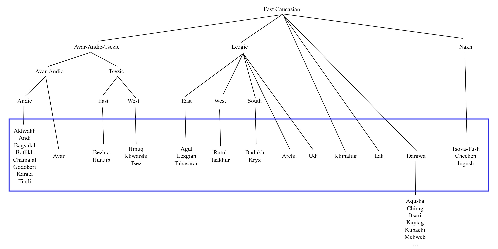
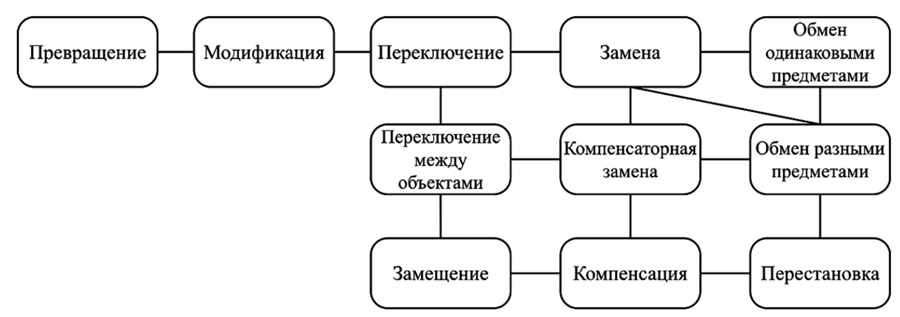
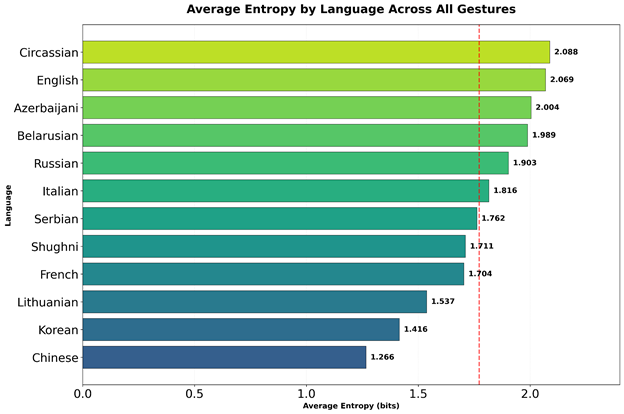
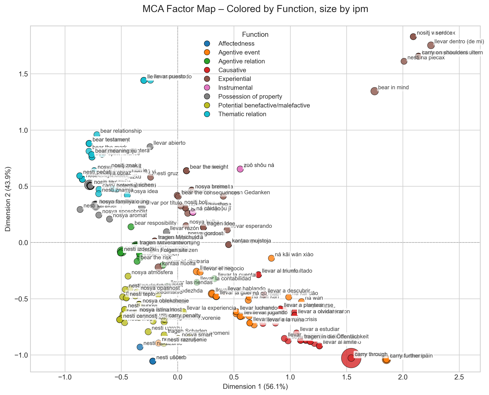
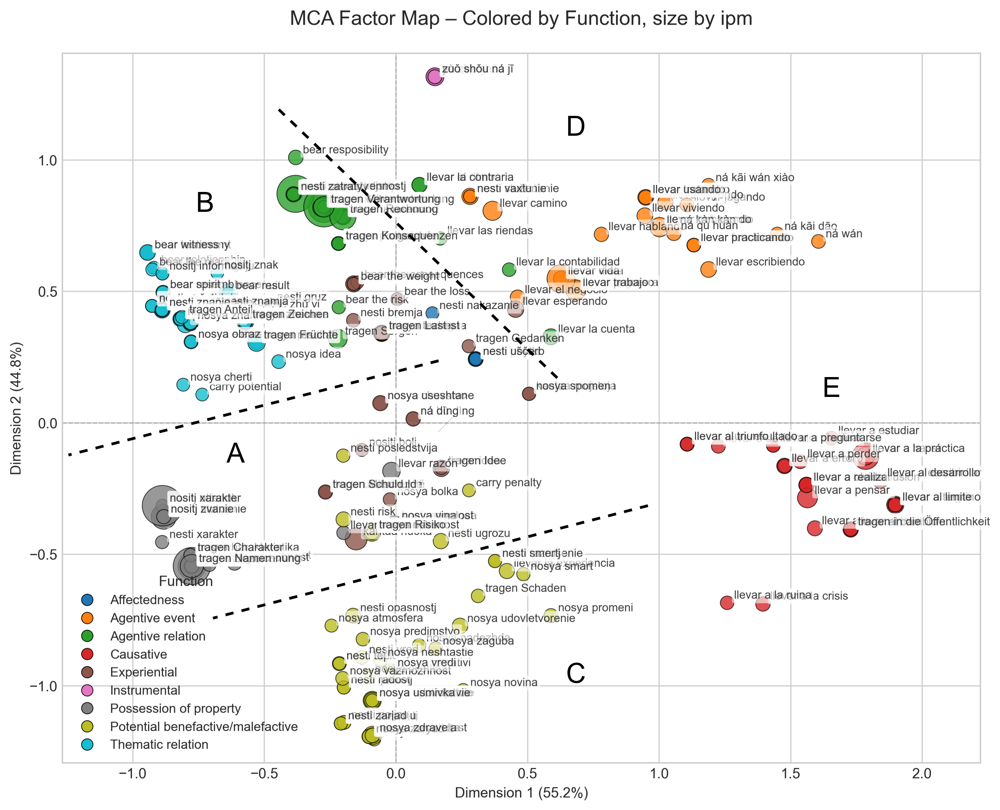

```{r}
#| include: false

library(lingglosses)
options("lingglosses.italic_transliteration" = FALSE)
```

# Типологические исследования

## Фонетические и фонологические исследования

### Фонологическая спецификация глухих латеральных фрикативных в уральских языках

Глухие латеральные фрикативные согласные, редкие в языках мира вообще, имеются в инвентаре лесного ненецкого языка и севернохантыйского языка. Эти фрикативные идентичны фонетически, однако экспедиционные данные лесного ненецкого и севернохантыйского показывают, что они занимают разные места в фонологической системе.

В лесном ненецком \[ʔ\] является базовым аллофоном гортанной смычки и дебуккализованных корональных шумных /t s/, а придыхание \[ʰ\] появляется как аллофон перед глухими согласными. Перед латеральным фрикативом появляется гортанная смычка \[ʔ\], а не придыхание \[ʰ\] (/ḿat-λʹi/ \> \[ḿiʔλʹi\] ['чум]-LIM[']), что показывает, что глухой латеральный фрикатив фонологически звонкий: \[ʰ\] возникает в результате ларингальной трансмиссии, а у /λ/ нет ларингальных признаков в лесном ненецком.

В севернохантыйском глухой латеральный фрикатив ведёт себя как глухой шумный. Глухие шумные озвончаются после гласных: /jasəŋ/ \> \[jazəŋ\] ['слово'], /wʉɬi/ \> \[wʉɮɨ\] 'олень' и после носовых: /ɬantən/ \> \[ɬandən\] 'ягельный лес', /pun-ɬ-əm/ \> \[punɮəm\] ['класть]-PRS-1SG[']. Таким образом, /λ/ содержит признак глухости, который удаляется в результате взаимодействия с носовым или после гласного.

Эти данные подтверждают то, что латеральные фрикативы типологически могут вести себя по-разному и не всегда являются фонологически глухими или шумными [@scheer2004]. Таким образом, это подтверждает предположение substance-free теорий фонологии, которые предполагают разделение на собственно фонологию, оперирующую абстрактными признаками, и фонетику, отвечающую за реализацию этих признаков. В лесном ненецком латеральный фрикатив озвучивается как глухой, но фонологически не имеет ларингальной спецификации, в то же время в севернохантыйском латеральный фрикатив является глухим и в фонетике, и в фонологии.

Полевые данные получены в экспедиции по изучению лесного ненецкого языка, г. Тарко-Сале, д. Харампур, ЯНАО и экспедиции по изучению языка ханты, с. Казым, ХМАО, март---апрель 2026 г.

### Ударение в тунгусо-маньчжурских языках: сбор данных

В рамках проекта были собраны данные для акустического и фонологического анализа ударения в двух тунгусо-маньчжурских языках: эвенском (быстринский диалект) и удэгейском.

В ходе майской экспедиции 2026 года в сёла Эссо и Анавгай Быстринского района Камчатки были собраны данные по ударению в быстринском эвенском. Ударение в быстринском эвенском и в эвенском не описано и не изучено. Некоторые отрывочные наблюдения представлены в существующих работах, однако систематического исследования эвенского ударения ни с фонетической, ни с фонологической точки зрения до сих пор не проводилось. Для изучения ударения была составлена анкета, проверяющая влияние на его позицию таких факторов, как долгота гласного звука, качество гласного, открытость / закрытость слога, наличие в слове определённых морфем. При сборе данных были записаны как изолированные произнесения, так и произнесения в контексте. Суммарно было собрано 4,5 часа записей. До конца 2026 года планируется завершить разметку записей и провести анализ собранных материалов.

Были собраны и систематизированы данные об удэгейском ударении на материале имеющихся грамматических описаний. В удэгейском языке есть краткие, долгие и долгие глоттализованные гласные. Ударение падает на самый тяжёлый и самый левый слог: \[ˈa.ta.zi.ga\] 'женщина.PL', \[dog.ˈbo\] 'ночь', \[dog.ˈdi\] 'слушать'. Ирина Николаева и Мария Тольская в грамматике [@nikolaeva-tolskaya2001] показывают, что суффиксы, содержащие гласные верхнего подъёма, «экстраметричны», то есть не принимают на себя ударение: \[bom.ˈbo.li.gi\] 'круглый (мяч-ADJ)'. Однако некоторые суффиксы с верхними гласными, например датив, всё же принимают на себя ударение и не являются экстраметричными: \[zug.di.ˈdu\] 'дом.DAT'. Удэгейское ударение предлагается анализировать в Strict CV Metrics, теории без дополнительного слоя для единиц, отвечающих за ударение, например мор. Экстраметричные суффиксы анализируются как содержащие меньшее количество фонологических проекций, а неэкстраметричные --- как содержащие такое же количество фонологических проекций, как и обычные краткие гласные.

## Исследования морфологии

### Сверхотчуждаемая посессивность в тунгусо-маньчжурских языках

В типологических исследованиях посессивности основное внимание традиционно уделялось противопоставлению неотчуждаемой и отчуждаемой принадлежности [@nichols1988]; [@heine1997]; [@haspelmath2017]. При этом значительно менее изучена другая граница расширенной шкалы: между отчуждаемыми и сверхотчуждаемыми именами. К последним относятся, например, названия природных объектов, диких животных и веществ, для которых связь с индивидуальным посессором обычно не предполагается. Исследование этой границы позволяет установить, какие отношения могут выражаться непосредственно, а какие требуют дополнительной морфологической деривации.

В 2026 году было проведено типологическое исследование посессивных конструкций в тунгусо-маньчжурских языках с опорой на полевые материалы по быстринскому варианту эвенского языка и опубликованные данные по негидальскому и другим языкам семьи. Основной задачей стало объяснение распределения деривационного суффикса *‑ŋ(V)*, традиционно рассматривавшегося как показатель отчуждаемой или косвенной принадлежности. Были систематизированы контексты, в которых этот суффикс обязателен, допускается факультативно или исключается, и сопоставлены интерпретации одного и того же имени при разных типах связи между посессором и обладаемым. В основу анализа легли данные, полученные методом контекстной элицитации в Эссо и Анавгае в 2024--2025 годах; в исследовании использовались как отдельные словоформы, так и целые высказывания. Суждения о приемлемости фиксировались с учётом межличностной вариативности: каждая конструкция, однозначно отнесённая к приемлемым или неприемлемым, была проверена не менее чем у пяти носителей.

В ходе анализа было показано, что противопоставление неотчуждаемой и отчуждаемой принадлежности не позволяет описать наблюдаемые различия. Обычная конструкция с притяжательным суффиксом используется не только с частями тела и терминами родства, но и при обозначении домов, одежды, домашних животных и других объектов, которые могут находиться во владении человека. Напротив, *‑ŋ(V)* появляется в сочетании с названиями природных объектов и веществ, диких животных, некоторыми именами собственными и субстантивированными формами. Следовательно, наличие суффикса не определяется ни возможностью физического отчуждения объекта, ни значением обладания как таковым. Не вполне достаточно и описание подобных употреблений как «неканонических» посессивных отношений: оно объединяет разнородные случаи, но не объясняет, почему одинаковая по смыслу ситуативная связь с человеком требует суффикса для одних имён и обходится без него для других.

Решающим оказался характер конкретного отношения, доступного существительному. Название вещества может сочетаться с естественным источником без специального показателя, однако для связи с человеком как владельцем выделенной порции используются другие средства. Сопоставление (@ex_arctic_001) и (@ex_arctic_002) показывает, что различие определяется не самим словом, а интерпретацией отношения. То же наблюдается при обозначении древесины: естественная связь с деревом оформляется без дополнительной деривации (@ex_arctic_003), а связь с человеком как владельцем допускает варьирование (@ex_arctic_004).

(@ex_arctic_001) быстринский эвенский
```{r}
gloss_example(
  transliteration = "erek okat mu-n / *mu-ŋə-n",
  glosses = "DEM.PROX река вода-POSS.3SG / вода-ALN-POSS.3SG",
  free_translation = "вода этой реки"
)
```

(@ex_arctic_002)  
```{r}
gloss_example(
  transliteration = "erek min mu-ŋ-u / *mu-wu",
  glosses = "DEM.PROX я.OBL вода-ALN-POSS.1SG / вода-POSS.1SG",
  free_translation = "Это моя вода."
)
```

(@ex_arctic_003)  
```{r}
gloss_example(
  transliteration = "diwud mo-n / *mo-ŋə-n",
  glosses = "берёза дерево-POSS.3SG / дерево-ALN-POSS.3SG",
  free_translation = "древесина берёзы"
)
```


(@ex_arctic_004)  
```{r}
gloss_example(
  transliteration = "min mo-ŋ-u / mo-wu ulak-ča",
  glosses = "я.OBL дерево-ALN-POSS.1SG / дерево-POSS.1SG промокнуть-PTC.PST",
  free_translation = "Мои дрова / моя древесина промокли."
)
```

Суффикс *‑ŋ(V)*, традиционно обозначаемый в глоссах как `r add_gloss("ALT")`, здесь рассматривается как показатель расширения реляционных возможностей имени.

Важным аргументом против трактовки суффикса *-ŋ(V)* как показателя физической отделимости стали конструкции части и целого. Если часть тела соотносится со своим носителем, дополнительный суффикс не требуется, даже когда эта часть фактически отделена. Напротив, связь части тела с посторонним обладателем может потребовать специального оформления. Аналогичный принцип действует при соотнесении вещества с естественным источником и части предмета с целым. Таким образом, морфологическое оформление определяется не физическими свойствами объекта, а тем, какое отношение актуализировано между участниками конструкции.

Для обобщения выявленных закономерностей было предложено понятие реляционного профиля имени --- совокупности отношений, которые доступны существительному в обычной посессивной конструкции. Выделены положительный и отрицательный типы такого профиля. Положительный профиль задаёт наиболее тесно связанное с именем отношение: например, часть тела предполагает носителя, а термин родства --- родственника. Отрицательный профиль, напротив, фиксирует отношения, недоступные немаркированной основе: дикое животное, вещество или часть тела --- с посторонним владельцем. Показано, что суффикс *‑ŋ(V)* снимает подобное ограничение и расширяет набор отношений, в которых может участвовать производная основа. При этом он не выражает самостоятельного значения ассоциации, порционности или принадлежности.

Деривационный характер суффикса подтверждается его морфологическим поведением. Суффикс ‑*ŋ(V)* располагается непосредственно после именной основы, перед словоизменительными показателями, в частности показателями числа и посессора, и может встречаться без лично-притяжательного показателя. Так, в рассматриваемых примерах противопоставлены производные от 'рыба', используемые при характеристике реки и человека.

Наглядный контраст получен и без притяжательных окончаний. В (@ex_arctic_005) прилагательное характеризует реку, в которой водится много рыбы, а в (@ex_arctic_006) --- человека, располагающего большим количеством рыбы. Различие в оформлении одной и той же основы подтверждает, что деривация зависит от отношения между участниками ситуации, а не только от лексического класса имени.

(@ex_arctic_005)  
```{r}
gloss_example(
  transliteration = "erek olla-pt͡ɕi / *olla-ŋa-pt͡ɕi okat",
  glosses = "DEM.PROX рыба-ADJMULT / рыба-ALN-ADJMULT река",
  free_translation = "Это река, в которой много рыбы."
)
```

(@ex_arctic_006)  
```{r}
gloss_example(
  transliteration = "erek olla-ŋa-pt͡ɕi / *olla-pči bej",
  glosses = "DEM.PROX рыба-ALN-ADJMULT / рыба-ADJMULT человек",
  free_translation = "Это человек, у которого много рыбы."
)
```

Контраст (@ex_arctic_005)--(@ex_arctic_006) особенно важен: суффикс меняет свойства именной основы и без следующего за ним посессивного показателя.

Полученные результаты были соотнесены с расширенной шкалой посессивности, различающей неотчуждаемую, отчуждаемую и сверхотчуждаемую зоны. В классических системах отчуждаемости специальное оформление выделяет ожидаемое отношение и противопоставляет его остальным отношениям. Для рассмотренных тунгусо-маньчжурских языков установлено обратное распределение: обычная посессивная конструкция охватывает широкий круг ожидаемых связей, а дополнительная деривация маркирует отношение, которое не лицензируется исходной основой. Сопоставление с языком мохеньо-тринитарио, где сверхотчуждаемые корни образуют отдельный лексический класс и требуют особого словообразовательного показателя для посессивного употребления, позволило квалифицировать тунгусо-маньчжурский тип как семантический аналог лексического разделения. Тем самым был предложен единый подход к лексическим и семантическим противопоставлениям на границе между отчуждаемой и сверхотчуждаемой посессивностью.

Результаты исследования оформлены в статье, прошедшей редакционную подготовку для журнала «Известия Российской академии наук. Серия литературы и языка».

### Морфологические особенности возвратных местоимений в нахско-дагестанских языках

В настоящей работе рассматриваются основные особенности парадигмы возвратного местоимения третьего лица в языках нахско-дагестанской языковой семьи. К анализируемым особенностям относятся: падежный синкретизм (использование одной и той же формы для эргативного и абсолютивного падежей); использование различных стратегий для маркирования категории рода на возвратном местоимении, а также его маркирование в разных частях парадигмы (ни в одной из форм, во всех формах или только в части из них); супплетивизм (использование разных корней для различных форм возвратного местоимения в зависимости от падежа, числа или рода).

Работа представляет собой типологическое исследование всех языков семьи на основе доступных грамматик и словарей. Была также предпринята попыткаохватить диалектное разнообразие.  Актуальность работы обусловлена тем, что ранее возвратные местоимения исследовались скорее с синтаксической точки зрения [@creissels2007; @kalyakin2023; @sumbatova2016; @testeletstoldova1998; @testelets2016], в то время как морфологов интересовали преимущественно личные местоимения [@corbett2005; @moskal2015; @siewierskabakker2013; @smithetal2019] и другие части речи. Так, в то время как синкретизм между эргативным и абсолютивным падежами был описан в личных местоимениях [@ganenkov2021; @politova2023], тот факт, что то же явление наблюдается и в возвратных местоимениях, оставался незамеченным. Возвратные местоимения представляют интерес и с морфологической точки зрения, и в настоящем разделе приводятся несколько их характеристик, заслуживающих внимания.

#### Нахско-дагестанская языковая семья

Языки нахско-дагестанской языковой семьи распространены преимущественно в трех российских республиках: Ингушетии, Чечне и Дагестане, --- но также в северных регионах Азербайджана и в восточных частях Грузии. Классификация языков семьи представлена на рисунке -@fig-conlab-3 (по [@ganenkovmaisak2021] с незначительными изменениями). Синий прямоугольник на схеме очерчивает уровень, который мы в рамках данной работы считаем собственно языками; в работах, посвященных нахско-дагестанским языках, существуют расхождения относительно статуса некоторых диалектов (см., например, [@koryakovsumbatova2007; @koryakov2021]).

{#fig-conlab-3}

Говоря об особенностях именной морфологии нахско-дагестанских языков, следует отметить существование почти во всех языках семьи категории рода, или класса. Глаголы, прилагательные и некоторые местоимения могут согласовываться с существительными по их грамматическому роду. Количество родов в языке варьируется от двух (в табасаранском) до восьми (в цова-тушинском); род полностью отсутствует в удинском, лезгинском и агульском языках. В единственном числе часто различаются мужской, женский и средний род, в то время как во множественном чаще разделение проходит между людьми и всеми остальными [@ganenkovmaisak2021].

Имена и местоимения в нахско-дагестанских языках имеют категории числа и падежа. Падежи можно подразделить на грамматические (которые, как правило, представлены абсолютивным, эргативным, дательным и родительным падежами) и пространственные. Абсолютивный падеж противопоставлен остальным (косвенным) падежам во множестве аспектов: например, косвенные падежи имен часто образуются от специальных (косвенных) основ. О склонении имен в нахско-дагестанских языках см., например, [@kibrikkodzasov1990].

#### Синкретизм абсолютива и эргатива

Как уже было сказано выше, личные местоимения во многих нахско-дагестанских языках демонстрируют синкретизм между эргативным и абсолютивным падежами, то есть используют для них одну и ту же форму. См. примеры (@ex-13) и (@ex-14) из годоберинского языка с местоимением *den* `r add_gloss("1SG")`.

(@ex-13) по [@kibriketal1996: 271]
```{r}
#| results: asis

gloss_example(transliteration = "den hac’ábaquralá w=ac’-á-mu-wq’aƛì wãwã́di bac’-é",
              glosses = "1SG gatsabakurala M=get.to-PST-PART-WHEN howl.PST wolf-PL",
              free_translation = "Когда я добрался до Г., выли волки.")
```

(@ex-14) по [@kibriketal1996: 271]
```{r}
gloss_example(transliteration = "den ħadúr ĩhi tamánčá",
              glosses = "1SG.ERG ready do.PST pistol",
              free_translation = "Я приготовил пистолет.")
```

Наличие такого синкретизма в личных местоимениях первого и второго лица активно изучалось [@politova2023]. Интересно, что и в возвратных местоимениях третьего лица может наблюдаться такой же синкретизм. Можно разделить языки нахско-дагестанской семьи на три группы по наличию синкретизма в них.

1. Наличие синкретизма и в единственном, и во множественном числе. К этому типу относятся языки нахской ветви (чеченский, ингушский, цова-тушинский), а также лакский язык. Так, в чеченском языке местоимения *šaː* `r add_gloss("REFL")`.`r add_gloss("SG")` и *šæš* `r add_gloss("REFL")`.`r add_gloss("PL")` используются и в абсолютивной, и в эргативной функциях [@nichols1994: 33–34]. То же верно и для лакских *cu* `r add_gloss("REFL")`.`r add_gloss("SG")` и *ciw* `r add_gloss("REFL")`.`r add_gloss("PL")` [@zhirkov1955: 69–71].

2. Наличие синкретизма только во множественном числе. Этот тип наблюдается также в четырех идиомах --- гинухском, цахурском, варташенском диалекте удинского и в северном диалекте табасаранского языка. Например, в варташенском удинском в единственном числе используются формы *ič* `r add_gloss("REFL")`.`r add_gloss("SG")`.`r add_gloss("ABS")` и *ič-en* `r add_gloss("REFL")`.`r add_gloss("SG")`-`r add_gloss("ERG")`, в то время как во множественном числе в обеих функциях используется форма *ič-ɣo-n* `r add_gloss("REFL")`-`r add_gloss("PL")`-`r add_gloss("ERG")`, маркированная эргативом [@schulze1982: 134–135].

3. Отсутствие синкретизма. Наконец, последний из типов представлен во всех остальных языках семьи, поскольку обычно эргативный и абсолютивный падежи в возвратных местоимениях всё же различаются. См. примеры в таблице -@tbl-conlab-12 для гунзибского [@vandenberg1995: 63–64] и в таблице -@tbl-conlab-13 для ботлихского [@gudava1967: 301–302].

: Возвратные местоимения\: гунзибский {#tbl-conlab-12}

|  | `r add_gloss("ABS")` | `r add_gloss("ERG")` |
| --- | --- | --- |
| `r add_gloss("SG")` | žu | žin-lo |
| `r add_gloss("PL")` | žu-ru | žide-l |


: Возвратные местоимения\: ботлихский {#tbl-conlab-13}

|  | `r add_gloss("ABS")` | `r add_gloss("ERG")` |
| --- | --- | --- |
| `r add_gloss("SG")` | `r add_gloss("M")`: hi-w, `r add_gloss("F")`: hi-j, `r add_gloss("N")`: hi-b | `r add_gloss("M")`: in-šːu-di, `r add_gloss("F")`: in-ɬːi-di, `r add_gloss("N")`: in-ɬːi-di |
| `r add_gloss("PL")` | hi-ol | in-du-di |

Отметим, что синкретизм в возвратных местоимениях нахско-дагестанской семьи менее распространен, чем в личных местоимениях. Кроме того, личные местоимения более разнообразны в выборе того, какие именно формы будут или не будут различать эргатив и абсолютив. Так, например, в цезском языке личные местоимения различают эргатив и абсолютив во множественном и не различают в единственном числе; подобного паттерна не наблюдается в возвратных местоимениях ни одного из языков семьи. Тем не менее наличие синкретизма в возвратных местоимениях хотя бы некоторых языков является примечательным и подлежит дальнейшему изучению.

#### Выражение рода

Как было отмечено ранее, почти все языки нахско-дагестанской языковой семьи имеют категорию рода, и многие части речи в них согласуются по роду с именами существительными. Маркеры рода могут присутствовать и в возвратных местоимениях некоторых языков; см. таблицу -@tbl-conlab-13 для ботлихского языка, где в единственном числе видно различение форм возвратного местоимения в зависимости от рода соответствующего референта. По ряду признаков, таким как отсутствие антецедента (существительного) в ряде употреблений, но также и иногда супплетивное (вместо аффиксального) выражение категории рода в возвратных местоимениях, мы не можем считать это полноценным согласованием по роду, и впредь будем называть это именно маркированием, или выражением, категории рода на возвратных местоимениях.

Можно выделить следующие типичные характеристики выражения рода в возвратных местоимениях языков нахско-дагестанской семьи:

1) категория рода выражена;
2) категория рода выражена и в единственном, и во множественном числе;
3) категория рода выражена и в абсолютивном, и в косвенных падежах;
4) в абсолютиве род выражена аффиксально;
5) аффиксы, выражающие род в абсолютиве, являются суффиксами;
6) в косвенных падежах род выражен специальными (косвенными) маркерами;
7) в косвенных падежах единственного числа разделение проходит между мужским родом и всеми остальными;
8) в косвенных падежах множественного числа разделение проходит между людьми и всеми остальными.

Все эти восемь условий редко соблюдаются в языках одновременно, кроме как в нескольких андийских языках --- ахвахском, кванадинском багвалинском, чамалинском и каратинском. См. таблицу -@tbl-conlab-14 для кванадинского багвалинского [@kibriketal2001: 162–163].

: Возвратные местоимения\: кванадинский багвалинский {#tbl-conlab-14}

|  | `r add_gloss("ABS")` | `r add_gloss("ERG")` |
| --- | --- | --- |
| `r add_gloss("SG")` | `r add_gloss("M")`: e-w-da,`r add_gloss("F")`: e-j-da,`r add_gloss("N")`: e-b-da | `r add_gloss("M")`: in-šːu-r-da,`r add_gloss("F")`, `r add_gloss("N")`: in-ɬːi-r-da |
| `r add_gloss("PL")` | `r add_gloss("HPL")`: e-ba-da,`r add_gloss("NPL")`: e-r-da | `r add_gloss("HPL")`: in-du-r-da,`r add_gloss("NPL")`: in-diri-r-da |

Кратко перечислим основные исключения для каждого из восьми условий.

Усливие 1. В некоторых языках категория рода в возвратных местоимениях отсутствует --- в удинском, лезгинском, агульском (где она отсутствует совсем), а также в табасаранском языке, во всех нахских языках (чеченском, ингушском, цова-тушинском), а также в трех цезских (бежтинском, гинухском, гунзибском).

Усливие 2. и 3. В некоторых языках семьи род маркирован в единственном числе, но не во множественном. К таким, например, относится ботлихский --- см. таблицу -@tbl-conlab-13. В арчинском род маркирован только в косвенных падежах ед. числа [@kibrik1977: 261--262]. Обратная ситуация наблюдается в хиналугском, где род маркирован везде кроме косвенных падежей ед. числа [@kibrikkodzasov1990: 226]. В последних двух языках род маркирован в косвенных падежах, но не в абсолютивном; см. таблицу -@tbl-conlab-15 для хиналугского.

: Возвратные местоимения\: хиналугский {#tbl-conlab-15}

|  | `r add_gloss("ABS")` | `r add_gloss("ERG")` |
| --- | --- | --- |
| `r add_gloss("SG")` | `r add_gloss("M")`: hæhu,`r add_gloss("F")`, `r add_gloss("N")`: hæhæ | hæhin-i |
| `r add_gloss("PL")` | `r add_gloss("HPL")`: hohoz,`r add_gloss("NPL")`: hæhed | `r add_gloss("HPL")`: hohoz-i,`r add_gloss("NPL")`: hæhnedir-i |

Усливие 4. Хиналугский язык маркирует род с помощью некоторых модификаций основы. Кроме того, некоторые языки маркируют род супплетивно, о чем пойдет речь ниже.

Усливие 5., 6. и 7. Рутульский и цахурский используют для маркирования рода в абсолютиве префиксы. В них же для различения рода в косвенных падежах используется модификация основы, как и в хиналугском (см. таблицу -@tbl-conlab-15). Кроме того, в цахурском языке в косвенных падежах единственного числа различаются мужской, женский и средний род, а в рутульском языке --- люди и все остальные. См. таблицу -@tbl-conlab-16 для цахурского [@kibrik1999: 132] и таблицу -@tbl-conlab-17 для рутульского [@maxmudova2002: 204–205]. В цахурском эргатив отличается по маркированию от других косвенных падежей.

:Возвратные местоимения\: мишлешский цахурский {#tbl-conlab-16}

|  | `r add_gloss("ABS")` | `r add_gloss("ERG")` | `r add_gloss("DAT")` |
| --- | --- | --- | --- |
| `r add_gloss("SG")` | `r add_gloss("M")`: w-uǯ,`r add_gloss("F")`: j-iǯ,`r add_gloss("N1")`: w-uǯ,`r add_gloss("N2")`: j-iǯ | `r add_gloss("M")`: wu-ǯ-eː,`r add_gloss("F")`: ji-ǯ-eː,`r add_gloss("N")`: či-šeː | `r add_gloss("M")`: ǯu-s,`r add_gloss("F")`: ǯe-s,`r add_gloss("N")`: či-s |
| `r add_gloss("PL")` | `r add_gloss("HPL")`: ǯo,`r add_gloss("HPL")`: ji-ǯ-bɨ | `r add_gloss("HPL")`: ǯo,`r add_gloss("NPL")`: či-šeː | `r add_gloss("HPL")`: ǯo-s,`r add_gloss("NPL")`: či-s |


:Возвратные местоимения\: мухадский рутульский {#tbl-conlab-17}

|  | `r add_gloss("ABS")` | `r add_gloss("ERG")` |
| --- | --- | --- |
| `r add_gloss("SG")` | `r add_gloss("M")`: w-ɨǯ,`r add_gloss("F")`: r-iǯ,`r add_gloss("N1")`: w-iǯ,`r add_gloss("N2")`: j-iǯ | `r add_gloss("M")`: ǯu,`r add_gloss("F")`: ǯu,`r add_gloss("N")`: ǯi |
| `r add_gloss("PL")` | ǯwaˤr | ǯwaˤr / ǯwaˤr-še |

Условие 8. Наконец, в андийском языке различение во множественном числе проходит между мужским родом и всеми остальными [@cercvadze1965: 349].

Таким образом, выражение категории рода в возвратных местоимениях языков нахско-дагестанской семьи очень разнородно по целому ряду параметров.

#### Супплетивизм

Супплетивизму в лингвистике посвящено огромное множество исследований. Тем не менее этот концепт не лишен теоретических проблем и противоречий; так, например, не всегда является очевидным, принадлежат ли две разные основы одной лексеме или же являются разными лексемами [@corbett2007]. С другой стороны, не очевидно, как сильно должны различаться два корня, чтобы считаться супплетивными, а не просто алломорфами. В настоящем разделе супплетивными считаются две основы возвратного местоимения тогда и только тогда, когда в них нет ни одного общего согласного; критерий кажется подходящим для целей данного исследования.

Основы возвратного местоимения в нахско-дагестанских языках могут быть супплетивными по ряду категорий --- по падежу, по числу или по роду.

1. Супплетивизм по падежу. Косвенные падежи в нахско-дагестанских языках часто образуются от косвенной основы, которая, в свою очередь, образуется довольно регулярно с помощью прибавления специальных аффиксов к основе абсолютивного падежа. Тем не менее и в именах наблюдаются случаи супплетивизма --- ср. арчинские формы *abtːu* ‘father.`r add_gloss("ABS")`’ и *umːu* ‘father.`r add_gloss("ERG")`’ [@chumakinaetal2007: 30].

В местоимениях дагестанских языков супплетивизм по падежу наблюдается чаще [@wier2024]. В возвратных местоимениях он также относительно распространен --- см. приведенные выше примеры из ботлихского (@tbl-conlab-13) и багвалинского (@tbl-conlab-14). Этот вид супплетивизма наблюдается во всех без исключения андийских языках, а также в бежтинском. В ниджском удинском наблюдается интересная картина, когда супплетивизм происходит не между абсолютивным и всеми косвенными падежами, а между, с одной стороны, абсолютивным и эргативным, а с другой стороны --- всеми остальными падежами: в эргативе и абсолютиве используется основа *ič-*, а в остальных падежах (хотя другие источники это не подтверждают) --- основа *iz-* [@gukasyan1974: 279].

В ряде языков супплетивизм зависит от числа --- так, в хваршинском супплетивизм есть только в единственном числе [@khalilova2009: 161--163], а в акушинском даргинском --- только во множественном; см. таблицу -@tbl-conlab-18 [@abdullaev1954: 140-–141].

: Возвратные местоимения\: акушинский даргинский {#tbl-conlab-18}

|  | `r add_gloss("ABS")` | `r add_gloss("ERG")` |
| --- | --- | --- |
| `r add_gloss("SG")` | `r add_gloss("M")`: sa-j,`r add_gloss("F")`: sa-r-i,`r add_gloss("N")`: sa-b-i | sune-ni |
| `r add_gloss("PL")` | `r add_gloss("HPL")`: sa-b-i,`r add_gloss("NPL")`: sa-r-i | ču-li |

2. Супплетивизм по числу. Этот вид супплетивизма наблюдается редко, но его можно также встретить в хваршинском и акушинском даргинском (см. таблицу -@tbl-conlab-18).

3. Супплетивизм по роду. Этот вид супплетивизма также редок. Один из примеров представлен крызским языком, где основами возвратного местоимения являются *ug-* (`r add_gloss("M")`), *iž-* (`r add_gloss("F")`, `r add_gloss("N")`), *gi-* (`r add_gloss("HPL")`) и *i-* (`r add_gloss("HPL")`) [@authier2009: 54–55].

Таким образом, супплетивизм по падежу в возвратных местоимениях нахско-дагестанских языков представлен довольно часто, реже можно встретить супплетивизм по числу и по роду. Категории также могут взаимодействовать друг с другом --- так, в цахурском языке (@tbl-conlab-16) особая основа используется для некоторых родов только в косвенных падежах, то есть супплетивизм зависит от падежа и рода.

Супплетивизм по падежу в возвратных местоимениях ранее не анализировался и представляет интерес с теоретической точки зрения. Как отмечалось в исследованиях ранее [@moskal2015], супплетивизм по падежу в существительных скорее не ожидаем, в отличие от супплетивизма по падежу в местоимениях, что может быть связано с морфологической «дефектностью» последних --- отсутствием у них полноценной основы. Возвратные местоимения в этом смысле представляют собой промежуточный случай, поскольку в большинстве языков обладают полноценной основой. В связи с этим супплетивизм в них примечателен и подлежит дальнейшему изучению, а в перспективе может иметь последствия для лингвистической теории супплетивизма.

Таким образом в настоящем разделе рассмотрены некоторые морфологические особенности возвратных местоимений в языках нахско-дагестанской семьи. Первой особенностью является наличие в них синкретизма между эргативным и абсолютивным падежами, который ранее не анализировался. Второй особенностью является различное выражение категории рода в этих местоимениях, которое варьируется от языка к языку и может различаться по части способа выражения, места выражения в парадигме и конкретных родов, между которыми проводится разделение. Третьей рассмотренной особенностью является наличие супплетивизма между основами по падежу и по ряду других категорий, которое также нуждается в теоретической интерпретации.

Настоящее исследование показывает важность изучения возвратных местоимений не только с синтаксической, но и с морфологической точки зрения, поскольку в некоторых аспектах они могут демонстрировать поведение, промежуточное между поведением имен существительных и других местоимений, а в некоторых аспектах, таких как маркирование категории рода, также сближаться с прилагательными и другими атрибутивами.

### Расчлененность причинных союзов, образованных от сочетания указательных местоимений и союза ‘что’, в славянских языках

Во многих славянских языках есть причинные союзы, образованные из сочетания указательного местоимения с падежным или адложным маркированием и союза, используемого для введения сентенциальных актантов, ср. (@ex-1)–(@ex-2).

(@ex-1) Польский
```{r}
gloss_example(transliteration = "dla-tego, że",
              glosses = "для-DEM что",
              free_translation = "потому что")
```

(@ex-2) Болгарский
```{r}
gloss_example(transliteration = "за-това че",
              glosses = "к-DEM что",
              free_translation = "потому что")
```

Подобная внутренняя структура известна из типологических работ [@kortmann1997: 71--74, 113--118; @zaika2019: 12--13] и характерна также для значительно более широкого круга сложных союзов, ср. русские *кроме того что*, *несмотря на то что* и мн. др. Внутренняя структура таких выражений предполагает, что в их исходной структуре указательное местоимение относится к главной клаузе, однако во многих случаях неочевидно, относится ли оно синхронно к главной или зависимой клаузе. Этот вопрос часто обсуждается в литературе в связи с противопоставлением т. н. расчлененных и нерасчлененных союзов [@zaza1958, @zaza1962; @bauer1960: 290–292; @paducheva1977; @kobozeva2010; @inkovaru2011; @inkovafr2011; @pekelis2024]. ср. русское *потому, что* (с запятой) и *потому что* (без запятой). Практически исследования расчлененности обычно основываются на данных пунктуации, однако, как правило, предполагается, что эти данные в некоторой мере отражаются интонационное противопоставление --- с границей интонационных единиц (интонационных групп, ЭДЕ и др. --- в зависимости от теоретического подхода) до или после указательного местоимения.

В основе настоящего исследования лежит следующая гипотеза: склонность союза к пунктуационному расчленению количественно ассоциирована с его семантической прозрачностью и синтаксическими свойствами, указывающими на его неполную лексикализацию. Для расчлененности непосредственное сопоставление данных между языками сопряжено с рядом сложностей, в особенности в случае исследования пунктуационной расчлененности, поэтому для исследования было выбрано следующее методологическое решение. В выборку включены только такие языки, в которых есть не менее двух причинных союзов, соответствующих критериям исследования. Для каждой пары таких союзов рассматривается, совпадает ли внутри языка их иерархизация по трем критериям --- семантической прозрачности, склонности к пунктуационной расчлененности и склонности к синтаксическим проявлениям неоднословности.

#### Материалы и методы

В таблице -@tbl-conlab-4 перечислены языки, вошедшие в часть исследования, представленную в разделе -@sec-3. Для сопоставления со славянскими данными в исследование была включена также небольшая выборка неславянских языков, отвечающих условиям исследования, --- латышский, мокшанский и эстонский языки.

В разделе -@sec-4 используется меньшая выборка, поскольку исследуемые конструкции представлены в тексте сравнительно редко, из-за чего для многих языков в доступных корпусах отсутствует достаточное количество примеров. В разделе -@sec-4 представлены данные по русскому, украинскому, македонскому, чешскому и хорватскому.

::: {#tbl-conlab-4 .list-table}
Языки и корпусы

- - Выборка
  - Группа
  - Язык
  - Корпус/Подкорпус

- - []{rowspan=8} Основная выборка (славянские)
  - []{rowspan=3} Восточнославянские
  - русский
  - [@nkrya] (с 1951)

- - белорусский
  - [@nkrya] (параллельный подкорпус, только непереводные тексты)

- - украинский
  - НКРЯ (параллельный подкорпус, только непереводные тексты); [@ukten]

- - []{rowspan=3} Южнославянские
  - болгарский
  - [@arbul]

- - македонский
  - [@classla]

- - хорватский
  - [@nhk]

- - []{rowspan=2} Западнославянские
  - польский
  - [@arpol]

- - чешский
  - [@synv]

- - []{rowspan=3} Дополнительная выборка (неславянские)
  - индоевропейские, балтийские
  - латышский
  - [@lvk]
  
- - []{rowspan=2} уральские, финно-угорские
  - мокшанский
  - Статьи из газеты [@mokpravda]
  
- - эстонский
  - [@ares] [@benko2014]

:::

В таблице -@tbl-conlab-5 для каждого языка перечислены союзы, вошедшие в выборку.

::: {#tbl-conlab-5 .list-table}
Союзы в выборке

- - Язык
  - Союз

- - []{rowspan=3} русский
  - *потому что*

- - *оттого, что*

- - *из-за того, что*

- - []{rowspan=4} белорусский
  - *таму, што* (`r add_gloss("DEM")`.`r add_gloss("DAT")` что)

- - *ад таго, што* (от `r add_gloss("DEM")` что)

- - *праз тое, што* (через `r add_gloss("DEM")` что)

- - *з-за таго, што* (из-за `r add_gloss("DEM")` что)

- - []{rowspan=4} украинский
  - *тому, що* (`r add_gloss("DEM")`.`r add_gloss("DAT")` что)

- - *за-тим, що* (behind-`r add_gloss("DEM")` что)

- - *від того, що* (от `r add_gloss("DEM")` что)

- - *через те, що* (через `r add_gloss("DEM")` что)

- - []{rowspan=3} болгарский
  - *за-това че* (к-`r add_gloss("DEM")` что)

- - *от това, че* (от `r add_gloss("DEM")` что)

- - *поради това, че* (из-за `r add_gloss("DEM")` что)

- - []{rowspan=2} македонский
  - *за-тоа, што* (за-`r add_gloss("DEM")` что)

- - *поради тоа, што* (из-за `r add_gloss("DEM")` что)

- - []{rowspan=3} хорватский
  - *za-to što* (за-`r add_gloss("DEM")` что)

- - *s-toga što* (с-`r add_gloss("DEM")` что)

- - *zbog toga što* (из-за `r add_gloss("DEM")` что)

- - []{rowspan=3} польский
  - *przez to, że* (через `r add_gloss("DEM")` что)

- - *wskutek tego, że* (из-за `r add_gloss("DEM")` что)

- - *dla-tego, że* (для `r add_gloss("DEM")` что)

- - []{rowspan=2} чешский
  - *kvůli tomu, že* (из-за `r add_gloss("DEM")` что)

- - *pro-to-že* (для-`r add_gloss("DEM")`-что)

- - []{rowspan=2} латышский
  - *tā-dēļ ka* (`r add_gloss("DEM")`-из-за что)

- - *tā-pēc ka* (`r add_gloss("DEM")`-после что)

- - []{rowspan=2} мокшанский
  - *ся-нкса, мес* (`r add_gloss("DEM")`-`r add_gloss("CSL")` почему)

- - *ся-с мес* (`r add_gloss("DEM")`-`r add_gloss("ILL")` почему)

- - []{rowspan=2} эстонский
  - *se-st et* (`r add_gloss("DEM")`.`r add_gloss("SG")`-`r add_gloss("EL")` что)

- - *selle-pärast, et* (`r add_gloss("DEM")`.`r add_gloss("SG")`.`r add_gloss("GEN")`-после что)


:::

```{r}
#| eval: false
my_abbreviations <- data.frame(gloss = c("CSL", "N1", "N2", "WHEN"),
                               definition_en = c("causal", "neuter 1", "neuter 2", "when"))
```

#### Семантическая прозрачность {#sec-3}

В настоящем исследовании при исследовании семантической прозрачности причинных союзов используются следующие критерии. Наиболее семантически прозрачными признаются те и только те союзы, в которых именное маркирование допустимо в контекстах непрямой каузации, --- это верно, например, для русского составного союза *из-за того, что.* Остальные союзы в выборке для языка упорядочиваются от более семантически прозрачных к менее семантически прозрачным на основании того, насколько продуктивен именной причинный маркер в причинном значении. Так, например, именной показатель причины *от* признается более продуктивным для русского языка в сравнении с показателем *по*, поскольку второй ограничен небольшим количеством устойчивых сочетаний (*по этой причине*, *по глупости*), тогда как первый широко употребляется с различными существительными, включая недавние заимствования. В соответствии с этим разделением причинный союз *оттого что* признается более семантически прозрачным, чем *потому что*.

Опора на контексты непрямой каузации связана с тем, что для именных причинных маркеров противопоставление причинных показателей прямой и непрямой каузации является типологически распространенным [@sayetalms], в то время как для дистрибуции полипредикативных причинных конструкций этот параметр обычно не описывается как релевантный [@zaika2019]. Как следствие, можно предположить, что при грамматикализации причинного союза типично расширение семантики относительно семантики именного причинного маркера --- а значит союзы, исходно содержащие именные показатели прямой каузации, претерпевают бо́льшие семантические изменения.

#### Пунктуационная расчлененность {#sec-4}

В таблице -@tbl-conlab-6 представлены данные о частотности расчлененных вариантов причинных союзов. Число в скобках соответствует доле пунктуационно расчлененных вхождений, столбцам соответствует внутриязыковой ранг по семантической прозрачности. Как видно из таблицы, в большинстве случаев данные соответствуют гипотезе: для более семантически прозрачных союзов более характерно пунктуационное расчленение; исключение составляет хорватский союз *zbog toga što*.

| язык        | ранг сп 1                                | ранг сп 2          | ранг сп 3        |
|-------------|------------------------------------------|--------------------|------------------|
| Русский     | из-за того, что (1,0)                    | оттого, что (0,9)  | потому что (0,3) |
| Белорусский | з-за таго, што (1,0) праз тое, што (1,0) | ад таго, што (1,0) | таму, што (0,8)  |
| Украинский  | через те, що (1,0)                       | від того, що (1,0) | тому, що (0,8)   |
| Украинский  |                                          |                    | затим, що (0,7)  |
| Болгарский  | поради това, че (0,9)                    | от това, че (1,0)  | затова, че (0,8) |
| Хорватский  | zbog toga što (0,0)                      | stoga što (0,02)   |                  |
| Хорватский  |                                          | zato što (0,01)    |                  |
| Македонский | поради тоа, што (1,0)                    | затоа, што (1,0)   |                  |
| Польский    | przez to, że (0,9)                       | dlatego, że (0,7)  |                  |
| Польский    | wskutek tego, że (0,8)                   |                    |                  |
| Чешский     | kvůli tomu, že (1,0)                     | protože (0,2)      |                  |
| Латышский   | tādēļ, ka (1,0)                          | tāpēc, ka (0,9)    |                  |
| Эстонский   | sellepärast, et (0,9)                    | sest et (0,1)      |                  |
| Мокшанский  | сянкса, мес (1,0)                        | сяс мес (0,2)      |                  |

: Семантическая прозрачность и пунктуационная расчлененность {#tbl-conlab-6}

#### Синтаксические корреляты расчлененности

В рамках настоящего исследования в качестве синтаксического критерия расчлененности рассматривается сравнительная частотность при сочинении частичного повторения союза (@ex-3) и полного повторения союза (@ex-4).

(@ex-3) *Умираю оттого, что заразилась, и еще оттого, что все люди подлецы* ***и что*** *жить очень гадко.* \[А. И. Куприн. Яма (1909–1915)\]

(@ex-4) *Умираю … оттого, что все люди подлецы* ***и оттого, что*** *жить очень гадко.*

Для всех языков, для которых корпусы содержат достаточное количество данных, полное повторение более характерно для союза, который демонстрирует меньшую семантическую прозрачность и/или меньшую склонность к пунктуационному расчленению.

Так, в русском языке союз *оттого, что* семантически более прозрачен и для него более обычно пунктуационное расчленение, чему соответствует и большая частотность частичного повторения союза (см. таблицу -@tbl-conlab-7). Различие статистически значимо (критерий Барнарда, p \< 0,001).

|  |  |  |  |
|------------------|------------------|------------------|------------------|
| Союз | Частичное повторение | Полное повторение | Доля частичного повторения |
| *оттого, что* | 27 | 16 | 0,6 |
| *потому что* | 26 | 120 | 0,2 |

: Полное и частичное повторение причинных союзов при сочинении в русском [@nkrya] {#tbl-conlab-7}

То же верно для украинского союза *через те, що* (@ex-5) в сравнении с *тому, що* (@ex-6). Различие статистически значимо (критерий Барнарда, p \< 0,001), данные приведены в таблице -@tbl-conlab-8.

(@ex-5) украинский
```{r}
#| results: asis

gloss_example(transliteration = "а забрали його тільки через те, що воно було моїм і що я хотів пристосувати його до себе",
              glosses = "и взяли его только через то что оно было моим и что я хотел приспособить его до себя",
              free_translation = "…и они забрали его только потому, что оно было моим и что я хотел приспособить его для себя", 
              line_length = 40)
```


(@ex-6) украинский
```{r}
#| results: asis

gloss_example(transliteration = "І казала, що пише себе, тому що багато часу проводить насамоті, і тому що є тією темою, яку знає найкраще.",
              glosses = "и сказала что пишет себя потому что много времени проводит одна и потому что есть той темой которую знает лучше.всего",
              free_translation = "И она сказала, что она пишет о себе, потому что проводит много времени одна и потому что это тема, которую она знает лучше всего.", 
              line_length = 40)
```

|  |  |  |  |
|------------------|------------------|------------------|------------------|
| Союз | Частичное повторение | Полное повторение | Доля частичного повторения |
| *через те, що* | 49 | 44 | 0,5 |
| *тому, що*[^ukrain_example] | 18 | 82 | 0,2 |

: Полное и частичное повторение причинных союзов при сочинении в украинском [@ukten] {#tbl-conlab-8}

[^ukrain_example]: Для *тому що* в таблице представлены данные случайной выборки в 100 примеров.

Сходное распределение демонстрирует македонский союз *поради тоа, што* (@ex-7): в сравнении с *затоа што* (8) он более семантически прозрачен, более склонен к расчлененности и чаще демонстрирует частичное повторение (см. таблицу -@tbl-conlab-9). Различие статистически значимо (критерий Барнарда, p \< 0,001).

(@ex-7) македонский
```{r}
#| results: asis

gloss_example(transliteration = "Со зборови не можам да ја опишам среќата која ја чувствувам поради тоа што е пронајдена и што ни се врати.",
              glosses = "с словами не могу COMP ее опишу счастье которое ее чувствую из_за DEM что есть найдена и что нам REFL возвратить",
              free_translation = "Я не могу описать словами радость, которую я испытываю из-за того, что ее нашли и вернули нам.", 
              line_length = 40)
```

(@ex-8) македонский
```{r}
#| results: asis

gloss_example(transliteration = "Немојте да ги менувате правилата само за-тоа што сте посилни и за-тоа што можете",
              glosses = "PROH.2PL COMP их меняете правила только для-DEM что быть.2PL сильнее и для-DEM что можете",
              free_translation = "Не меняйте правила только потому, что вы сильнее и можете это сделать.", 
              line_length = 40)
```

|  |  |  |  |
|------------------|------------------|------------------|------------------|
| Союз | Частичное повторение | Полное повторение | Доля частичного повторения |
| *поради тоа, што* | 42 | 39 | 0,5 |
| *затоа што*[^macedonian_example] | 10 | 90 | 0,1 |

: Полное и частичное повторение причинных союзов при сочинении в македонском [@classla] {#tbl-conlab-9}

[^macedonian_example]: Для *затоа што* в таблице представлены данные случайной выборки в 100 примеров.

Сходное различие демонстрируют чешские союзы *kvůli tomu* (@ex-9) и *protože* (@ex-10), см. таблицу -@tbl-conlab-10. Различие статистически значимо (критерий Барнарда, p \< 0,001).

(@ex-9) чешский
```{r}
#| results: asis

gloss_example(transliteration = "Volala jsem vám kvůli tomu, že mám problémy ve škole, a že nemám kamarády.",
              glosses = "позвонила быть.1SG вам из_за того что имею проблемы в школе и что не.имею друзей",
              free_translation = "Я позвонила вам потому, что у меня проблемы в школе и потому, что у меня нет друзей.", 
              line_length = 40)
```

(@ex-10) чешский
```{r}
#| results: asis

gloss_example(transliteration = "Plakala, protože ji tlačily boty a protože měla ošumělé a promáčené šaty…",
              glosses = "плакала потому.что ей жали ботинки и потому.что имела поношенную и промокшую одежду",
              free_translation = "Она плакала, потому что ей жала обувь и потому что ее одежда была поношенной и мокрой", 
              line_length = 40)
```

|  |  |  |  |
|------------------|------------------|------------------|------------------|
| Союз | Частичное повторение | Полное повторение | Доля частичного повторения |
| *Kvůli tomu, že* | 128 | 2 | 1,0 |
| *Protože*[^czech_example] | 2 | 98 | 0,0 |

: Полное и частичное повторение причинных союзов при сочинении в чешском [@synv] {#tbl-conlab-10}

[^czech_example]: Для *protože* в таблице представлены данные случайной выборки в 100 примеров.

В хорватском языке сходное различие демонстрируют союзы *stoga što* (@ex-11) и *zato što* (@ex-12), см. таблицу -@tbl-conlab-11.  Используемые критерии не позволяют установить между ними различий по семантической прозрачности, однако первый из них более склонен к пунктуационной расчлененности и для него более характерно частичное повторение при сочинении, что соответствует общей тенденции.

(@ex-11) хорватский
```{r}
#| results: asis

gloss_example(transliteration = "I to najviše stoga što šire krvne žile i što sadrže vitamin E…",
              glosses = "и это в.основном потому что расширяет кровеносные сосуды и что содержит витамин {E}",
              free_translation = "И это в основном потому, что он расширяет кровеносные сосуды и содержит витамин E…", 
              line_length = 40)
```

(@ex-12) хорватский
```{r}
#| results: asis

gloss_example(transliteration = "Kuću je sagradio, zato što je zemlja njegova, zato što je sirotinja i zato što nema gdje živjeti.",
              glosses = "дом есть построил потому что есть земля его потому что есть бедный и потому что не.имеет где жить",
              free_translation = "Он построил дом потому, что земля принадлежит ему, потому что он бедный и потому, что ему негде жить.", 
              line_length = 40)
```

|  |  |  |  |
|------------------|------------------|------------------|------------------|
| Союз | Частичное повторение | Полное повторение | Доля частичного повторения |
| *Stoga što* | 10 | 1 | 0,9 |
| *Zato što* | 55 | 45 | 0,6 |

: Полное и частичное повторение причинных союзов при сочинении в хорватском [@nhk] {#tbl-conlab-11}

Исследованные данные указывают на то, что неслучайным образом связана внутриязыковая иерархизация рассматриваемых сложных союзов по трем параметрам: частотности запятой между частями союза, прозрачностью его семантики и склонностью к частичному, а не полному повторению союза при сочинении. Для всех этих параметров естественно предположить, что они связаны со степенью грамматикализации причинного союза.

## Исследования лексики

В 2026 году типологические исследования лексики фокусировались на трех основных семантических зонах: семантических полях ‘искать’ и ‘найти’; семантическом поле ‘менять’; зоне конструкций движения частей тела. Все три направления предполагали анализ материала различных языков с особым фокусом на русских данных, а также при работе со всеми семантическими зонами особое внимание уделялось взаимодействию лексической семантики и грамматических особенностей рассматриваемых единиц. Все исследования лексики проводятся в рамках методологии фреймового подхода к лексической типологии [@rakhilinareznikova2013].

### Семантические поля ‘искать’ и ‘найти’

Особый интерес данного фрагмента семантического пространства связан с аспектуальной структурой этих ситуаций. На первый взгляд может показаться, что поиск и находка соотносятся стандартным образом как процесс и его результат. Однако это не совсем так: процесс поиска может не привести к какому бы то ни было результату, а находка может произойти без всякого подготовительного действия.

По-видимому, этой логической независимостью двух ситуаций объясняется особенность их лингвистической концептуализации в сопоставлении с прототипическими процессуально-результативными парами. В стандартном случае (ср. ‘рисовать’/‘нарисовать’ или ‘пить’/‘выпить’) результат описывается тем же глаголом, что и процесс, или же --- как в случае русской видовой системы --- его дериватом. Между тем зоны поиска и находки и в русском, и во многих других языках устроены иначе: для «результата» здесь имеется отдельная лексема, не производная от наименования процесса, ср. рус. *искать* vs. *найти*, а также англ. *look for* и *find*, франц. *chercher* и *trouver* и мн. др. И тем не менее, как свидетельствуют, в частности, материалы базы данных CLICS3 (крупнейшей типологической коллекции колексификаций, т. е. моделей совмещения разных смыслов в одной лексеме, см. [@rzymskietal2020]), концепты ‘искать’ и ‘находить’ все-таки могут выражаться общим глаголом. Однако CLICS3 только фиксирует связи между концептами, не проясняя их природу. При этом для семантической теории и понимания принципов эволюции значений важно еще и описать механизмы подобных связей. Таким образом, основной задачей в рамках типологического исследования семантической зоны поиска и находки стало выявление принципов колексификации исследуемых смыслов.

В процессе решения этой задачи были получены следующие результаты:

- Разработана типологическая анкета для изучения способов выражения смыслов ‘искать’ и ‘находить’ в языках мира.

- Собран и проанализирован материал по лексификации смыслов ‘искать’ и ‘находить’ на материале более 25 языков разных семей, в том числе индоевропейской (белорусский, сербский, чешский, исландский, английский, шведский, немецкий, французский, итальянский, испанский, литовский, персидский, шугнанский); уральской (нганасанский, хантыйский), нахско-дагестанской (агульский, годоберинский), абхазо-адыгской (адыгейский, абазинский), тунгусо-маньчжурской (нанайский, ульчский), тюркской (казахский), чукотско-камчатской (чукотский), сино-тибетской (мандаринский китайский), японо-рюкюской (японский), а также австралийского не-пама-ньюнгского языка кунбарланг. При анализе использовались как данные, полученные непосредственно в ходе проекта, так и материалы, собранные в ходе нашего пилотного исследования [@ryzhovaetal2018].

- Описана фреймовая структура для полей ‘искать’ и ‘найти’.

Для поля ‘искать’ значимыми, по данным нашего анализа, являются следующие фреймы:

- поиск референтного объекта (‘Мама ищет ключи’);

- поиск нереферентного объекта (‘Мама ищет репетитора по французскому’);

- поиск, осуществляемый животным (‘Зверь ищет добычу’);

- поиск, сфокусированный на пространстве (‘Мама обыскала всю комнату’ <чтобы найти нужную книгу>).

В русском для трех первых фреймов может использоваться глагол *искать*, а поиск, профилирующий пространство, выражается дериватом основного глагола --- *обыскать*. Но и первые три ситуации могут задействовать более специфические лексические средства, позволяющие выделить каждый из типологически релевантных фреймов. Так, к референтности объекта «чувствительны» некоторые приставочные производные *искать*: *подыскивать* специализируется на поиске нереферентного объекта (ср. *подыскивать подходящую квартиру*), а *разыскивать*, напротив, описывает референтную ситуацию (ср. *разыскивать пропавшего знакомого*). Внутри фрейма «звериного» поиска русский лексически выделяет ситуации с одним конкретным типом субъекта, ср. глагол *рыскать*, описывающий поведение волка в поисках добычи.

Для противопоставлений, которые русский язык кодирует словообразовательными средствами, в некоторых языках имеются специализированные лексемы, не связанные деривационными отношениями. Так, в агульском используются разные лексемы в зависимости от референтности объекта: *arucas* выражает референтную ситуацию, а *ǯik'arq'as* --- нереферентную. В хантыйском специальный глагол *laliti* описывает поиск с фокусом на пространстве, тогда как общую ситуацию ‘искать’ (профилирующую объект) покрывает глагол *kănši*.

Для поля ‘найти’ были выявлены следующие типологически релевантные фреймы:

- обнаружение потерянного объекта в результате поиска (*Мама нашла потерянные очки*);
- обнаружение нового объекта в результате поиска (*Мама нашла для тебя интересную игру*);
- случайное обнаружение неодушевленного объекта (*Мама нашла на улице 100 рублей*);
- случайное обнаружение одушевленного объекта (*Мама случайно встретила друга в кафе*);
- «непосессивное» обнаружение, т. е. ситуация, которая --- в отличие от прототипического случая --- не предполагает, что субъект вступает в посессивное отношение с найденным объектом или взаимодействует с ним еще каким-то образом (*За поворотом Анна обнаружила поляну*).

В русском для первых трех ситуаций используется глагол *найти*, однако он недопустим при описании случайного обнаружения одушевленного объекта (этот фрейм задается лексемой *встретить*) или непосессивного обнаружения (здесь функционирует прежде всего *обнаружить*). В других языках фреймы, которые русский колексифицирует, могут различаться. Так, в годоберинском случайная находка (*bisã*) противопоставлена находке в результате поисков, которая выражается каузативом от *bisã* --- *bisani*. В нанайском обнаружение пропавшего объекта выражается рефактивом *baogo* от основы *bā*, кодирующей обнаружение нового объекта. И наоборот, ситуации, различаемые в русском, в типологической перспективе могут колексифицироваться, ср. глагол *ŋətə-* в нганасанском, который охватывает случайное обнаружение не только неодушевленных, но и одушевленных объектов (т. е. объединяет смыслы ‘найти’ и ‘встретить’).

Выявлены механизмы колексификации поиска и находки. В базе данных CLICS фиксируется возможность совмещения концептов ‘искать’ и ‘находить’, однако результаты нашего описания свидетельствуют о том, что ни ‘искать’, ни ‘находить’ не представляют собой единые концепты, так что говорить о совмещении смыслов ‘искать’ и ‘находить’ в целом не вполне корректно --- в этом отношении материалы CLICS требуют уточнения. Совмещаться могут не любые подзоны, а только поиск, осуществляемый человеком, и обнаружение как результат поиска. Специализированные глаголы поиска животным (рус. *рыскать*, яп. *asaru*) или обследования пространства (рус. *обыскать*, кит. *sou*) не переходят в зону находки; точно так же глаголы непосессивного или случайного обнаружения не распространяются на ситуацию поиска.

Помимо уточнения границ понятий, для которых возможна колексификация, мы описали «грамматическую технику» такой колексификации. По нашим данным, она может развиваться в двух противоположных направлениях: либо у глагола находки появляется процессуальное значение поиска (ср. агульский каузативный дериват *ǯik'arq'as* от базового глагола ‘найти’ *ǯik'as*, который в презенсе описывает поиск нереферентного объекта, а в перфекте находку в результате поисков); либо глагол поиска приобретает результативное значение находки под действием результативных или перфективных показателей (ср. китайск. *zhǎo* ‘искать’, который в сочетании с результативным показателем *dào* дает значение ‘найти’; аналог этого процесса можно обнаружить и в славянских префиксальных дериватах типа русского *отыскать*).

Выявлены дополнительные свидетельства близости зон поиска и находки. К ним относится, во-первых, нейтрализация различий между ‘искать’ и ‘найти’ в модальных контекстах, которая проявляется как во внутриязыковой, так и в межъязыковой перспективе, ср. *Он обещал поискать/найти эту книгу*. Вероятно, подобная квазисинонимия характерна и для других представителей класса конативных глаголов (см. [@maslov1984, @plungian2001]), однако эта гипотеза требует дополнительной проверки.

Во-вторых, близость исследуемых зон проявляется в общности источников, на базе которых развиваются смыслы ‘искать’ и ‘находить’. Возможность проследить источники для изучаемых глаголов связана с их особыми семантическими свойствами, а именно, с их недоспецифицированностью, см. [@geeraerts1993]. Недоспецифицированные лексемы задают лишь некоторый общий аспект ситуации --- например, ее цель или результат, но не специфицируют конкретный способ достижения этой цели или получения результата. Так, глаголы со значением ‘искать’ предполагают определенную цель действия --- найти объект, но не выражают, как именно ведется поиск. Точно так же ‘найти’ описывает, что объект был получен, но не специфицируют, как именно это случилось. На лингвистическом уровне недоспецифицированность зачастую проявляется в этимологических свойствах соответствующих лексем: они восходят к единицам, описывающим конкретный способ совершения действия --- в ходе эволюции эта конкретная семантика стирается, и лексема распространяется на любой способ достижения цели, ср. английский предикат *look for* ‘искать’, исходно ограниченный идеей зрительного поиска (*look*).

Подобные источники тоже свидетельствуют о близости ситуаций ‘искать’ и ‘найти’: они оказываются во многом типологически общими для обоих полей. Прежде всего здесь выделяются глаголы движения и восприятия, ср. в русском в зоне находки конструкцию, состоящую из глагола с приставкой на- в сочетании с предлогом *на*, в которую могут встраиваться разные глаголы движения: *набрести на*, *налететь на*, *наскочить на*, ср. [@rakhilinareznikova2021]. Ее семантика подразумевает внезапное обнаружение. Собственно, основной глагол находки в русском --- *найти* --- исторически тоже восходит к данной модели. В то же время глаголы движения --- но уже в процессуальном значении --- выступают и в качестве источников для поиска, ср. агульский *arucas* ‘ходить’, который в сочетании с существительным в постлативе (т. е. букв. ‘ходить за чем-л.’) выражает семантику поиска референтного объекта. Аналогичные параллели наблюдаются и для глаголов восприятия.

Собранный языковой материал был систематизирован и помещен в базу данных, разработанную в рамках проекта. В нее были включены сведения о каждой изученной лексеме выборки: о покрываемых ею фреймах, о семантическом источнике (если лексема является семантически производной), а также о ее переносных употреблениях и синтаксических свойствах.

По результатам исследования была подготовлена и опубликована статья в журнале Lingua.

### Семантическое поле ‘менять’

В это поле входит широкий набор ситуаций, которые на первый взгляд заметно отличаются друг от друга, однако имеют общие семантические компоненты и регулярно выражаются одними и теми же лексическими единицами. Среди таких ситуаций можно перечислить изменение свойств объекта, замену одного объекта другим, замещение участника и обмен. Поле ‘менять’ не сводится к одному физически наблюдаемому действию, как, например, события деления объекта на части [@majid2007] или помещения и изъятия предметов [@narasimhan2012]. Один и тот же глагол употребляется в контекстах, где реальные действия участников почти не совпадают: *заменить лампочку*, *сменить врача*, *выменять корову на овцу*. Вместе с тем это значение нельзя считать полностью абстрактным: оно предполагает различие между исходным и последующим состоянием. Глагол обычно не уточняет способ изменения состояния, а нередко оставляет неопределённым и его результат --- изменяется ли свойство предмета, его функция, занимаемое место или отношение обладания. Недоспецифицированность процесса и результата позволяет отнести поле к промежуточной зоне между конкретной и абстрактной лексикой. Поля с подобными промежуточными значениями до сих пор подробно не описаны и представляют большой интерес для исследования лексики.

В подотчетный период было завершено исследование и описание этой зоны; в специальном выпуске журнала «Acta Linguistica Petropolitana» опубликована статья с типологическими обобщениями. Материалом послужили данные 37 языков, относящихся к индоевропейской, уральской, тюркской, сино-тибетской, австронезийской, афразийской, нахско-дагестанской, абхазо-адыгской и ряду других семей. Выборка даёт возможность сопоставить как родственные глагольные системы, так и независимо сложившиеся способы категоризации одной семантической области.

В основу типологического сопоставления положены четыре базовых фрейма. Модификация предполагает объект или субъект и объект; в результате действия изменяются внутренние характеристики объекта: ‘Жизнь сильно изменилась’ или ‘Повар изменил рецепт, чтобы блюдо получилось менее острым’. Идентичность объекта при этом сохраняется, иным становится значение одного или нескольких его параметров.

В ситуации Замены участвует субъект и два объекта: прежний объект перестаёт использоваться в определённой функции, а его место занимает другой --- ‘Я заменил перегоревшую лампочку’. При Замещении субъект сам выступает замещающей единицей: ‘Он играет так хорошо, что никто не может его заменить’. Различие между фреймами заключается в распределении ролей: при Замене исходный объект и объект-2 представлены самостоятельными участниками, при Замещении роль объекта-2 совмещается с ролью субъекта.

Обмен предполагает двух субъектов и два объекта и связан с взаимным изменением посессивных отношений: ‘Мы обменялись открытками’, ‘Я выменял корову на овцу’. Внутри фрейма различаются реципрокальный обмен однотипными предметами и обмен разными объектами, однако для обобщённого сопоставления эти фреймы учитывались совместно.

Возможные варианты колексификации фреймов представлены в таблице -@tbl-lexicalization.

|  | Модификация | Замена | Обмен | Замещение |
| --- | :---: | :---: | :---: | :---: |
| Доминантные: сербский, японский, саамский, карельский, севернохантыйский, амхарский, осетинский, персидский | + | + | + | + |
| Квазидоминантные: русский, финский, сокотри | ++ | ++ | ++ | |
| Квазидистрибутивные (1): китайский | | ++ | ++ | + |
| Квазидистрибутивные (2): индонезийский, казахский | | ++ | + | ++ |
| Квазидистрибутивные (3): адыгейский | ++ | ++ | + | |
| Дистрибутивные: норвежский, польский | | + | ++ | +++ |

: Стратегии лексикализации поля. Одинаковым количеством плюсов внутри строки обозначены колексифицированные фреймы {#tbl-lexicalization}

Модель с четырьмя основными фреймами описывает ядро для сравнения, но не исчерпывает всю область. При анализе конкретных систем учитывались также фреймы Превращения, Переключения, Компенсаторной замены, Компенсации и Перестановки. Эти ситуации примыкают к разным частям ядра либо остаются на периферии поля. Помимо числа актантов, на выбор лексемы влияют добровольность или вынужденность изменения, его регулярность, продолжительность и обратимость. Поэтому одинаковый набор участников не гарантирует использования для описания ситуации одной лексемы, а различие в количестве синтаксических актантов не исключает колексификации. Связи между центральными и периферийными фреймами представлены на семантической карте, где соседство отражает возможность их объединения одним лексическим средством (см. рисунок -@fig-corpuslab-01).

{#fig-corpuslab-01}

### Конструкции движения частей тела

Еще одним направлением исследований в 2026 году стал анализ способов описания движений частей тела (ср. ‘скрестить на груди руки’, ‘вытянуть ноги’, ‘закинуть руки за голову’ и под.) в русском и ряде других языков. Изучались возможные стратегии лексикализации такого рода движений, факторы, влияющие на выбор наименований задействованных частей тела, а также степень внутри- и межъязыковой вариативности в этой семантической зоне.

Пятнадцать различных движений и поз, представленных в формате gif-изображений, использовались в качестве стимулов для носителей 13 языков (английского, французского, итальянского, русского, белорусского, сербского, литовского, азербайджанского, корейского, китайского, шугнанского, адыгейского и кабардино-черкесского), которых просили описать каждое изображение одной фразой. Для каждого языка было получено от 10 до 30 ответов. Затем способы описания каждого стимула в каждом языке классифицировались по типу использованной конструкции и далее считались значения абсолютной энтропии Шеннона для каждого стимула в каждом языке и усредненные значения энтропии для каждого стимула по всем языкам и для каждого языка по всем стимулам.

Проведенный анализ позволил ранжировать языки относительно степени вариативности в выбранной группе конструкций. Наименьшую вариативность, т. е. большую склонность к идиоматизации выражений движения частей тела продемонстрировал изолирующий китайский, наибольшую вариативность --- полисинтетические адыгские языки (см. рисунок -@fig-corpuslab-02).


{#fig-corpuslab-02}


При этом очевидно, что описания разных движений в разных языках тоже характеризуются разной степенью гомогенности, что говорит о разной степени идиоматизации соответствующих выражений. Так, например, в русском языке для вариантов описания движения ‘скрестить на груди руки’ вычисляется значение энтропии 1.21 (из 23 опрошенных 17 использовали вариант *скрестить руки (на груди)*, 2 --- *скрестить руки перед собой*, 3 --- *сложить руки на груди* и 1 --- *сложить руки перед собой*), в то время как в шугнанском языке значение энтропии для того же жеста --- 2.25 (из 12 опрошенных 6 не предложили никакого варианта, а 6 оставшихся предложили 5 разных версий), из чего следует, что в шугнанском языке, в отличие от русского, нет сколько-нибудь устойчивой конструкции для описания такого рода смены позы (хотя, безусловно, есть для ряда других). Очевидно, что это пилотные результаты, для подтверждения или опровержения которых требуется увеличение числа опрошенных.

### Легкие глаголы ношения: типологическое корпусное исследование семи языков Евразии

Исследование посвящено проблеме легких глаголов как особых языковых единиц, занимающих промежуточное положение между полнозначными лексическими единицами и грамматическими показателями на примере глаголов ношения (*нести*, *носить* и их аналогов в других языках). Легкие глаголы активно обсуждаются в современной лингвистической литературе последних двух десятилетий. Данные единицы демонстрируют промежуточное поведение между лексическими и грамматическими единицами. С одной стороны, они в какой-то степени сохраняют лексическую и морфосинтаксическую сочетаемость, свойственную их исходным полнозначным употреблениям, с другой, они приобретают новую грамматическую функцию, которая проявляется в сочетании с другими элементами сложной предикативной конструкции. Кроме того, легкие глаголы отличаются значительной семантической и морфосинтаксической вариативностью и вносят различный вклад в событийную и аргументную структуру конструкции. При этом, несмотря на большое количество исследований отдельных языков, типологические сопоставления легких глаголов пока представлены недостаточно широко. Глаголы ношения в этой связи представляют особый интерес, поскольку демонстрируют высокую степень вариативности, ср. в русском пациентивное *нести убытки/потери/урон*, агентивное *нести вахту/дежурство/службу* и экспериенциальное *нести тяжесть/бремя/груз*. Подобная вариативность не может быть реализацией одного и того же значения ношения, поэтому требует подробного изучения.

Объектом исследования являлись легкие употребления глаголов ношения в семи языках Евразии. Для сравнения можно привести полнозначное употребление глагола *нести* в *Иван несет чемодан на станцию* и легкое употребление в *Иван несет вахту в школе*. Во втором употреблении по сравнению с первым у глагола *нести* отсутствует исходный смысл каузированного движения, и выражается новое значение, близкое к «выполнять». Предметом исследования являлись семантические функции, морфосинтаксические характеристики и межъязыковая вариативность конструкций с легкими глаголами ношения. Анализ проводился на двух уровнях: на уровне отдельных коллокаций, представляющих собой конкретные сочетания глаголов с различными лексемами, а также на уровне конструкций как обобщенных морфосинтаксических моделей, объединяющих такие коллокации.

Целью исследования было выявление типологически значимых закономерностей устройства и функционирования легких глаголов ношения, определение и системное описание их основных семантических функций, морфосинтаксических особенностей и лексической сочетаемости и установление отношений между этими функциями. Данная цель предполагала последовательное решение следующих основных исследовательских задач:

- Разработать рабочее определение легкого глагола, применимое для межъязыкового сопоставления.
- Сформировать корпусную выборку легких употреблений глаголов ношения в семи языках.
- Определить семантические, синтаксические и морфосинтаксические характеристики выявленных конструкций и разработать их функциональную классификацию.
- Выявить закономерности полифункциональности отдельных глаголов и определить степень пересечения их функций.
- Построить концептуальное пространство функций легких глаголов ношения и установить закономерности их распределения.

Основные вопросы исследования можно сформулировать следующим образом:

- Как легкий глагол и лексическая часть совместно формируют значение и морфосинтаксическую структуру предикатного комплекса? Данный вопрос исходит из допущения, что легкий глагол не является семантически пустым средством вербализации конструкции, а сохраняет либо трансформирует исходное значение и набор валентностей во взаимодействии с предикативным лексическим компонентом конструкции.
- Как варьируются легкие глаголы ношения в различных конструкциях одного языка и между языками? Данный вопрос подразумевает анализ лексической и морфосинтаксической сочетаемости глаголов в каждой конструкции и установление межъязыковых соответствий в наблюдаемых паттернах.
- Какие функции реализуются легкими глаголами ношения, как эти функции связаны друг с другом и насколько полифункциональны отдельные глаголы? Данный вопрос предполагает получение содержательных обобщений о функционировании конструкций в виде общих значений и моделей управления, выделение ключевых аспектов, объединяющих выделенные функции, и построение общей модели полифункциональности.

#### Теоретические основания исследования

##### Понятие легкого глагола

Исследование опиралось на концептуальный аппарат, разработанный в литературе по легким глаголам. Термин «легкий глагол» восходит к работе Есперсена [@jespersen1942], где под ним понимается финитный глагол в составе составного сказуемого, предикативное значение которого выражается именем существительным или именем существительным с предлогом. В современной лингвистике термин «легкий глагол» применяется к нестандартным употреблениям финитных глаголов в различных морфосинтаксических контекстах, часто обозначаемых как «конструкции с легкими глаголами». Во-первых, под «легким глаголом» понимается финитный глагол (или вспомогательный глагол) в составе сложного предиката, где второй компонент также является глаголом, как, например, *lıkh li-* 'полностью написать' ('писать' + 'брать') или *bɑna di-* 'построить для кого-либо' ('строить' + 'давать') в урду [@butt2010: 51]. Во-вторых, этим термином обозначается финитный глагол, выполняющий функцию обобщенного вербализатора в сочетании с чистыми (голыми) глагольными основами, как в некоторых языках Австралии, например, *roowil -nya-* 'идти' ('идти' + 'поднимать, хватать'), *garr -boo-* 'тереть (что-либо), чтобы снять боль' ('тереть' + 'ударять') в языке барди [@bowern2008: 19]. В-третьих, и это наиболее релевантно для нашего исследования, данный термин описывает глагольные компоненты в соединениях «глагол + неглагольный элемент», например, *take shower* 'принять душ', *give a smile* 'улыбнуться'; ср. также частое употребление легких глаголов в так называемых «глагольно-именных оборотах» (Funktionsverbgefüge) --- глагольных соединениях с именной или предложной группой в немецком языке, как в *unter Druck stehen* 'находиться под давлением' [@helbig1984; @vanpottelberge2001; @harm2021]. Легкие глаголы были подробно изучены в отдельных языках, включая германские (особенно немецкий и английский), романские (особенно испанский и итальянский), а также персидский, китайский (путунхуа) и японский среди прочих; см. новейшие сборники [@pompei2023; @riccio2025]. Эти исследования сосредоточены на различных аспектах легких глаголов: варьировании значения, синтаксисе, аспектуальности (например, лексическом виде, совместном выражении аспектуального значения), актантной структуре (например, повышении и понижении валентности, совместном использовании актантов), лексикализации и грамматикализации, проблеме семантической полноты/пустоты в сравнении с простыми предикатами и т. д. Для определения легкого глагола использовались три критерия: 1) наличие синхронно связанного полнозначного употребления, 2) образование сложного предиката и 3) выполнение грамматической или квазиграмматической функции. Данное определение исключает из рассмотрения копулы, модальные и фазовые глаголы, и, что особенно существенно в контексте глаголов ношения, метафорические употребления глагола. Все рассматриваемые в работе легкие употребления глаголов ношения соответствуют принятому определению за исключением отдельных периферийных случаев, которые обсуждаются отдельно.

##### Исходная семантика глаголов ношения и границы выборки

В своем полнозначном употреблении глаголы ношения обозначают каузированное движение с сопровождением, направленное, как в случае *нести*, либо ненаправленное, как в случае *носить.* Движение подразумевает перемещение субъекта движения из исходного пункта в конечный по некоторой траектории. Движение имеет место под воздействием каузатора, который придает импульс субъекту движения и сопровождает его на всем протяжении пути. В некоторых случаях в глаголе движения лексикализуется способ перемещения (например, *везти* и *вести*) и дейксис (ср. финское *tuoda* 'принести' и *viedä* 'унести'). В легких употреблениях глагол ношения десемантизируется, отношение между каузатором и субъектом переосмысляются как посессивное, экспериенциальное или аффективное, компонент движения метафоризируется. В целях сужения задачи исследуемый класс был существенно ограничен. В сферу рассмотрения были включены непроизводные глаголы ношения с невыраженной дейктической спецификацией, имеющие легкие употребления. Первый параметр исключает из рассмотрения глаголы, в которых компонент пути выражен не в корневом элементе, а в ориентационном префиксе, превербе или глагольной частице.

#### Материал исследования и методика его обработки

##### Типологическая выборка языков

В языковую выборку исследования вошли семь языков, в каждом из них было выбрано от одного до двух глаголов ношения, перечень представлен в таблице -@tbl-conlab-1.

| Язык       | Языковая группа / семья | Исследуемые глаголы |
|------------|-------------------------|---------------------|
| Английский | Германская              | *carry*, *bear*     |
| Немецкий   | Германская              | *tragen*            |
| Испанский  | Романская               | *llevar*            |
| Русский    | Славянская              | *нести*, *носить*   |
| Болгарский | Славянская              | *нося*              |
| Финский    | Уральская               | *kantaa*            |
| Китайский  | Синитская               | *ná* (拿)           |

: Языковая выборка исследования {#tbl-conlab-1}

Материал извлекался из веб-корпусов Aranea, функционирующих на технологической основе NoSketch Engine [@rychly2007; @kilgarriffetal2014]. Для обеспечения сопоставимости был выбран вариант Maius объемом около 1,25 млрд токенов. Ограничение ресурса состоит в том, что он представляет преимущественно письменную интернет-коммуникацию и не сбалансирован по жанрам, стилям и сферам употребления. При составлении выборки учитывались следующие критерии: представленность нескольких языковых семей, возможно сравнения генетически близких языков, наличие внутри одной группы языков с различающимися грамматическими характеристиками, возможность сопоставления германских и славянских языков между собой и с представителями других семей и наличие сходных по наполнению корпусов достаточно объема. В русском и английском языках было взято по два глагола, в равной степени используемых в изучаемых конструкциях, что позволило сопоставить лексемы, различающиеся по исходному значению и спектру легких употреблений в рамках одного языка. Для каждого языка задавались ключевые глаголы ношения; поиск коллокаций выполнялся в окне от −3 до +3 токенов относительно ключевого слова. Поскольку объем корпусов несколько различался, сырые частоты нормализовались и выражались в ipm (instances per million --- число вхождений на миллион токенов). Для всех языков применялся порог 0,2 ipm. Итоговая выборка включила 278 коллокаций.

#### Семантическая и морфосинтаксическая классификация легких глаголов ношения

Сочетание семантики лексической части и валентной рамки позволяет выделить девять функций. Ниже каждая функция описывается по единой схеме: значение конструкции, тип лексического компонента, роли участников, межъязыковая распространенность и характерные коллокации.

В экспериенциальных конструкциях субъект концептуализируется как экспериенцер, переживающий психическое или эмоциональное состояние. Лексическая часть выражает отношение, свойство или, реже, событие; дополнительно может присутствовать «телесный» локатив, концептуализируемый как вместилище переживания. Функция засвидетельствована во всех семи языках. Наиболее характерны существительные, представляющие переживаемое состояние как ношу: англ. *bear burden* 'нести бремя', *carry weight* 'нести вес'; нем. *Schuld tragen* 'нести вину'; рус. *нести бремя*, *носить боль*. Стимул может выражаться зависимым родительным или предложным компонентом, но часто остается имплицитным.

В функции обладания свойством субъект является темой, которой приписывается определенное свойство; лексическая часть обычно выражена существительным со значением имени, названия, титула, статуса или характера. Субъект может быть одушевленным или неодушевленным. Функция обнаружена во всех исследуемых языках, кроме китайского. Типичные сочетания: англ. *bear a name* 'носить имя', нем. *Titel tragen* 'носить титул'; рус. *носить имя*, *носить характер* (например, *ознакомительный*). Имя или свойство может уточняться зависимым компонентом: например, через определение в родительном падеже, прилагательное или именную группу.

Тематическое отношение сходно с обладанием свойством тем, что субъект является темой, однако лексическая часть обозначает не качество субъекта, а его отношение к другому участнику --- ориентиру (Ground). Ориентир может быть выражен эксплицитно или оставаться имплицитным. Функция наиболее широко представлена в английском, болгарском и русском языках, но зафиксирована также в испанском и немецком. Типичные сочетания: *carry meaning* 'нести значение', *bear witness* 'нести свидетельство', рус. *нести отпечаток*, нем. *Zeichen tragen* 'носить в знак'. Ориентир оформляется косвенным падежом или предложной группой. Особый тип образуют испанские сочетания «*llevar* + причастие», например *llevar asociado* и *llevar incorporado*.

Функция потенциальных бенефактива и малефактива близка к обладанию свойством, но дополнительно вводит участника, для которого описываемая ситуация потенциально создает положительный или отрицательный эффект. Субъект конструкции выступает темой, лексическая часть обозначает свойство, отношение или событие, а бенефициант/малефициант оформляется косвенным падежом либо остается имплицитным. Эффект является потенциальным: конструкция характеризует ситуацию как способную повлечь определенные последствия, не утверждая, что они уже реализовались. Типичные примеры: болг. *нося полза* 'нести пользу', *нося радост* 'приносить радость', рус. *нести вред*, *нести угрозу*; фин. *kantaa riskin* ‘нести риск’. Получатель эффекта кодируется доступными в языке падежными и предложными средствами.

В конструкции агентивного отношения субъект получает роль агенса, однако само действие непосредственно не выражается: оно подразумевается как потенциальное, ожидаемое или связанное с обязанностью субъекта. Центральная группа коллокаций включает существительное «ответственность»: англ. *carry responsibility*, *bear responsibility*; нем. *Verantwortung tragen*; рус. *нести ответственность*; болг. *нося отговорност*; фин. *kantaa vastuun*. К близким употреблениям относятся рус. *нести обязанность*, *нести обязательство*, а также конструкции со значением затрат и последствий --- рус. *понести расходы*, ср. нем. *tragen Kosten*.

Агентивное событие представляет собой динамический вариант агентивного отношения. Лексическая часть обозначает событие или процесс, а субъект интерпретируется как агенс. Функция особенно широко представлена в испанском языке: *llevar dieta* 'быть на диете', *llevar guerra* 'вести войну'. В русском обнаружены сочетания *нести вахту*, *нести службу*, *нести послушание*, *нести дежурство*; они обозначают выполнение определенной службы и могут включать локатив, указывающий место ее осуществления. Особую продуктивную модель испанского языка образует сочетание «*llevar* + герундий», ср. *llevar trabajando* 'работать' (букв. «нести работая»). Данная модель обозначает продолжающееся действие с указанием на его длительность.

В каузативной функции субъект является каузатором, прямое дополнение --- темой, а лексическая часть обозначает событие или состояние, к которому направлено изменение. Тем самым конструкция выражает каузацию достижения темой определенного результата. Функция почти исключительно представлена в испанском языке: *llevar a la práctica* 'реализовывать на практике', *llevar al cambio* 'приводить к изменениям'. В испанском также существует продуктивная модель «*llevar a* + инфинитив», например *llevar a pensar* 'заставлять думать' и *llevar a hacer* 'заставлять делать'.

Функция затронутости засвидетельствована только в русском языке. Ее реализуют сочетания *нести потери*, *нести убытки*, *нести ущерб* и *нести наказание*. Лексическая часть обозначает неконтролируемое событие или неблагоприятное воздействие, а субъект выступает затронутым участником, а не агенсом. Конструкция приобретает пассивоподобное значение: субъект не инициирует событие, а испытывает его последствия.

Инструментальная функция обнаружена в китайском языке, где *ná* (拿) употребляется как коверб, маркирующий инструмент при основном глаголе действия. К соответствующим сочетаниям относятся *ná dāo* и *ná jiàn* в контекстах использования ножа или меча, а также *ná zhe shǒu jī* --- 'держать телефон'. В конструкциях типа *ná jiàn ōudǎ* 'избивать мечом' инструментальный компонент предшествует глаголу, обозначающему основное действие. Эта функция периферийна по отношению к принятому определению легкого глагола: *ná* не образует сложный предикат с именной группой в том же смысле, что остальные конструкции, а выступает в составе ковербной конструкции.

Ниже в таблице -@tbl-conlab-2 представлена сводная таблица классификации функций легких глаголов ношения:

| Функция                | Лексическая часть      | Валентностная рамка |
|------------------------|------------------------|------------------------|
| Экспериенциальная      | OBJ отношение, свойство или событие, или локатив OBL частей тела| S экспериенцер, (OBJ/OBL стимул) |
| Обладание свойством | OBJ свойство | S тема, (OBL/ADJ свойство) |
| Тематическое отношение | OBJ отношение | S тема, (OBL ориентир) |
| Потенциальный бенефактив/малефактив | OBJ свойство, отношение или событие | S каузатор, OBL бенефактив/малефактив |
| Агентивное отношение | OBJ отношение | S агенс |
| Агентивное событие | OBJ или V событие, или ADV направление | S агенс, (OBL локатив) |
| Каузативная | OBL или V событие | S каузатор, OBJ тема |
| Затронутость | OBJ событие | S затронутый участник |
| Инструментальная | --- | OBJ инструмент |

: Классификация функций «легких» употреблений глаголов ношения. {#tbl-conlab-2}

Функции возникают в результате взаимодействия исходной семантики глагола, значения лексической части и валентной структуры конструкции. Изменение одного из этих компонентов может сопровождаться переосмыслением семантической роли субъекта и способом кодирования дополнительных участников.

#### Концептуальное пространство функций

Для описания отношений между функциями использовался множественный анализ соответствий (MCA; [@greenacre2007; @glynn2014]). Данный метод визуализирует отношения между наблюдениями и категориями переменных в двумерном пространстве. Близкое расположение наблюдений указывает на сходство по совокупности параметров, но не означает тождества функций или наличия жестких дискретных классов. В анализе использовались шесть категориальных переменных; на графиках цвет точки обозначал функциональную группу, а размер --- частоту соответствующей коллокации в ipm.

Общий график, представленный на рисунке -@fig-conlab-1, выявляет центральный кластер, в котором тематическое отношение и обладание свойством переходят через экспериенциальную функцию и агентивное отношение к агентивному событию и каузативным употреблениям. Это распределение можно интерпретировать как движение от пациентивного к агентивному полюсу. Потенциальный бенефактив/малефактив вместе с затронутостью образует отдельную группу. Инструментальные коллокации располагаются вблизи экспериенциальных, тогда как часть каузативных и адвербиальных конструкций оказывается на периферии из-за особого формального устройства.

{#fig-conlab-1}

Для содержательного обобщения распределение было разделено на пять приблизительных зон, представленных на рисунке -@fig-conlab-2. Зона A, зона свойства, объединяет конструкции с лексической частью, обозначающей свойство; в ней преобладает обладание свойством, но представлены также отдельные экспериенциальные и потенциально бенефактивные употребления. Зона B, зона отношения, включает тематические и агентивные отношения, а также отдельные экспериенциальные и аффективные коллокации. Зона C, бенефактивная, состоит преимущественно из потенциальных бенефактивных и малефактивных конструкций. Зона D, динамическая, объединяет агентивные события, инструментальные конструкции и более динамичные разновидности агентивного отношения. Зона E, каузативная, содержит конструкции, выражающие каузацию изменения состояния.

{#fig-conlab-2}

Зоны представляют собой аналитическое упрощение многомерного распределения, а не систему взаимоисключающих классов. Их расположение позволяет сформулировать общий континуум: C (бенефактив) → A/B (свойство и отношение) → D (динамика) → E (каузатив). Центральное положение занимают более статические и сравнительно простые по актантной структуре конструкции; динамические и валентно более сложные модели расположены ближе к периферии. Немецкий *tragen* представляет собой исключение из этой последовательности: у него обнаружена каузативная коллокация при отсутствии промежуточных употреблений зоны D.

#### Межъязыковая вариативность и полифункциональность

Специализированных глаголов, выражающих только одну из выделенных функций, в выборке не обнаружено. Каждый исследуемый глагол выражает как минимум три функции, но ни один не охватывает их полного набора. Затронутость обнаружена только в русском языке, инструментальная функция --- только в китайском. Полифункциональность отдельных глаголов образует повторяющиеся комбинации зон концептуального пространства, что позволяет выделить шесть основных моделей, см. таблицу -@tbl-conlab-3 ниже.

Первая модель охватывает зоны A и B и представлена русским *носить* и английским *bear*. Вторая модель объединяет зоны A, B и C и представлена болгарским нося. Третья модель, A–B–C–D, представлена русским нести. Четвертая модель, A–B–D, представлена китайским *ná*. Пятая модель характеризуется широким функциональным диапазоном и включает испанский *llevar* и английский *carry.* Шестая, исключительная модель, относится к немецкому *tragen*: глагол охватывает зоны A, B и C и имеет отдельную каузативную коллокацию из зоны E, но не демонстрирует промежуточных динамических употреблений зоны D.

| Глагол | A (свойство) | B (отношение) | C (бенефактив) | D (динамика) | E (каузатив) |
|------------|------------|------------|------------|------------|------------|
| Рус. *носить* | \+ | \+ | --- | --- | --- |
| Рус. *нести* | \+ | \+ | \+ | \+ | --- |
| Англ. *bear* | \+ | \+ | --- | --- | --- |
| Англ. *carry* | \+ | \+ | \+ | \+ | \+ |
| Болг. *нося* | \+ | \+ | \+ | --- | --- |
| Фин. *kantaa* | \+ | \+ | \+ | --- | --- |
| Кит. *ná* | \+ | \+ | --- | \+ | --- |
| Исп. *llevar* | \+ | \+ | \+ | \+ | \+ |
| Нем. *tragen* | \+ | \+ | \+ | --- | \+ |

: Модели полифункциональности легких функций глаголов ношения {#tbl-conlab-3}

Таблица представляет собой схематическое обобщение распределения функций по зонам. Данные в таблице отражают зоны, представленные в функциональном репертуаре каждого глагола, и являются обобщенной схемой: отдельные функции внутри зоны могут быть представлены неравномерно. В целом полифункциональность развивается не как произвольный набор значений, а как охват смежных областей концептуального пространства. Исключением остается немецкий *tragen*, для которого наблюдается разрыв между бенефактивной и каузативной зонами.

### База данных типологических систем числительных

На протяжении 2026 года проводилась коллективная работа над базой данных типологических систем числительных, направленная на повышение качества и согласованности типологических данных о числовых системах языков мира. Проект призван восполнить недостаток масштабных количественных исследований в этой области и устранить методологические несоответствия, выявленные в Grambank и WALS. В основе аннотирования лежит определение основания системы числительных как цикла, по которому повторяются структуры числительные, позволяющее учитывать не только множители, но и аддитивные основания. Для 162 языков из четырёх ареалов: Папунезии, Центральной Америки, Центральной Африки и Южной Азии --- вручную аннотированы характеристики систем числительных, включая наборы оснований и их базовые морфологические свойства. Предварительные результаты демонстрируют существенные расхождения с данными Grambank: в отношении оснований 5, 10 и 20 разметка совпадает лишь в 33% случаев. База данных также содержит сведения о диахронических, социолингвистических и морфосинтаксических свойствах систем числительных. Она создаёт основу для дальнейших количественных и качественных исследований, уточнения ареальных и макротипологических обобщений и изучения разнообразия двадцатеричных систем в языках мира.

Предварительные обобщения и общая информация о базе данных были представлены на 16-й Конференции Ассоциации лингвистической типологии (ALT-2026).