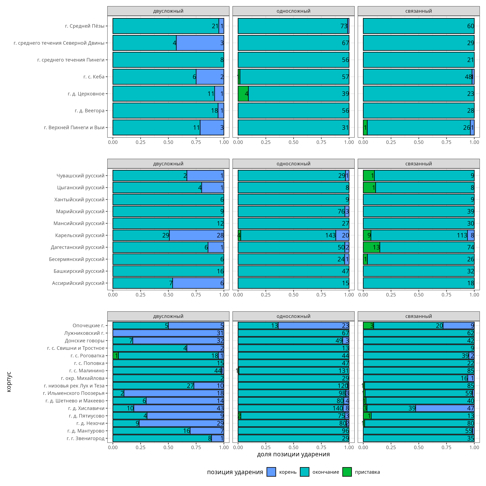
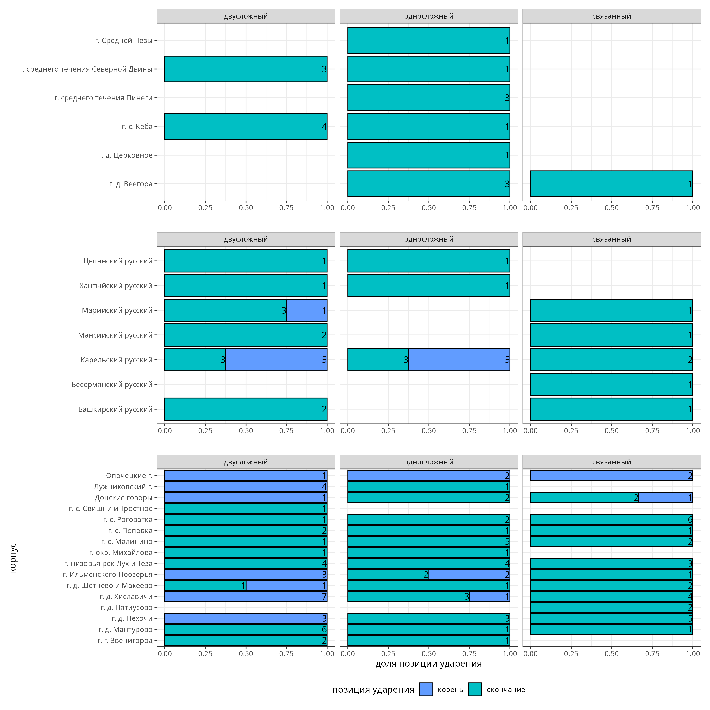

```{r}
#| include: false

library(lingglosses)
options("lingglosses.italic_transliteration" = FALSE)
```

# Функциональные исследования русского языка и других языков России

## Исследования русского языка

### Нестандартный русский язык: микродиахрония

Исследование в сфере микродиахронии русского языка посвящено семантическим сдвигам в употреблении русского глагола *броситься* в XIX-XXI вв. Современное его употребление отличается от функционирования в XIX в. Контексты, включающие эту лексему, изменились. В исследовании показано, как постепенно архаизировались три конструкции с этим глаголом: во-первых, он перестал быть синонимом глагола *влезть* при обозначении попадания внутрь помещения (современное *броситься в окно* употребляется только для описания движения наружу); во-вторых, вне иронических и гиперболических контекстов глагол *броситься* стал слабо сочетаться в современной речи с глаголами требования и, в-третьих, он больше не описывает ситуации попадания человека на поверхности малой площади (*на стул*, *на табурет*, *в седло*). Выбор этого глагола для обозначения движения человека раньше предполагал, что действие осуществляется под контролем исполнителя. В современной речи в некоторых из перечисленных случаев глагол *броситься* вытеснен глаголами *кинуться, вскочить, запрыгнуть, рвануться* и *ринуться*, в других осмысляется не вполне так, как осмыслялся читателями новеллы «Фаталист», из которой извлечены примеры для анализа (например, *броситься на постель* в речи современников М.Ю. Лермонтова было синонимично выражению *лечь спать*). Вероятно, изменения в семантике и сочетаемости глагола на протяжении XIX столетия были вызваны постепенным ослаблением влияния на русское *броситься* французского аналога *se jeter,* служившего основой для семантического калькирования в годы становления значения и типичной сочетаемости глагола. К XX веку глагол *броситься* потерял сему контроля, присущую *se jeter*, и поэтому практически утратил возможность свободно (вне идиоматики) сочетаться с глаголами требования и с наименованиями поверхностей малой площади; перестал обозначать осознанное движение внутрь помещения; сохранил идею скорости (утратил контексты неспешности); приобрел сочетаемость с эмоциональными стимулами; начал употребляться в контексте имен эмоциональных проявлений.

В повести «Фаталист» из романа М.Ю. Лермонтова «Герой нашего времени» глагол *броситься* встречается в пяти контекстах, не вполне тождественных нашим современным речевым практикам и в этом смысле для нас уже несколько архаичных. Два из них были рассмотрены в рамках специального исследования: *броситься к оружию* и *бросилось мне в глаза … лицо старухи*.

Рефлексив от глагола *бросить* в эпоху Лермонтова переживал стадию становления: формировал семантику и круг типичных контекстов. Сперва он тесно сближался с французским аналогом *se jeter*, но постепенно терял некоторые свойства кальки: утрачивал значение контролируемости действия субъектом, переставал выражать направленное движение внутрь помещения (*броситься в окно* перестало в наши дни передавать движение внутрь), утрачивал сочетаемость с глаголами приказа и с объектами цели движения малой площади (сегодня мы скорее *бросимся на землю*, чем *на стул*).

В лермонтовском примере с *оружием* нарушаются ограничения на ориентир, или цель движения, которая, как правило, должна быть более статична и массивна, чем движущийся к ней предмет. Это происходит под влиянием французского *courir aux armes*, букв. 'стремиться / бежать к оружию (любого рода, включая пушки)', видимо калькированного как военный термин и широко употребительного в XIX в. (но есть и более ранние примеры). При калькировании, особенно поначалу, использовался не только глагол *броситься*, как у Лермонтова, но и глагол *бежать* --- и не только существительное *оружие*, но и *ружья* / *ружье* в абстрактном значении 'оружие', близком французскому *armes*.

Часто французские кальки уходят из русской речи или преобразуются уже в середине XIX в. --- в данном случае речь идет о своеобразной терминологизации кальки, поэтому произошла задержка на целых 100 лет: последние и редкие употребления такого рода встречаются в текстах середины XX в. И более того, эта нестандартная конструкция сохранилась в новом виде: в XXI в. нестандартным объектом-целью при *броситься* выступает *телефон*. Понятно, что изначально (и очень недавно) телефон представлял собой стационарное устройство, часто с кабиной --- и не нарушал распределения Фон-Фигура. Однако с появлением мобильных телефонов ситуация изменилась --- а конструкция пока осталась старой.

*Броситься / бросаться в глаза*, вероятнее всего, является калькой с французского устоявшегося выражения *sauter aux yeux* 'быть очевидным, заметным' (букв. 'устремиться, метнуться, прыгнуть в глаза'), которое фиксируется в Le Dictionnaire de l'Académie française начиная с 1690 г. В этом смысле можно интерпретировать те русские примеры, которые встречаются в первой половине XIX в., --- речь идет о метафорическом движении, очень быстром, какого-то конкретного предмета (обычно неподвижного) к говорящему: этот предмет настолько заметен среди других, что как бы запрыгивает наблюдателю в глаза. В русском такая сочетаемость поддерживается близкой конструкцией *бросить взгляд*, а также параллельной ей уже исчезнувшей *бросить глаза* со значением 'быстро, мельком взглянуть’. Начиная с середины XIX в. исходное значение быстрого движения стирается, и непредметные имена начинают вытеснять предметные. Происходит переосмысление и перестройка метафоры.

Вторым направлением в сфере исследования русской речевой микродиахронии стало исследование функционирования предлога *поперек*. Предлог *поперек*, по «Словарю русского языка» (МАС), указывает на направленность действия по ширине чего-либо. Ширина объекта обычно предполагает и его длину (а *поперек* противопоставляется *вдоль*), поэтому привычное употребление этого предлога связывается с объектами вытянутыми, при этом имеющими очевидное и значимое для наблюдателя измерение не только по длине, но и по ширине. Однако употребление с именами объектов, не характеризующихся выраженной шириной, вполне традиционно: *поперек струны, жилы, волокна*. Современный узус предлагает неканонические (относительно классического синхронного словарного толкования) употребления этого предлога, в диапазоне от соотнесения с объектами, не обладающими ни выраженным противопоставлением измерений, ни фиксированными границами, ни строгой формой (*поперек неба, моря, тайги, вселенной*), до контекстной замены предлога *вдоль* (*поперек ворот, дверей, въезда*). У проемов (порталов) в русской языковой картине мира нет измерения по длине, их основным измерением является ширина, и применительно к проемам *вдоль* и *поперек* оказываются соотнесены с одним и тем же положением в пространстве (*вратарь лежит поперек хоккейных ворот*, то есть в направлении от штанги к штанге; *ливневка идет вдоль ворот*, то есть в направлении от столба до столба). Разница часто заключается в положении объекта или наблюдателя внутри или снаружи очерченного пространства. Специфична сочетаемость противопоставленных в словарях предлогов со словом *лоб*: *вдоль лба пролегла глубокая морщина* и *человечек с широкой тесьмой поперек лба* (в обоих случаях речь идет о направлении по ширине тела, перпендикулярно росту человека). В исследовании показано, что русское *поперек* не всегда антонимично *вдоль* и не связано с необходимостью описывать исключительно объект, обладающий измерением по ширине.

### Нестандартный русский язык: билингвизм

В исследовании поведения русского предлога *через* рассматриваются модели, используемые казахско-русскими билингвами при употреблении русских инструментальных конструкций. Анализ инструментальных конструкций не только сопровождается документацией отклонения в речи билингвов, но и (сквозь призму речевых данных билингвов) описывает вариативность, присущую нормам русского языка. Семантика предлогов трудно поддается описанию, и, как правило, большинство из них обладают обширной сетью значений. Именно абстрактные, метафорические значения вызывают трудности при усвоении, а не прототипические (пространственные) значения. Что касается конструкций, они развиваются от формул через низкоуровневые паттерны к более абстрактным схемам. Отправной точкой послужил анализ конструкций с *через* из казахского подкорпуса Russian Learner Corpus --- собрания академических текстов, написанных на русском языке казахскими билингвами (180000 слов, из которых было извлечено 29 инструментальных конструкций с предлогом *через*). Для выявления особенностей казахских инструментальных конструкций, которые могут влиять на русское употребление, использовался Алматинский корпус казахского языка. Характер отклонения от русской нормы, а также микродиахроническая эволюция русских инструментальных конструкций оценивались с помощью Национального корпуса русского языка. Эти корпусные данные были дополнены лингвистическим опросом, проведённым среди казахско-русских билингвов, русскоязычных жителей Казахстана и России. В опросе участвовали 90 человек (по 30 в каждой группе). Был проведён как качественный, так и количественный анализ корпусных данных и результатов опроса.

Во-первых, инструментальные конструкции с предлогом *через* в речи казахско-русских билингвов являются результатом влияния казахского как первого языка (L1) --- конструкций с послелогом *arqyly*. Показано, что семантическая сеть *через* основана на понятии «промежуточной стадии» (которая может функционировать либо как «препятствие», либо как «связующее звено»), тогда как *arqyly* принципиально опирается только на идею о «связующем звене». Это различие концептуальных оснований объясняет несовпадение некоторых значений этих служебных слов, в том числе в сфере инструментальности.

Но и целом организация поля инструментальности следует в двух языках разным принципам. В русском инструментальность структурируется по принципу различения разных типов объектов (инструментов), что достигается с помощью различных предлогов (включая предлог *через*, периферийный для этой зоны). В казахском проводится различие между прямой каузацией, выражаемой инструментальным падежом, и косвенной каузацией, связанной с послелогом *arqyly*. Наблюдения над академическими текстами, включёнными в RLC, подтверждаются результатами лингвистического опроса: по сравнению с носителями русского языка казахско-русские билингвы значительно чаще выбирают *через* в инструментальных контекстах.

Во-вторых, было рассмотрено, насколько устойчиво или вариативно употребление этих инструментальных конструкций в русском языке в диахроническом и региональном измерениях. Как показывают данные Национального корпуса русского языка, вариативность предложно-именных средств выражения инструментальности наблюдается и в самом русском языке. В частности, эволюция почтовой связи отражается в изменениях и конкуренции инструментальных конструкций (*через почту* вин. п., *на почте* предл. п., *по почте* дат. п., *с почтой* твор. п. и *почтой* твор. п.). Более того, наблюдения выявляют текущие тенденции региональной стратификации русского языка. Обновление инвентаря русских инструментальных конструкций происходит на фоне формирования региональных вариантов русского языка. Опрос демонстрирует умеренные расхождения в предложных предпочтениях между носителями русского языка, проживающими в Казахстане, и носителями, проживающими в России. Предполагается, что эти различия проистекают из опосредованного воздействия, которое русский язык, на котором говорят носители казахского как L1, оказывает на русскоязычных жителей Казахстана. Таким образом, употребление предлога *через* в инструментальных конструкциях казахско-русскими билингвами находится на пересечении переноса и продолжающегося языкового изменения: нестандартное употребление, обусловленное L1, совпадает с нарождающимися тенденциями в L2.

### Нестандартный русский язык на фоне литературного стандарта: наложение конструкций

В исследовании русского *гораздо* анализировалось поведение интенсификатора. Самый многочисленный тип конструкций --- интенсификаторы (более 300 --- по данным Русского Конструктикона) --- изучался в контексте сравнительных конструкций неравенства, таких как *Х больше Y* —> *Х гораздо больше Y*. Сравнительные конструкции и интенсификаторы обычно изучаются отдельно, поскольку они принадлежат к двум разным семантическим полям. Однако взаимодействие двух конструкций --- сравнительной и интенсифицирующей --- нетривиально и имеет свои собственные правила. Помимо ожидаемых морфологических и синтаксических ограничений, засвидетельствованы и менее тривиальные ограничения, такие как аспектуальный класс глагола в сфере действия сравнительной конструкции. Было показано, каким образом эти две конструкции сливаются в новую сущность, которая также является конструкцией с собственными свойствами, не сводимыми к свойствам сравнительной и интенсифицирующей конструкций, взятых по отдельности. Поскольку интенсификаторы надстраиваются над другими значениями, они обязательно пересекаются с конструкцией, в сферу действия которой попадают. Существенно, что это пересечение не следует сводить к простому сочетанию двух значений (сравнения и интенсификации), а скорее анализировать как взаимодействие двух сложных конструкций: сравнительной конструкции и интенсифицирующей конструкции. Это взаимодействие проливает свет на внутренние свойства обеих конструкций и уточняет ограничения на их употребление. Помимо практической значимости для изучающих язык, этот материал имеет важное теоретическое измерение, поскольку демонстрирует эффекты, которые могут возникать в результате конструкционного взаимодействия. В этом отношении исследования конструкционных взаимодействий открывают новые перспективы для будущих исследований в рамках грамматики конструкций.

Анализ интенсифицирующих конструкций, включённых в русскую сравнительную конструкцию неравенства, привёл нас к следующим выводам. Широкий диапазон интенсификаторов в русском языке объясняется их распределением по конструкциям с различной первичной семантикой. Интенсификаторы специализируются на конструкциях определённого семантического типа, поскольку они взаимодействуют с различными структурными и семантическими компонентами этих конструкций. Взаимодействие двух конструкций --- не единственная возможность, которую предлагают интенсификаторы. Хотя интенсификации может подвергаться определённая конструкция, можно также интенсифицировать сам интенсификатор, тем самым объединяя не две, а три конструкции вместе. В то же время интенсификаторы, допускающие такую возможность, строго ограничены из-за сложной семантики, которой они обладают. Было показано, что одна конструкция может модифицировать свойства другой конструкции, накладывая ограничения на употребление обеих. Однако помимо наложения новых ограничений взаимодействие двух конструкций может также создавать новые возможные употребления этих конструкций. В частности, хотя сравнительные конструкции неравенства строго запрещают опущение эталона сравнения за пределами эллиптических контекстов, некоторые интенсификаторы могут отменять этот запрет, сегментируя ongoing процесс или длящуюся ситуацию на серию итеративно повторяющихся порций, которые сравниваются попарно. Результаты показывают, что взаимодействие двух конструкций создаёт новую конструкцию с собственными свойствами, отличными от тех, которыми обладают две конструкции по отдельности. Этот подход к конструкционным данным имеет значение как для теоретических разработок в рамках грамматики конструкций, так и для типологии конструкций в более широком смысле.

В исследовании конструкции *мало ли что* рассматривается полисемичная русская дискурсивная формула *мало ли (что)* в её отношении к исходным конструкциям и проводится сравнение её функций с корейскими эквивалентами. Цель исследования --- дать систематическое описание полисемии *мало ли (что)* и выявить наиболее точные корейские некомпозициональные эквиваленты. Эмпирический материал составляет более 8000 примеров *мало ли (что)* и *а вдруг*, извлечённых из открытых баз данных «Русский Конструктикон» и «Прагматикон», а также из Национального корпуса русского языка, охватывающих как письменные, так и устные жанры. Корейские данные, собранные из веб-ресурсов, использовались для контрастивного анализа на базе корпусов. Анализ показывает, что семантика и прагматика *мало ли (что)* могут быть правильно поняты только через анализ лежащих в их основе конструкций и контекстов употребления. Диахронический анализ выявляет два значения формулы. Одно значение, обозначающее «неопределённо большое количество», не соответствует критериям дискурсивной формулы и должно быть описано в Русском Конструктиконе как нетипичная эллиптическая конструкция. Другое значение, выражающее обесценивание предшествующего высказывания, удовлетворяет критериям дискурсивной формулы и должно быть включено в Прагматикон. Это разграничение позволяет устранить несоответствия в трактовке *мало ли (что)* в двух базах данных. Синхронное сравнение с *а вдруг* проясняет функциональные свойства *мало ли (что)* и раскрывает иллюзию их взаимозаменяемости, основанную на поверхностном сходстве. Анализ функциональных фреймов, в свою очередь, позволяет выявить соответствующие корейские дискурсивные формулы. Предлагаемый подход уточняет описание русских дискурсивных формул и обеспечивает надёжную основу для сравнения с типологически далёкими языками, такими как корейский.

### Вариативность ударения в речи билингвальных и диалектных носителей русского языка: глаголы прошедшего времени

Исследованию русского ударения посвящены многие работы. Так, оно рассмотрено со стороны исторической акцентологии [@zaliznyak2019], кодификации и нормы, акустики. Детальное описание истории русской акцентологии представлено во второй главе [@ukiah_stress_1996]. Данное же исследование посвящено вариативности русского словесного ударения.

Акцентная система стандартного русского языка лексическая: позицию ударения в случайном непроизводном слове тяжело предугадать. В стандартном русском языке ударные гласные отличаются от безударных: обычно они длиннее других гласных в слове и имеют более четкую артикуляцию, в то время как безударные гласные подвергаются редукции
[@avanesov1958; @knyazev2011; @timberlake_reference_2004]. Русское
словесное ударение свободно и подвижно: оно может падать на любой слог в
фонетическом слове, а также его позиция может изменяться в
словоизменительной парадигме. Кроме того, ударение некоторых слов
нестабильно и отличается вариативностью [@avanesov1958;
@vorontsova1979; @zaliznyak1985; @ukiah_variation_2001;
@Lehfeldt2006; @savinov2020 и другие]. Областью такой вариативности,
среди прочих, является особая группа глаголов прошедшего времени:
*брать, быть, вить, врать, гнать, дать, драть, ждать, жить, жрать,
звать, (со)здать, клясть, лгать, лить, пить, плыть, прясть, рвать,
слыть, спать, ткать, -ча-, -я- (-ня-), -мер-, -пер-, родить* и
производные от них глаголы [@vorontsova1979; @savinov2020]. Выделяют
разные предпосылки проявления вариативности ударения в таких глаголах:
парадигматическая аналогия [@ukiah_variation_2001; @vorontsova1979;
@savinov2020], фонетическая аналогия [@ukiah_variation_2001;
@savinov2020], степень освоенности слова
[@marklund_sharapova_implicit_2000; @savinov2020], фактор
ритмического равновесия [@ukiah_variation_2001; @savinov2020].
История слова является важным фактором, определяющем стабильность его
ударения. Так, [@vorontsova1979] предполагает, что в глаголах с исконно
одно- и двусложной сложной основой наблюдается разная интенсивность
вариативности ударения. Предыдущие исследования отмечают важность
социолингвистических факторов [@ukiah_variation_2001; @savinov2020;
@avanesov1958], особенно возраста говорящего и места его проживания.

Объектом данной работы является вариативность ударения в речи
билингвальных и диалектных носителей русского языка. В литературе
упоминаются примеры влияния первого языка (L1) билингва на постановку
ударения во втором языке (L2) [@altmann_perception_2006;
@broselow_second_2013; @archibald_acquisition_2014; @avanesov1958;
@janurik_erzyarussian_2017; @hart_traces_1998]. Вариативность
ударения в западных русских говорах была исследована
[@askarova_osobennosti_2024]. Среди прочих выводов, отмечается влияние
литературной нормы на акцентные системы отдельных говоров.

Данная работа посвящена описанию акцентных систем нестандартных (билингвальных и диалектных) разновидностей русского языка. Кроме того, исследуются факторы, влияющие на вариативность между идиомами и внутри одного идиома.

#### Методы и данные

В данной работе мы используем материалы устных корпусов, которые для
каждой поисковой выдачи предоставляют достаточную социолингвистическую
информацию об информанте, включая год и место рождения, а также дают
доступ к оригинальным записям для прослушивания высказываний. В работе
были использованы следующие корпуса:

- Билингвальные: корпус ассирийского русского [@assyr_2025],
    башкирского русского [@sokur_corpus_2019], бесермянского русского
    [@bes_2020], чувашского русского [@chuvrus_2018], дагестанского
    русского [@dobrushina_corpus_2018], карельского русского
    [@karelrus], хантыйского русского [@khantyrus], мансийского русского
    [@MansiRus], марийского русского [@MariRus], цыганского русского
    [@romarus]

- Диалектные: корпус г. среднего течения Северной Двины [@dvina], г.
    с. Кеба [@keba], г. д. Хиславичи [@khislavichi], г. низовья рек Лух
    и Теза [@lukhteza], Лужниковского г. [@luzhnikovo], г. с. Малинино
    [@malinino], г. д. Мантурово [@manturovo], г. среднего течения
    Пинеги [@pinega], г. окр. Михайлова [@mikhaylov], г. д. Нехочи
    [@nekhochi], г. Ильменского Поозерья [@novgorod], Опочецкие г.
    [@opochka], г. с. Поповка [@popovka], г. д. Пятиусово [@pyatiusovo],
    г. Средней Пёзы [@pyoza], г. с. Роговатка [@rogovatka], г. д.
    Шетнево и Макеево [@shetnevo], г. д. Церковное [@tserkovnoe], г.
    Верхней Пинеги и Выи [@vaduga], г. д. Веегора [@veegora], г. с.
    Свишни и Тростное [@yelets], Донских говоров [@don_rnd], г. г.
    Звенигород [@panova_corpus_2021].

{#fig-conlab-4}

Мы исследуем глаголы с подвижным ударением в формах прошедшего времени.
Списки таких глаголов приведены в (@vorontsova1979; @savinov2020):
*брать, быть, вить, врать, гнать, гнить, дать, драть, ждать, жить,
жрать, звать, (со)здать, клясть, лгать, лить, пить, плыть, прясть,
рвать, слыть, спать, ткать, -ча-, -я- (-ня-), -мер-, -пер-* и
производные от них. Вслед за предыдущими исследованиями, мы
ограничиваемся этим списком. Кроме того, в данной работе мы
останавливаемся на словоформах женского рода. Мы исключаем из
исследования глагол *быть* и производные от него. Данный глагол требует
индивидуального внимательного исследования функций каждой из его
словоформ и вариативности ударения в них, особенно в диалектных
разновидностях русского языка.

Мы строили датасет для исследования следующим образом. Сначала из
каждого корпуса автоматически были выкачаны все примеры с прошедшими
формами исследуемых глаголов. Далее были скачаны производные формы этих
глаголов с помощью регулярных выражений. Например, чтобы выкачать все
производные формы глагола *взять*, использовалась следующая формула: \[
lemma='.\*взять.\*'%c & tag='.\*past.\*'%c\]. Наконец, вручную были
отобраны примеры с релевантными формами. Так, например, запрос \[
lemma='.\*жить.\*'%c & tag='.\*past.\*'%c\] выдавал нерелевантные
примеры с формами глагола *положить*. Итак, в датасете остались
словоформы следующих лемм: *брать, взять, взяться, влить, впиться,
врать, гнать, дать, добрать, добраться, догнать, дожить, допить,
допиться, доплыть, драть, драться, ждать, жить, забрать, забраться,
загнать, задать, зажить, залить, залиться, замереть, занять, запереть,
запить, заспать, заткать, звать, зваться, издать, клясться, набрать,
набраться, наврать, нагнать, надорваться, нажить, нажиться, назвать,
назваться, налить, налиться, нанять, напиться, нарваться, наткать,
обдать, обдаться, облить, обнять, ожить, отдать, отжить, отжиться,
отлить, отнять, отобрать, отогнать, оторвать, отослать, перебраться,
переврать, передать, пережить, перелить, перенять, пить, плыть,
повыпить, погнать, подать, податься, поддаться, поджить, поднять,
подняться, подобрать, подобраться, подогнать, подождать, подозвать,
подсобрать, пожить, пожрать, позвать, поклясться, полить, политься,
помереть, поназваться, поналить, понять, пооторвать, попить, поплыть,
попрогнать, порвать, порваться, послать, поспать, поспаться, постлать,
прибрать, привить, приврать, пригнать, прижиться, призвать, принять,
приняться, приплыть, прислать, прогнать, продать, прождать, прожить,
пролить, развиться, раздать, разжиться, разобраться, разогнать,
разорвать, разорваться, рвать, рваться, свить, сдать, сдаться, слать,
снять, сняться, собрать, собраться, соврать, согнать, содрать, созвать,
сорвать, сорваться, спать, спиться, убрать, убраться, удаться, удрать,
украсть, умереть, уняться, упиться, уплыть*.

Примеры, порожденные интервьюерами, были отфильтрованы. В окончательном
варианте датасета насчитывается 4516 строк.

Ударение в каждом из токенов было размечено вручную после прослушивания
аудиофрагментов, соответствующих примеру. В некоторых случаях позиция
ударения была неясна: например, аудио обрывалось на середине нужной
словоформы. Такие случаи были размечены меткой ‘неясно’. Распределение
меток разметки и примеры представлены в таблице -@tbl-conlab-19.

| метка (позиция ударения) | пример | число примеров в датасете |
|--------------------|----------------------|------------------------------|
| приставка | *он на́лил стакан* | 152 |
| корень | *А мы с мужем хорошо жи́ли* | 460 |
| окончание | *я эту корову сдала́* | 3736 |
| неясно |  | 168 |

: Разметка ударения {#tbl-conlab-19}

Все примеры со словоформами с приставкой *вы-* были исключены из
дальнейшего анализа, так как во всех 98 примерах приставка была ударной.

#### Ударение невозвратных словоформ

Вслед за предыдущими исследованиями, мы отдельно рассматриваем глаголы
разных типов основы (одно- и двусложные, глаголы со связанными корнями).
Рисунки -@fig-conlab-5, -@fig-conlab-6, -@fig-conlab-7 описывают акцентное поведение
невозвратных глаголов женского рода со связанными, односложными и
двусложными корнями. На каждом графике каждой точке --- корпусу ---
соответствует график доли каждой позиции ударения в примерах из корпуса; прописаны также абсолютные значения числа примеров для каждой доли. Доли ударения на приставке закрашены зеленым, на корне --- синим, на окончании --- голубым. Компиляция данных из рисунков -@fig-conlab-5, -@fig-conlab-6, -@fig-conlab-7 представлена на рисунке
-@fig-conlab-8 в более удобном для чтения формате.

{#fig-conlab-5}

{#fig-conlab-6}

{#fig-conlab-7}

{#fig-conlab-8}

Рисунок -@fig-conlab-5 показывает, что в невозвратных глаголах со связанным корнем в большинстве корпусов доминирует ударение на окончании. В некоторых лексемах (*умерла, поняла, приняла* являются наиболее показательными) проявляется конкуренция ударения на приставке и окончании. Эта вариативность встречается в некоторых билингвальных корпусах (цыганского, карельского, дагестанского, чувашского, бесермянского русского), а также в западных диалектных корпусах и в одном корпусе архангельских диалектов. Кроме того, в нескольких корпусах (особенно отчетливо в корпусе говора д. Хиславичи, где представлено большое количество примеров *поме́рла*) представлена вариативность ударения на корне и окончании.

Похожая ситуация наблюдается среди невозвратных форм глаголов с исконно односложной основой (@fig-conlab-6). Намного меньше примеров отмечается с ударением на приставке (часто это словоформы с приставкой *про-*); появляется больше примеров корневого ударения. Отличается от других корпусов опочецкий говор, где доминирует корневое ударение (*да́ла, ж́ила*).

Интересно поведение глаголов с исконно двусложной основой (@fig-conlab-7). Вариативность в таких словоформах распределена географически. В более
западных корпусах доминируют формы с корневым ударением (*зва́ла*).
Примеры с «западным» ударением часто встречаются в корпусах карельского
и ассирийского русского, а также единично в других билингвальных
корпусах. В архангельских говорах тоже встречаются примеры накорневого
ударения, обычно в словоформах с приставкой *по-*.

Итак, мы можем сделать следующие выводы об акцентных системах в
исследуемых идиомах. В архангельских говорах наблюдается доминирование
ударения на окончании вне зависимости от типа основы глагола. За
исключением трех случаев (*зва́ла-зв́ала, ишь взя́ла*), корневое ударение
появлялось в словоформах с приставкой. Можно предположить, что
вариативность в таких случаях продиктована тенденцией к ритмическому
равновесию в фонетическом слове.

В говорах территории ДАРЯ и донских говорах проявляется географическое
разделение акцентных систем. Чем более западный говор, тем больше
заметна разница в акцентологическом поведении одно- и двусложных
глаголов. Так, односложные глаголы в таких говорах принимают ударение на
окончании (исключение --- опочецкий г.), а двусложные --- как на основе, так
и на окончании. Многие примеры с ударением на окончании в двусложных
глаголах произнесены более молодыми носителями; так, можно заметить
влияние литературной нормы на акцентную систему этих говоров. Глаголы со
связанными корнями обычно принимают то же ударение, что и односложные
глаголы. Исключениями являются опочецкий г. и г. д. Хиславичи.

В билингвальных корпусах акцентологические тенденции менее однородные. В хантыйском, мансийском, бесермянском и башкирском русском нет вариативности ударения, оно всегда н окончание. Отличается корпус карельского русского, где накорневое встречается в формах с любым типом
основы, притом в двусложных глаголах, как и в ассирийском русском,
сильная вариативность корневого и флексионного ударения. Можно
предположить, что акцентная система в этих идиомах подверглась контакту
с акцентными системами говоров с акцентной системой западного типа.
Невозможно выявить убедительные примеры влияния акцентной системы L1 на
ударение в L2. Кроме того, акцентные тенденции в идиомах невозможно
сгруппировать по правилам постановки ударения в L1.

#### Ударение возвратных словоформ

Возвратные формы глаголов менее частотны, поэтому составляют меньшинство
примеров датасета. Их распределение показано на рисунке -@fig-conlab-9. Несмотря на
ограниченное количество примеров для отдельных идиомов, можно заметить
общую тенденцию: не встречаются примеры с ударением на приставке. Это
является еще одним примером проявления тенденции к ритмическому
равновесию.

{#fig-conlab-9}

Таким образом, данная работа исследует вариативность ударения в глагольных словоформах
прошедшего времени женского рода в диалектных и билингвальных
разновидностях русского языка. Результаты исследования показали, что
некоторые источники вариативности, наблюдаемые для стандартного русского
языка, являются релевантными и для его разновидностей. Так, в разных
говорах наблюдается тенденция ритмического баланса, вследствие которой в
словоформах ударение может смещаться к центру слова.

Различие акцентного поведения лексем с исторически одно- и двусложными
основами проявляется и в стандартном русском, и в диалектах, и в речи
носителей русского как L2. В большинстве корпусов это различие
проявляется в менее стабильном ударении в глаголах с исторически
двусложной основой. В западных говорах правила постановки ударения четко различаются для исторически одно- и двусложных глаголов.

В акцентных системах русского языка и его разновидностей проявляется
влияние литературной нормы, особенно у молодых носителей.

### Конкуренция форм дательного падежа на -*у* и -*ови* на материале Галицкой и Волынской летописей

Было проведено исследование, расширяющее существующее описание конкуренции форм дательного падежа на -*у* и на -*ови* и проверяющее влияние на это распределение различных факторов на материале Галицкой и Волынской летописей.

В XI--XV вв. на части территории распространения древнерусского языка у существительных мужского рода, относящихся в современном русском литературном языке ко II склонению, наблюдалась конкуренция двух форм дательного падежа единственного числа --- с окончанием -*у* (-*ю*) и с окончанием -*ови* (-*еви*). Исторически первая форма наблюдалась у слов *ŏ*-склонения, которые составили основу современного II склонения; вторая форма возникла из парадигмы *ŭ*-склонения, представлявшего собой небольшой закрытый класс слов, которые впоследствии также перешли в это склонение. В ряде предшествующих работ отмечается, что употребление окончания -*ови* у слов *ŏ*-склонения тяготеет к лексемам, обозначающим лиц, а также к именам собственным. Тем не менее для большинства древнерусских источников статистический анализ распределения соответствующих форм не представлен.

На материале Ипатьевского списка (XV век) двух летописей --- Галицкой и Волынской (конец XIII века) было проведено статистическое исследование значимости влияния различных фонетических, морфологических и синтаксических факторов на выбор окончания -*ови* или -*у* у того или иного вхождения. Рассматривались как параметры, уже отмеченные в предшествующей литературе по теме, так и факторы, влияние которых на распределение окончаний ранее не проверялось. Для анализа было размечено и проанализировано 1074 вхождений, относящихся к 234 леммам.

Всего для проверки различных гипотез все вхождения существительных мужского рода в дательном падеже единственного числа были размечены по следующим параметрам:

1) тип основы (твёрдая на -*в* / твёрдая не на -*в* / мягкая);
2) личное / неличное имя;
3) количество слогов в основе дательного падежа;
4) акцентный тип лексемы;
5) второе слово в неоднословном наименовании лица (отчества) (да / нет);
6) употребление с предлогом / без предлога;
7) употребление в конъюнкции (да / нет);
8) употребление в составе конструкции «дательный самостоятельный» (да / нет);
9) семантическая функция датива в контексте (адресат / посессор / ...).

Для личных / неличных имён был также размечен параметр

10) собственное / несобственное имя.

Проведение статистических расчётов значимости всех вышеприведённых параметров показало, что синтаксические параметры имеют наименьшее влияние на распределение окончаний -*ови* и -*у*. Вхождения, находящиеся в конъюнкции, чаще встречаются с одинаковыми окончаниями, то есть окончание второго конъюнкта можно считать в некоторой степени зависимым от окончания первого конъюнкта. Однако таких вхождений достаточно мало, чтобы говорить о явной тенденции --- большинство вхождений не находится в отношениях конъюнкции. Другие синтаксические параметры, как оказалось, не имеют значения для выбора окончания -*у* / -*ови*. Несмотря на то, что нередко одна и та же лексема может встречаться с разными окончаниями, как правило, одно из них значительно (при достаточно большом количестве вхождений) превалирует над другим, например, для лексемы *король* зафиксировано 37 вхождений с окончанием -*ови* против 1 вхождения с окончанием -*у*. Таким образом, тяготение к одному из окончаний в дательном падеже единственного числа является лексически обусловленным (для сравнения, слово *князь* ведёт себя противоположным образом --- все 60 вхождений отмечены с окончанием -*у* (-*ю*)).

Среди несинтаксических факторов выбора окончания однозначно предсказывает его только параметр «второе слово в неоднословном наименовании лица» --- все отчества в Галицкой и Волынской летописях встречаются только с окончаниями -*у*, но никогда не с -*ови*. Этот вывод согласуется с наблюдениями, сделанными на материале древненовгородского диалекта.

Второй важнейший параметр, определяющий выбор между окончаниями -*ови* и -*у* --- противопоставление личности / неличности имени --- окончание -*ови* тяготеет к личным именам, тогда как -*у* чаще встречается с неличными. Этот вывод также согласуется с наблюдениями в ряде более ранних работ.

Также статистическую значимость имеют факторы *тип основы* --- с основами на -*в* окончание -*ови* почти не встречается, а также *количество слогов* --- чем длиннее слово, тем ниже его вероятность получить окончание -*ови*. Это также уже было описано для древненовгородского диалекта.

Если посмотреть на конкретные вхождения, стоящие за этой статистикой, можно заметить, что часть из отмеченных закономерностей является достаточно строгими правилами с небольшим количеством отклонений, тогда как некоторые представляют собой лишь частотные тенденции. Выбор окончания -*у* или -*ови* в Галицкой и Волынской летописях можно представить в виде такой схемы:

Если отчество =\> -*у* (нет исключений), иначе

Если основа заканчивается на -*в* =\> -*у* (два исключения), иначе

Если существительное неличное =\> -*у* (пять исключений), иначе

Относительная неопределённость.

Внутри личных имён, не относящихся к отчествам и не заканчивающихся на -*в* выбор окончания может быть подчинён одной из миноритарных тенденций: окончание -*ови* чаще встречается у основ на мягкий согласный или у слов с акцентными парадигмами кроме «a» (неподвижное наосновное ударение), однако эти закономерности проявляются крайне слабо и распределение остаётся во многом случайным, свободно варьирующимся.

По итогам исследования планируется подать статью в журнал «Рема».

### Грамматические ошибки сквозь призму моделей

Отдельное исследование было посвящено тому, как большие языковые модели исправляют сложные грамматические ошибки в академических учебных текстах на русском языке. В отличие от традиционных GEC-систем, которые руководствуются принципом минимального исправления, большие языковые модели (LLM) часто применяют генеративные стратегии переписывания, которые могут улучшить восприятие текста, однако появляется риск гиперкоррекции структуры и семантических изменений. В работе был представлен новый экспертный бенчмарк, основанный на русском учебном корпусе из 3,1 млн слов, и продемонстрирована оценочная система, аннотированная по типу ошибки и уровню сложности. Авторы предлагают систему оценивания, основанную на экспертных суждениях и сочетающую количественный анализ, исследование изменения структуры и слепое попарное сравнение. Результаты выявляют баланс между минимальными исправлениями и генеративным подходом LLM. Это оказывает прямое влияние на оценивание, так как референсные метрики могут недооценивать структурную гиперкоррекцию и не учитывать разницу в подходах к исправлению.

Позиционный глагол «сидеть» развивает целый ряд значений, в том числе ‘находиться где-л. длительное время’ по Малому академическому словарю, которое, согласно современным исследованиям, в XI-XVII вв. в варианте ‘пребывать, находиться где-л.’ отмечалось значительно чаще, чем в современном языке. Представляется, что именно это значение легло в основу многих устойчивых употреблений, в т.ч. в пословицах и поговорках («сидеть в девках», «сидеть на бобах» и др.) и наблюдается в фольклорных текстах. Наблюдения над собранным корпусом фольклорных обрядовых и необрядовых текстов показали, что действие «сидеть» редко оказывается значимым, этот глагол достаточно редко фигурирует в фольклорных текстах (в необрядовых песнях, по результатам нашего анализа, всего в 5% текстов), однако использование этого глагола всегда не случайно, оно маркирует определенную ситуацию. Соответственно, в обрядах действие «сидеть» тоже может выступать как маркированное, предписанное традицией. Целью было исследовать условия, при которых употребляется глагол «сидеть», семантику этого глагола и действие в фольклоре. Авторы опирались на этнолингвистические методы, рассматривали обряд как семиотический комплекс и своего рода «текст» на многих языках и предполагали, что изучение семантики и прагматики глагола и действия «сидеть» в фольклоре позволит уточнить и расширить научные представления о глаголе и концепте «сидеть» как в традиционной культуре, так и в языке.

Было предложено описание семантики и прагматики действия «сидеть» в нескольких русских обрядах (во вьюнишном (свадебном) обряде, в обряде отправки в дорогу) и исследованы функции сидения в необрядовых лирических и обрядовых песнях и выявлены направления развития семантики глагола «сидеть» в русской традиционной культуре. Для анализа был собран корпус описаний обрядов, сделанных в Костромской и Нижегородской областях, интервью с жителями Костромской области и Московского региона; источниками послужили опубликованные работы и экспедиционные данные фольклорного архива НИУ ВШЭ. Кроме того, был составлен корпус необрядовых и обрядовых песен, в тексте которых содержится глагол сидеть.

В качестве семантической доминанты глагола «сидеть» выступает значение фиксированного положения, неизменного, неподвижного состояния. При этом особенностью русского «сидеть» (в сравнении с нидерландским» оказывается положение в некотором локусе, который концептуализируется как среда, а «сидение» --- как погружение в среду.

В мифологических текстах действие по глаголу «сидеть» входит в оппозицию с действиями и глаголами «стоять» и «лежать» (по признаку положения в пространстве) и «ходить» по признаку движения или его отсутствия. Касаясь семантики «сидения» в мифологических текстах, В.Н. Топоров отмечает, что сидение ассоциируется в них с семенем, зерном, которое сидит в земле, т.е. с началом жизни, потенциалом роста.

В славянской традиционной культуре сидение --- это неотъемлемая часть праздничного застолья. Оно связывается с совместным пребыванием, пребыванием внутри своей социальной среды --- семьи, рода, деревенской общины, в том числе живых и умерших родственников (особенно во время поминальной или праздничной трапезы). Во Владимирской области фиксируется свадебный термин «сидение»: так называли гуляние и застолье в доме у невесты накануне свадьбы --- то есть накануне накануне решающего события: поездки невесты и жениха к венцу.

При этом обрядовая традиция противопоставляет сидящих за свадебным столом совместно родственников --- и не приглашенных на свадьбу жителей деревни или случайных людей, которых называли «глядельцы». Они приходят посмотреть на свадьбу и их тоже угощают --- но у порога, стоя (они не могут сидеть за столом во время праздника, поскольку не включены в родовую общность).

В традиции костромских деревень Макарьевского района (Юрово, Большие Рымы) сидение обнаруживается как маркированное действие во вьюнишном обряде. Вьюнишный обряд, или окликание молодых --- величание молодоженов в воскресенье после Пасхи (Радошно воскресенье, Красная горка и др.) замужними или даже пожилыми жителями села --- совершалось как символ включения молодой пары в сельскую общину, завершение свадьбы как обряда перехода и окончательное формирование новой семьи. В традиции названных деревень, как показывают экспедиционные (архивные) данные, во время прихода окликальщиков молодожены должны были сидеть. Окликающие ходили вокруг них и пели вьюнишную песню. Затем окликавшие садились за стол, родители молодоженов и сами молодожены угощали их.

Круговой обход в этом обряде символизировал закрепление определенного состояния, выделение круга своих, сохранение молодой семьи. Однако примечательно, что молодые должны были сидеть в присутствии старших, пожилых и уважаемых жителей села. Семантика обряда свидетельствует о том, что сидение было принципиально важно, оно обозначало то состояние, в котором молодые должны были закрепиться в ходе обряда. Очевидно, что это совместное пребывание внутри семьи, рода.

Отправление в дорогу повсеместно осмысливается как кризисная ситуация, поскольку путешествие связывалось с опасностью, требовало выхода из освоенного пространства дома и деревни. Поэтому отправление в дорогу ритуализовано. В разных традициях принят различный набор апотропейных действий, среди которых, вероятно, одно из самых распространенных --- обряд «посидеть на дорожку». Обряд предполагает, что все, кто отправляется в путь и кто присутствует в доме непосредственно перед отправкой в одном пространстве (не в разных помещениях) должны сесть и некоторое время находиться сидя, вместе, в молчании. Представляется, что молчание, которое нередко маркирует переход в другое состояние, служит оберегом перед вхождением в чужое пространство, здесь, помимо этого, поддерживает статическое положение участников, обозначая отсутствие всякого действия, в том числе вербального. Учитывая семантику «сидения» как фиксированного положения внутри определенного локуса (это семантическая доминанта глагола «сидеть»), обряд фиксирует закрепленность человека в пространстве дома и рода, его связь с домом и семьей, но самое примечательное то, что это делается непосредственно перед выходом из своего пространства в чужое. Таким образом, нарочитое сидение маркирует и закрепляет связь человека с домом и семьей --- и отмечает границу пребывания дома перед отправкой в дорогу.

В связи с этим А.Б. Мороз указывает, что на Севере обычай посидеть на дорожку связан с традицией застолья, поскольку отправляющийся в путь обычно выходил в дорогу прямо из-за стола, где вместе с ним собиралась вся семья.

Заметим, однако, что устойчивость и широкое распространение обряда в настоящее время вне всякого застолья говорят о том, что сидение имеет здесь собственные функции и это обусловлено семантикой этого действия.

В народной песне «сидеть» всегда употребляется в прямом значении --- физического действия. Представляется неслучайным тот факт, что глагол не отмечен в конкордансах и словарях языка фольклора, поскольку глагол называет обыденное действие и, казалось бы, не обладает символической нагруженностью.

Как уже говорилось, глагол на удивление редко встречается в текстах песен. Из 400 песен собранного корпуса глагол фигурировал в 21 тексте (т.е. в 5% от всех песен). Примечательно, что пребывание в одном месте --- это значение характерно для «сидеть» --- описывается в песнях другими глаголами: гулять, ходить по терему и др.

Анализ песенного материала позволил выделить контексты, в которых употребляется глагол. Среди них преобладают любовные и свадебные.

Совместное сидение как форма ухаживания, общения молодых (ср. термины молодежные «посиделки», «поседки»). Сидят рядом или против друг друга невеста с женихом («Ты садись подле меня --- будешь верная жена» (Гор. № 21), «Не садися против меня… Люди скажут --- любишь меня» (Гор. № 23), «Вы не сказывайте в доме матерям, что который со которою сидел, что который со которой говорил» (Гор. №193), «Куда поприсести живу рыбу чистити? Сяду-поприсяду к зеленому саду, мил не обойдет, посадит в саночки» (Гор. №261). Вариантом того же контекста представляется и сидение чечетки-лебедки, которую посадили за решеточку, где она родила семь дочерей и сына № 176)

Одинокое сидение в ожидании замужества: сидит невеста в ожидании жениха (№ 145 сидит и прядет; № 230, 254 --- сидит у окна, также песня «Сидела Катюшенька день до вечера (вар: в светлой горенке) одна» [Соб., т. 7]. Также сидят в девушках (Гор. № 283). Ср. в подблюдной песне: «У окошка сижу, долги нитки вожу. Я еще посижу, я еще повожу» (девушка ждет замужества).

Сидящим может представляться и жених: Старый и ровня сидят во беседе, тревожат сердце девушки (Гор. № 168). Ср.: в игровой песне «Сидит олень» (Гор. № 115) парень-олень выбирает невесту.

Сидит птица на дереве, кусте, траве (Гор. № 39, 93). В некоторых песнях птица явным образом символизирует девушку (Гор. 270, 218).

Сидение может знаменовать начало нового состояния: «сядем и поедем домой» (Гор. 245), «сядем и споем» (Гор. 390).

Подобную же функцию, как кажется, сидение выполняет в новой балладе «Морячка»: «На берегу сидит девица, она платок шелками шьет»: далее начинается развитие сюжета.

Встречаются и устоявшиеся в языке употребления в других значениях: «сажать на корабль» и «сесть на корабль», «сажать хлеб на лопату» и в печь (вероятно, тоже связанные с семантикой смены/начала состояния).

Таким образом, в народных песнях сидение обозначает совместное пребывание девушки и парня, жениха и невесты, семьи или пребывания в ожидании (обычно замужества), а также состояние непосредственно накануне изменений, начала действия («Сидела Катюшенька», «Морячка»), само начало нового состояния (сядем и поедем, сядем и споем).

Специальное упоминание сидения встречается в тех случаях, когда нужно либо маркировать статическое положение перед началом изменений, указать на переход в другое состояние, либо выделить отсутствие изменений в ситуации, в которой изменения ожидались.

Таким образом, в рассмотренных жанрах фольклора действие и глагол «сидеть» опираются на общую семантическую доминанту этого глагола --- неизменное, постоянное пребывание внутри определенного локуса и на этом основании развивают семантику пребывания в определенном состоянии (которая, впрочем, наблюдается и в обыденном языке, ср. «они еще сидят работают») и принадлежности к определенной общности. Прагматика сидения в фольклорных текстах включает фиксацию стабильного состояния и маркирование перехода. Глагол и действие становятся обязательными, если персонаж только что пережил изменения и необходимо закрепиться в определенном положении, общности (молодые в свадебном обряде) или персонажу предстоят изменения и необходимо сохранить связь с исходным положением, общностью (девушка на выданье, девушка-героиня песенного сюжета, человек, отправляющийся в дорогу). Конкретные функции такого маркирования с помощью глагола и действия «сидеть» различны в разных жанрах.

### Фонетика рифмы в песенной поэзии на русском языке

В 2026 году продолжились исследования фонетики рифм в русскоязычной поэзии со второй половины XX века до начала XXI века. В рамках этого направления проводились исследования рифмы в русскоязычном рэпе. Был составлен корпус русского рэпа, в который входит 53 композиции. В этом корпусе содержится 1571 рифма разных типов.

Рифмы делятся на два типа: точные и неточные. Точные рифмы --- это рифмы, в которых ударный гласный и все звуки после него полностью совпадают, неточные рифмы --- все остальные. Вслед за М. Л. Гаспаровым в исследовании выделяются два основных типа неточных рифм: пополненные и измененные [@gasparov1991]. Пополненные рифмы --- это рифмы, в которых в одном рифмующемся слове есть сегмент, которого нет в другом. Например, в рифме «гимнастерки --- Теркин» в финали последнего слога второго рифмующегося слова есть согласный \[н\], а в финали последнего слога первого рифмующегося слова нет согласного. Измененные рифмы --- это рифмы, где в одинаковой позиции находятся разные согласные. Например, в рифме «гармонь --- домой» в первом слове в финали последнего слога находится звук \[н'\], а во втором слоге на том же месте находится звук \[j\]. В нашей выборке есть 379 точных рифм, 284 рифмы, которые являются только пополненными, 456 рифм, которые являются только измененными, и 452 рифмы, которые являются и пополненными, и измененными одновременно.

В рамках исследования было показано, что в русскоязычном рэпе, как и в англоязычном, встречаются двойные рифменные комплексы (далее --- *двойные Р-комплексы*) --- последовательности нескольких попарно рифмующихся слов, идущих друг за другом. Однако в русскоязычном рэпе у них есть ряд особенностей. Было показано, что двойные Р-комплексы в русскоязычном рэпе возникают благодаря усилению безударных гласных или сверхсхемным ударениям. Ниже приведен пример подобного Р-комплекса --- отрывок из композиции ATL *Диссонанс*:

Ой, когда нужно мыслить позитивней \[ˈп[аз'и]{.underline}ˈт'[ивн'ьй']{.underline}\],

Тебя накрыл диссонанс когнитивный \[ˈк[агн'и]{.underline}ˈт'[ивнъй']{.underline}\]

В этом отрывке второй предударный слог последних слов произносится с усилением, и благодаря этому /о/ произносится не со второй, а с первой степенью редукции. Таким образом, обе рифмы двойного Р-комплекса появляются в рамках одного слова. В других случаях в рамках одного Р-комплекса два слова рифмуются с одним словом, в котором усиливается гласный. Так происходит, например, в отрывке из композиции ATL *Звездный лорд*:

Меня встретят пришельцы в кокошниках \[каˈк[ош]{.underline}н'иˈк[ах]{.underline}\]

С караваем да солью, аж дрожь в руках \[ˈдр[ош]{.underline} вруˈк[ах]{.underline}\]

В корпусе зафиксировано 53 двойных Р-комплекса.

В рамках исследования фонетики рифм была проанализирована точность рифм, которые образуют двойные Р-комплексы. Оказалось, что последняя рифма в двойном Р-комплексе чаще оказывается точной, чем предпоследняя (р-значение точного теста Фишера --- 0,031445). Затем были рассмотрены рифмующиеся согласные в неточных рифмах, образующих двойные Р-комплексы. Оказалось, что согласные в предпоследней рифме рифмуются менее случайно, чем последние. Чтобы установить, насколько случайно рифмуются согласные, было рассчитано отношение наблюдаемого значения к ожидаемому (далее --- О/Е-значение). Среднее О/Е-значение в предпоследней рифме --- 2,24, а в последней рифме --- 1,69. Разница между этими значениями статистически значима (р-значение Т-теста --- 0,0347461).

Еще была исследована фонетика рифмующихся согласных в русскоязычном рэпе. Были выделены бинарные признаки, которыми различаются рифмующиеся согласные. Было показано, что чем чаще согласные рифмуются, тем на меньшее количество бинарных признаков они различаются (р-значение соответствующей переменной в линейной регрессии со смешанными эффектами --- 6,16e-06). Если согласные различаются единственным признаком, то чаще всего они различаются только звонкостью (р-значение соответствующей переменной в линейной регрессии со смешанными эффектами --- 4,95e-07). В предыдущих исследованиях рифмы в русскоязычной поэзии, в частности в работах М. Л. Гаспарова и Д. С. Самойлова, были отмечены аналогичные свойства согласных, которые различаются только звонкостью, но теперь они подтверждены статистическими тестами.

Было исследовано, какие признаки согласных влияют на их способность рифмоваться. При анализе влияния разных признаков на рифмуемость согласных была использована линейная регрессия со смешанными эффектами. Зависимая переменная для всех регрессий --- О/Е-значение для пары рифмующихся согласных, независимые переменные --- различные значения признаков. Выяснилось, что рифмующиеся согласные стремятся совпадать по месту образования (р-значение регрессии --- 1,34e-07). Еще они стремятся совпадать по разным бинарным признакам, связанным со способом образования: сонорностью (р-значение регрессии --- 6,41e-11), наличием щели (р-значение регрессии --- 7,05e-05) и назальностью (р-значение регрессии --- 9,16e-08). Затем было показано, что согласные некоторых способов образования стремятся рифмоваться: а именно, это --- шумные и щелевые согласные. Кроме того, стремятся рифмоваться глухие и мягкие согласные. Еще было показано, что стремятся рифмоваться согласные всех мест образования, кроме зубных. Однако зубные согласные, которые совпадают по некоторым способам образования, стремятся рифмоваться. Класс зубных согласных, в отличие от остальных классов согласных по месту образования, разнороден с точки зрения способа образования: в нем есть как сонорные, так и шумные взрывные, так и щелевые согласные. Таким образом, стремятся рифмоваться согласные, у которых совпадают способ и место образования одновременно. Тем не менее, для некоторых классов согласных описанная выше тенденция неверна: например, не стремятся рифмоваться ни сонорные, ни носовые согласные.

Для описанной выше картины есть типологические параллели: совпадающие по способу и месту образования согласные стремятся рифмоваться в рэпе, написанном на японском языке (согласно работам С. Кавахары) и афроамериканском английском языке (согласно работам Дж. Катца).

О рифмующихся согласных в русскоязычном рэпе была написана статья, которая была подана в журнал «Известия Российской академии наук. Серия литературы и языка».

### Теневая рифма в поэзии на русском языке

Отдельное исследование в области фонетики рифмы, проведенное в рамках работы по проекту в 2026 году, было посвящено исследованию теневой рифмы в поэме В. А. Гандельсмана «Видение». Этот термин ввел В. С. Баевский [@baevskiy1972], обозначая так способ рифмовки, при котором слова, принадлежащие к нескольким разным цепочкам рифм, рифмуются между собой, но менее точно, чем слова внутри этих цепочек. В большинстве текстов русскоязычной поэзии теневая рифма, если она есть, то возникает спорадически. Однако поэма «Видение» --- пример произведения крупной формы, в котором теневая рифма является частью схемы рифмовки.

Строфика поэмы «Видение», которая была проанализирована Е. В. Брейдо, устроена сложно. Поэма состоит из восьмистиший. В строфе чередуется количество слогов: 7-10-8-7-7-8-7-6. Первая строка рифмуется с пятой, вторая с шестой, третья с восьмой и четвертая с седьмой. В каждой строфе есть хотя бы одна мужская, женская, дактилическая и гипердактилическая клаузулы. В рамках работы было показано, что строфика в поэме «Видение» осложняется еще одним правилом: две теневые рифмы, каждую из которых образуют две основные рифмы, возникают в каждом восьмистишии поэмы.

Теневые рифмы всегда являются неточными; для них характерны типы неточной рифмовки, встречающиеся редко в остальной поэзии того же времени. Теневые рифмы в поэме «Видение» часто оказываются разноударными, то есть такими, в которых сходство рифмующихся слов сохраняется, но различается позиция ударения. Устройство разноударных рифм хорошо видно во втором восьмистишии поэмы.

```
Неба школьная доска,
яма антрацита угольная.
Опрокинута повозка
звезд многоугольная.
Снег, ступающий с носка,
снег, витрина кукольная,
улица продольная
между штор полоска.
```

В этом восьмистишии основные рифмы «доска --- носка» и «повозка --- полоска» образуют разноударную теневую рифму, основные рифмы «угольная --- кукольная» и «многоугольная --- продольная» тоже образуют ее.

Разноударные рифмы очень редко встречаются в русскоязычной поэзии (в отличие, например, от англоязычной). М. Л. Гаспаров считает, что для разноударных рифм в русскоязычной поэзии важно графическое сходство слов, а фонетическое сходство --- нет [@gasparov1991]. Исследование разноударных теневых рифм в поэме «Видение» частично опровергло эту идею. Так, было показано, что графическое сходство между словами, образующими разноударную рифму, есть. В разноударных рифмах есть два ударных гласных: один --- ближе к концу слова, второй --- дальше от него. И последний ударный гласный теневой рифмы часто совпадает с соответствующим ему безударным гласным. Поскольку теневую рифму в поэме образуют четыре слова, в некоторых случаях ударные гласные и соответствующие им безударные гласные совпадают не полностью. В нашей выборке 39 случаев, в которых последние ударные гласные теневой рифмы совпадают с соответствующими безударными гласными полностью или частично, и 20 случаев, в которых они не совпадают. Однако, если рассматривать предпоследние ударные гласные и соответствующие им безударные гласные, то складывается другая картина: только в 15 случаях эти гласные полностью или частично совпадают, а в 41 случаях не совпадают. Эти данные показывают, как устроен рифменный домен в разноударных рифмах. Рифменный домен большинства рифм --- ударный гласный и все звуки после него. Однако в разноударных рифмах положение ударных гласных различается, и поэтому границы рифменного домена неочевидны. Если опираться на графику, то последний ударный гласный в рифменный домен входит, в предпоследний --- нет.

Вопреки мнению М. Л. Гаспарова, звуковое сходство рифмующихся слов важно для устройства разноударных рифм. Выше было упомянуто, что в рифменный домен входят звуки после ударного гласного. Для разноударных рифм были рассмотрены как звуки после последнего ударного гласного, так и звуки между последним и предпоследним ударными гласными. Оказалось, что звуки после последнего ударного гласного чаще совпадают полностью, чем между последним и предпоследним ударными гласными.

Еще были рассмотрены характеристики согласных, входящих в разноударную рифму. Для русскоязычной поэзии как в работах Д. С. Самойлова и С. М. Толстой, так и в настоящем  исследовании рифмы в русскоязычном рэпе было показано, что чем на меньшее количество признаков различаются рифмующиеся согласные, тем чаще такие согласные рифмуются. Это же наблюдение верно как для согласных после последнего ударного гласного в разноударных рифмах, так и для согласных между последним и предпоследним ударным гласным в них.

Оценить фонетическое сходство ударных гласных и соответствующих им безударных гласных в разноударных рифмах трудно из-за редукции гласных в русском языке. Тем не менее, вне зависимости от ступени редукции на произношение гласных влияет, предшествует ли им мягкий согласный. Поэтому мы оценили, совпадают ли по мягкости согласные перед ударными и соответствующими им безударными гласными в разноударных рифмах. Оказалось, что перед последним ударным гласным такие согласные чаще всего совпадают, а перед предпоследним --- нет.

Таким образом, для разноударных теневых рифм в поэме «Видение» был выделен следующий рифменный домен: в рифму входят все звуки после предпоследнего ударного гласного.

О теневых рифмах в поэме «Видение» была написана статья, которая прошла рецензирование в журнале «Зборник Матице српске за славистику».

## Исследования малоресурсных языков России

### Употребление объектного спряжения при выраженном объекте в нганасанском языке

Была исследована проблема употребления объектного спряжения при выраженном объекте в нганасанском языке. Подготовлена статья, которая будет предложена в журнал «Урало-алтайские исследования» (список В).

Объектное спряжение в ряде уральских языков --- это особый набор лично-числовых окончаний, которые употребляются чаще всего для указания на эллиптированный объект. Однако оно также может употребляться при выраженном объекте. Этим употреблениям в хантыйском, тундровом ненецком, энецком языках был посвящен ряд работ, которые пытались сформулировать его условия ([@nikolaeva2001] и [@nikolaeva2014] среди прочих). Были выдвинуты разные гипотезы, общим для которых является взгляд на выбор типа спряжения (при выраженном объекте) как на автоматический процесс, зависящий от некоего фактора. Из такого взгляда логически вытекает ожидание того, что употребление того или иного типа спряжения в каждом конкретном случае --- либо для данного объекта в данном тексте, либо для данной пары «объект-глагол» --- однозначно предопределено и не может варьироваться. Однако как минимум к нганасанскому языку такого рода объяснения оказываются неприменимы уже потому, что один и тот же глагол с одним и тем же объектом может стоять и в субъектном, и в объектном спряжении в соседних фразах и даже в одной и той же фразе.

Этим фактам предлагается следующее объяснение: объектное спряжение при выраженном объекте, т. е. двойное маркирование объекта, служит для коммуникативного выделения, акцентирования соответствующей синтагмы, с целью обратить на нее внимание адресата. Собственно, похожее объяснение предлагалось ранее и для нганасанского, и для близкородственных ему ненецкого и энецкого языков: употребление объектного спряжения связывалось с «акцентированием», с «логическим ударением». Однако эти понятия не раскрывались, с чем, вероятно, и связано то, что соответствующий взгляд не получил широкого распространения. В советской лингвистике под логическим ударением понималось именно разновидность ударения --- как более сильное ударение на том слове, которое требуется выделить, а функцией логического ударения называлось «усиление смысловой нагрузки», «смысловое подчеркивание» и т. д.

Нганасанский язык позволяет конкретизировать эти расплывчатые термины. Двойное маркирование объекта используется в ситуациях контраста, эмфазы, смены или реактивации топика. Помимо перечисленных случаев, двойное маркирование объекта используется, чтобы отметить поворот сюжета в нарративе, а также чтобы подчеркнуть какую-то важную информацию в диалоге. Ср. следующие примеры (из корпуса нганасанских текстов INEL).

(@ex_arctic_007) контраст
```{r}
#| results: asis

gloss_example(
  transliteration = "Təndə bi̮δi̮ˀki-ˀə-gəj, heli̮ə-mti̮ koi-ˀə-ti̮.",
  glosses = "тот.ACC выпить-PF-3SG.DU половина-ACC.SG.3SG оставить-PF-3SG.O",
  free_translation = "Её они вдвоем выпили, половину он оставил",
  comment = "[Папа мой бутылку достал. У мужчин бутылки лежат вот здесь, в комбинезоне. Такую бутылку достал.]")
```

(@ex_arctic_008)  
```{r}
#| results: asis

gloss_example(
  transliteration = "Təti məküδa-ku-mtu təbtə koi-si̮tə? Iľi məküδa-kü-mtu hüətə honəi-sʼitə? — Məküδa-kü-mtu honəi-sʼitə-δi̮.",
  glosses = "тот мешок-DIM-ACC.SG.3SG тоже оставить-FUT[3SG.S] или мешок-DIM-ACC.SG.3SG  всегда использовать-FUT[3SG.S] мешок-DIM-ACC.SG.3SG использовать-FUT-3SG.O",
  free_translation = "[женщина] тоже выбросит? Или будет его дальше использовать? --- Она мешочек будет использовать.",
  comment = "(Обсуждаются процедуры, связанные с новорожденным ребенком.) ‘А этот мешочек (в который клали новорожденного)")
```

Во втором из приведенных примеров в фокусе контраста находится не объект, а глагол («не выбросит, а будет использовать»).


(@ex_arctic_010) эмфаза
```{r}
#| results: asis

gloss_example(
  transliteration = "Tə-məəni̮ ďerⁱar-i̮: «Kaδiauˀ, əm-kümü śiəˀ-hiati̮-mə təˀ!»",
  glosses = "тот-PROL.ADV смотреть-PRAES.3SG.S INTERJ этот-то продырявить-INFER-1SG.O PTCL",
  free_translation = "Он сквозь нее смотрит: «Гляди-ка, ведь я же, видать, его продырявил!»",
  comment = "[Дыра от его пальца оказалась сквозной, [когда он] отдернул руку.]")
```

(@ex_arctic_011)  
```{r}
#| results: asis

gloss_example(
  transliteration = "Təi-kələ-ˀ, ŋəδə-tə-tu-mə ľaŋkuəbtiˀə-gümü-mtü.",
  glosses = "находиться-TEMP-IMP.2SG.S найти-FUT-PRAES-1SG.O пуночка-то-ACC.SG.3SG",
  free_translation = "Подожди, найду я твою пуночку",
  comment = "(Говорит лиса, чью хитрость разоблачила пуночка --- полярный воробей.)")
```

В первом из приведенных предложений говорящий выражает удивление по поводу собственных действий, во втором --- угрозу.

(@ex_arctic_012) Реактивация топика
```{r}
#| results: asis

gloss_example(
  transliteration = "təniˀa ńüə-ˀkü-gəj hüətə heδi̮ti̮-gə-ti̮-gəj. taharⁱabiˀ muŋka-ˀa kaťəmi-ˀə-δi",
  glosses = "так ребенок-DIM-DU все.время идти-ITER-PRAES-3DU.S  PTCL дерево-AUGM увидеть-PF-3DU.O",
  free_translation = "Так дети все время идут. Потом они увидели большое дерево",
  comment = "[дерево было упомянуто за 11 предложений до этого]")
```

(@ex_arctic_013) Важная информация в диалоге
```{r}
#| results: asis

gloss_example(
  transliteration = "ńüə-mə kunda-ˀi-δə, ńüə-mə ťiδiδi-m-hⁱati̮,  ťiδiδə-mti̮ hᵘajhəδa-ˀa-mə, ńüə-mə kunda-ˀi-δə.",
  glosses = "ребенок-1SG уснуть-PF-3SG.S ребенок-1SG болячка-FACT-INFER  болячка-ACC.SG.3SG проколоть-PF-1SG.O ребенок-1SG уснуть-PF-3SG.S",
  free_translation = "Мой ребенок уснул, у ребенка болячка; болячку я его проколол, и он уснул.")
```


Важно отметить, что перечисленные коммуникативные значения не обязательно относятся именно к объекту: они могут относиться и к объекту, и ко всей клаузе. Сочетание выраженного объекта с глаголом в объектном спряжении --- то есть двойное маркирование объекта --- это свойство целой конструкции, которая, таким образом, вся целиком оказывается выделена.

Надо отметить, что использование двойного маркирования для коммуникативного выделения в нганасанском языке не ограничивается сочетаниями глагола с объектом. Ранее было показано, что сходную функцию имеет двойное маркирование в посессивных конструкциях. По-видимому, аналогичный механизм действует в субъектно-глагольных конструкциях (факультативное наличие личного местоимения при обязательном согласовании на глаголе) и в сочетаниях имен с числительными (факультативное выражение двойственного/множественного числа при числительных). Доклад об этом был сделан на конференции Transalpine Typology Meeting 2026 (München, 26--28 ноября, 2026).

### Антикаузатив и каузально-некаузальная альтернация в тундровом ненецком языке

Были исследованы антикаузативные морфологические средства в тундровом ненецком языке, в котором существует несколько стратегий не только пассивизации, результативизации, антипассивизации, каузативизации, но и антикаузативизации. Специализированный показатель *‑rə* не является главным антикаузативным средством. Он может образовывать антикаузативные дериваты, которые в дальнейшем могут подвергаться каузативизации; ср. *yeka‑* 'развязать' \> *yeka‑rə‑* 'развязаться' \> *yeka‑r°‑ta‑* 'развязать'; при этом значимых различий в семантике двух переходных глаголов в подобных «тройках» не фиксируется. Даже для языков с богатой деривационной глагольной морфологией сама возможность каузативизации морфологически производного антикаузатива представляется типологически своеобразной опцией (хотя этот аспект и заслуживает специального изучения); например, для карачаево-балкарского в [@lyutikova2006] (стр. 189, 212) эксплицитно отмечается запрет на такую последовательность морфологически маркированных операций. Иногда *‑rə* присоединяется к связанным глагольным основам, а в отдельных случаях антикаузативный дериват и соответствующий ему переходный глагол могут быть устроены с формальной точки зрения одинаково сложно; ср. *t[ə]{.underline}xarə‑* 'разрушиться, разбиться' vs. *t[ə]{.underline}x[°]{.underline}bta‑* 'разрушить, разбить'.

Антикаузативизация --- один из двух стандартных результатов присоединения показателя т. н. Статива на \*w; ср. *syidyo‑* 'проснуться, пробудиться' \< *syidye‑* 'разбудить', *wadyo‑* '1) вырасти, развиться (о людях, животных, растениях); 2) развестись, расплодиться' \< *wada‑* '1) вырастить, выкормить (кого-либо); 2) вырастить, развести (кого-либо / что-либо)'. Формальных синхронных способов образования «стативных» дериватов множество, но их объединяет то, что в итоге всегда образуется альтернирующий глагол («alteration verbs», в терминах Т. Салминена) с основой на *ə* или *o* (иногда с палатализацией предшествующего согласного). Другая функция Статива --- «расширенный результатив», т. е. выделенным из события, описываемого исходным глаголом, подсобытием может быть как результирующее состояние *(ŋamtyo‑* 'сидеть' \< *ŋamtə‑* 'сесть', *penyo‑* 'быть положенным' \< *peh‑* 'положить'), так и результирующий процесс *(məncabtyo‑* 'шевелиться; качаться' \< *məncabta‑* 'пошевелить; покачать'). Статив является направленной деривацией и образует дериваты, к которым может присоединяться другая деривационная морфология.

Также антикаузативизация может выражаться в мене «спряжения» (cross-reference series) на «рефлексивное» (всегда непереходное, показатели которого индексируют только S-участника), что применимо к амбитранзитивным глагольным основам типа *næ-* '1) открыть; 2) открыться'. При этом полностью совпадают некоторые нефинитные формы, в частности инфинитив, а личные формы в норме различаются (хотя и не всегда) благодаря различным сериям лично-числовых индексов. В таких случаях можно говорить о неканонической лабильности (в терминах [@letuchiy2013]), а именно о частичной лабильности, приближающейся к лабильности на уровне лексем, распределённой по подпарадигмам. Общим участником для переходного и непереходного употреблений подобных глаголов, достаточно распространённых в тундровом ненецком, является Пациенс. Необходимо подчеркнуть, что «рефлексивное спряжение» ассоциировано не только с антикаузативизацией, но также с инхоативизацией (ср. *tyí‑* (т. н. «субъектное спряжение») 'сидеть' vs. *tyí‑* (т. н. «рефлексивное спряжение») 'сесть') и изредка с рефлексивизацией. Оно также практически в обязательном порядке маркирует пассивные глаголы, инхоативные с *l‑*овым показателем и некоторые другие дериваты.

К периферийным средствам антикаузативизации относятся некоторые показатели глагольной множественности (pluractionality markers), что типологически естественно и засвидетельствовано в самых разных языках, а также Трансформатив с показателем *‑m*, присоединяющийся в других функциях и к глагольным, и к именным основам (в последнем случае обычно к основам со значением качественного признака); ср. *wabtom‑* '1) опрокинуться, перевернуться; 2) вылиться, пролиться; 3) вы́сыпаться, просы́паться' \< *wabta‑* '1) опрокинуть, перевернуть; 2) вылить, перелить, пролить; 3) высыпать, пересыпать, просы́пать; 4) навалить, положить, наложить (поверх чего-либо)'.

Кроме того, была изучена каузально-некаузальная альтернация в тундровом ненецком языке. Для решения этой задачи были составлены и проанализированы списки переходных и непереходных глагольных пар с опорой на [@haspelmath1993b], где рассматривается 31 пара глаголов (аналогичный список принят в проекте [@transitivity2014], при этом выборка языков в последнем значительно больше, но тоже ареально и генеалогически не сбалансирована). При этом неизбежны методологические трудности, связанные с включением той или иной пары глаголов, наличием нескольких вариантов глагольных пар с близкой семантикой, отсутствием глаголов с определённой семантикой. Условен выбор некоторых глаголов, в частности, основного глагола качания, поскольку в тундровом ненецком языке эта семантическая зона очень развита. Условно также определение лабильных пар. Во всех парах, отмеченных как лабильные, глаголы регулярно различаются серией лично-числовых согласовательных показателей (см. выше), однако их основы идентичны (могут существовать различные взгляды на то, являются ли такие пары одной лексемой или нет).

Если исключить из числа рассматриваемых значений 'develop', из 30 глагольных пар 5 будут демонстрировать антикаузативную альтернацию (A), 18 --- каузативную альтернацию (C), 1 --- эквиполентное соотношение (E), 1 --- супплетивизм (S), 5 --- лабильность (L) (в том смысле, в котором это явление описано выше). Если считать, что значения глаголов *wadyo‑* / *wada‑* близки к 'develop', тогда число пар, демонстрирующих антикаузативную альтернацию, увеличится до шести. Индекс A/C (отношение числа антикаузативных пар к числу каузативных), таким образом, может быть 0,2(7) или 0,(3). Во всех этих случаях антикаузатив маркирован Стативом. Специализированный показатель *‑rə* присутствует только в уже названном глаголе *t[ə]{.underline}xarə‑* 'разрушиться, разбиться', находящемся в эквиполентном соотношении с *t[ə]{.underline}x¡°¿bta‑* 'разрушить, разбить'.

Процент каузативной альтернации в каузально-некаузальных парах глаголов в тундровом ненецком (18 из 30) почти совпадает с соответствующим процентом в турецком языке (17,5 из 30, согласно [@haspelmath1993], стр. 101). В выборке М. Хаспельмата процент каузативных пар выше только в монгольском языке (22 из 31), что подтверждает статус тундрового ненецкого языка как преимущественно транзитивизирующего. Число антикаузативных пар близко к показателям монгольского (6 из 31) и венгерского (7 из 31). Индекс A/C (соотношение антикаузативной и каузативной альтернаций) оказывается близким к монгольскому (0,(27)). При этом процент ненаправленных пар достаточно высок (23,(3) %).

Возможно, однако, и принципиально другое техническое решение, если считать, что мена «спряжения» на «рефлексивное», хотя и является словоизменительным средством, может рассматриваться как направленная деривация. В таком случае лабильные глаголы будут признаны отсутствующими, число ненаправленных пар сократится до двух, а число глагольных пар, демонстрирующих антикаузативную альтернацию, вырастет сразу до десяти или одиннадцати (с учётом оговорок, сделанных выше).

Независимо от конкретного упорядочения списка (и в [@haspelmath1993], и в [@transitivity2014] список упорядочен в соответствии с возрастанием индекса A/C, но из-за различий в выборке он выглядит существенно различным образом) и одного из двух принципиальных технических решений, описанных выше, разные средства в тундровом ненецком достаточно слабо кластеризуются. Каузативная альтернация встречается во всех частях списка, но везде разрывается другими типами. Антикаузативная альтернация зафиксирована не только во второй половине списка, но и в первой, причём в самом верху (значения 'wake up', 'go out / put out, extinguish (об огне)'). Однако три из пяти глагольных пар, демонстрирующих (неканоническую) лабильность, сконцентрированы в нижней части списка (значения 'open', 'gather' и 'close', хотя для 'gather' можно подобрать и другую пару, которая будет демонстрировать каузативную альтернацию).

Более содержательным может быть соотнесение языковых данных со шкалой самопроизвольности (spontaneity scale), один из вариантов которой представлен ниже: *freeze --- dry --- melt --- burn --- fill --- rock --- gather --- open --- break --- spill* [@letuchiy2013: 108].

Эта шкала основывается на типологических обобщениях. С одной стороны, она предполагает, что глаголы со значениями, представленными на правом полюсе, гораздо более склонны в самых разных языках образовывать маркированный антикаузатив, чем глаголы со значениями, представленными на левом полюсе, для которых более нормально образование маркированного каузатива. С другой стороны, данная шкала должна обнаруживать свойства семантической карты, то есть удовлетворять принципу смежности.

В тундровом ненецком языке глаголы со значениями 'freeze', 'dry', 'melt', 'burn', 'fill', 'rock' образуют маркированный каузатив, глаголы со значениями 'break', 'spill' --- маркированный антикаузатив, а глаголы со значениями 'gather' и 'open' лабильны (в рассмотренном выше смысле, то есть в непереходном употреблении присоединяют показатели «рефлексивного спряжения»). Если принимать в расчёт этот усечённый вариант шкалы самопроизвольности, материал тундрового ненецкого языка соответствует типологическим ожиданиям: маркированные каузативы, антикаузативы и лабильные глаголы занимают непрерывную зону на данной шкале.

### Симилятивные показатели в лесном ненецком языке

В рамках работы над проектом в экспедиции по изучению лесного ненецкого языка было проведено исследование распределения различных симилятивных показателей и их семантических характеристик. В тундровом ненецком существуют морфологические показатели *-rəxa* 'SIM' и *-(də)rˊem* 'EQU', однако их морфосинтаксические свойства описаны в литературе кратко, а потенциальные семантические различия не упоминаются; также не было известно, способны ли эти показатели выражать только симилятивное значение или также эквативное. Отличия симилятивной конструкции от эквативной состоят в том, что в симилятивной конструкции нет эксплицитного параметра сравнения, а также выражается не совпадение со стандартом сравнения по признаку, а примерное приближение подразумеваемых степеней выраженности этого признака.

Для лесного ненецкого языка подробные описания симилятивных и эквативных показателей отсутствовали в известных источниках ([@burkova2004; @jalava2017; @kuznetsova2014] и др.). По итогам предварительного этапа исследования в лесном ненецком было выявлено по крайней мере четыре в разной степени грамматикализованных показателя стандарта сравнения: *-λ°xa* 'SIM1', *=t°λˊam* 'SIM2', *šeλ* 'SIM3' и *toʔλ°xa* 'похож'. Их морфосинтаксис и семантика сопоставлялись по пяти параметрам:

1. морфологические характеристики стандарта сравнения;
2. синтаксические позиции (а) стандарта сравнения (б) объекта сравнения;
3. семантические характеристики стандарта (одушевлённость, референциальные свойства);
4. возможность эквативного употребления, то есть использование эксплицитного параметра сравнения и значение полного совпадения объекта и стандарта по этому признаку;
5. возможность образования симилятивных предикаций с глагольными основами.

По результатам исследования четыре показателя демонстрируют существенно различное морфологическое и синтаксическое поведение, в то время как семантические ограничения на их употребление приблизительно одинаково слабые. Показатели *=t°λˊam* и *šeλ* специализируются на адвербиальном употреблении, то есть характеризуют сходство объекта и стандарта сравнения по образу действия. Показатели же *-λ°xa* и *toʔλ°xa* используются в предикативной позиции в первую очередь, а также в атрибутивной и аргументной; при этом *toʔλ°xa* управляет аккузативом личных местоимений и генитивом существительных. Также было обнаружено, что симилятивы в лесном ненецком неизбирательны в отношении одушевлённости и референциального статуса стандарта сравнения.

(@ex_arctic_016)  
```{r}
gloss_example(
  transliteration = "Xomani păči-λa kaλ´a=tăλˊam / kaλ´a-ŋ šeλ",
  glosses = "Х. плавать-3SG рыба=SIM2 / рыба-GEN.SG SIM3",
  free_translation = "Хомани плавает как рыба."
)
```

(@ex_arctic_017)  
```{r}
#| results: asis

gloss_example(
  transliteration = "ńań° mănλˊe° ṕă-ŋ kań°ku=λ°xa / kań°ku-ŋ toʔλ°xa",
  glosses = "хлеб уже дерево-GEN кусок=SIM1 / кусок-GEN похож",
  free_translation = "Хлеб уже как кусок дерева."
)
```

Наиболее продуктивно в качестве маркера экватива используется *šeλ;* при этом параметр сравнения, отсутствующий в симилятивных конструкциях, в эквативной конструкции не требует дополнительного маркирования.

(@ex_arctic_018)  

```{r}
#| results: asis

gloss_example(
  transliteration = "čĭk´i ḿăʔ pĭt° ḿaʰ-t° šeλ ṕĭλša",
  glosses = "this house 2SG house-GEN.POSS.2SG SIM3 tall",
  free_translation = "Этот дом такой же высокий, как твой."
)
```

Таким образом, показатели сходства в лесном ненецком языке при схожих семантических ограничениях заметно различаются своими морфосинтаксическими свойствами. Часть из них используется в качестве эквативов, при этом специализированных эквативных конструкций не выявлено.

Полевое исследование в лесной ненецкой экспедиции было напрямую связано с исследованием, проводимым в течение последних двух лет и посвящённым симилятивно-аппроксимативным показателям в лесном ненецком языке: показатель *-λ°xa* в лесном ненецком (так же как и родственные ему показатели в других языках самодийской ветви уральской семьи) из показателя симилятива развился в показатель эпистемического наклонения. Основные теоретические положения этого исследования в масштабе всех самодийских языков были представлены в постерном докладе на 16-й конференции Ассоциации лингвистической типологии (ALT-2026).

### Семантика и синтаксис некоторых конвербов в лесном ненецком языке

В 2026 году в экспедиции по изучению лесного ненецкого языка в д. Харампур методом элицитации были получены новые языковые данные. Целью работы было изучить придаточные клаузы, оформленные комитативным показателем *-samæ* на глаголе, и сопоставить их с придаточными, оформленными конвербом *-š°.* Кроме этого, был изучен показатель отрицательного причастия *-w°t°mæ* и производный от него конверб *-w°t°mi-ŋ.*.

Показатель *-samæ* ранее описывался в следующих функциях: проприетив/атрибутивизатор (@ex_arctic_019), комитатив (@ex_arctic_020) и скалярно-аддитивный показатель 'даже' (@ex_arctic_021).

(@ex_arctic_019) *ńămt°-samæ ti* 'олень с рогами'

(@ex_arctic_020) *pos°kan°-samiŋ kandʹaʔ kădʹa* 'Петя пошёл на охоту с ружьём'.

(@ex_arctic_021) *jura-samiŋ buran° meʰ-š°tu-ʔ* 'Даже Юра на «Буране» ездит'.

В этих употреблениях отмечены алломорфы *-sami*, *-samæj* и *-sami-ŋ* с наречным генитивом.

При этом было замечено, что *-samæ* может присоединяться и к глагольным основам (@ex_arctic_022).

(@ex_arctic_022) *măń° šexeλæm°na mĭndʹat° kĭnuʰ-samæ*  'Я иду по дороге и напеваю'.

Данное употребление допускается не всеми носителями: его используют в основном более компетентные носители языка, что указывает на периферийный, возможно книжный, характер конструкции.

В данной функции возможен вариант *-samæ* или *-samæj,* форма *samiŋ* не отмечается, что позволяет интерпретировать показатель как сочетание комитатива с конвербом *-°.* Допустимо также сочетание комитатива с конвербом на *-š°:* *kĭnuʰ-samæ-š°* 'напевая'. Таким образом, комитативный суффикс не является сам по себе показателем конверба, но присоединяется перед ним, возможно, привнося дополнительное значение. Дальнейшая работа с этим показателем была посвящена определению этого компонента значения.

Конверб с *-samæ-°* обозначает действие, одновременное движению или другому непредельному действию матричной клаузы (@ex_arctic_023).

(@ex_arctic_023) *ńeŋ́i kĭnuʰš° / kĭnuʰsamæ xä̆tuλăŋa°* 'Женщина шьёт, напевая'.

По функции он близок конвербу на *-š°,* однако, в отличие от него, маркирует именно дополнительное действие и не может, наоборот, оформлять глагол движения (@ex_arctic_024)--(@ex_arctic_025).

(@ex_arctic_024) *măń° šexeλæm°na ḿĭnš° kĭnuʔŋat°* 'Я, идя по дороге, пою'.

(@ex_arctic_025) *\*măń° šexeλæm°na ḿĭnsamæ° kĭnuʔŋat°*\ Ожид.: 'Я, идя по дороге, пою'.

Показатель *-samæ-°* используется при непредельных матричных глаголах и выражает именно одновременность, а не хабитуальность (@ex_arctic_026) или последовательность действий (@ex_arctic_027).

(@ex_arctic_026) *maša kĭnuʰš°tu, tăλaš°tu, xä̆tuλăš°tu / *xä̆tuλă(š°tu)samæ° šaŋk°ḿan° šeλ čedˊiḿa*\ 'Маша поёт, танцует, шьёт --- всё умеет'.

(@ex_arctic_027) *kasa° ŋăʰš°kˊi ŋuλăš° / *ŋuλ°samæ kădˊa a*\ 'Мальчик встал и пошел'.

Конверб с *-samæ-°* может обозначать способ движения (@ex_arctic_028), реже --- компонент движения при его интерпретации как способа: *šuλp'esamæ ḿĭndˊa* 'идет быстрым шагом'.

(@ex_arctic_028) *măń° šexeλæm°na măjtăš° / mæt°samæ° ḿĭndˊăt°* 'Я иду по дороге, хромая'.

Однако *-samæ-°,* в отличие от *-°* и *-š°,* не может оформлять компонент той же ситуации (@ex_arctic_029).

(@ex_arctic_029) *xalaʰku čiʔ / čiʰš° / \*čiʔsamæ ḿĭńdˊa* 'Птица летит'.

Клауза с *-samæ-°* в инструментальном значении возможна в ситуации способа (@ex_arctic_030) или параллельного действия (@ex_arctic_031), но сочетаемость с моментальными действиями хуже (@ex_arctic_032).

(@ex_arctic_030) *dˊăxam pačaλ´š° / pačeλ´samæ mataŋamaʔ* 'Мы пересекли реку вплавь'.

(@ex_arctic_031) *xomańi λusa watam toxoλaŋa λusax°na munuʰš° / ^%^munuʰsamæ* 'Хомани выучила русский язык, разговаривая с русскими'.

(@ex_arctic_032) *dˊăx́aʔudˊem xaʔmăš° / ^%^xaʔmsamæ mataŋamaʔ* 'Мы пересекли ручей прыжком'.

Клауза с *-samæ-°*, как и конвербы *-°* и *-š°,* возможна только при совпадении субъекта с матричной клаузой (@ex_arctic_033).

(@ex_arctic_033) *măń° šexeλem°na mĭndʹat° xalaʰkuʔ kinuʔŋaʔ / \*kĭnuʰ-š° / \*kĭnuʔ-samæ*\ 'Я иду по дороге, птицы поют'.

Матричный глагол при придаточной клаузе с *-samæ-°* должен быть непредельным (@ex_arctic_034). Возможно, это говорит о том, что ситуации в матричной и в зависимой клаузах должны совпадать по времени.

(@ex_arctic_034) *măń° xä̆tuλămaj° šeλ / xä̆tuλăš° / \*xä̆tuλ°samæ końoλamæm°* 'Я заснула, пока шила'.

Детелисизирующая морфология на глаголе иногда оказывается необязательной: *kuλsuʰṕosamæ°* = *kuλsuʔsamæ°* 'помешивая' (ср. *kuλsuʰš°* 'размешать' \> *kuλsuʰṕoš°* 'размешивать').

Что касается синтаксических свойств двух конвербов, *-samæ-°*, как и *-š°*, может оформлять целую клаузу (@ex_arctic_035).

(@ex_arctic_035) *ńĭ kaλ´ita ṕiλ´iṕita ńun°ta kinsat me-samæ* 'Женщина варит рыбу, поя ребёнку песню'.

Конверб с *-samæ-°* обнаруживает несколько большую свободу порядка слов относительно матричного глагола, чем *-š°.*

Таким образом, конвербы с *-samæ-°* отличаются от конверба на *-š°* тем, что не может маркировать компонент той же ситуации, а также не сочетается с моментальным действием в матричной клаузе. В остальном два вида придаточных клауз употребляются практически синонимично, но *-samæ-°* оценивается носителями как более «художественный» и литературный вариант.

Формы на *-wăt°mi-ŋ* используются как отрицательные конвербы, то есть *-ŋ* появляется в той функции, где на *‑samæ* он скорее невозможен: *kĭnuʔwăt°miŋ* 'не поя', *mætwăt°mi* 'не хромая'. Альтернативной стратегией является отрицательный конверб *ńiš°*. На именах для обозначения отсутствующего участника используется каритив *-šiṕoj: šoḿašiṕoj dˊatŋat°* 'я иду без шапки'; взаимозаменяемость *‑wăt°mi* и *-šiṕoj* не обнаружена.

Конвербы на *-wăt°miŋ*, как и с *-samæ-°*, возможны только при совпадении субъекта в придаточной и матричной клаузах (@ex_arctic_036).

(@ex_arctic_036) *măń° ŋotaʰkom°na ḿĭńdˊăt°, xalaʰkuʔ \*kĭnuwăt°miŋ / ^ok^kĭnuwăt°mi meŋaʔ*  'Я иду по дороге, птицы не поют'.

При этом в отличие от *-samæ-°*, отмеченных ограничений на матричную клаузу у них нет (@ex_arctic_037)--(@ex_arctic_038).

(@ex_arctic_037) *kasa ŋaškˊi ŋuλwăt°mi kĭčamta næʰkaλ´a* 'Мальчик достал чашку, не вставая'.

(@ex_arctic_038) *kušeʔ xajtuλaw°tămiŋ pataλ´aλ´°*  'Как ты не шья укололась?'

Большинство носителей допускает образование конверба *-wăt°mi-ŋ* от недетелисизированной основы: *kuλsuʰṕowăt°miŋ* / *kuλsuʰwăt°miŋ* 'не перемешивая'.

Показатель *-wăt°mæ,* в свою очередь, представляет собой отрицательное причастие. Вместо *-wăt°mi* обычно возможно *ńińa* P-*mi*, при этом и *-wăt°mi* также может употребляться с *ńińa*. От предельных глаголов (*ŋămš°* 'съесть') образуется пассивное причастие, от непредельных (*ŋamoλ´°š°* 'есть') --- преимущественно активное; причастия на *-wăt°mi* имеют референцию к прошедшему (@ex_arctic_039)--(@ex_arctic_040).

(@ex_arctic_039) *(ńińa) ŋaw°tămi / \* (ńińa) ŋamuλ´wăt°mi ńań° ṕisan nińa došita* 'Несъеденный хлеб лежит на столе'.

(@ex_arctic_040) *(ńińa) ŋamuλˊ°-wăt°mi / \# (ńińa) ŋaw°tămi wedˊaʰku matuλ´a*\ 'Неевшая собака лает'.

Значение невозможности данными формами не выражается (@ex_arctic_041).

(@ex_arctic_041) *ŋamiŋæ ńanant° tăλa ńińa dˊeλana / \*dˊeλawăt°mi / \*dˊeλašăta paʰtku?* 'Зачем тебе такой неподъёмный мешок?'

Итак, показатели *-samæ-°* (утвердительный) и *-wătmæ* (отрицательный) не параллельны: первый является сочетанием комитатива *-samæ-°* и конверба *-°* и употребляется как конверб, второй --- отрицательным причастием, тогда как в функции отрицательного конверба используется форма *-wăt°mi-ŋ*. Конверб с *-samæ-°* также демонстрирует больше ограничений на акциональность глагола матричной клаузы, чем *‑wăt°mi-ŋ*.

### Экцептивные показатели в якутском языке

В 2026 году в рамках проекта исследовались якутские экцептивные показатели. Данные собирались методом элицитации в сёлах Столбы и Крест-Кытыл Намского улуса в экспедиции 2026 года.

Экцептивы вводят исключение из обобщения. Сильно грамматикализованные экцептивы вроде английского *but* сочетаются исключительно с кванторами, монотонно-убывающими в своём рестрикторе, и вводят как пресуппозицию отрицание предиката, служащего вторым аргументом квантора для исключения (из предложения *Every Berklee undergrad but John likes analog speakers* с необходимостью следует, что Джон не любит аналоговые динамики). Именную группу (ИГ) с квантором, исключение из которой вводит экцептив, в литературе принято называть ассоциатом экцептива.

В якутском для введения исключения из домена универсального квантора используются экцептивы *атын* и *ураты*. Однако они не дают таких пресуппозиций, как сильно грамматикализованные экцептивы, и имеют менее ограниченную сочетаемость.

Слабые пресуппозиции *ураты* и *атын* наиболее ясно проявляются, когда их ассоциатом выступает ИГ с экзистенциальным квантором: такие предложения приемлемы как в контекстах, где известно, что для исключения предикат выполняется (аддитивное прочтение), так и в контекстах, где верно обратное (собственно экцептивное прочтение). Так, предложение *Махсыымтан ураты ким эрэ остуолга олорбута* (букв. 'За столом сидел кто-то кроме Максима') приемлемо вне зависимости от того, сидел сам Максим за столом, или нет.

В ряде случаев *атын* и *ураты* не демонстрируют такой неоднозначности. Когда ассоциатом экцептива выступает ИГ с универсальным квантором, ИГ с количественным числительным или ИГ во множественном числе без кванторных слов, получить аддитивное прочтение оказывается невозможно без добавления аддитивной частицы (например, частицы *эмиэ*): *Сайаанаттан ураты*/ *атын бары кыргыттар **эмиэ** кэллилэр* 'Помимо Сайааны, все остальные девушки тоже пришли'. Без неё в контекстах, где положительное следствие заведомо истинно в контексте, такие предложения дают противоречие и неприемлемы. Доступность аддитивного прочтения в предложениях с аддитивной частицей объясняется тем, что экцептив вводит исключение из экзистенциального компонента значения аддитива.

В случае, когда ассоциат экзистенциально квантифицируется и из предшествующего дискурса неизвестно, выполняется предикат клаузы для исключения или нет, *ураты* даёт отрицательное следствие, а *атын* --- отрицательное с ассоциатами, не допускающими аддитивного прочтения, и положительное в остальных случаях. Это показывает, что два экцептива не синонимичны и по-разному взаимодействуют с информационной структурой.

М. Полинская и Э. Потсдам выделяют три основных параметра вариативности экцептивов: синтаксическая категория исключения (клауза или ИГ), место экцептивной группы в клаузе (адъюнкт ИГ-ассоциата или всей клаузы) и, для клаузальных экцептивов, тип связи клаузы, вводимой экцептивом, с остальным предложением (сочинительная или подчинительная связь).

*Атын* и *ураты* являются фразовыми экцептивами. Фразовый статус *атын* и *ураты* виден по тому, что оба экцептива приписывают исключению падеж (аблатив на *-(т)тАн*) и не принимают в качестве исключения ничего, кроме именных групп, а также не могут вводить несколько исключений одновременно.

Однозначно отнести *атын* и *ураты* к свободным (модифицирующим клаузу) или соединённым (модифицирующим ИГ) экцептивам оказывается сложнее. В пользу анализа обоих экцептивов как свободных говорит их способность сочетаться с ассоциатами, не содержащими универсального квантора. С точки зрения другого диагностического свойства свободных экцептивов --- способности находится в парентетических позициях и на периферии клаузы, --- *атын* и *ураты* демонстрируют неодинаковые возможности --- оба показателя могут находиться слева от своего ассоциата и на левой периферии клаузы, но позиция на правой периферии однозначно доступна только *ураты*, а *атын* в таком положении мало приемлемо. В реакциях на сконструированные примеры с *атын* на правой периферии информанты часто предлагают в качестве исправления вариант с дублированием на *атын* признаков числа и падежа ассоциата.

Опущение ассоциата с выражением его признаков на экцептиве --- возможность доступная и для *атын*, и для *ураты*. Такое опущение возможно в тех случаях, когда множество, из которого делается исключение, салиентно в дискурсе. Предложения с опущенным ассоциатом экцептива всегда получают такую интерпретацию, как если бы в составе опущенного ассоциата был универсальный квантор (и не могут иметь аддитивного прочтения в отсутствие аддитивной частицы). *Атын* и *ураты* не могут употребляться в случаях, когда ассоциат лишь имплицируется, в отличие от свободных экцептивов типа английского *except* (ср. *I enjoy an occasional stroll, except when it rains*). Всё это указывает на то, что нулевой ассоциат *атын* / *ураты*, хоть и не репрезентирован фонологически, присутствует в синтаксической структуре, то есть является нулевым анафорическим местоимением или полноценной ИГ, которая была подвергнута эллипсису.

Возможность принимать морфологическое число и падеж объединяет *атын* и *ураты* в экцептивном значении с другими их употреблениями --- обе единицы могут функционировать как адъективы со значением 'другой, отличающийся'. При этом адъективные *атын* и *ураты* не полностью синонимичны.

В литературе о семантике единиц со значением неидентичности известно противопоставление типовых и индивидных прочтений (type- и token-readings в терминологии Г. Чинкве). Так, русское предложение *это другой человек* имеет два прочтения. В одном прочтении речь идёт о простой неидентичности двух индивидов --- этот человек не тот же самый, что некоторый человек, уже известный в контексте (антецедент). При другом прочтении заведомо известно, что есть два человека (а не два способа указать на одного и того же), и утверждается, что есть какое-то контекстно релевантное качество, отличающего одного от другого --- они принадлежат к разным «типам» людей.

Адъектив *ураты* может употребляться только в типовом прочтении, причём антецедент обязательно должен быть выражен как стандарт сравнения (в аблативе или компаративе), а в отсутствие стандарта сравнения *ураты* получает интерпретацию 'необычный, особенный'. *Атын* доступно и индивидное, и типовое прочтение, причём антецедент может не быть выражен явно --- достаточно, чтобы он мог быть установлен из контекста. Интересная особенность *атын* --- две возможных формы множественного числа: регулярное *атыннар* и нерегулярное *атыттар*. Эти формы встречаются в тех случаях, когда *атын* не модифицирует никакой выраженной ИГ, которая могла бы получить морфологическое число. Две формы имеют разный набор интерпретаций: *атыттар* доступно как типовое, так и индивидное прочтение, а для *атыннар* возможна только типовая интерпретация, подобно *ураты*. Без показателя множественного числа, *атын* в индивидном прочтении отличается от *атын* в типовом прочтении в маркировании стандарта сравнения: индивидное *атын* всегда приписывает ему аблатив, в то время как типовое *атын* принимает стандарт сравнения и в аблативе, и в компаративе (на -*ТААҕАр*), что роднит его с *ураты*, которое также принимает стандарт сравнения в любом из двух падежей.

Употребления *атын* в функции экцептива сближаются с его употреблениями в функции адъектива со значением 'другой' в индивидном прочтении. Во-первых, когда экцептив *атын* употребляется с нулевым ассоциатом и принимает на себя множественное число, возможна только форма *атыттар*. Во-вторых, *атын*-экцептив приписывает исключению только аблатив (и не компаратив), аналогично тому, как индивидное *атын* всегда присваивает аблатив стандарту сравнения. Эти обстоятельства делают особенно интересным экцептивное *ураты*. В отношении падежа на исключении оно ведёт себя так же, как экцептивное *атын* --- принимает исключение только в аблативе. Однако индивидных прочтений у адъектива *ураты* не встречается.

Доклад по результатам исследования принят на Шестую конференцию по уральским, алтайским и палеоазиатским языкам.

### Морфосинтаксис пространственных конструкций в амгуэмском диалекте чукотского языка

Исследование морфосинтаксиса пространственных конструкций основано на полевых данных, собранных методом элицитации в ходе работы с носителями чукотского языка в селе Амгуэма Чукотского автономного округа (7--31 июля 2026 года). По результатам исследования была составлена база посессивных конструкций, включающая около 300 примеров с оценками их грамматичности. В рамках исследования рассматриваются два показателя, используемых в посессивных конструкциях: посессивный показатель (генитив, -*in(e-)* `r add_gloss("POSS")`) и показатель относительного прилагательного (-*kin(e-)* `r add_gloss("REL")`)
[@dunn1999]. В базе представлены следующие типы конструкций:

- инкорпорация посессора в посессум (*nenene-riɬquneŋe-te* ребенок-ложка-
`r add_gloss("INS")` 'ложкой ребенка');
- инкорпорация посессора в посессум с генитивом / показателем относительного прилагательного (*osos-ena-ətɬʔa-ɣtə* начальник-`r add_gloss("POSS")`-мать-`r add_gloss("DAT")` 'к матери начальника');
- неинкорпорированный посессор с посессивом / показателем относительного прилагательного (*orwoor osos-en* нарта.`r add_gloss("NOM.SG")` начальник-`r add_gloss("POSS")` 'нарта начальника');
- согласование посессива / относительного прилагательного с посессумом по падежу (*nenen-ine-te riɬquneŋe-te* ребенок-`r add_gloss("POSS")`-`r add_gloss("INS")` ложка-`r add_gloss("INS")` 'ложкой ребенка');
- замещение показателя посессива / относительного прилагательного внешним падежом (падежом посессума) (*nenene-te riɬquneŋe-te* ребенок-`r add_gloss("INS")` ложка-`r add_gloss("INS")` 'ложкой ребенка').

К другим исследуемым параметрам относятся внешний падеж посессивной группы, тип посессора и посессума (местоимение, существительное личного склонения или существительное неличного склонения), а также число посессора и посессума.

Основное внимание в исследовании уделено конструкции последнего типа, далее называемой конструкцией с замещением. Ранее эта конструкция не была описана для чукотского языка. Замещение возможно при использовании посессивного показателя (*-in(e-)* `r add_gloss("POSS")`), но не показателя относительного прилагательного (-*kin(e-)* `r add_gloss("REL")`).

Конструкция с замещением признаётся грамматичной лишь частью носителей языка. Её допустимость зависит прежде всего от падежа посессивной группы. Все носители считают конструкцию с замещением неграмматичной в абсолютиве. Наиболее характерным контекстом для неё является локатив: замещение посессивного показателя локативом допускается большинством носителей.

При замещении не происходит полного копирования внешнего падежа: выбор алломорфа зависит от свойств посессора. Это иллюстрирует пример (@ex_arctic_042).

(@ex_arctic_042)  
```{r}
gloss_example(
  transliteration = "^OK^epeqejə-ne / *epeqej-e riɬquneŋe-te",
  glosses = "бабушка-AN.INS / бабушка-INS ложка-INS",
  free_translation = "[Я ем] бабушкиной ложкой."
)
```

Не копируется и показатель множественного числа --- независимо от типа склонения посессора, то есть от того, изменяется ли он по числам (@ex_arctic_043).

(@ex_arctic_043)  
```{r}
#| results: asis

gloss_example(
  transliteration = "*tomɣə-r-ɣəpə / *Masha-r-ɣəpə ənʔa-qajə-r-ɣəpə",
  glosses = "друг-AN.PL-ABL / Маша-AN.PL-ABL старший_брат-DIM-AN.PL-ABL",
  free_translation = "[Я услышала сказку] от старших братьев друга / Маши."
)
```

Разрыв посессивной группы другим материалом в конструкции с замещением неграмматичен.

Дополнительно было исследовано, допускаются ли внешние локативные и дативные посессоры при непредикативных посессумах. Такие конструкции отвергаются всеми носителями независимо от падежа посессивной группы (@ex_arctic_044). Согласно ранее полученным данным, локативные и дативные посессоры при посессуме, занимающем позицию предиката, допускаются в большей степени.

(@ex_arctic_044)  
```{r}
#| results: asis

gloss_example(
  transliteration = "ososə-k / *osos-etə ø-simet-ɣʔ-i orwoor",
  glosses = "начальник-LOC / начальник-DAT 2/3.S/A-ломаться-TH-2/3SG.S нарта.NOM.SG",
  free_translation = "У начальника сломалась нарта."
)
```

### Сочетаемость префиксов-интенсификаторов с качественными основами в чукотском языке

В рамках проекта в 2026 году проводились исследования сочетаемости префиксов-интенсификаторов *ɬɣi-*, *teŋ-*, *kət-* с качественными основами. В грамматических описаниях чукотского языка эти показатели упоминаются как транскатегориальные аффиксы повышенной интенсивности, при этом сочетаемость префиксов с качественными основами подробно не рассматривается. Показатель *ɬɣi-* восходит к основе 'настоящий', *teŋ-* --- к 'хороший', *kət-* --- к 'тяжелый', при этом распределение префиксов-интенсификаторов определяется не только синхронно прослеживающейся связью морфемы с источником грамматикализации, но и иными семантическими свойствами основ.

Исследование проводилось с опорой на корпусный метод. В итоговый список контекстов (более 140 контекстов из словаря Ш. Венстена) попали предложения, в которых предикативная (одна из «адъективных» форм статива от переходного глагола) или причастная форма (т. н. *-ɬ*-причастие) используются для указания на признак участника ситуации. При анализе для каждой качественной основы размечался тип шкалы в соответствии с теорией [@kennedy2005]: абсолютно открытая (TO), абсолютно закрытая (TC), прикрытая снизу (LC) и прикрытая сверху (UC); также указывался характер модифицируемого признака: физический (physical) или абстрактный (abstract). Отдельно отмечались цветообозначения (colour).

В результате квантитативного анализа удалось установить, что показатель *ɬɣi-* чаще всего сочетается с основами с пометой TO. Шкала для абстрактной основы практически никогда не классифицируется как прикрытая; немногие вхождения шкал UC и LC при помете abstract рассматриваются отдельно. Показатель *ɬɣi*- практически одинаково часто модифицирует абстрактные и физические признаки (48% и 52% вхождений соответственно).

Префикс *teŋ*- чаще сочетается с основами, кодирующими физический признак (67% контекстов против 33% для абстрактных признаков), причем в большинстве контекстов с пометой abstract тип шкалы --- абсолютно открытый (TO). Среди контекстов, помеченных как physical, напротив, преобладают прикрытые шкалы. Те же параметры были оценены для показателя *kət*-. В контекстах употребления префикса *kət*- заметно преобладают признаки типа physical, составляющие 89% всех контекстов; чаще остальных шкал встречаются прикрытая снизу и абсолютно открытая (LC и TO). Анализ контекстов-исключений позволяет подтвердить выделенные корреляции, например:

(@ex_arctic_045)  
```{r}
gloss_example(
  transliteration = "ɬəɣi-jərkə-piɬɣə-ɬʔən",
  glosses = "INTS-мягкий-голос-ATTR",
  free_translation = "[Отец пел] очень мягким голосом."
)
```

(@ex_arctic_046)  
```{r}
gloss_example(
  transliteration = "taŋ-pəɬɣətr-etə nə-twa-qen",
  glosses = "GOOD-спокойный-DAT ST-быть-ST.3SG",
  free_translation = "[Его мысли] были совсем спокойными."
)
```

Семантический переход в каждом из контекстов-исключений может быть смоделирован как *физическое \> абстрактное*, что объясняет нарушения паттерна ассоциации шкалы и показателя --- тип шкалы не изменяется в зависимости от значения в контексте (прямого или переносного). Основа демонстрирует те же сочетаемостные свойства, что и ранее --- так, например, прилагательное *сухой* в русском языке и в прямом (сухой лоскут) и в переносном (сухой текст) значениях имеет идентичные скалярные характеристики, одинаково сочетаясь с лексическими модификаторами-максимайзерами, модификаторами-минимайзерами и наречиями меры и степени (*совершенно сухой / \*частично сухой / \*чуть-чуть сухой* в неоценочных контекстах).

Дополнительно в каждом контексте был определен вид интенсифицирующей модификации --- контекстам присваивалась помета high (модификация вида 'очень X') или superb ('самый Х'). На материале предыдущих исследований удалось установить, что из всех показателей только префикс *teŋ*- тяготеет к модификации типа superb больше, чем остальные префиксы, что может влиять и на то, какие качественные основы допускают модификацию показателем *teŋ*-.

В результате исследования обсуждаются корреляции между семантическими параметрами основы (характером кодируемого признака и типом шкалы по [@kennedy2005]) и выбором интенсифицирующего префикса, а обнаруженные исключения объясняются семантическими переходами, сопоставимыми с данными русского перевода. Дистрибуция показателей соотносится с типами шкал и признаков: так, *kət*- преимущественно модифицирует физические признаки со шкалой LC, тогда как *ɬɣi*- и *teŋ*- тяготеют к модификации абстрактных признаков (шкала TO), что объясняется семантическими свойствами источников грамматикализации каждого показателя и иными особенностями функционирования префиксов (в частности, тенденцией к модификации типа high или superb). Полученные результаты позволяют уточнить представление о системе показателей повышенной интенсивности в чукотском языке и её взаимодействии с атрибутивными категориями.

По результатам исследования готовится к публикации статья.

### Адверсативные конструкции в быстринском диалекте эвенского языка

В 2026 году проводилось исследование морфонологии, морфосинтаксиса и семантики адверсативных конструкций в быстринском диалекте эвенского языка. Адверсативы быстринского диалекта обладают некоторыми свойствами, не описанными ранее в работах по этой деривации в эвенском языке.

Адверсатив --- актантно-значимое преобразование, морфологически маркированное в глаголе, продвигающее в позицию подлежащего затронутого событием участника, который либо имел низкий синтаксический ранг в аргументной структуре исходного предиката, либо отсутствовал в ней. Как правило, событие затрагивает участника негативно; референт подлежащего адверсативной конструкции в подавляющем большинстве случаев одушевлённый. Адверсативные конструкции эвенского языка были впервые описаны в [@malchukov1993] с опорой на данные западных диалектов. Собранные материалы быстринского диалекта (одного из восточных) позволяют предположить, что адверсативные деривации продуктивнее, чем описано в этой работе. Предложенная в [@malchukov1993] классификация, основанная на переходности и валентности глагола, а также наличии или отсутствии посессивных отношений между участниками, может быть дополнена и отчасти пересмотрена.

Исследование основано на корпусном анализе; морфологически аннотированный корпус включает около 700 контекстов.

Анализ корпусных данных показал, что в быстринском диалекте эвенского языка адверсатив --- самостоятельная деривационная категория со специализированным показателем, не являющаяся подклассом ни каузативно-декаузативных, ни пассивных конструкций.

В быстринском диалекте адверсатив образуется специализированным показателем ‑*(V)w*, где *V* --- эпентетический гласный, с алломорфом ‑*m* для основ, оканчивающихся на т.н. «неусечённый» ‑*n*. Морфонология показателя адверсатива отличается от морфонологии когнатных показателей каузатива и декаузатива: в позиции после согласных показатели каузатива и декаузатива выражаются алломорфом ‑*u*, показатель же адверсатива не имеет этого алломорфа и в позиции после согласных принимает дефолтную форму ‑*Vw*.

Адверсативы отличаются от каузативов, образуемых непродуктивным когнатным показателем ‑*w*, не только морфонологией, но и семантикой. Каузативы этого типа фактитивны и, как правило, выражают отношение непосредственной каузации с инкрементальным отношением между подсобытиями деятельности каузатора и изменения состояния каузируемого. Адверсативы же семантически соответствуют инволитивному пермиссивному каузативу.

Семантика адверсативов отличается и от семантики декаузативов, образуемых когнатным непродуктивным показателем *-w*. Во-первых, в семантике декаузативных конструкций не обязателен элемент «событие затронуло участника», поэтому нет и ограничения на одушевлённость референта подлежащего. Во-вторых, в событийной структуре декаузатива отсутствует каузирующее подсобытие, поэтому поверхностное выражение Агенса или Эффектора в этих конструкциях, в отличие от адверсатива, невозможно.

Анализ корпусных данных показал, что стратегия детопикализации агенса путем образования прямообъектного пассива с показателем *-w* на глаголе, по-видимому, практически полностью блокирована в быстринском диалекте продуктивностью адверсативных конструкций с когнатным глагольным маркером, что согласуется с более ранними наблюдениями для западных диалектов эвенского языка.

Выяснилось, что в быстринском диалекте помещение в позицию подлежащего при адверсативе возможно из большего числа синтаксических позиций, чем было описано ранее, в частности, подтверждено, что такое преобразование возможно для посессора Цели. Допустимо также наращивание структуры (т.е. каузативизация) для помещения в позицию подлежащего участника, отсутствовавшего в аргументной структуре непереходного глагола.

По результатам исследования подготовлена статья, прошедшая рецензирование в журнале «Урало-алтайские исследования».

### Образование каузативов от переходных глаголов в быстринском диалекте эвенского языка

В 2026 году проводилось исследование образования каузативных конструкций от переходных глаголов в быстринском диалекте эвенского языка. Исследование основано на полевых данных, полученных апреле-мае 2026 года в рамках экспедиции в Быстринский район Камчатского края. Всего расшифровано и морфологически размечено около 140 релевантных предложений.

В быстринском диалекте существует три основных способа образовать каузативную конструкцию от переходного глагола: глагол *gun*- 'сказать' + конверб цели от исходной основы; глагол *kelme-* 'заставить' + конверб цели от исходной основы; каузативная деривация с показателем *-wkan* (алломорфы *‑ukan*, ‑*mkan*) на исходной основе.

Выяснилось, что носители быстринского диалекта предпочитают дополнять конструкции с морфологическим каузативом конвербом цели от исходной основы, в точности таким же, как и в конструкциях с *gun-* 'сказать' и *kelme-* 'заставить'.

Семантика всех трёх конструкций одинакова: каузация события, описываемого исходной глагольной основой, событие каузации недоспецифицировано (общая каузация). Тест «...но он не сделал» показал, что во всех трёх случаях каузатив неимпликативен. Маркирование участников идентично, вариативность есть только в падежном оформлении каузируемого участника.

Порядок слов и рефлексивное маркирование кореферентных участников в некоторых примерах позволяют предположить, что ядерные аргументы глагольной основы присоединяются в зависимой клаузе, а в матричной клаузе к каузативному деривату присоединяются только аргументы, референтные участникам события каузации. Если это предположение верно, то нефинитная клауза с конвербом цели не может быть адъюнктом, а, вероятно, является либо сентенциальным актантом, либо частью сериальной конструкции.

Для проверки этих гипотез составлены анкеты для сбора данных, содержащие тесты на синтаксическую структуру.

### Аддитивные показатели в быстринском диалекте эвенского языка: сбор данных

В ходе майской экспедиции 2026 года в сёла Эссо и Анавгай Быстринского района Камчатского края были собраны данные по аддитивным показателям.

Аддитивы в быстринском эвенском уже частично попадали в поле зрения исследователей, однако общего детального описания пока не существует.

В ходе экспедиции анкета по аддитивам [@russkikh2026] (94 контекста) была полностью собрана у двух носителей и частично собрана у пяти носителей.

Среди эвенских аддитивов выделяется несколько классов с плохо изученным распределением. В первую очередь, это комитативы. В быстринском эвенском наблюдается три комитативных показателя --- -*čil*, -*gli* и -*nun*, которые часто (но, по-видимому, не всегда) взаимозаменяемы. Показатель -*čil* отсутствует в системе по крайней мере одного из опрошенных носителей.

Схожие с комитативными значения могут выражать частицы =*da* и *ɲan*. При этом *=da* иногда может появляться на обоих конъюнктах (у некоторых носителей), тогда как *ɲan* может быть только после первого. Также разные носители дают различные комментарии к приемлемости возможных контекстов употребления таких примеров:

(@ex_arctic_047)  
```{r}
gloss_example(
  transliteration = "saša taɲa-nun em-ni-ten",
  glosses = "Саша Таня-COM прийти-PST-3PL",
  free_translation = "Саша и Таня пришли"
)
```

(@ex_arctic_048)  
```{r}
gloss_example(
  transliteration = "saša taɲa-gli em-ni-ten",
  glosses = "Саша Таня-COM.VIT прийти-PST-3PL",
  free_translation = "Саша и Таня пришли"
)
```

(@ex_arctic_049)  
```{r}
gloss_example(
  transliteration = "saša taɲa-čil em-ni-ten",
  glosses = "Саша Таня-COM.ANIM прийти-PST-3PL",
  free_translation = "Саша и Таня пришли"
)
```

(@ex_arctic_050)  
```{r}
gloss_example(
  transliteration = "saša taɲa=da em-ni-ten",
  glosses = "Саша Таня=ADD прийти-PST-3PL",
  free_translation = "Саша и Таня пришли"
)
```

(@ex_arctic_051)  
```{r}
gloss_example(
  transliteration = "saša=da taɲa em-ni-ten",
  glosses = "Саша=ADD Таня прийти-PST-3PL",
  free_translation = "Саша и Таня пришли"
)
```

(@ex_arctic_052)  
```{r}
gloss_example(
  transliteration = "*saša=da taɲa=da em-ni-ten",
  glosses = "Саша=ADD Таня=ADD прийти-PST-3PL",
  free_translation = "Саша и Таня пришли"
)
```

(@ex_arctic_053)  
```{r}
gloss_example(
  transliteration = "*saša ɲan taɲa em-ni-ten",
  glosses = "Саша и Таня прийти-PST-3PL",
  free_translation = "Саша и Таня пришли"
)
```

Ограничения и отсутствие семантических различий между приведёнными вариантами (@ex_arctic_047)--(@ex_arctic_053) установлены для одного носителя; для других засвидетельствованы запрет на вариант (@ex_arctic_049), порождение варианта (@ex_arctic_052), комментарии о том, что в вариантах (@ex_arctic_047), (@ex_arctic_048) и (@ex_arctic_052) участники пришли из разных мест, а в варианте (@ex_arctic_053) --- «по очереди» и т. д.

До конца 2026 года планируется завершить разметку записей и провести анализ собранных материалов.

### Редукция гласных в быстринском диалекте эвенского языка

В мае 2026 года в сёлах Эссо и Анавгай Камчатского края в ходе полевой работы был собран материал для инструментального исследования количественных и качественных характеристик гласных в быстринском диалекте эвенского языка; в исследовании приняли участие пять носителей диалекта. Работа была направлена на уточнение условий реализации редукции гласных, описанной в предшествующих исследованиях эвенского вокализма, и на описание влияния положения в слове, структуры слога и морфологического статуса гласного на его акустические характеристики.

Для сбора сопоставимого материала была составлена экспериментальная анкета, включавшая около 70 лексем. Объём записанного материала различался между носителями: от одного из участников удалось записать лишь половину словоформ. Целевыми были выбраны краткие /a/, /e/ и долгие /aː/, /eː/: именно /a/ и /e/ в предшествующих описаниях характеризуются как нестабильные и подверженные редукции. Формы, вошедшие в анкету, позволяли сопоставить краткие и долгие гласные в различных фонологических и морфологических условиях: материал охватывал корневые и аффиксальные гласные, позиции в начале, середине и конце слова и слоги разной структуры. Для большинства сочетаний исследуемых параметров было предусмотрено несколько лексических форм. Каждая форма записывалась не менее чем в трёх изолированных произнесениях и как минимум один раз в составе несущей фразы.

В ходе работы было посегментно аннотировано более часа эвенской речи. Первоначальный массив включал более 3100 реализаций целевых гласных; после исключения сегментов, не отвечавших требованиям анализа, в итоговую выборку вошло 2270 реализаций. Фильтрация учитывала длительность сегмента, качество и прослеживаемость формантных траекторий, а также пригодность консонантного окружения для сопоставления гласных: чтобы исключить эффекты коартикуляции, рассматривались только сегменты, окружённые согласными *t*, *d*, *š*, *č*, *r*, *l* и *n*. Разметка включала сведения о целевом сегменте, структуре слога, морфологическом статусе, позиции в слове, номере слога, словоформе, говорящем и конкретном произнесении.

Акустическая обработка выполнялась в Praat с использованием инструмента FastTrack, результаты автоматического извлечения проверялись вручную. Для целевых сегментов измерялись длительность, интенсивность и частота основного тона, а также значения первой и второй формант (F1 и F2). Формантные значения усреднялись по центральной части гласного, а акустические показатели нормализовались с учётом индивидуальных особенностей речи участников. Для статистического анализа применялись линейные смешанные модели, позволявшие учитывать вариативность между говорящими и лексемами. Сопоставление проводилось отдельно для разных позиций в слове и типов слога; при множественных сравнениях использовалась поправка Холма.

Для оценки количественной стороны редукции сопоставлялась длительность кратких и долгих гласных в разных позициях в слове и типах слога. Анализ показал, что противопоставление кратких и долгих гласных зависит не только от положения в слове, но и от структуры слога. В начале слова долгие гласные последовательно и статистически значимо превосходят краткие по длительности независимо от типа слога. Аналогичное различие сохраняется в непервых закрытых слогах, где долгие реализации в среднем в 1,5--1,7 раза длиннее кратких. В непервых открытых слогах контраст по длительности существенно ослабляется и в исследованном материале перестаёт быть статистически значимым. Таким образом, количественная редукция долгих гласных имеет позиционно-структурные ограничения и не может быть описана только как общее сокращение гласных в непервых слогах.

При этом краткие гласные не демонстрируют аналогичного сокращения в зависимости от структуры слога: их длительность остаётся относительно стабильной, а позиционные сдвиги невелики. Это позволяет предположить, что выявленная закономерность связана прежде всего с изменением реализации долгих гласных, а не с одновременным укорочением долгих и кратких гласных в непервых слогах.

Полученные результаты можно соотнести с предшествующими описаниями эвенского вокализма. В. И. Цинциус отмечала сокращение гласных в непервых слогах, в том числе долгих. Н. И. Новикова описывала редуцированные варианты /a/ и /e/ в непервых открытых и закрытых слогах. В более поздних работах обсуждались позиционные и морфологические условия редукции, в том числе возможность сохранения долготы гласного в отдельных аффиксах. На этом фоне в исследованном материале решающим оказывается сочетание позиции в слове и структуры слога: если бы редукция определялась только нахождением гласного в непервом слоге, она проявлялась бы одинаково во всех непервых позициях, однако полученные данные этому не соответствуют. Различия же между корневыми и аффиксальными гласными основных наблюдаемых закономерностей не объясняют.

Отдельное направление анализа было связано с качественными характеристиками гласных, которые оценивались по значениям F1 и F2. В начале слова реализации /a, aː/ и /e, eː/ различаются по ряду и подъёму, что отражается на формантных значениях. В непервых слогах реализации /a/ смещаются к центру акустического пространства; сходное смещение наблюдается у /aː/ в открытых слогах. Для /e/ и /eː/ сопоставимого смещения не обнаруживается: в разных слоговых позициях их реализации занимают сходную область акустического пространства. Следовательно, качественные изменения, как и количественные, неоднородны и зависят от гласного и контекста.

Сопоставление количественных и качественных характеристик показывает, что эти два аспекта редукции не следует отождествлять. Сокращение длительности долгого гласного не обязательно сопровождается изменением его качества в той же степени, а смещение гласного в акустическом пространстве само по себе не означает исчезновения фонологического противопоставления. Так, более центральное положение реализаций /a/ в непервых слогах сочетается с относительной стабильностью /e/. Это позволяет описывать редукцию как неоднородный процесс, отдельные проявления которого могут иметь разные фонетические условия.

Несмотря на ослабление количественного контраста и смещение отдельных реализаций к центру акустического пространства, различия, связанные с гармонией гласных, сохраняются по крайней мере в финальном глагольном суффиксе *-dA(n)*. Статистический анализ формантных значений в соответствующем материале, включавшем 116 реализаций, выявил различия между реализациями /a/ и /e/ по F1 и F2. Эти данные не дают оснований считать, что качественные различия полностью нейтрализуются в непервых позициях. Данное наблюдение важно для дальнейшего изучения того, в какой мере редуцированные гласные сохраняют признаки гармонического набора и насколько их реализация приближается к единому нейтральному гласному.

Помимо описания самой редукции, акустические данные были использованы как дополнительный критерий при уточнении фонемного состава аффиксов. В частности, была проанализирована долгота гласных в локативных суффиксах *-lA* и *-dulA*, а также в эвалютивных суффиксах *-kAn*, *-čAn* и *-kAkAn*. Для части этих аффиксов долгие гласные ранее отмечались в отдельных источниках, в том числе в работах В. И. Цинциус и Л. Д. Ришес, а также Ю. Янхунена. Полученные акустические данные поддерживают анализ гласных в упомянутых суффиксах как долгих: изменения их длительности сходны с паттернами, выявленными для долгих гласных в других позициях. Тем самым выявленные закономерности можно использовать не только для описания фонетической реализации фонем, но и для анализа фонемной структуры морфем.

В целом результаты дополняют существующие описания быстринского диалекта эвенского языка инструментальными данными о длительности и формантных характеристиках гласных. Реализация гласных зависит от сочетания фонологической длительности, позиции в слове, структуры слога и качества самого гласного, причём для количественного противопоставления особенно важно взаимодействие позиции и открытости или закрытости слога. Редукция неоднородна, а сохранение гармонических различий не позволяет свести все редуцированные реализации к одному нейтральному гласному. В дальнейшем требуется проверить, распространяются ли обнаруженные закономерности на другие гласные, а также сопоставить речь носителей из Эссо и Анавгая на более широком материале. Дополнительного изучения требует и связь между синхронным поведением гласных в непервых открытых слогах и историческим выпадением конечных гласных в эвенском языке.

По итогам исследования в ноябре 2026 года представлен доклад на VI конференции по уральским, алтайским и палеоазиатским языкам.

### Фонетические особенности песенной речи на эвенском языке

В 2026 году в ходе полевой работы на Камчатке были разобраны десять песен на быстринском эвенском языке. Полученные материалы сопоставлены с опубликованными текстами песен и соответствующими архивными аудиозаписями; в анализ были включены и песни, отсутствующие в ранее опубликованной коллекции. Помимо работы с песенным материалом была проведена выверка двадцати страниц учебного пособия, содержащих материалы по именному словоизменению.

При исследовании песенной речи была обнаружена связь вокалического наращения с положением слова в просодической единице. В отличие от обычной речи, где добавленный гласный часто редуцирован, в песнях \[a\] и \[e\] обычно реализуются как полные и длительные. Так, *titel* 'давно' внутри фразы сохраняет закрытый финальный слог, а на её правой границе может произноситься как \[titele\]. Наращение при этом вариативно: необходимая для мелодии длительность достигается также растяжением уже существующего слога.

Помимо \[a\] и \[e\] обнаружены формы с конечным \[o\], например \[namo\] 'море' и \[toro\] 'земля'; большинство таких употреблений приходится на начало фразы. Этот гласный не входит в обычный набор быстринских эпентетических гласных. Особую группу составляют элементы \[ja\] и \[je\], способные присоединяться даже к уже открытой финали: *gun-ɟi-m* 'я скажу' реализуется как \[gunɟimeje\]. Для этих элементов рассматриваются два анализа --- особое песенное наращение или самостоятельная частица.

Наращение встречается и в словоформах, не имевших исторического финального гласного: *eme-ɟen-ɟi-m* 'я приду' произносится как \[emeɟenɟime\], а *deɣe-li-ɟen-ɟi-p* 'мы улетим' --- как \[deɣeliɟenɟipe\]. Следовательно, эти реализации нельзя объяснить сохранением исторической флексии: они отражают синхронное взаимодействие фонетической структуры слова с музыкальной просодией.

Подготовлены материалы для выступлений на Шестой конференции по уральским, алтайским и палеоазиатским языкам (Санкт-Петербург, 23--25 ноября 2026 года); доклад посвящен просодическим свойствам песенной речи на быстринском эвенском.

### Функции клитики *=ti* в бартангском языке

Ранее эта клитика была описана в литературе как «частица со значением определённости», а также как показатель уверенности, долженствования и обыкновенности действия. Исследование было направлено на уточнение её семантики и дистрибуции; в качестве целевых параметров контекста были определены временная референция высказывания, модальность и хабитуальность/прогрессивность. Материал был собран с помощью анкеты, первоначально разработанной для изучения клитики *=ta* в близкородственном бартангскому шугнанском языке и впоследствии расширенной для проверки разнообразных модальных и временных контекстов. Исследование охватывало настоящее и будущее время, хабитуальные контексты, а также эпистемическую, деонтическую и обстоятельственную модальность. Дополнительно использовались материалы элицитации разных участников экспедиции, полученные в рамках экспедиционной работы в Сипондже и содержащие контексты клитики *=ti* --- как полученные спонтанно в процессе работы над другими темами.

В результате была проведена работа методом элицитации с 9 носителями языка (\~12 часов аудиозаписей). Исследование обнаруживает значительную вариативность между консультантами в употреблении клитики *=ti* и позволяет предположить, что клитика пока не обладает фиксированным распределением, в отличие от когнатной единицы *=ta* шугнанского языка, обладавшей ранее похожим разнообразием функций, но в настоящее время стабилизировавшейся в качестве показателя будущего времени.

Полученные данные показывают, что клитика *=ti* требует наличия выраженного предиката в форме настояще-будущего времени и регулярно употребляется в высказываниях, ориентированных в будущее:

(@ex_arctic_054)  
```{r}
#| results: asis

gloss_example(
  transliteration = "ya=ti bad=i bist sol inžener saw-d",
  glosses = "D3.SG=ti after=EZ twenty year engineer become-PRS.3SG",
  free_translation = "Он через 20 лет инженером станет."
)
```

Хабитуальная семантика сама по себе обычно не вызывает её спонтанного употребления, хотя такие контексты принимаются носителями. В модальных контекстах клитика *=ti* используется только при сохранении ориентации в будущее: в контексте деонтической модальности она не допускается, тогда как эпистемические контексты преимущественно допускают её использование, однако не влияют существенно на её использование.

Наиболее любопытным свойством представляется регулярность употребления *=ti* в ответах на вопросы, в том числе в высказываниях с актуально-длительной семантикой, которая предполагалась недопустимым контекстом для этой клитики по предыдущим описаниям:

(@ex_arctic_055)  
```{r}
gloss_example(
  transliteration = "Axmad=ti xu δest tar maš wiδ-d",
  glosses = "Axmad=ti REFL hand EQ PRN.1PL wave-PRS.1SG",
  free_translation = "{Что там происходит? Я не вижу} Это Ахмад нам рукой машет."
)
```

На настоящий момент продолжается анализ данных, полученных в экспедиции, в том числе в составе разобранных текстов; в качестве рабочей гипотезы предлагается анализировать *=ti* либо как показатель с верификативной функцией, либо как показатель новой информации в дискурсе.

Предварительные данные исследования представлены на конференции Transalpine Typology Meeting (26--28 ноября 2026, Мюнхен, Германия). В фокусе доклада были данные из шугнанского языка о клитике *=ta*, которая, как было упомянуто выше, в последнее время обладает регулярной функцией показателя будущего времени, и заметный контраст распределения клитики *=ti* позволяет продемонстрировать особенности памирских языков в сравнении друг с другом.

### Оредежский ижорский в записях XIX--XX вв. и его положение среди идиомов Ингерманландии

В рамках проекта с начала сентября по сер. октября 2026 г. были собраны и подготовлены для дальнейшей работы все доступные источники по оредежскому диалекту ижорского языка. Оредежский диалект --- вышедший из употребления около сер. ХХ в. диалект ижорского языка (\< прибалтийско-финские \< уральские), самый юго-восточный ижорский идиом. Носители оредежского ижорского проживали в некоторых деревнях современного Гатчинского р-на Ленинградской области, расположенных западнее среднего течения р. Оредеж. Оредежский диалект относится к числу наименее задокументированных диалектов ижорского языка.

Известно лишь о трех случаях документации и лингвистического обследования идиома за всю историю изучения ижорских диалектов. Впервые оредежский ижорский был освещен в работе В. Поркки «Über den ingrischen Dialekt» (1885 г.), где приводится текст из д. Низовка (ныне --- д. Низовская Лужского р-на Ленинградской обл.) Затем оредежский диалект был частично отражён в полевых записках анонимного автора в финском журнале Virittäjä (1911 г.): языковые данные ограничиваются парой десятков неточно записанных слов. Наиболее полно оредежский диалект ижорского языка был исследован П. Аристэ и А. Лаанестом в 1958--1959 гг. в ходе лингвистических экспедиций к последним носителям идиома. Был записан ряд текстов разной длины, лёгших в основу нескольких статей и монографии, доступна и магнитофонная запись, сделанная А. Лаанестом. Таким образом, в нашем распоряжении есть небольшой корпус текстов и отдельных лексических, грамматических и социолингвистических данных из ряда деревень к западу от р. Оредеж, которые были собраны в различные этапы «угасания» оредежского ижорского.

Полевая тетрадь П. Аристэ из экспедиции 1958 г. к носителям оредежского ижорского была расшифрована (переведена в текстовый вид) почти целиком, а языковые данные, представленные в ней, подготовлены для дальнейшей работы. Полевая тетрадь содержит 54 страницы рукописного текста на нескольких языках: эстонском, русском и оредежском ижорском. В ходе работы было расшифровано 40 из 54 страниц записей: текст на страницах, не вошедших в число расшифрованных, представляет собой записки автора на эстонском либо о различных событиях, не связанных с самой экспедицией, либо нерелевантные для настоящей работы сведения (например, русская диалектная лексика, описание праздников или тексты заговоров на русском).

Всего П. Аристэ посетил пять населённых пунктов. Структура полевых записей выглядит следующим образом: первые семь страниц посвящены деревням Кургино и Лампово, в которых ему удалось записать социолингвистическую информацию и сведения о местном русском говоре. Следующие семь страниц посвящены д. Озерешно, где автор смог найти носителя оредежского финского и записать порядка 20 слов и коротких фраз. На страницах 14--37, а также 37--47 находятся обширные сведения о языке двух пожилых информантов из д. Новинки, причём один из них (Е. Чухарёва) являлся, судя по всему, одним из последних компетентных носителей оредежского диалекта. На этих страницах можно найти порядка 270 слов и фраз, элицитированных у Е. Чухарёвой, а также 8 небольших текстов. Кроме того, П. Аристэ записал небольшую песню от другого носителя. Наконец, на страницах 37--47 расположены записи во время пребывания в д. Чаща. В этом населённом пункте автору также удалось элицитировать нескольких носителей оредежского диалекта и получить в общей сложности \~130 слов и фраз. Тексты у этих носителей записаны не были.

Данные, полученные в ходе расшифровки полевых записей П. Аристэ, указывают с одной стороны на различные изменения, произошедшие с момента фиксации этого идиома В. Поркка (например, сокращение долгих непервых слогов), а с другой --- на языковую аттрицию у носителей, заметное влияние русского языка, гетерогенный характер записанного материала с точки зрения исторической фонетики, а также возможные следы контактов с проживающими поблизости носителями ингерманландских финских диалектов.

Так, например, среди возможных следов контакта можно выделить: (1) реализацию конечного \*-ёda как *‑ja* (оредеж. *šogja* 'слепой'*,* *vaлgja* 'белый'), что известно ближайшим ингерманландским финским говорам, но не остальным ижорским диалектам, где обнаруживается -*ea/ee/eja/ia/e*, (2) удлинение гласного перед выпадающим при чередовании ступеней /g/ или /d/, (3) прогрессивная палатализация согласного после /i/ (напр., оредеж. *silloiń, vaiń, sellaiśt*), почти неизвестная среди ижорских диалектов и встречающаяся редко на территории Ингерманландии. Что касается гетерогенной с точки зрения исторической фонетики составляющей материала, то на данный момент найдены только различные рефлексы праприбалтийско-финского кластера \*cr в словоформах глагола 'прясти' по материалам из дд. Чаща и Новинки: *keźŕän, kezrän* в первом случае и *kedrän* во втором. Вероятно, более пристальный взгляд на лексику позволит найти больше подобных примеров. Среди наиболее ярких примеров языковой аттриции в оредежском диалекте можно выделить отмеченную в некоторых словоформах утрату чередования ступеней: например, nom. sg. *k'erveš*, nom. pl. *k'erveže̮t* 'топор' вместо ожидаемого nom. pl. \**k'erv[ehe]{.underline}t*. Влияние русского языка больше всего заметно на фонетическом уровне (например, палатализация согласных перед переднеязычными гласными), но также оно заметно и на лексическом: например, употребление русских больших числительных вместо ижорских.

Помимо расшифровки полевых записей и их анализа было также начато написание вводной части статьи: в этой части отражаются сведения об оредежском диалекте ижорского языка, история его изучения, имеющиеся данные об идиоме, а также данные о лингвистическом ландшафте части Ингерманландии, где проживали последние носители идиома. Кроме того, было начато глоссирование и изучение двух больших текстов из источников 1885 г. (В. Поркка) и 1959 г. (А. Лаанест). Поскольку последний текст был записан на магнитофон, проводится также прослушивание аудиоматериала с целью выявления возможных неточностей в фонетической записи.
