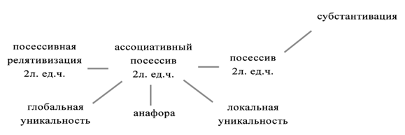

```{r}
#| include: false

library(lingglosses)
options("lingglosses.italic_transliteration" = FALSE)
```

# Формальные описания нестандартных языковых процессов

В ходе исследования языковых процессов были разработаны формальные модели нестандартных грамматических явлений в области внутренней структуры именной группы и ее внешнего синтаксиса, анафорических отношений и глагольных категорий. Для моделирования были собраны полевые языковые данные по казымскому хантыйскому, якутскому, ингушскому, лесному ненецкому и мишарскому татарскому языкам, использовались данные корпусов уральских языков: хантыйского, коми, селькупского и др., также были проведены исследования на материале русского языка. Были подготовлены к публикации ресурсы, обеспечивающие работу с языковыми данными с использованием компьютерных инструментов. Корпус хантыйского языка переработан для регистрации в качестве результата интеллектуальной деятельности (РИД). Разработанная схема базы данных по согласованию была преобразована в бета-версию базы данных «Типология согласовательных систем», доступную в интернете и зарегистрированную как РИД.

Одна из магистральных тем, которая разрабатывалась в 2026 году, включала внутренний и внешний синтаксис именной группы --- типологию неопределённых местоимений, типологию непосессивных употреблений показателей посессивности в уральских языках, дифференцированное объектное маркирование, приименное согласование. Работа проводилась на типологически разнообразном материале, включая материал уральских языков, якутского и ингушского языков. В ходе исследования рассматривались распределение неопределённых показателей и ограничения на их совыражение, функции непосессивных употреблений показателей посессивного согласования, факторы маркирования прямого дополнения, а также взаимодействие приименного согласования и числовой супплетивности. Для исследуемых явлений разработаны эксплицитные формальные модели, либо обобщены полевые и типологические данные, необходимые для их разработки; полученные результаты показывают необходимость корректировки существующих формальных моделей данных явлений.

В отчётном периоде продолжалась работа над исследованием синтаксиса и семантики глагольных категорий на полевом материале лесного ненецкого и мишарского татарского. Среди прочего рассматривалось морфологическое оформление отрицательной конструкции, интеррогативное прошедшее и условия, при которых псевдоотрицание получает эпистемическое значение в матричных клаузах и утрачивает его в комплементах глагола незнания в лесном ненецком; для объяснения этих распределений предложен анализ в рамках теории дизъюнктивной модальности. В мишарском татарском проверялось, вводит ли вербализатор -*ай* событийный аргумент, и отдельно исследовалась агентивность образованных с его помощью глаголов, а также возможность их каузативизации.

## Типология неопределённых местоимений

### Задача и основной результат

Исследование посвящено границам применимости наносинтаксиса [@caha2009; @starke2009] --- подхода, в котором совыражение (использование одного показателя в нескольких функциях) моделируется как синкретизм, т. е. как лексикализация одной единицей нескольких вложенных друг в друга структур признаков. На материале неопределённых местоимений показано, что совыражение может возникать не из структурного включения, а из семантической недоспецифицированности: показатель с более слабыми семантическими ограничениями просто совместим с большим числом контекстов. Наносинтаксический анализ неопределённых местоимений [@dekier2021] сопоставлен с семантическим анализом [@deganoAloni2025]; показано, что второй лучше объясняет и типологию, и диахронию, а наносинтаксис не должен служить подходом по умолчанию к любым совыражениям.

### Материал: карта неопределённых местоимений

В работе рассматривается левый фрагмент семантической карты М. Хаспельмата [@haspelmath1997], построенной для неопределенных местоимений --- три функции, иллюстрируемые в (@ex-fomlab_one)--(@ex-fomlab_three) (на русском материале; ср. английские примеры в [@haspelmath1997]).

(@ex-fomlab_one) *Специфическое известное (SK)*: Тебе звонил кое-кто --- угадай кто!

(@ex-fomlab_two) *Специфическое неизвестное (SU)*: Я что-то услышал, но не понял, что это был за звук.

(@ex-fomlab_three) *Неспецифическое ирреальное (NS)*: Поищи где-нибудь ещё.

В SK и SU у именной группы есть конкретный референт, и различаются они тем, знает ли его говорящий; в NS конкретного референта нет (типичный контекст --- императив). Русский различает все три функции, английский *some-* покрывает все три; возможны и промежуточные распределения, но не распределение, при котором одна форма выражает SK и NS, а SU --- другая (см. таблицу -@tbl-formlab_1).

|                       | NS      |  SU    |   SK   | паттерн     |
|-----------------------|---------|--------|--------|-------------|
| английский            | some-   | some-  | some-  | AAA         |
| якутский              | -eme    | -ere   | -ere   | ABB         |
| латынь                | ali-    | ali-   | -dam   | AAB         |
| русский               | -нибудь | -то    | кое-   | ABC         |
| не засвидетельствован | A       | B      | A      | \*ABA       |

: Распределения неопределённых показателей (по [@dekier2021]) {#tbl-formlab_1}

### Наносинтаксический анализ и его проблемы

Я. Декер [@dekier2021] на выборке из 45 языков интерпретирует (таблицу -@tbl-formlab_1) как частный случай обобщения \*ABA [@bobaljik2012]: в иерархически упорядоченных рядах паттерн ABA не встречается. Предлагается иерархия (см. формулу -@eq-two), в которой каждая следующая функция структурно включает предыдущую; по принципу надмножества (Superset Principle) единица, лексикализующая большую структуру, может лексикализовать и её подструктуры, и потому совыражение SK и NS в обход SU невозможно.

::: {#eq-two}
$$[F_3 [F_2 [F_1]]] ⇒ SK; [F_2 [F_1]] ⇒ SU; [F_1]⇒ NS$$
:::


Направление иерархии обосновывается двумя аргументами. Семантический: SK предполагает и существование референта, и знание его говорящим, SU --- только существование, NS --- ни того, ни другого. Аргумент от лакун: в неполных парадигмах первыми отсутствуют SK, затем SU (каннада *-aadaruu* для NS и *-oo* для SU без SK; кечуа; в мандаринском есть только вопросительное местоимение в функции NS; в ирландском, суахили и филиппинском нет ни одного из трёх показателей).

В работе показаны три проблемы этого анализа. Во-первых, при иерархии (@eq-two) ожидаются случаи морфологического включения --- языки, где показатель SK состоит из показателя SU и дополнительной морфемы, --- но таких случаев нет, что признаёт и сам Декер. Даже пересмотренный принцип надмножества с «плоскими» наборами признаков [@vandenWyngaerd2018] не снимает проблему: следовало бы ожидать хотя бы общих экспонентов для общих признаков. Во-вторых, семантический аргумент стипулятивен: он работает лишь при заранее принятой иерархии, тогда как в альтернативной семантике (раздел -@sec-form-4) самым сложным оказывается SU. В-третьих, аргумент от лакун опирается всего на шесть языков, и его надёжность неясна.

### Семантический анализ: вариативность и постоянство {#sec-form-4}

М. Дегано и М. Алони [@deganoAloni2025], развивая [@farkasBrasoveanu2020], объединяют специфичность и знание референта говорящим (*knownness*) через **вариативность** и **постоянство** денотата в командной семантике (team semantics) [@hodges1997; @vaananen2007]. Используются две атомарные формулы: *var(y,x)* --- при фиксированном *y* переменная *x* принимает разные значения хотя бы в двух присваиваниях; *dep(y,x)* --- при фиксированном *y* значение *x* единственно. В качестве *y* выступает либо переменная мира *v* (её значения --- миры, совместимые со знанием говорящего), либо пустая последовательность ∅ (отсутствие релятивизации). Тогда *dep(v,x)* означает одно значение в каждом эпистемически возможном мире (специфичность), *var(v,x)* --- хотя бы два значения хотя бы в одном мире (неспецифичность), *dep(*∅*,x)* --- одно значение во всех присваиваниях (референт известен), *var(*∅*,x)* --- разные значения хотя бы в двух присваиваниях, в каких бы мирах они ни находились (референт неизвестен). Получающаяся типология приведена в таблице -@tbl-formlab_2.

|  |  |  |  |  |  |
|------------|------------|------------|------------|------------|------------|
| **Тип** | **SK** | **SU** | **NS** | **ограничение** | **пример** |
| \(i\) немаркированный | ✓ | ✓ | ✓ | --- | ит. *qualcuno* |
| \(ii\) специфический | ✓ | ✓ | ✗ | *dep(v,x)* | груз. *-ghats* |
| \(iii\) неспецифический | ✗ | ✗ | ✓ | *var(v,x)* | рус. *-нибудь* |
| \(iv\) эпистемический | ✗ | ✓ | ✓ | *var(*∅*,x)* | нем. *irgend-* |
| \(v\) специфический известный | ✓ | ✗ | ✗ | *dep(*∅*,x)* | рус. *кое-* |
| \(vi\) SK + NS | ✓ | ✗ | ✓ | *dep(*∅*,x)* ∨ *var(v,x)* | не засвидетельствован |
| \(vii\) специфический неизвестный | ✗ | ✓ | ✗ | *dep(v,x)* ∧ *var(*∅*,x)* | каннада *-oo* |

: Типы неопределённых показателей (по [@deganoAloni2025]) {#tbl-formlab_2}

Многофункциональные показатели здесь не синкретичны: немаркированный тип (i) не налагает ограничений и годится для всех контекстов, специфический (ii) требует постоянства внутри каждого мира, но не глобально, эпистемический (iv) --- глобальной вариативности без требования вариативности внутри мира. Отсутствие типа (vi) следует из того, что его условия несовместимы и задаются только дизъюнкцией, --- т. е. запрет \*ABA выводится без иерархии. Тип (vii) --- конъюнкция двух ограничений, является самым сложным, предсказание о его редкости подтверждается [@deganoAloni2025: 973].

### Диахронические предсказания

У Хаспельмата [@haspelmath1997] описаны два релевантных направления изменений. Расширение от SU вправо: специфические неизвестные (vii) становятся эпистемическими (iv); так ведут себя показатели, восходящие к выражениям типа ‘не знаю’, --- лит. *kaž-*, алб. *di-*, др.-нем. *neiz-* [@haspelmath1997: 153]. Расширение от NS влево: показатели, исходно употреблявшиеся в контекстах свободного выбора, через неспецифическую функцию (iii) распространяются на специфические; таковы французская серия *quelque* (ставшая немаркированной, тип (i)) и немецкое *irgend-* (iii → iv) [@portAloni2015].

Семантический анализ описывает оба направления как ослабление ограничений: *var(v,x)* влечёт *var(*∅*,x)*, откуда переход (iii) → (iv) [@aloniDegano2022: 200–201]; утрата *var(*∅*,x)* даёт (iv) → (i); отбрасывание конъюнкта в *dep(v,x)* ∧ *var(*∅*,x)* даёт (vii) → (iv). Сами Алони и Дегано допускают лишь ослабление атомарных формул и потому исключают (iv) → (i), но французский *quelque* это изменение как раз демонстрирует. Не подтверждены предсказанные переходы (ii) → (i) и (v) → (ii), что может объясняться малым числом надёжно описанных случаев.

Диахронический наносинтаксис не разработан, но естественно допустить, что лексическая статья может утрачиваться. Тогда в формулах (-@eq-threea)--(-@eq-threeb) после утраты A статья B по принципу надмножества начинает лексикализовать и подструктуру \[F1\], что даёт засвидетельствованный переход (vii) → (iv).


::: {#eq-threea}
Исходно: $$A ⇔ [F_1], B ⇔ [F_2 [F_1]]; NS [F~_1] ⇒ A, SU [F_2[F_1]] ⇒ B$$.
:::

::: {#eq-threeb}
После утраты A: $$NS [F_1] ⇒ B, SU [F_2[F_1]] ⇒ B$$.
:::

Однако тот же механизм не порождает изменений в обратном направлении (от NS влево) и при этом предсказывает незасвидетельствованные (v) → (ii) → (i). При иерархии Декера ожидалось бы однонаправленное развитие от более сложных единиц к менее сложным, как в рядах «направление \> реципиент» [@caha2017; @haspelmath2003] или «комитатив \> инструмент» [@caha2009; @narrog2010]; у неопределённых местоимений же изменения идут в обе стороны, а общим для них оказывается только семантическое ослабление. Обратная иерархия (NS включает SU, SU включает SK), предложенная рецензентами, диахронически несколько удачнее и согласуется с данными Дж. Миддлтон, у которой большей структуре соответствует менее постоянный денотат (анафор \> диафор \> прономинал) [@middleton2020; @middleton2021], но и она не подкреплена морфологическим включением.

### Следствия для архитектуры грамматики

Если совыражения неопределённых местоимений --- результат недоспецифицированности, то соответствующие экспоненты лексикализуют не подструктуры одной иерархии, а иерархически не связанные узлы. Возможны два варианта моделирования. Первый --- разные вершины ∃ без отношений включения, каждая с парой статей, фонологической и семантической, как в формулах (-@eq-foura)-(-@eq-fourc) для русского. Второй --- единая вершина ∃ и статьи-тройки «форма --- синтаксис --- значение», как в формуле -@eq-five.

::: {#eq-foura}
$$\text{/кое-/} ⇔ ∃спец.изв; ∃спец.изв ⇔ ∃x ∩ dep(∅,x)$$
:::

::: {#eq-fourb}
$$\text{/-то/} ⇔ ∃эпист; ∃эпист ⇔ ∃x ∩ var(∅,x)$$
:::

::: {#eq-fourc}
$$\text{/-нибудь/} ⇔ ∃неспец; ∃неспец ⇔ ∃x ∩ var(v,x)$$
:::

::: {#eq-five}
$$\text{/кое-/}, ∃, ∃x ∩ dep(∅,x)〉,〈\text{/-то/}, ∃, ∃x ∩ var(∅,x)〉, 〈\text{/-нибудь/}, ∃, ∃x ∩ var(v,x)〉$$
:::

Второй вариант противоречит несемиотическому подходу О. Премингера [@preminger2021], по которому статьи связывают синтаксис либо с формой, либо со значением, но не форму со значением напрямую; в традиционном наносинтаксисе тройки допускаются только для корней [@ramchand2008], так что вершину ∃ пришлось бы считать корнем. Данные говорят в пользу первого варианта: русское *-нибудь* морфологически сложно (*ни* + *будь*, форма глагола *быть*), но не включает других неопределённых показателей, --- значит, узлы ∃ сложны и сложны по-разному.

### Выводы и перспективы

Не всякое совыражение является синкретизмом: для неопределённых местоимений семантическая недоспецифицированность на уровне LF объясняет форму карты, отсутствие \*ABA, редкость типа SU и двунаправленность диахронических изменений лучше, чем иерархия признаков. Совыражения, таким образом, не сводятся к PF. Наносинтаксис остаётся оптимальным там, где есть явное морфологическое включение, --- прежде всего в области падежа [@caha2009; @caha2017] и лица [@vandenWyngaerd2018]. Перспективы работы --- разработка диахронического наносинтаксиса (в частности, проверка, может ли лексическая статья расширяться), поиск общих экспонентов у неопределённых показателей и проверка обратной иерархии на более широкой выборке.

## К типологии непосессивных употреблений посессивных показателей: poss.2sg и другие

Непосессивные употребления показателей посессивного согласования в уральских языках привлекали значительное внимание исследователей на протяжении последних восьми десятилетий. Это явление обсуждается в грамматиках уральских языков (например, [@nikolaeva1999]), в статьях, посвящённых одному языку [@kortvely2010; @zayzon2015; @serdobolskayaEtAl2019; @mikhailov2023, среди многих других], в монографиях [@janda2019; @budzisch2021], в работах по уральским языкам в целом [@fraurud2001; @kuznetsova2003; @nikolaeva2003; @gerland2014; @simonenko2017] и в более широких типологических работах [@schroeder2006; @becker2021].

Цель исследования состояла в том, чтобы создать функциональную типологию непосессивных употреблений уральских показателей посессивного согласования (беспосессивов) и предложить семантическую карту для них. Эта карта в дальнейшем может служить исходным материалом для построения формальных семантических моделей для различных типов беспосессивов.

### Функции `r add_gloss("POSS")`.`r add_gloss("2SG")`

#### Детерминатороподобные функции

Беспосессив второго лица единственного числа заметно хуже представлен в языках мира, чем `r add_gloss("POSS")`.`r add_gloss("3SG")`. Среди уральских языков он встречается в северносамодийских языках, севернохантыйских диалектах и, в меньшей степени, в пермских языках и северномансийском. На рисунке -@fig-formlab1 представлена семантическая карта некоторых функций беспосессива `r add_gloss("POSS")`.`r add_gloss("2SG")`.

```{r}
#| label: fig-formlab1
#| fig-cap: "Семантическая карта беспосессива poss.2sg"


```


Чаще всего беспосессивы `r add_gloss("POSS.2SG")` используются в детерминатороподобных функциях, аналогично `r add_gloss("POSS.3SG")`. Так, в (@ex_formlab_1)---(@ex_formlab_3) приведены примеры `r add_gloss("POSS.2SG")` в функциях анафоры, контекстной уникальности и ситуативной уникальности соответственно. Пример (@ex_formlab_4) представляет собой случай бриджинга (олень -\> бубенцы на нем).

(@ex_formlab_1) нганасанский [@siegl2015a: 78--79]
```{r}
#| results: asis
gloss_example(
  'ну"озу"дяңуру" нини ңу"ой басутуо нилыбяты ны хонты цянту басутуо-ра ңукəга бабий котəбату',
  'однажды тундра[GEN] на.LOCone охотник жить.INFER.3SG жена[ACC] иметь.IPF.3SG мальчик[ACC] охотник-POSS.2SG много дикий.олень[ACC.PL] убить.INFER.3SG',
  "‘В тундре когда-то жил охотник. У него были жена и сын. Охотник добывал много диких оленей.’")
```


(@ex_formlab_2) Тегинский диалект севернохантыйского [@kashkin2010: 2]
```{r}
gloss_example(
  'xătλ-en aλena et-əs.',
  'солнце-POSS.2SG утро появиться-PST',
  "‘Утром вышло солнце.’")
```


(@ex_formlab_3) Казымский хантыйский (полевые данные)

```{r}
gloss_example(
  "wońśəmut-əŋ ńań-en šɛŋk epλ-əŋ",
  "ягода-PROP хлеб-POSS.2SG очень вкус-PROP",
  "‘Пирог с ягодами очень вкусный’",
  comment = "[Семейный ужин. На столе несколько блюд, в том числе пирог с ягодами.]")
```

(@ex_formlab_4) cеверномансийский (Проект “Typology of Negation in Ob-Ugric and Samoyed languages”, text02.069/02.70; [@gerland2014: 278])
```{r}
gloss_example(
  'Mātra Sʼilʼka pāɣlʼe tijūw-3. Lōŋxanʼsʼap-a-ne sujtēɣǝt',
  'M. С. к.стаду такприйти-3SG бубенец-EP-PL.POSS.2SG звук.EP.3PL',
  "‘Матра Силька идёт к стаду. Бубенцы звенят.’")
```


Одна функция обнаруживается только в севернохантыйских разновидностях, наиболее заметно --- в казымском хантыйском [@mikhailov2023; @mikhailov2024b], а именно функция проприального артикля. В (@ex_formlab_5) poss.2sg используется с именем собственным Klawa.

(@ex_formlab_5) казымский хантыйский [КХК: TVG_juilsk][^corpus]
```{r}
gloss_example(
  'min χɵλənt-s-əmən klawaj-en piλa',
  'мы.DU слышать-DEC-PST.1DU Клава-POSS.2SG с',
  "‘Мы с Клавой выслушали (и согласились).’",
  comment = "Нас попросили приехать в Казым и помочь, иначе школу бы закрыли.")
```

[^corpus]: ККХ --- Корпус казымского хантыйского, собрание текстов, записанных от носителей казымского диалекта севернохантыйского языка участниками полевого проекта НИУ ВШЭ и МГУ имени М.В. Ломоносова под руководством Светланы Толдовой и Алексея Козлова в 2018--2024 годах.

#### Субстантивация

Что касается более маркированных детерминатороподобных функций, рассмотрим употребление `r add_gloss("POSS.2SG")` с демонстративами. Зигль [@siegl2015a: 83--85] обсуждает примеры типа (@ex_formlab_6) под рубрикой `r add_gloss("POSS.2SG")` «в эквативных конструкциях с невербальными предикатами» (ср. [@siegl2015b]). В частности, он показывает, что `r add_gloss("POSS.2SG")` используется с демонстративами в эквативных конструкциях, как в (@ex_formlab_6), в нескольких северносамодийских языках (нганасанском, тундровом ненецком, тундровом энецком, лесном энецком) при элидированной именной вершине.

(@ex_formlab_6) лесной энецкий [@siegl2015a: 83]
```{r}

gloss_example(
  'čiki-r uu äsi-r',
  'это-POSS.2SG 2SG отец-POSS.2SG',
  "‘Этот [мужчина] --- твой отец.’")
```

Пример (@ex_formlab_7) из казымского хантыйского показывает, что скорее беспосессивный показатель имеет функцию субстантивизатора:

(@ex_formlab_7) казымский хантыйский [@marinina2025]
```{r}

gloss_example(
  'tăm-en-a',
  'это-POSS.2SG-DAT',
  "‘Этому.’",
  comment = "[Ответ на “Какому мальчику ты дал конфету?”]")
```


Существует естественная связь между детерминатороподобными беспосессивами и демонстративами, поскольку и те, и другие маркируют определённых референтов. Более того, согласно авторам беспосессивы `r add_gloss("POSS.2SG")` казымского хантыйского [@mikhailov2024a] и нганасанского [@siegl2015a] несут дополнительные требования, которые ещё больше сближают их с демонстративами. Согласно Зиглю, нганасанский `r add_gloss("POSS.2SG")` в беспосессивном употреблении маркирует смену топика, тогда как демонстративы часто используются именно для этой цели в других языках [@diessel2006]. В то же время Михайлов [@mikhailov2024a: 32--36] утверждает, что беспосессив `r add_gloss("POSS.2SG")` казымского хантыйского требует салиентности, а демонстративы обеспечивают её, что объясняет тот факт, что они часто выступают в одной ИГ.

#### Другие узкоспециализированные функции

Функция, вероятно также типичная для `r add_gloss("POSS.2SG")` в северносамодийских языках, --- маркирование первичного топика (в смысле [@nikolaeva2001]). Зайзон [@zayzon2015] подробно обсуждает её для нганасанского, см. (@ex_formlab_8) ([@zayzon2015: 268-269]; `r add_gloss("POSS.3SG")` же маркирует вторичный топик в нганасанском).

(@ex_formlab_8) нганасанский [@zayzon2015: 270]
```{r}
#| results: asis
gloss_example(
  '…Djajku-rə huəða-mtu mɨntə-lə-sɨ ďigə dʹiľe huaľürə na-nu tahari͡͡aa hualə-j bənďe ŋuńü-ďa maľiə hualə i-gə-tu, tərəďi sani-tü,',
  '…Д.-2SG мешок-ACC.3SG нести-INCH-INF холм[GEN] down.LATADV камень.берег[GEN] PP-LOC сейчас камень-ACC.PL все.ACC.PL собрать-INF разноцветный.PL камень.PL быть.ITER-PRS-3PL.S так играть-PRS,',
  "‘…Даяку, пронеся мешок вниз по склону к каменистому берегу реки, собирая все (виды) камней, разноцветные камни, так он играет’")
```


Для казымского хантыйского Михайлов [@mikhailov2024a: 26--28] явно возражает против того, что `r add_gloss("POSS.2SG")` является показателем топика, основываясь на примерах типа (@ex_formlab_9), где ИГ в фокусе высказывания (здесь --- фокус предиката) маркирована `r add_gloss("POSS.2SG")`.

(@ex_formlab_9) казымский хантыйский [@mikhailov2024a: 26]
```{r}
gloss_example(
  'kampjuter-ew λoλmaχ-#(en)-ən tinij-əm',
  'компьютер-POSS.1PL вор-POSS.2SG-LOC продать-NFIN.PST[PASS.3SG]',
  "‘Оказывается, вор где-то продал компьютер’",
  comment = "Ответ на «— Из нашего музея украли компьютер. --- Компьютер уже вернули?»")
```

Переходя к другим функциям, в двух языках `r add_gloss("POSS.2SG")` встречается на маркерах препаративной подстановки [@podlesskaya2010; @kibrikPodlesskaya2009: 185]. `r add_gloss("POSS.2SG")` несколько раз встречается на существительном *ut* ‘вещь’ (@ex_formlab_10) в ККХ [^1], образуя маркер хезитации. Аналогичное употребление с демонстративом приводится для лесного энецкого в [@siegl2015b: 26].

(@ex_formlab_10) казымский хантыйский, история о вороньем дне. [KKX: raven_day]
```{r}
#| results: asis
gloss_example(
  'wurŋa χătəλ puraj-ən šaj, ut-en, jańś-i păsan-a χuλijewa oms-ijəλ-λ-ət',
  'ворона день время-LOC чай вещь-POSS.2SG пить-NFIN.NPST стол-DAT все сидеть-FREQ-NPST-3PL',
  "‘В вороний день все садятся за стол, чтобы пить, это, чай.’")
```

#### Общие функции

В диалектах мансийского и хантыйского языков и в венгерском посессивы встречаются на личных местоимениях в аккузативе и/или в других падежах как часть системы дифференцированного маркирования объекта [@eKiss2020]. В венгерском это ограничено первым и вторым лицом (см. таблицу -@tbl-formlab_3), тогда как в мансийских и хантыйских языках, согласно Э. Киш, это употребление было распространено и на третье лицо.

|              |             |             |              |               |
|--------------|-------------|-------------|--------------|---------------|
|              | 1sg         | 2sg         | 1pl          | 2pl           |
| Именительный | én          | te          | mi           | ti            |
| Винительный  | en-g-**em** | té-g-**ed** | mi-**nk**-et | ti-**tek**-et |
| Посессив     | -m          | -d          | -nk          | -tEk          |


: Личные местоимения и посессивы в венгерском [@eKiss2020: 7] {#tbl-formlab_3}


Это явление не обнаруживается в других уральских языках.

Как и `r add_gloss("POSS.3SG")` и другие посессивы, `r add_gloss("POSS.2SG")` встречается в ассоциативной функции [@nikolaeva2003] и в посессивных относительных конструкциях [@ackermanNikolaeva2014]. В ассоциативной функции `r add_gloss("POSS.2SG")` часто встречается в императивах, поскольку они представляют естественный контекст для ассоциации между адресатом и референтом (@ex_formlab_11). В зависимости от числа адресата в этой функции может появляться и `r add_gloss("POSS.2PL")`, как показано в (@ex_formlab_12) из казымского хантыйского, которое также даёт неимперативный пример ассоциативного `r add_gloss("POSS.2")`.

(@ex_formlab_11) северноселькупский [@budzisch2021: 9]
```{r}
gloss_example(
  'Tü-lɨ čɔːt-ät!',
  'огонь-POSS.2SG зажги-IMP.2SG.O',
  "‘[Он приходит домой и кричит:] Зажги огонь!’")
```

(@ex_formlab_12) казымский хантыйский (полевые данные)
```{r}

gloss_example(
  'mˊačok-ən petˊaj-en-ən wʉ-s-i',
  'мяч-POSS.2NSG П.-POSS.2SG-LOC взять-PST-PASS[3SG]',
  "‘Петя уже взял мяч.’",
  comment = "Вася и Катя ищут мяч, чтобы поиграть с ним в детском саду, в ящике с игрушками. Учительница, зная, что они любят играть с мячом, говорит им:")
```

Согласно Будич [@budzisch2021: 91--92], другие посессивы в селькупском не встречаются в ассоциативной функции вопреки ожиданиям. Очень немногочисленные доступные примеры `r add_gloss("POSS.2SG")` все относятся к северноселькупскому. В казымском хантыйском практически все посессивы встречаются в ассоциативной функции.

Посессивная относительная функция `r add_gloss("POSS.2SG")` показана в (@ex_formlab_13).

(@ex_formlab_13) приуральский хантыйский [@ackermanNikolaeva2014: 68]
```{r}

gloss_example(
  'naŋ man-eːm neːpək moːjl-əm woːšaj-eːn-a ma man-l-əm',
  'ты я-POSS.1SG книга дать-NFIN.PST город-POSS.2SG-LAT я идти-PRES-1SG',
  "‘Я иду в город, где ты дал мне книгу.’")
```

Наконец, иногда показатель `r add_gloss("POSS.2SG")` используется без ясной мотивации в данном языке. Это случай `r add_gloss("POSS.2SG")` в бесермянском удмуртском (@ex_formlab_14), обсуждаемый Сердобольской и коллегами [@serdobolskayaEtAl2019] как этическая функция. Здесь показатель индексирует признаки референта (адресата), который не является аргументом в данной клаузе и не входит в число известных референтов в текущем общем фоне разговора. Возможно, он используется для управления вниманием адресата.

(@ex_formlab_14) бесермянский удмуртский [@serdobolskayaEtAl2019: 302]
```{r}
#| results: asis
gloss_example(
  'Kartoški-de=no kopa-l’l’a-m kartoška=no puk-t-ə̑l-i-m lud və̑l-e bakč’a-je.',
  'картошка-ACC.P.2(SG)=ADD капать-ITER-PST.1PL картошка=ADD сидеть-CAUS-ITER-PST-1PL field top-ILL garden-ILL',
  "‘(Текст начинается с рассказа о традиционном производстве льна. Предыдущее предложение: «Вот так мы его убирали, делали любую работу».) Мы копали картошку, сажали картошку в поле, в огороде.’")
```

Похожий пример из лесного ненецкого приведён в (@ex_formlab_15), где `r add_gloss("POSS.2SG")` выступает в партитивно-специфической функции. Здесь, опять же, функция типично реализуется другим маркером, `r add_gloss("POSS.3PL")`, так что `r add_gloss("POSS.2SG")` здесь неожидан и должен считаться этическим.

(@ex_formlab_15) лесной ненецкий (И. Ольхов, л.с.)
```{r}
#| results: asis
gloss_example(
  'ńaŋa-j wedʹaʰku-ʔ to-ŋa-ʔ xelaʰku piλičena dʹiluʔmi. xelaʰko-toŋ / xelaʰku wedʹaʰko-λ ńaŋa-j mataλa',
  'к-POSS.1SG собака-PL прийти-GFS-3P белый чёрный серый белый-POSS.3PL / белый собака-POSS.2SG к-POSS.1SG лаять',
  "‘Ко мне подошли три собаки --- белая, чёрная и серая. Белая залаяла на меня.’")
```

Этическое употребление также встречается с другими комбинациями лица и числа.

Обобщение данных уральских языков является необходимым условием для построения семантических моделей для разных функций беспосессивов, а также позволяет выделить следующие типологически релевантные функции беспосессивов `r add_gloss("2SG")`, которые могут быть учтены при построении типологии для других показателей, а также для детального описания беспосессивных показателей в конкретных языках.

А. Детерминатороподобные функции: анафора, ситуативная уникальность, контекстная уникальность, бриджинг, партитивная специфичность.

Б. Синтаксические функции: посессивные относительные конструкции, субстантивация, дифференцированное маркирование объекта, косвенное маркирование в местоимениях.

В. Другие функции: ассоциативный посессив, этическая функция, маркер хезитации

Г. Маркирование информационной структуры: первичный топик, вторичный топик, контрастивный топик, введение топика, возобновление топика, эмфаза.

## Дифференцированное объектное маркирование в якутском языке

Дифференцированное объектное маркирование (ДОМ) --- явление, при котором морфологическое маркирование прямого дополнения (ПД) систематически варьируется в зависимости от свойств самого дополнения или семантических и прагматических свойств клаузы [@bossong1991; @aissen2003; @malchukov_deswart2008]. Так в якутском языке [@vinokurova2005: 322] в (@ex_formlab_16) именная группа (ИГ) ‘жёлтый цветок’ --- неопределённая [@paducheva2010: 91], она нейтральна по числу (‘сорвал цветок’ или ‘сорвал цветы’) и не маркирована показателем винительного падежа ---*ни*; в (-@ex_formlab_17) речь идёт о конкретном цветке, и дополнение получает ---*ни* (падеж в якутском языке выражается единожды, на вершине ИГ).

(@ex_formlab_16)  
```{r}
gloss_example(
  'Мин саһархай сибэкки үргээ-т-им',
  '1SG жёлтый цветок сорвать-AOR-P.1SG',
  "‘Я сорвал жёлтый цветок.’ или ‘Я сорвал жёлтые цветы.’")
```

(@ex_formlab_17)  
```{r}
gloss_example(
  'Мин саһархай сибэкки-ни үргээ-т-им',
  '1SG жёлтый цветок-acc сорвать-AOR-P.1SG',
  "‘Я сорвал жёлтый цветок.’ (конкретный или определённый жёлтый цветок)")
```

Согласно [@vinokurova2005; @baker_vinokurova2010: 601] и ранее [@ubryatova_etal1995: 22–27], если дополнение неопределённое или нереферентное, оно не маркируется.

Цель исследования --- описать ДОМ в якутском языке в духе многофакторного подхода [@serdobolskaya_toldova2012]. Мы покажем, что маркирование определяется не только референтностью, но и: (а) одушевлённостью ИГ, точнее, личностью ИГ ; (б) наличием определенных модификаторов (см. (@ex_formlab_16)); а так же (в) немаркированное дополнение может находиться на удалении от глагола, хотя в литературе такая конфигурация считается невозможной.

А. Личные ИГ маркируются почти всегда, и фактор референтности для них как будто неактуален. В (@ex_formlab_18) обе ИГ --- ‘концерт’ и ‘оперный певец’ --- нереферентны, но личная ИГ маркируется:

(@ex_formlab_18)  
```{r}
gloss_example(
  'Театр-га бар-ыах-пыт, концерт / опернай ырыаһыт-*(ы) көр-үөх-пүт',
  'театр-DAT идти-FUT-1PL концерт / оперный певец-ACC видеть-FUT-1PL',
  "‘Пойдём в театр, посмотрим концерт.’")
```

Личное имя может быть немаркированным лишь в специальном контексте --- в сфере действия ограниченного набора модальных операторов. В (@ex_formlab_19) ИГ *кыыс* ‘девушка’ нереферентна в сфере действия долженствования (показатель -*лаах*, присоединяющийся к причастию будущего времени) и не маркирована.

(@ex_formlab_19)  
```{r}
gloss_example(
  'Мин атыыһыт миэстэ-ти-гэр кыыс бул-уох-таах-пын',
  '1SG продавец место-P.3-P.DAT девушка найти-PTSP.FUT-OBLIG-1SG',
  "‘Я должен найти девушку на место продавца.’")
```

Б. Некоторые модификаторы накладывают свои ограничения на маркирование. В (@ex_formlab_20) нереферентная ИГ с отрицательным местоимением *биир да* ‘никакой’ должна быть маркирована, хотя в том же контексте допустима и ИГ *тэллэй* ‘гриб’ без аккузатива. Обе ИГ не имеют показателя множественного числа и нейтральны по числу (ср. рус. *не нашёл никаких грибов*).

(@ex_formlab_20)  
```{r}
gloss_example(
  'Мин (биир да тэллэй-ˀˀ((и) / тэллэй) бул-ба-т-ым',
  '1SG один даже гриб-ACC / гриб найти-NEG-AOR-P.1SG',
  "‘Я не нашёл никаких грибов.’")
```

В. Согласно [@baker_vinokurova2010: 602] немаркированное дополнение должно непосредственно предшествовать глаголу. Однако наши исследования показывают, что при специальной информационной структуре (ИС) это не так: в (@ex_formlab_21) дополнение --- топик, а вопросительное местоимение в предглагольной позиции --- фокус.

(@ex_formlab_21)  
```{r}
gloss_example(
  'Хааһы ким сиэ-бэтэҕ=ий?',
  'каша кто есть-NEG.PST=Q',
  "‘Кто не съел каши?’")
```

### Неодушевлённые дополнения

Согласно [@silverstein1976; @comrie1989: 185–200] одушевлённость --- семантическая категория, представимая в виде шкалы ; в простейшем виде Human \< Animate \< Inanimate (в шкалу могут включаться также местоимения или значения определённости [@bossong1991]. В якутском имена животных группируются с неодушевлёнными именами: немаркированное дополнение-название животного допустимо при нереферентности без специальных операторов и может быть нейтральным по числу, как *ынах* ‘корова’ в (@ex_formlab_22) (аналогично неодушевленным ИГ).

(@ex_formlab_22)  
```{r}
gloss_example(
  'Сардаана ынах ыа-т-а.',
  'С. корова доить-AOR-P.3SG',
  "‘Сардана подоила корову / коров.’")
```
Неодушевлённые имена немаркированы при нереферентности и без каких-либо операторов, в том числе в веридикативном контексте прошедшего времени (ср. (@ex_formlab_16)): когда прагматически важнее совершённое действие, а объект нереферентен, он не маркируется и остаётся нейтральным по числу.

Аккузативное дополнение в (@ex_formlab_23) интерпретируется как референтное. В терминах [@vonheusinger2011] это специфичность: имя не обязано быть определённым, т. е. оно маркируется, если эпистемически специфично [@vonheusinger2019] --- этот тип специфичности ориентирован на прагматику и не влияет на условия истинности. Числовой нейтральности при маркировании нет.

(@ex_formlab_23)  
```{r}
gloss_example(
  'Аҕа-м (билигин) массыына-ны оҥор-ор.',
  'отец-P.1SG сейчас машина-ACC делать-PRS[3SG]',
  "‘Отец чинит машину / *машины.’")
```

Итак, неодушевлённые дополнения немаркированы при нереферентности (неспецифичности). Взаимодействие с семантическими операторами проявляется в контекстах специфичности сферы действия [@vonheusinger2019]: при отрицании и кванторе всеобщности. При отрицании немаркированное дополнение нереферентно и находится в сфере действия отрицания (как в (@ex_formlab_20)). Аккузативное дополнение без маркера числа может пониматься и как нереферентное, а при наличии маркера множественности ---*ЛАр* (здесь выглядит как ---*дэр*) дополнение обязательно маркировано и референтно (∃ \> ¬: ‘конкретные грибы, замеченные вчера’), см. (@ex_formlab_24). Судя по всему, верна и обратная логика: специфичная интерпретация множественного объекта требует показателя множественного числа.

(@ex_formlab_24)  
```{r}
gloss_example(
  'Мин (тэллэй-(и) тэллэй-дэр-*(и)) бул-ба-т-ым',
  '1SG гриб-ACC гриб-PL-ACC найти-NEG-AOR-P.1SG')
```

::: {#eq-sixa}
∅ или acc, sg: ¬ \> ∃ ‘Я не нашёл грибов.’
:::

::: {#eq-sixb}
∅, pl, ожид. знач.: ¬ \> ∃ ‘Я не нашёл грибов.’
:::

::: {#eq-sixc}
acc, pl: ∃ \> ¬ ‘Я не нашёл грибы.’ (конкретные)
:::

Аналогично с квантором всеобщности в позиции подлежащего: немаркированные подлежащие нереферентны, а маркированные референтны. т. е. неспецифичные дополнения интерпретируются низко, в сфере действия оператора.

Таким образом, для личных дополнений аккузатив соответствует специфичности, его отсутствие --- неспецифичности любого типа.

Рассмотренные данные согласуются с другими тюркскими языками: в турецком с неодушевлёнными объектами соблюдается соответствие между немаркированностью и неспецифичностью по всем трём типам [@vonheusinger_etal2019]; со специфичностью связано маркирование в татарском [@lyutikova_pereltsvaig2015], с референтностью --- в тувинском и хакасском [@ondar2022: 105].

### Одушевлённые (личные) дополнения

Для личных имён эпистемическая неспецифичность и неспецифичность сферы действия нерелевантны: такие дополнения маркируются. Так (@ex_formlab_25) такая ИГ маркирована в контексте эпистемического наречия *буолуо* ‘вероятно’, в В (@ex_formlab_26) контексте отрицания (ср. ИГ ‘филологов’):

(@ex_formlab_25)  
```{r}
gloss_example(
  'Петя (кыыһ-ы / *кыыс) таптаа-быт-а буолуо.',
  'Петя девушка-ACC / девушка любить-PST-3SG вероятно',
  "{— Что такое с Петей?} ‘Петя, наверное, влюбился в девушку.’ (какую-то)")
```

(@ex_formlab_26)  
```{r}
gloss_example(
  'Иван (филолоҕ-*(у) / *филолог) бул-батах.',
  'Иван филолог-ACC / филолог найти-NEG.PST[3SG]',
  "{Иван в свободное время исследует родной язык. Он приехал на филологический факультет, чтобы обсудить некую тему, но увидел одних студентов и никаких старших учёных. Зато было пару историков и философ, которые вели занятия.} ‘Иван не нашёл филологов.’")
```

Одушевлённые дополнения немаркированы только при референциальной неспецифичности, т. е. нереферентности в интенсиональных контекстах, в частности при глаголе *көрдөө* ‘искать’, долженствование на *-лаах*, модальные предикаты *сөп* / *син* ‘можно’ и *наада* ‘нужно’, глагол *баҕар* ‘хотеть’ и императив. ((@ex_formlab_27)) и (@ex_formlab_28) иллюстрируют оформление ПД при глаголе ‘искать’: при нереферентной интерпретации одушевлённое дополнение немаркировано (@ex_formlab_27); при конкретной --- маркировано (@ex_formlab_28).

(@ex_formlab_27)  
```{r}
gloss_example(
  'Айтал киинэ уһул-аары кыыс көрдүүр.',
  'Айтал фильм снимать-CVB.PURP девушка искать:PRS[3SG]',
  "‘Айтал ищет девушку для съёмок фильма (актрису).’ (не конкретную)")
```

(@ex_formlab_28)  
```{r}
gloss_example(
  'Айтал киинэ-(ни) уһул-аары кыыһ-ы көрдүүр.',
  'Айтал фильм-ACC снимать-CVB.PURP девушка-ACC искать:PRS[3SG]',
  "‘Айтал ищет девушку, чтобы снимать фильм.’ (конкретную) {… актриса куда-то ушла со съёмок}")
```

Контекст долженствования, представленный причастием с аффиксом *-лаах*: в (@ex_formlab_19) ‘девушка’ нереферентна и не маркирована. Сравним также контексты (@ex_formlab_19)  и (@ex_formlab_29). В (@ex_formlab_29) ПД интерпретируется не как референтное, однако, оно находится в контрастивном фокусе (‘девушку, а не парня’). В таком контексте оно маркируется.

(@ex_formlab_29)  
```{r}
gloss_example(
  'Мин атыыһыт миэстэ-ти-гэр кыыһ-ы бул-уох-таах-пын',
  '1SG продавец место-P.3-P.DAT девушка-ACC найти-PTCP.FUT-OBLIG-1SG',
  "‘Я должен найти девушку на место продавца.’ (а не парня)")
```

Контекст ‘хотеть’ сложен: суждения носителей неоднозначны. Именное одушевлённое дополнение, как правило, маркируется независимо от специфичности. При этом голое дополнение нередко допустимо в контекстах несуществующего референта типа фразы ‘хочу \[завести\] *ребёнка*’. При дополнении вложенной клаузы нереферентное имя, как правило, немаркировано (@ex_formlab_30), без значимой разницы в семантике.

(@ex_formlab_30)  
```{r}
gloss_example(
  'Мин үчүгэй үлэһит-(и) бул-уох-п-ун баҕар-а-бын.',
  '1SG хороший работник-ACC найти-PTCP.FUT-P.1SG-P.ACC хотеть-PRS-1SG',
  "‘Я хочу найти хорошего работника.’")
```
Наконец, императив --- единственный контекст, где дополнение может получить третий вариант маркирования, партитив. [@baker_vinokurova2021] обсуждают его на материале неодушевлённых имён, [@korkina_etal1982: 134] приводят пример с одушевлённым дополнением.

Итак, личные ИГ в позиции ПД маркируются почти всегда, кроме нереферентности в интенсиональных контекстах (референциальной неспецифичности [@vonheusinger2019]); ‘хотеть’ ведёт себя нерегулярно, а императив допускает и партитив.

### Структура именной группы дополнения

Рассмотрим модификаторы и квантификаторы в ИГ дополнения и структуру ИГ как ещё один фактор маркирования.

Личные и указательные местоимения, имена собственные и ИГ с указательными актуализаторами [@paducheva2010: 85–86] обязательно маркируются аккузативом (ср. [@lyutikova2017: 390] о мишарском татарском); так же ведут себя ИГ с квантором ‘каждый’. Это можно объяснить их обязательной референтностью (для ‘каждого’ --- партитивной специфичностью элементов известного множества). ИГ с неопределённым местоимением в позиции ПД предпочтительно маркируется --- *биир да* ‘никакой’, *ханнык баҕарар* ‘какой угодно’. В (@ex_formlab_20) ИГ с отрицательным местоимением на *да* должна быть маркирована, и отсутствие аккузатива сомнительно для носителей.

В (@ex_formlab_31) ИГ с местоимением свободного выбора *ханнык баҕарар* немаркированной не бывает никогда:

(@ex_formlab_31)  
```{r}
gloss_example(
  'Ханнык баҕарар остуол-*(у) ыл-ыах-хыт-ын сөп.',
  'какой угодно стол-ACC брать-FUT.PTCP-P.2PL-P.ACC можно',
  "‘Вы можете взять какой угодно стол, {все хорошие}.’")
```

Что касается ИГ с посессором, то они различаются по его референтности, которая может определять маркирование всей ИГ [@lyutikova_pereltsvaig2015]. Для якутского это верно отчасти: некоторые носители допускают немаркированную ИГ при нереферентном посессоре и требуют аккузатива при референтном; для других отсутствие маркирования неприемлемо, и любая ИГ с посессором маркируется. Такое распределение маркирования можно объяснить структурной сложностью по аналогии с татарским [@lyutikova_pereltsvaig2015]: ИГ размера DP требуют падежа (в позиции дополнения --- аккузатива), а ИГ размера NP (голое имя, имя с прилагательным, как в (@ex_formlab_16) не маркируются. Если неопределённые местоимения и посессоры занимают только позицию спецификатора DP, их наличие означает, что ИГ --- DP.

### Линейная позиция дополнения

Согласно существующим исследованиям [@baker_vinokurova2010; @vinokurova2005], немаркированное дополнение должно быть смежно с глаголом (псевдоинкорпорация [@baker2014]). В (@ex_formlab_32a)--(@ex_formlab_32b) оно не может быть отделено от глагола наречием (а); смежное положение (б) --- базовая конфигурация, а аккузатив в ней указывает на контрастный фокус. Однако требование не абсолютно: между дополнением и глаголом могут находиться фокусные частицы (*эмиэ* ‘тоже’, *да*(*ҕаны*) ‘даже’, *эрэ* ‘только’. Пример по [@baker_vinokurova2010: 602: (12)]:

(@ex_formlab_32a)  
```{r}
gloss_example(
  'Маша саламаат-*(ы) түргэнник сиэ-т-э.',
  'Маша каша-ACC быстро есть-AOR-P.3SG',
  "‘Маша быстро съела кашу’")
```

(@ex_formlab_32b)  
```{r}
gloss_example(
  'Маша түргэнник саламаат-(#ы) сиэ-т-э.',
  'Маша быстро каша-ACC есть-AOR-P.3SG',
  "‘Маша быстро съела кашу’ (аккузатив на дополнении при контрастном фокусе)")
```

Порядок слов в якутском языке достаточно свободный и кодирует ИС. В (@ex_formlab_33) дополнение вынесено в начало предложения; если в предглагольной позиции маркирование кодирует референтность, то при выносе оно почти необходимо даже при нереферентной интерпретации. Часть носителей, однако, ограниченно допускает (@ex_formlab_33) и без аккузатива (вынос связан с эмфазой).

(@ex_formlab_33)  
```{r}
gloss_example(
  'Чааскы-(ны) ким эрэ алдьат-т-а.',
  'чашка-ACC кто только ломать-AOR-3SG')
```

::: {#eq-sevena}
{— Что за шум, что случилось? --- А, наверное}
:::

::: {#eq-sevenb}
∅: ‘Чашку кто-то разбил!’ (неконкретную)
:::

::: {#eq-sevenc}
ACC: ‘Чашку кто-то разбил!’ (конкретную или неконкретную)
:::

Другой контекст --- вопросы. ИГ дополнения, находящаяся в узком фокусе ответа в самом начале предложения, до подлежащего, может быть немаркирована; ответ требует паузы после фокусной частицы и перед подлежащим. Так же ведёт себя вопросительная ИГ (‘с чем ты пьёшь чай?’) перед подлежащим и глаголом.

Наконец, ИГ дополнения, являющаяся топиком и отсылающая к данному в контексте, тоже может быть немаркирована на удалении от глагола.

Итак, требование смежности немаркированного дополнения и глагола действительно имеет место: немаркированное дополнение внутри клаузы (например, после подлежащего) не может быть отделено от глагола. Но это требование не абсолютно: при специальной ИС такое дополнение может отстоять от глагола, находясь в самом начале предложения, до подлежащего. Следовательно, допустимо передвижение «псевдоинкорпорированных» дополнений (аналогично см. в [@driemel2023]).

В исследовании предложен целый ряд уточнений для базовых правил ДОМ в якутском языке. Подтверждено, что для маркирования прежде всего важна референтность: специфичные имена маркируются, неспецифичные --- нет. Однако следует учитывать: (а) позицию ИГ в иерархии одушевленности (для неличных имён это верно при любом типе специфичности; для личных отсутствие маркирования возможно только в контексте интенсиональных операторов); наличие приименных модификаторов определенного типа, которые, в отличие от прилагательных, требуют маркирования; (в) немаркированное дополнение может находиться на удалении от глагола, хотя в литературе такая конфигурация считается невозможной.

## Приименное согласование и супплетивность: двойное маркирование множественного числа у ингушских прилагательных

Исследование посвящено ингушскому прилагательному *-oaqqa/-oaqqii* ‘большой’, которое выражает множественное число одновременно классно-числовым префиксом и выбором особой основы. Основной вопрос --- это представляют ли оба показателя результат приименного согласования или за ними стоят разные морфосинтаксические операции. Данная проблема связана с более широкой дискуссией о неоднократном выражении числа внутри именной группы [@deal2016; @norris2022].

В ингушском различаются два числа и шесть именных классов. Класс и число существительного совместно выражаются префиксами на некоторых зависимых словах. Однако префиксальный слот имеется лишь у части прилагательных --- приблизительно у 10%. Наличие префикса само по себе не определяет особого синтаксического поведения прилагательного: это прежде всего морфологическое свойство лексемы [@nichols2011; @norris2022].

У прилагательного ‘большой’ префиксальное согласование сочетается с чередованием *-oaqqa/-oaqqii*. Сочетание *v-oaqqa sag* может означать ‘большой человек’ или ‘старший’, а *b-oaqqii nax* --- ‘большие люди’ или ‘старшие’. Во втором случае множественность выражается одновременно и префиксом *b-*, и основой *-oaqqii*. В предшествующем анализе оба показателя рассматриваются как результат приименного согласования, причём *-ii* трактуется как отдельный суффикс множественного числа. Это предполагает особое правило вставки согласовательного показателя, применяющееся фактически к одному прилагательному [@norris2022].

Мы предлагаем иной анализ: префикс выражает обязательное приименное согласование, тогда как чередование основ представляет собой контекстно обусловленную супплетивность. Основной аргумент --- различное распределение показателей. При множественном существительном префикс обязательно соответствует его классу и числу, а основа может иметь как специализированный множественный, так и неспециализированный вариант.

Так, ‘большие ручки’ можно выразить и как *d-oaqqa q’oalam-až*, и как *d-oaqqii q’oalam-až*. Префикс единственного числа здесь невозможен. В единственном числе допустима только основа *-oaqqa*: *b-oaqqa q’oalam* ‘большая ручка’, но не *b-oaqqii* *q’oalam*. Следовательно, противопоставление основ не тождественно противопоставлению единственного и множественного числа: *-oaqqii* ограничена множественными контекстами, а *-oaqqa* встречается при обоих числах.

Факультативность исчезает в идиоматических выражениях. В сочетаниях с *sag/nax* ‘человек/люди’ прилагательное может обозначать возраст или социальный статус; подобные употребления отмечались ранее в грамматическом описании [@nichols2011]. Сочетание *b-oaqqii nax* допускает буквальное значение ‘большие люди’ и идиоматическое ‘старшие, старейшины’. Вариант *b-oaqqa nax* грамматичен, но имеет только буквальное прочтение. Множественная основа поэтому обязательна для сохранения идиоматического значения.

Такое же распределение обнаруживается у *zwamig/kegii* ‘маленький’. Это прилагательное не принимает классно-числового префикса и имеет полностью супплетивную числовую пару. В обычных композициональных сочетаниях множественного числа допустимы обе основы, в единственном --- только *zwamig*. Но идиоматическое значение ‘молодые люди’ требует *kegii nax*; *zwamig nax* означает лишь ‘маленькие люди’. Данная параллель поддерживает супплетивный анализ *-oaqqa/-oaqqii*. Принадлежность обеих пар к семантике размера согласуется с типологическими наблюдениями о числовой супплетивности [@veselinova2005]. Другие сопоставимые нерегулярные адъективные парадигмы в доступных грамматических описаниях не отмечены [@malsagov1963; @nichols2011].

Для формального объяснения используется распределённая морфология. В этой теории разные реализации одного корня конкурируют в зависимости от синтаксического окружения: специализированный вариант выбирается при выполнении определённых условий, неспециализированный --- в остальных случаях [@hallemarantz1994; @bobaljik2012]. Возможность обусловливания алломорфии признаками других элементов структуры и ограничения её локальности обсуждаются в ряде исследований [@moskal2015; @bobaljikharley2017; @choiharley2019; @adamson2024].

В предлагаемой модели *kegii* и *-oaqqii* выбираются при наличии множественного существительного внутри соответствующей локальной области. В отсутствие такого контекста используются *zwamig* и *-oaqqa*. Префиксальное согласование осуществляется независимо: прилагательные с префиксальным слотом получают значения класса и числа от существительного. Особенность прилагательного ‘большой’ в сочетании двух механизмов, независимо представленных в языке.

Идиоматические и композициональные употребления, согласно анализу, занимают разные структурные позиции. Идиоматическое прилагательное располагается ближе к существительному, а композициональное --- выше. Это подтверждается порядком определений: в выражении «физически маленькие старшие» определение размера предшествует компоненту идиоматического сочетания. Идиоматическое прилагательное также обязано следовать за числительным, тогда как композициональное допускает более свободное расположение.

Можно выделить локальную область, содержащую идиоматическое прилагательное и существительное, внутри которой множественная основа обязательна. Высокое композициональное определение находится за пределами этой области и получает неспециализированную основу. Однако граница может факультативно удаляться, и тогда правило распространяется на более высокое определение. Так объясняется вариативность композициональных сочетаний. Локальность структурная, а не просто линейная: множественная основа возможна и у определения, отделённого от существительного другим прилагательным. Такой подход согласуется с исследованиями структурных ограничений алломорфии [@choiharley2019].

Оба способа выражения числа ориентируются на грамматическое, а не смысловое число. При числительном ‘два’ существительное *sag* имеет форму единственного числа, поэтому и префикс, и основа прилагательного соответствуют единственному числу. Отдельно отмечаются регистровые различия: в литературной речи предпочтительна специализированная множественная форма, в разговорной допустимы обе. Регистр рассматривается как возможный фактор вариативности, а не как окончательно исследованное объяснение.

Альтернативой было бы признание вариантов независимыми корнями; общая проблематичность такого анализа обсуждается в литературе о морфологическом статусе корня [@borer2014]. Подобный анализ подлежит отклонению по двум соображениям. Во-первых, обе формы каждой пары участвуют в одном идиоматическом значении. Во-вторых, возможен эллипсис, при котором произнесённая и опущенная части содержат разные числовые варианты прилагательного. Если эллипсис требует тождества корня, такие данные поддерживают единую корневую репрезентацию [@harley2015; @choiharley2019].

Главный результат исследования --- разграничение приименного согласования и числовой супплетивности. Первое обязательно для соответствующего класса прилагательных, вторая имеет собственные условия локальности и допускает факультативность. Более общие критерии разграничения согласования и алломорфии предложены в специальном исследовании этой проблемы [@weisser2019].

Мы не утверждаем, что всякая супплетивность независима от согласования --- в литературе существуют прецеденты согласовательного анализа [@thornton2019; @adamson2024], а ингушские указательные местоимения также имеют более строгое числовое распределение. Наш вывод относится прежде всего к двум рассмотренным парам: их поведение лучше объясняется независимым взаимодействием приименного согласования и контекстного выбора основы.

## Анафора

Две основные темы, рассмотренные в рамках данной тематической области --- это свойства местоимений, отсылающих к сентенциальным составляющим как местоимение *это* в русском языке, и взаимодействие возвратных местоимений с падежным маркированием и согласованием (использовался материал исслеандского и некоторых других языков).

### «Несклоняемое актантное это» в русском языке

У местоимения *это* в русском языке есть особое разговорное употребление: в таком употреблении оно является членом предложения – актантом при вершине – однако не принимает падежной формы, требуемой этой вершиной. Исследование показывает, что, видимо, несклоняемое употребление, не учитывающее модель управление вершины, возможно в силу двух факторов: информационной структуры (несклоняемое актантное это употребляется при топикализации актанта) и синтаксического типа антецедента (антецедент является сентенциальным актантом). Ни один из этих факторов не достаточен сам по себе. С одной стороны, топикализация местоимения позволяет ему употребляться в форме номинатива / аккузатива. С другой стороны, это возможно только в случае, когда это отсылает к сентенциальной составляющей, также не имеющей падежа. Сходное поведение можно наблюдать и у не местоименных сентенциальных составляющих – а именно у сентенциальных актантов, маркированных показателем *то, что.*

Описанные данные важны и для синтаксических, и для семантических исследований. С одной стороны, оказывается, что синтаксический тип антецедента важен для поведения местоимения не в меньшей степени, чем синтаксические свойства самого местоимения. Нестандартное поведение *это* возможно, несмотря на то, что само местоимение *это* является падежно-маркированным именным элементом. В этом смысле «несклоняемое актантное *это*» близко к составляющим с *то, что*, имеющим вершину с именными свойствами, однако содержащим клаузу.

Данные относительно местоимения *это* можно рассматривать как проявление общей тенденции: если синтаксический элемент получает дискурсивную функцию (например, используется как показатель топикализации или фокуса), грамматические ограничения на его употребление становятся менее строгими. Например, Е.А. Лютикова [@lyutikova2001] анализирует употребления рефлексивных показателей в функции интенсификаторов и показывает, что в таких случаях ряд ключевых ограничений на русские рефлексивы снимается (например, рефлексив возможен в составе группы подлежащего). Тем не менее, случай «несклоняемого актантного *это*» выбивается из общего ряда: стандартно при топикализации требования модели управления, как правило, не нарушаются. Как показано выше, именительный падеж темы стандартно не заменяет актант со стандартным падежным маркированием, а дублирует его.

Наше исследование ставит вопросы, релевантные для типологических и теоретических исследований: в частности, в какой мере местоимения, отсылающие к сентенциальным составляющим, наследуют их неканонические (неименные) свойства в других языках мира. Как выясняется, есть целый ряд случаев, когда местоимения ведут себя особым образом, который не копирует синтаксическое поведение именных составляющих при той же вершине. В одних случаях (slightly-transitive verbs) местоимения с сентенциальными антецедентами возникают при вершинах, в прочих случаях вообще не присоединяющих именных зависимых. В других же случаях («нестандартное актантное *это*») местоимения с сентенциальным антецедентом могут нарушать требования, которые строго соблюдаются при именных зависимых той же вершины. Оба класса случаев показывают, что фактор типа антецедента иногда важнее для поведения местоимений, чем часть речи и набор грамматических категорий самого местоимения. Однако данная тема, лежащая на стыке исследования сентенциальных составляющих и местоимений, требует дальнейшей разработки. Ещё один вопрос состоит в том, следует ли считать, что нестандартные употребления многофункциональных (в частности, местоименных) единиц могут изначально возникать в силу смешения носителями нескольких более стандартных употреблений.

### Об эффекте согласования с анафором

Во многих языках анафоры не могут появляться в позициях, требующих номинативного падежа, хотя условия связывания выполнены; ср. (@ex_formlab_34a)--(@ex_formlab_34b).

(@ex_formlab_34a) исландский
```{r}
gloss_example(
  'Jón segir að María elski sig.',
  'Йон говорит что Мария любить.SBJV REFL',
  "‘Йонᵢ говорит, что Мария любит егоᵢ.’")
```

(@ex_formlab_34b) по [@rizzi1990: пример 17]
```{r}
gloss_example(
  '*Jón segir að sig elski María.',
  'Йон говорит что REFL любить.SBJV Мария',
  "Предполагаемое значение: «Йонᵢ говорит, что онᵢ любит Марию».")
```

Рицци [@rizzi1990] связывает это с эффектом согласования с анафорами (Anaphor Agreement Effect, AAE): анафоры не могут контролировать согласование. Впоследствии формулировка AAE неоднократно ослаблялась, чтобы учесть анафорическое согласование [@woolford1999], согласование, инвариантное по φ-признакам [@tucker2012], и косвенное согласование [@sundaresan2016]. Однако в литературе приводятся аргументы в пользу наличия полного согласования с анафорами, варьирующего по φ-признакам, в тамильском [@murugesan2019], аварском [@rudnev2020] и некоторых других языках, поэтому AAE не может быть универсальным принципом. Гипотеза инкапсуляции [@preminger2019; @rudnev2020] выводит вариативность согласования и позволяет обойтись без AAE. Руднев [@rudnev2023] полностью устраняет специальный принцип, относящийся к данной области: тривиальное согласование следует из именной природы анафоров, а запрет отражает исторически специфическую лакуну в парадигме --- отсутствие номинативной формы (ср. [@maling1984]).

Это создает две проблемы. Во-первых, лакуна в парадигме является постулатом, и остаётся необъяснённым, почему именно эта лакуна столь широко распространена. Во-вторых, там, где анафор блокируется, результатом оказывается не неграмматичность: вместо него появляется прономинал в конфигурации, в которой условия связывания должны были бы его исключать. В исландском дательный субъект требует рефлексива с областью связывания в пределах клаузы ((@ex_formlab_35a), однако номинативный объект, связанный субъектом того же типа, представляет собой прономинал ((@ex_formlab_35b).

(@ex_formlab_35a) исландский
```{r}
gloss_example(
  'Honumᵢ er oft kalt heima hjá sérᵢ / *honumᵢ.',
  'он.DAT есть часто холодно дома у REFL.FAT / он.DAT',
  "«Емуᵢ часто холодно у себяᵢ дома».")
```

(@ex_formlab_35b) по [@maling1984: пример 7]
```{r}
gloss_example(
  'Henniᵢ finnst húnᵢ veik.',
  'она.DAT кажется она.nom больная',
  "«Онаᵢ считает себяᵢ больной».")
```

Таким образом, любой анализ AAE должен объяснить не только падежное или согласовательное ограничение, но и это изменение формы связанного выражения. Обычно его объясняют с помощью правила конкуренции, отдающего предпочтение рефлексивам перед местоимениями [@reinhart1983; @burzio1991; @hornstein2001; @reuland2011; @johnson2026].

Данную проблему можно решить, предположив, что аккузативные «анафоры» и номинативные «прономиналы», связанные одинаковым образом, --- это один и тот же элемент. У анафоров всегда есть номинативные формы (и они в принципе могут контролировать согласование), однако в рассматриваемых языках номинативная форма анафора синкретична с номинативной формой прономинала. Таким образом, *hún* в (@ex_formlab_35b) --- это номинативный рефлексив, а дополнительное распределение «анафоров» и «прономиналов» следует из падежа, без лакуны и без правила конкуренции. Синкретизм независимо необходим во всех областях словоизменения, поэтому такое решение экономнее. Там, где номинативная форма анафора не синкретична, она выражается отдельной формой, как в упомянутых выше тамильском и аварском языках.

В заключении отметим, что нет ни особого эффекта согласования с анафорами, ни лакуны в парадигме: у анафоров всегда есть номинативные формы, часто синкретичные с местоименными. Это позволяет устранить как AAE, так и правило конкуренции для номинатива и предсказывает, что в языках с отдельными номинативными формами анафоров и местоименным копированием номинативные местоименные копии должны быть анафорами.

## Глагольные категории

В отчётном периоде продолжалась работа над исследованием синтаксиса и семантики глагольных категорий на полевом материале лесного ненецкого и мишарского татарского. Среди прочего рассматривалось морфологическое оформление отрицательной конструкции, интеррогативное прошедшее и условия, при которых псевдоотрицание получает эпистемическое значение в матричных клаузах и утрачивает его в комплементах глагола незнания в лесном ненецком; для объяснения этих распределений предложен анализ в рамках теории дизъюнктивной модальности. В мишарском татарском проверялось, вводит ли вербализатор *-ай* событийный аргумент, и отдельно исследовалась агентливность образованных с его помощью глаголов, а также возможность их каузативизации.

### Инвертированное отрицание в лесном ненецком и эпистемическая модальность

Исследование посвящено конструкции с инвертированным отрицанием и свойств интеррогативного прошедшего в лесном ненецком языке (\<самодийские\<уральские). Мы покажем, что конструкция с инвертированным отрицанием интерпретируется как эпистемическая модальность в матричных клаузах, а также используется как нейтральный комплемент глагола незнания, и продемонстрируем инквизитивную природу инвертированного отрицания. Наиболее перспективным моносемическим анализом нам представляется анализ в рамках теории дизъюнктивной модальности, см. [@kang_inquisitive_2020].

#### Морфологическое оформление

Отрицательная конструкция в лесном ненецком состоит из отрицательного глагола *ni-*, несущего на себе согласовательные показатели, и следующего за ним лексического глагола в форме коннегатива [@potseluev_negation_2023; @glavatskikh2023], см. (@ex_formlab_36).

(@ex_formlab_36)  
```{r}

gloss_example(
  'manˊ nˊi-ta-š ŋamoλ',
  'я NEG-2SG-PST есть.CNG',
  "‘Я не ел’")
```


Однако если поменять порядок лексического и отрицательного глагола, то конструкция теряет отрицательное значение и превращается в показатель эпистемической модальности. Назовём такие конструкции вида V-cng neg-agr *псевдоотрицанием*.

(@ex_formlab_37)  
```{r}

gloss_example(
  'šičaλsʹi-m nʹemʹa naj-ʔ nʹi-ša',
  'окно-ACC мать открыть-CONNEG NEG-INTRG',
  "‘Видимо, мать открыла окно’",
  comment = "[Что-то холодно]")
```

Псевдоотрицание может вкладываться в комплементы глагола *dʹexʹeλasʹ* ‘не знать’, см. (@ex_formlab_38). При этом оно не обозначает эпистемическую модальность, а просто маркирует комплемент отрицательного глагола.

(@ex_formlab_38)  
```{r}
gloss_example(
  'manʹ dʹexʹeλa-ŋa-t šaŋok puŋ dʹiλʹi-ʔ nʹi-ša',
  'я не.знать-GFS-1SG сколько долго жить-CNG NEG-INTRG',
  "‘Я не знаю, сколько он прожил’")
```

Таким образом, имеющиеся данные ставят перед нами два вопроса --- как псевдоотрицание получает своё эпистемическое значение в матричных клаузах и почему это значение отсутствует, когда псевдотрицание употребляется в комплементах глагола незнания. Вслед за В.Ю. Гусевым [@gusev2020] мы предлагаем считать, что псевдоотрицание появилось из вопросов с отрицанием. Главным аргументом в пользу этого мы считаем дистрибуцию интеррогативного прошедшего.

#### Интеррогативное прошедшее

Лесное ненецкое прошедшее время *(-šʹ°)* присоединяется после согласовательных морфем и опционально в ряде случаев. В отличие от него, интеррогативное прошедшее (-*sa/-ša*) не может употребляться в утвердительных предложениях и линейно расположено не на правой границе словоформы, а между основой и показателями согласования. Предложения с собственно отрицанием маркируются только аффирмативным прошедшим; предложения же с псевдоотрицанием маркируются только интеррогативным прошедшим, что объединяет их с вопросами, а не с утвердительными предложениями. Предложения с псевдоотрицанием, подобно риторическим вопросам, не требуют ответа и имеют иллокутивный эффект, сходный с простыми модальными утверждениями. Именно поэтому В.Ю. Гусев [@gusev2020] считает, что ненецкое псевдоотрицание – это результат грамматикализации риторических вопросов, хотя такая точка зрения не объясняет того, каким образом семантика риторических вопросов связана с семантикой эпистемической модальности, которую маркирует псевдоотрицание. Чтобы объяснить семантический переход из интеррогативных предложений в эпистемическую модальность и объяснить то, почему псевдоотрицание теряет модальную семантику в сентенциальных актантах, мы предполагаем, что, вопреки очевидным сходствам с риторическими вопросами, псевдоотрицание возникло не из риторических вопросов, а из полноценных вопросов, содержащих в себе дизъюнкцию *¬р* ∨ *р*.

Мы предлагаем считать, что псевдоотрицание произошло не от высокого отрицания в вопросах, а от дизъюнкции, и такая теория позволяет объяснить не только эпистемические функции псевдоотрицания, но и его использование в неверидикальных сентенциальных аргументах. Продемонстрируем, что идея о дизъюнктивной природе псевдоотрицания делает дополнительные предсказания про его вкладываемость. Рассмотрим (@ex_formlab_39), где псевдоотрицание заменяется на выраженную дизъюнкцию. Неверидикативные пропозициональные установки, как правило, берут интеррогативные комплементы. Как замечают Кан и Юн [@kang_inquisitive_2020], подобные дизъюнктивные комплементы сходны с интеррогативными, т.к. они также проецируют альтернативы *λw. p*(*w*)*, λw. ¬p*(*w*)*.*

(@ex_formlab_39)  
```{r}
#| results: asis
gloss_example(
  'maša daλʹmi-ŋa čuki dʹaλa-ŋ waša tuλ-mi ŋæ-p-ta naj ńiʔ-mi ŋæ-p-ta tuλ',
  'Маша не.знать-GFS этот день-gen Вася прийти-PT.PFV быть-COND-POSS.3SG или NEG-PT.PFV быть-COND-POSS.3SG прийти.CONNEG',
  "‘Маша не знает, приходил ли Вася сегодня’")
```

Однако, чтобы объяснить дистрибуцию пседоотрицания во вложенных клаузах, параллели между дизъюнкцией и вопросами недостаточно. К примеру, заметим, что в некоторых случаях, когда комплемент глагола незнания --- это частный вопрос, пседоотрицание доступно только маргинально, но доступен интеррогатив, см. (@ex_formlab_40). Также см. (@ex_formlab_41), где интеррогативное прошедшее недоступно в комплементе глагола знания.

(@ex_formlab_40)  
```{r}

gloss_example(
  'maša dʹexeλa kiḿa čuki dʹaλaŋ tuλ-sa / %tuλ ńi-ša',
  'Маша не.знать кто этот день.GEN прийти-INTRG / %прийти NEG-INTRG',
  "‘Маша не знает, кто сегодня приходил’")
```

(@ex_formlab_41)  
```{r}
gloss_example(
  'maša čedʹiḿa-ŋa čuki dʹaλa-ŋ miša to-ŋa-š / *to-sa',
  'Маша знать-GFS этот день-gen Миша прийти-GFS-PST / *прийти-INTRG',
  "‘Маша знает, что Вася приходил сегодня’")
```

Кан и Юн обращаются к идее неверидикативности. Множество миров веридикативно относительно *р*, если для всех миров, совместимых со знаниями говорящей, истинна пропозиция *р.* Соответственно, множество миров неверидикативно, если среди миров, совместимых со знаниями говорящей, есть как *р,* так и *¬р* миры. Как полярные вопросы, так и дизъюнкция обозначают множество пропозиций {*p, ¬p*}, чем удовлетворяют требования к комплементам неверидикальных предикатов, таких как *не знать.* Однако распределение интеррогативного прошедшего и псевдоотрицания в сентенциальных аргументах несколько отличаются. Это можно разрешить, допустив, что интеррогативное прошедшее не ограничено исключительно вопросительными предложениями. Так как интеррогативное прошедшее также употребляется в рестрикторах универсальных кванторов, для такого предположения действительно есть основания, которые требуют дальнейшего уточнения семантики интеррогативного прошедшего.

В пользу дизъюнктивной природы эпистемической модальности в псевдоотрицании говорит также возможность употребления показателя кондиционалиса, маркирующего протазисы условных конструкций, в качестве показателя дизъюнкции. Он же при этом может выступать и как маркер эпистемической модальности, см. (@ex_formlab_42). Таким образом, в лесном ненецком наблюдается устойчивое соответствие между дизъюнкцией и эпистемической модальностью, которое потенциально затрагивает несколько разных конструкций.

(@ex_formlab_42) [@glavatskikh2023]
```{r}
gloss_example(
  'čukoxăna dʹiλʹi-pta',
  'здесь жить.COND-POSS.3SG',
  "‘(Она) здесь живёт, наверное’",
  comment = "Я знаю, что Вера живёт в красном доме. Передо мной два красных дома, указываю на один")
```

Дизъюнкция, как и полярные вопросы, по своей природе неверидикальна. Кан и Юн [@kang_inquisitive_2020] опираются на *Аксиому Неверидикальности* (Nonveridicality Axiom), согласно которой все модальные базы неверидикальны относительно своего прокимна *р*, иными словами, для любой функции доступности верно, что миры, которые она выбирает, содержат как миры, где *р* истинно, так и миры, где *р* ложно. Эта аксиома контролирует, что ни из одного модального выражения М(*р*)(*w0*) не будет следовать истинность *р*(*w0*). Кан и Юн предполагают, что, раз дизъюнкция неверидикальна, она имеет модальную, а не индикативную природу. Они также рассмативают сочетаемость *–(i)nka* с различными модальными показателями и прописывают анализ, который предсказывает в том числе и эту сочетаемость. Ввиду отсутствия данных о сочетаемости лесного ненецкого псевдоотрицания с другими показателями мы не можем подтвердить или опровергнуть анализ Кан и Юн для псевдоотрицания, однако, путь анализа семантики псевдоотрицания через дизъюнкцию вида *р* ∨ *¬р* кажется нам наиболее многообещающим.

### Вербализации на *-ай* в мишарском татарском: эвентивность и агентивность

#### Эвентивность

В рамках исследования вербализатора *-ай* в мишарском диалекте татарского языка, в частности, проверялось, вводит ли он событийный аргумент. Для этого образованные с помощью вербализатора глаголы были протестированы по диагностикам, предложенным в [@maienborn2007], где предлагается разделять стативные предикаты на d(давидсоновские)-стативы с событийным аргументом *e* и k(кимовские)-стативы, вводящие вместо него кимовское состояние *z*, в котором объект *x* обладает свойством *P*, см. формулы (-@eq-eighta)-(-@eq-eightb).

::: {#eq-eighta}
d-стативы: *λP. λx. λe. P*(*e*, *x*)
:::

::: {#eq-eightb}
k-стативы: *λP. λx. λz.* \[*z* ≈ \[*P*(*x*)\]\]
:::

Тест с глаголами перцепции. D-стативы, в отличие от k-стативов, могут употребляться в качестве нефинитного комплемента при глаголах перцепции. Глаголы на *-ай* проходят эту диагностику, ср. (@ex_formlab_43a)--(@ex_formlab_43b).

(@ex_formlab_43a)  
```{r}
gloss_example(
  'min Marsel-nɤŋ kart-aj-gan-ɤ-n kür-äm',
  'я Марсель-GEN старый-VBLZ-PTCP-3SG-ACC видеть-1SG',
  "‘Я вижу старение Марселя.’")
```

(@ex_formlab_43b)  
```{r}
gloss_example(
  'min mašina-nɤŋ äkren-äj-gän-ɤ-n kür-äm',
  'я машина-GEN медленный-VBLZ-PTCP-3SG-ACC видеть-1SG',
  "‘Я вижу замедление машины.’")
```

<u>Тест с локативными адвербиалами.</u> D-стативы могут модифицироваться локативными адвербиалами, локализующими само событие *e*. Часть глаголов на *-ай* могут употребляться с такими адвербиалами (@ex_formlab_44a), часть нет (@ex_formlab_44b). K-стативы такими адвербиалами модифицироваться не могут, например, предикативы с нулевой копулой (@ex_formlab_44c).

(@ex_formlab_44a)  
```{r}
gloss_example(
  'mašina azbar-da äkren-äj-ä',
  'машина двор-LOC медленный-VBLZ-PRS',
  "‘Машина во дворе замедляется.’")
```

(@ex_formlab_44b)  
```{r}
gloss_example(
  '*Marsel ü-dä kart-aj-a',
  'Марсель дом-LOC старый-VBLZ-PRS',
  "‘Марсель дома стареет.’")
```

(@ex_formlab_44c)  
```{r}
gloss_example(
  '*Marsel ü-dä kart',
  'Марсель дом-LOC старый',
  "‘Марсель дома старый.’")
```

Тест с адвербиалами образа действия. d-стативы могут модифицироваться адвербиалами образа действия, в то время как k-стативы нет. Глаголы на -ай всегда допускают такую модификацию, в отличие от предикативных конструкций с копулой, см. (@ex_formlab_45).

(@ex_formlab_45)  
```{r}
gloss_example(
  'Marsel äkren kart-aj-a / *kart',
  'Марсель постепенно старый-VBLZ-PRS / старый',
  "‘Марсель постепенно стареет.’")
```

По результатам исследования разных основ, глаголы на -ай проходят тесты на сочетаемость с перцептивными глаголами и адвербиалами образа действия. Вербализатор -ай, таким образом, вводит событийный аргумент e.

#### Агентивность

Целевые конструкции. Целевые конструкции требуют участника-инициатора события. Большинство глаголов на *-ай* не допускают целевых придаточных, что указывает на отсутствие агентивного аргумента у этих глаголов. С некоторыми глаголами возможны целевые конструкции (@ex_formlab_46), что, по-видимому, зависит от свойств корня, к которому присоединяется *-ай*.

(@ex_formlab_46)  
```{r}
gloss_example(
  'Min äkren-äj-dem, irtä-räk eš-kä kil-mäs ečen',
  'я медленный-VBLZ-PST.1SG рано-CMPR работа-DAT прийти-NEG.PTCP чтобы',
  "‘Я замедлилась, чтобы не прийти на работу слишком рано.’")
```

<u>Совместимость со</u> <u>specialno</u>. Модификатор *specialno* ‘специально’ требует агентивного аргумента. Только меньшинство глаголов на *-ай* допускает такой модификатор, тогда как большинство его не допускает, ср. контраст в (@ex_formlab_47). Как и в случае целевых конструкций, возможность употребления глаголов на *-ай* со *specialno*, вероятно, объясняется свойствами отдельных корней.

(@ex_formlab_47)  
```{r}

gloss_example(
  'Marsel specialno äkren-äj-de / *zur-aj-dɤ',
  'Марсель специально медленный-VBLZ-PST / большой-VBLZ-PST',
  "‘Марсель специально замедлился.’")
```

<u>Совместимость с</u> <u>üz-üzennän</u>. Еще один тест на отсутствие агентивного участника --- совместимость с модификатором *üz-üzennän* ‘сам по себе’. Проверенные глаголы на *-ай* допускают этот модификатор (@ex_formlab_48a)--(@ex_formlab_48b), что согласуется с предположением об отсутствии у них агентивного участника.

(@ex_formlab_48a)  
```{r}

gloss_example(
  'pogoda üz—üzennän načar-aj-dɤ',
  'погода сам_по_себе плохой-VBLZ-PST',
  "‘Погода сама по себе ухудшилась.’")
```

(@ex_formlab_48b)  
```{r}

gloss_example(
  'köl üz—üzennän tirän-äj-de',
  'озеро сам_по_себе глубокий-VBLZ-PST',
  "‘Озеро само по себе стало глубже.’")
```

#### Каузативизация

Глаголы на *-ай* допускают каузативизацию. Появляется участник-каузатор, а подлежащее исходного глагола становится объектом и оформляется винительным падежом (@ex_formlab_49b). Каузатор может не выражаться эксплицитно.

(@ex_formlab_49a)  
```{r}
gloss_example(
  'kišer siräg-äj-de',
  'морковь редкий-VBLZ-PST',
  "‘Морковь поредела.’")
```

(@ex_formlab_49b)  
```{r}
gloss_example(
  '(balalar) kišer-ne siräg-äj-t-te-lär',
  'дети морковь-acc редкий-VBLZ-CAUS-PST-3PL',
  "‘Дети проредили морковь.’ / ‘Морковь проредили.’")
```

Согласно [@pylkkänen2008], каузативная вершина Cause вводит каузирующее событие, но не вводит внешний аргумент: внешние аргументы всегда вводятся вершиной Voice. Поэтому появление каузатора в @ex_formlab_49b) не свидетельствует об отсутствии у исходного глагола на *-ай* внешнего аргумента (как и тесты на агентивность, т.к. внешний аргумент может быть, например, Holder). Вопрос о наличии внешнего аргумента у глаголов на *-ай* остается открытым.

## Дебуккализация в лесном ненецком языке и репрезентационные теории фонологии

В лесном ненецком языке корональные шумные /t s/ дебуккализауются (теряют фонологические признаки места) в коде: /ḿat/ \> \[ḿaʔ\] 'чум'. Фонема шва, обычно чередующийся с нулём в безударной позиции, однако, может блокировать дебуккализацию: /năt°/ \> \[năt\] ['берег']. Такой паттерн непрозрачного применения правил называется недоприменением: если моделировать дебуккализацию через порядок правил, то кажется, что шва удаляется после удаления признаков места у согласного, из-за чего кажется, будто для /năt°/ \[năt\] «берег» правило дебуккализации не применилось, так как согласный находится в коде.

Для пары /pat°λ/ \> \[patăλ\] ['книга' и] /ḿat-λ°/ \> \[ḿaʔăλ\] ['чум]-POSS.2SG' паттерн представляет собой другой вид непрозрачности: переприменение. Почему-то для /ḿat-λ°/ \[ḿaʔăλ\] ['чум]-POSS.2SG' невозможно сохранение признаков места у /t/, и правило удаления признаков всё равно применяется, несмотря на то что согласный фонетически находится не в коде, а является инициалью слога.

Такие паттерны непрозрачности являются проблемой для репрезентационной автосегментной теории фонологии Strict CV [@lowenstamm1996]. Данная теория предполагает существование двух уровней фонологического представления: абстрактного «слогового» (syllabic), на котором находятся строго чередующиеся абстрактные инициали (onsets) и ядра (nuclei), и «мелодического» (melodic), на котором существуют фонологические признаки. Мелодия не может влиять на слоговой уровень, а слоговой уровень может присоединять или отсоединять фонологические признаки.

Если недоприменение возможно моделировать с помощью «позднего правила» для шва, которое позволяло бы ему быть фонологически активным несмотря на отсутствие произношения (то есть сначала бы происходила фонологическая деривация, а потом безударный шва интерпретировался как ноль на поверхности), то для анализа переприменения в Strict CV пришлось бы задать порядок автосегментных отношений «управления» (government) и «лицензирования» (licensing). Быть вершиной автосегментных отношений могут только ядра, а зависимыми --- и ядра, и инициали. Отношения существуют строго справа налево. Предполагается, что если чередующийся с нулём гласный не управляется, то он обязан проявиться. Отсутствие лицензирования влечёт дебуккализацию. Но при переприменении необходимо задать порядок применения данных отношений для верной деривации /ḿat-λ°/ \[ḿaʔăλ\]. Сначала лицензирование должно примениться и удалить фонологические признаки места у /t/, и только после этого управление должно примениться на согласный, а не на «пустой» гласный. Если порядок применения отношений будет другой, то в результате должно было бы получиться \*\[ḿatăλ\]: сначала управление не применяется на пустой гласный, который не может лицензировать; из-за отсутствия управления гласный должен проясниться и фонологические признаки должны ассоциировать к данному ядру. После этого должно примениться лицензирование, которое позволит этому изначально пустому ядру блокировать дебуккализацию, потому что в итоге оно перестаёт быть пустым.

Расширение Strict CV под названием Turbidity Theory [@cavirani2022] позволяет предсказать поведение фонетически пустого шва и произносимого «вставного» гласного в /ḿat-λ°/ \[ḿaʔăλ\]. Turbidity Theory предлагает разделить линию ассоциации на фонологическую и фонетическую активность (проекция и произношение соответственно), из-за чего задавать порядок управления и лицензирования не нужно: лицензировать могут только ядра с проекцией, а произношение ядер зависит от управления.

Полевые данные получены в экспедиции по изучению лесного ненецкого языка, г. Тарко-Сале, д. Харампур, ЯНАО июль---август 2026 г. Собрано более 50 диагностических форм.

## Репрезентационная разница коннегатива/императива и плюралиса в лесном ненецком языке

В лесном ненецком языке коннегатив/императив (`r add_gloss("CNG")`) и плюралис (`r add_gloss("PL")`) почти всегда проясняются как гортанная смычка \[ʔ\]. Например, после основы на поверхностно реализующийся гласный звук: \[kata-ʔ\] ['бабушка]-`r add_gloss("PL")`['], \[kapta-ʔ\] ['звать]-CNG[']; после основы на гласный шва: \[kăn-ʔ\] ['нарта]-`r add_gloss("PL")`['], \[kan-ʔ\] ['болеть]-`r add_gloss("CNG")`[']; после основы на фонологически неглухие согласные \[ten-ʔ\] ['жила]-PL['], \[ŋăm-ʔ\] ['есть]-`r add_gloss("CNG")`[']. Однако для основ, кончающихся на фонологически глухие согласные, PL проясняется как \[ʔ\], а `r add_gloss("CNG")` --- как \[s\]: \[ḿat-ʔ\] ['чум]-`r add_gloss("PL")`['], \[mănæʰ-s\] 'слышать-`r add_gloss("CNG")`[']. Тапани Салминеном ранее предполагалось, что оба показателя проясняются как гортанная смычка, но это оказалось верно не всегда.

Показать разницу между показателями можно, предположив разную структуру у `r add_gloss("PL")` и `r add_gloss("CNG")`. Предполагается, что `r add_gloss("PL")` глубинно является гортанной смычкой /ʔ/, а `r add_gloss("CNG")` является /s/. У гортанной смычки нет ларингальных признаков: она появляется перед гласными и фонологически неглухими согласными: /waʔw°/ \> \[waʔăw\] ['кровать'], /ḿat-λʹi/ \> \[ḿaʔλʹi\] ['чум]-LIM['], /ḿat-maʔ/ \> \[ḿaʔmaʔ\] ['чум]`r add_gloss("POSS")`.`r add_gloss("1PL")`[']. Придыхание \[ʰ\] --- аллофон гортанной смычки и дебуккализаованных шумных перед фонологически глухими согласными: /ẃeʔk°/ \> \[ẃeʰk\] ['шея'], /ḿat-ta/ \> \[ḿaʰta\] ['чум]-`r add_gloss("POSS")`.`r add_gloss("3SG")`['].

Важно также, что в основах на согласный происходит вставка шва, которая не проявляется на поверхности: /ḿat-ʔ/ \> \|ḿat°ʔ\| \> \[ḿatʔ\], \*\[ḿatăʔ\], \[ḿatĭʔ\]. Это следует из отсутствия дебуккализации (\[ḿaʔʔ\]) и укорочения гласных в односложных основах (\[ḿătʔ\]). Анализ через присутствие шва в глубинном представлении `r add_gloss("PL")` и `r add_gloss("CNG")` опровергается поведением основ на шва. Два таких звука подряд проясняются как \[i\]: /tes°-°/ \> \[tesi\] ['капать]-`r add_gloss("GFS")`['], /čĭm°-°ʔ/ \> \[čĭmiʔ\] ['зуб]-`r add_gloss("TOP")`[']. Однако формы `r add_gloss("PL")` и `r add_gloss("CNG")` от основ на шва ведут себя не как `r add_gloss("GFS")` /°/ и `r add_gloss("TOP")` /°ʔ/: /kăn°-ʔ/, \*/kăn°-°ʔ/ \> \[kănʔ\] ['нарта]-`r add_gloss("PL")`['], /ŋăm°-s/, \*/ŋăm°-°s/ \> \[ŋamʔ\] ['есть]-`r add_gloss("CNG")`[']. Таким образом, `r add_gloss("CNG")` и `r add_gloss("PL")` действительно состоят из одного согласного, и шва в таких формах от основ на согласный действительно является вставным.

Предполагается, что `r add_gloss("CNG")` /s/ содержит признак глухости (\|H\| в Теории элементов), который передаётся слева направо, если элемент слева находится в коде. Такой процесс называется ларингальной трансмиссией. `r add_gloss("PL")` /ʔ/ не имеет элемента глухости и не может его передавать. Ларингальная трансмиссия создаёт домен, в котором вставка гласного запрещена. Предполагается, что вставка шва в финальные кластеры происходит из-за ограничения на два кодовых согласных подряд. Шва вставляется в самое левое место из возможных. Однако в случае `r add_gloss("CNG")` от основ на глухой согласный происходит ларингальная трансмиссия, из-за чего вставка между согласными невозможна, после чего происходит дебуккализация корневого согласного и удаление конечного шва: /tes-s/ \> \|tess°\| \> \|tehs°\| \> \[tehs\] 'собирать ягоды-`r add_gloss("CNG")`['].

В остальных формах отсутствует ларингальная трансмиссия, из-за чего шва вставляется после первого согласного кластера: /ḿat-ʔ/ \> \|ḿat°ʔ\| \> \[ḿatʔ\].

Полевые данные получены в экспедиции по изучению лесного ненецкого языка, г. Тарко-Сале, д. Харампур, ЯНАО. Собрано более 15 диагностических форм для глаголов на согласный, более 10 форм для имён на согласные.
