```{r}
#| include: false

library(lingglosses)
options("lingglosses.italic_transliteration" = FALSE)
```

# Корпусная и компьютерная лингвистика

## Исследование и сравнительный анализ вариативности обозначения причинно-следственных связей в текстах обучающихся и экспертов, языковых особенностей и возможности орфокоррекции учебных текстов

### Новые корпусы ИИ-сгенерированных текстов

В рамках работы над проектом были созданы новые корпусы ИИ-сгенерированных текстов, которые послужат основой для дальнейших исследований лингвистических различий между текстами человека и ИИ.

#### Корпус аннотаций научных статей

Корпус текстов, написанных человеком, был составлен из аннотаций научных статей, опубликованных в ведущих международных журналах в 2016--2020 гг., то есть до широкого публичного и коммерческого внедрения генеративных ИИ-инструментов. Корпус был спроектирован для охвата широкого спектра академического дискурса: в него вошли публикации двух основных дисциплинарных областей --- точных и гуманитарных наук. Термины точные («hard») и гуманитарные («soft»), часто связываемые со Сторером [@Storer1967], используются для сравнения академических областей с точки зрения методологической точности, объективности и строгости. Хотя некоторые исследователи утверждают, что дихотомия hard/soft не всегда отражает вариативность знания (см., например, @BecherTrowler2001; @Nesi2002), она может использоваться как удобное условное обозначение при характеристике разнообразия академического дискурса [@Dang2018]. Наш подкорпус точных наук, на основе которого создавался ИИ-корпус, включает статьи по химии, физике, математике и инженерии; подкорпус гуманитарных наук --- тексты в области менеджмента, истории, лингвистики и политологии.

Корпус ИИ-текстов состоит из такого же количества аннотаций, сгенерированных DeepSeek-V2 по следующему промпту: «Ты исследователь, который собирается отправить статью в авторитетный журнал, основываясь на тексте \[текст статьи без прилагаемой аннотации\], напиши аннотацию объемом примерно в XXX слов \[количество слов определено исходя из фактической длины оригинальной аннотации\], используй академический стиль изложения». Дата отсечения знаний модели --- июль 2024 г. Каждый промпт запускался в новой сессии. Состав и объем копруса аннотаций приведены в таблице -@tbl-corpora_lab_1.


```{r}
#| echo: false
#| warning: false
#| message: false
#| label: tbl-corpora_lab_1
#| tbl-cap: "Состав и объем копруса аннотаций"

library(flextable)
library(officer)

# Section headings occupy ordinary body rows, merged below.
dat <- data.frame(
  subject = c(
    "ТОЧНЫЕ НАУКИ",
    "Химия",
    "Физика",
    "Математика",
    "Инженерия",
    "Всего",
    "СОЦИОГУМАНИТАРНЫЕ НАУКИ",
    "Экономика",
    "Лингвистика",
    "История",
    "Политология",
    "Всего"
  ),
  human_n = c(
    NA, 25, 27, 28, 21, 101,
    NA, 20, 22, 21, 25, 88
  ),
  human_words = c(
    NA, 4030, 3497, 3174, 3872, 14573,
    NA, 3158, 4032, 3614, 3952, 14756
  ),
  ai_n = c(
    NA, 25, 27, 28, 21, 101,
    NA, 20, 22, 21, 25, 88
  ),
  ai_words = c(
    NA, 4040, 3526, 3611, 3850, 15027,
    NA, 3057, 3690, 3575, 4293, 14615
  ),
  stringsAsFactors = FALSE
)

section_rows <- c(1, 7)
numeric_cols <- c("human_n", "human_words", "ai_n", "ai_words")

rule <- fp_border(color = "black", width = 0.6)

ft <- flextable(dat)

# Lower header row.
ft <- set_header_labels(
  ft,
  subject     = "Предметная\nобласть",
  human_n     = "Кол-во\nаннотаций",
  human_words = "Слов всего",
  ai_n        = "Кол-во\nаннотаций",
  ai_words    = "Слов всего"
)

# Upper header row: 1 ungrouped column + 2 pairs of columns.
ft <- add_header_row(
  ft,
  values = c(
    "",
    "Человеко-сгенерированные\nтексты",
    "ИИ-сгенерированные тексты"
  ),
  colwidths = c(1, 2, 2),
  top = TRUE
)

# Full-width section headings.
for (r in section_rows) {
  ft <- merge_at(
    ft,
    i = r,
    j = 1:5,
    part = "body"
  )
}

# Preserve integer formatting, with no thousands separator.
ft <- colformat_int(
  ft,
  j = numeric_cols,
  big.mark = "",
  na_str = ""
)

# Typography.
ft <- fontsize(ft, size = 11, part = "all")
ft <- bold(ft, bold = FALSE, part = "all")
ft <- color(ft, color = "black", part = "all")
ft <- bg(ft, bg = "white", part = "all")
ft <- valign(ft, valign = "center", part = "all")

# Alignments.
ft <- align(ft, align = "center", part = "all")
ft <- align(
  ft,
  j = "subject",
  align = "left",
  part = "body"
)
ft <- align(
  ft,
  i = 2,
  j = "subject",
  align = "left",
  part = "header"
)
ft <- align(
  ft,
  i = section_rows,
  j = 1:5,
  align = "center",
  part = "body"
)

# Compact spacing.
ft <- padding(
  ft,
  padding.top = 3,
  padding.bottom = 3,
  padding.left = 5,
  padding.right = 5,
  part = "all"
)

# Explicit widths, in inches; total width = 6.3 inches.
ft <- width(
  ft,
  j = 1:5,
  width = c(1.65, 1.00, 1.30, 1.00, 1.35)
)

ft <- set_table_properties(
  ft,
  layout = "fixed",
  align = "center",
  opts_word = list(
    split = FALSE,
    repeat_headers = TRUE
  ),
  opts_pdf = list(
    float = "none"
  )
)

# Remove default borders, then draw horizontal rules only.
ft <- border_remove(ft)

ft <- hline_top(ft, border = rule, part = "header")
ft <- hline(ft, i = 1, border = rule, part = "header")
ft <- hline_bottom(ft, border = rule, part = "header")

ft <- hline(ft, border = rule, part = "body")
ft <- hline_bottom(ft, border = rule, part = "body")

# Normalize borders around merged cells.
ft <- fix_border_issues(ft)

# Leave the flextable as the final expression for Quarto rendering.
ft
```

#### Корпус эссе

Этот корпус опирается на два существующих корпуса текстов, написанных человеком: LOCNESS [@Granger1998] и WriCLE [@RollinsonMendikoetxea2010]. Для каждого из них были созданы параллельные ИИ-подкорпусы с сохранением тем и количества текстов.

LOCNESS_ai состоит из аргументативных эссе, написанных носителями английского языка --- британскими (144 текста) и американскими (178 текстов) студентами. Темы охватывают широкий спектр социальных, политических и этических вопросов: от охоты на лис и генетики до эвтаназии и ядерной энергии.

Тексты LOCNESS_ai были сгенерированы на те же темы и в том же количестве с использованием двух моделей: (1) ChatGPT (GPT-5) от OpenAI через веб-интерфейс в период с ноября 2025 г. по февраль 2026 г. и (2) GigaChat (GigaChat 3.5 Ultra) от Сбера в сентябре 2026 г. Конкретные идентификаторы развёрнутых версий LLM не были публично доступны. Заявленная дата отсечения знаний ChatGPT --- примерно конец 2024 г., GigaChat --- начало 2026 г. В обоих случаях использовались одни и те же промпты.

WriCLE_ai [@RollinsonMendikoetxea2010] был составлен в Мадридском автономном университете. Он включает аргументативные эссе, написанные студентами с родным испанским языком, изучающими английский в рамках академического модуля письма; в корпус вошли работы студентов первого и третьего курсов. Уровень владения языком оценивался с помощью Oxford Quick Placement Test: баллы варьировались от 57 до 90, средний --- 72 (уровни B1-C1 по CEFR). Темы эссе: аборт, анорексия, жестокое обращение с детьми, клонирование, домашнее насилие, однополые браки, оружейная политика, иммиграция, социальные проблемы, марихуана, пиратство ПО, проституция, религия, половое воспитание, закон против табака, испанское образование, терроризм, правила дорожного движения и дорожные проблемы.

Тексты WriCLE_ai были сгенерированы на те же темы и в том же количестве с использованием тех же моделей и в те же сроки: ChatGPT (GPT-5) через веб-интерфейс в ноябре 2025 г. --- феврале 2026 г. и GigaChat (GigaChat 3.5 Ultra) в сентябре 2026 г. Как и для LOCNESS_ai, конкретные версии моделей не были публично доступны; дата отсечения знаний ChatGPT --- конец 2024 г., GigaChat --- начало 2026 г.; использовались одинаковые промпты.

Генерация промптов для обоих корпусов включала два этапа. Сначала модели подавались несколько образцов эссе на соответствующую тему и промпт: «These are some samples of argumentative essays American university students had to write on the topic "XXX". What task were they given? Formulate the topic and 4-5 bullet points they had to cover in a concise way.» --- для LOCNESS_ai; аналогичный промпт использовался для WriCLE_ai с указанием, что речь идет об эссе испанских студентов, изучающих английский как иностранный. Затем на основе ответа создавался итоговый промпт, который и использовался для генерации эссе.

Объем и состав корпусов представлены в таблице -@tbl-corpora_lab_2.


| **Корпус**             | **Кол-во текстов** | **Кол-во токенов** | **Ср. длина текстов** |
|------------------|------------------|------------------|------------------|
| LOCNESS_hum            | 322                | 230540             | 716                   |
| LOCNESS_ai_ChatGPT     | 322                | 213810             | 664                   |
| LOCNESS_ai_GigaChat    | 322                | 291413             | 905                   |
| WriCLE_hum             | 583                | 506235             | 868                   |
| WriCLE_ai\_ ChatGPT    | 583                | 585176             | 1004                  |
| WriCLE \_ai\_ GigaChat | 583                | 779730             | 1337                  |
: Состав и объем копруса эссе {#tbl-corpora_lab_2}

Созданные корпусы образуют сопоставимую базу для дальнейшего анализа лингвистических различий между текстами человека и ИИ, в том числе с учетом дисциплинарной принадлежности и языкового бэкграунда авторов.

### Количественный и качественный анализ способов выражения авторской позиции в различных структурных частях академических текстов {#sec-teaching_lab2}

Для сравнения текстов, написанных студентами на английском языке, и особенностей оригинальных научных статей, написанных его носителями, было проанализировано то, как авторская позиция выражается в различных структурных частях этих научных статей. В фокусе внимания исследования в 2026 году были хеджи и бустеры --- ключевые маркеры эпистемической осторожности и уверенности, которые позволяют авторам позиционировать себя по отношению к своим утверждениям, читателям и дисциплинарному сообществу [@Hyland1998]. Существующие работы здесь часто ограничены одной дисциплиной или рассматривают эти маркеры как широкие категории, не учитывая их грамматические реализации. Проведенное исследование предлагает крупномасштабный анализ двенадцати грамматических категорий хеджей и бустеров в четырех разделах научных статей: аннотации, введении, основной части и заключении.

Корпус исследования включает 576 статей из ведущих международных журналов, индексируемых в Scopus и опубликованных в 2022--2024 гг. Статьи представляют двенадцать дисциплин, сгруппированных в четыре области: искусство и гуманитарные науки (история, философия, литература), социальные науки (лингвистика, право, политология), науки о жизни (химия, медицина, биология) и физические науки (астрономия, геология, физика). Общий объем корпуса составляет около 4,6 млн слов (см. таблицу -@tbl-corpora_lab_3). Все нелингвистические элементы (таблицы, рисунки, формулы, ссылки) были удалены. Разделы выделялись на основе авторских заголовков; всё, что находилось между введением и заключением (обзоры литературы, методы, результаты, обсуждения), было агрегировано в «основную часть», которая служит внутренним базисом для сравнения. Такой подход обусловлен значительной вариативностью структуры статей в разных дисциплинах: даже эмпирические статьи редко следуют канонической последовательности IMRD [@LinEvans2012], а гуманитарные работы часто организованы тематически.

```{r}
#| echo: false
#| warning: false
#| message: false
#| label: tbl-corpora_lab_3
#| tbl-cap: "Состав и объем копруса"

library(flextable)
library(officer)

subjects <- c(
  "Гуманитарные\nисследования",
  "Социология",
  "Науки о жизни",
  "Физика",
  "Итого"
)

dat <- data.frame(
  section = c(
    rep("Аннотация", 4), "",
    rep("Введение", 4), "",
    rep("Основная часть", 4), "",
    rep("Заключение", 4), "",
    "Итого"
  ),
  subject = c(
    rep(subjects, 4),
    ""
  ),
  texts = c(
    rep(c(144, 144, 144, 144, 576), 4),
    2304
  ),
  tokens = c(
    35009, 31819, 47670, 33136, 147634,
    174970, 168338, 110136, 131431, 584875,
    950047, 1175402, 607149, 844665, 3577263,
    113173, 113628, 32483, 64250, 323534,
    4633306
  ),
  stringsAsFactors = FALSE
)

subtotal_rows <- c(5, 10, 15, 20)
grand_total_row <- 21

rule <- fp_border(color = "black", width = 0.6)

ft <- flextable(dat)

ft <- set_header_labels(
  ft,
  section = "Раздел",
  subject = "Предм. область",
  texts   = "Кол-во\nтекстов",
  tokens  = "Кол-во токенов"
)

# Merge each section name across its four subject rows.
# Subtotal rows remain outside the merged cells.
for (start in c(1, 6, 11, 16)) {
  ft <- merge_at(
    ft,
    i = start:(start + 3),
    j = "section",
    part = "body"
  )
}

# Integer formatting with comma thousands separators.
ft <- colformat_int(
  ft,
  j = c("texts", "tokens"),
  big.mark = ",",
  na_str = ""
)

# Base typography.
ft <- fontsize(ft, size = 11, part = "all")
ft <- bold(ft, bold = FALSE, part = "all")
ft <- italic(ft, italic = FALSE, part = "all")
ft <- color(ft, color = "black", part = "all")
ft <- bg(ft, bg = "white", part = "all")

# Text columns left-aligned; numeric columns right-aligned.
ft <- align(
  ft,
  j = c("section", "subject"),
  align = "left",
  part = "all"
)
ft <- align(
  ft,
  j = c("texts", "tokens"),
  align = "right",
  part = "all"
)

# Section labels and multiline cells align to the top.
ft <- valign(ft, valign = "top", part = "all")

# Italicize the subtotal label and its two numbers.
ft <- italic(
  ft,
  i = subtotal_rows,
  j = c("subject", "texts", "tokens"),
  italic = TRUE,
  part = "body"
)

ft <- padding(
  ft,
  padding.top = 3,
  padding.bottom = 3,
  padding.left = 5,
  padding.right = 5,
  part = "all"
)

# Widths in inches; total width = 6.3 inches.
ft <- width(
  ft,
  j = 1:4,
  width = c(1.55, 2.00, 1.25, 1.50)
)

ft <- set_table_properties(
  ft,
  layout = "fixed",
  align = "center",
  opts_word = list(
    split = FALSE,
    repeat_headers = TRUE
  ),
  opts_pdf = list(
    float = "none"
  )
)

# Begin with no borders.
ft <- border_remove(ft)

# Top border and rule under the header.
ft <- hline_top(ft, border = rule, part = "header")
ft <- hline_bottom(ft, border = rule, part = "header")

# Full-width rules immediately above the first three subtotals.
ft <- hline(
  ft,
  i = c(4, 9, 14),
  j = 1:4,
  border = rule,
  part = "body"
)

# In the source image, the final subtotal has a short rule
# above its label, rather than a full-width rule.
ft <- hline(
  ft,
  i = 19,
  j = "subject",
  border = rule,
  part = "body"
)

# Bottom border beneath the grand total.
ft <- hline(
  ft,
  i = grand_total_row,
  j = 1:4,
  border = rule,
  part = "body"
)

ft <- fix_border_issues(ft)

ft
```

Маркеры позиции отбирались на основе списков из [@Hyland2005] с дополнениями из других исследований и были сгруппированы по грамматической форме: именные группы, предложные группы, прилагательные, наречия, лексические глаголы и модальные глаголы. Частоты сравнивались как количество вхождений на 1000 слов, поскольку секции существенно различаются по длине.

Для ответа на исследовательский вопрос о вариативности хеджей и бустеров по секциям применялись тесты хи-квадрат. Сначала проводились омнибусные тесты для каждой категории, затем попарные сравнения каждой секции с основной частью с использованием %DIFF в качестве размера эффекта. Результаты омнибусных тестов (см. таблицу -@tbl-corpora_lab_4) показали, что частотность большинства категорий зависит от секции. Исключение составили именные, предложные и адъективные хеджи, а также именные бустеры. Среди хеджей значимая вариативность ограничена модальными глаголами, лексическими глаголами и наречиями; среди бустеров --- всеми категориями, кроме именных.


```{r}
#| echo: false
#| warning: false
#| message: false
#| label: tbl-corpora_lab_4
#| tbl-cap: "Омнибусные тесты секционной вариативности по категориям хеджей и бустеров (*df* = 3)"

library(flextable)
library(officer)

dat <- data.frame(
  category = c(
    "Все хеджи",
    "Хеджи в именных группах",
    "Хеджи в предложных группах",
    "Хеджи в прилагательных",
    "Хеджи в наречиях",
    "Хеджи в глагольных группах",
    "Хеджи с модальными глаголами",
    "Все бустеры",
    "Бустеры в именных группах",
    "Бустеры в предложных группах",
    "Бустеры в прилагательных",
    "Бустеры в наречиях",
    "Бустеры в глагольных группах",
    "Бустеры с модальными глаголами"
  ),
  chi_sq = c(
    171.51, 7.79, 5.08, 2.25, 11.33, 97.47, 238.01,
    85.57, 0.80, 15.69, 25.64, 137.06, 35.56, 35.61
  ),
  significance = c(
    "***", "ø", "ø", "ø", "*", "***", "***",
    "***", "ø", "**", "***", "***", "***", "***"
  ),
  stringsAsFactors = FALSE
)

rule <- fp_border(color = "black", width = 0.6)

ft <- flextable(dat)

ft <- set_header_labels(
  ft,
  category = "Категория",
  chi_sq = "χ²",
  significance = "Значимость"
)

# Fixed caption; do not also supply a Quarto tbl-cap.


# Typography.
ft <- fontsize(ft, size = 11, part = "all")
ft <- bold(ft, bold = FALSE, part = "all")
ft <- color(ft, color = "black", part = "all")
ft <- bg(ft, bg = "white", part = "all")
ft <- valign(ft, valign = "center", part = "all")

# Retain two decimal places, including trailing zeros.
ft <- colformat_double(
  ft,
  j = "chi_sq",
  digits = 2,
  decimal.mark = ".",
  big.mark = ""
)

# Alignments.
ft <- align(ft, j = "category", align = "left", part = "all")
ft <- align(ft, j = "chi_sq", align = "right", part = "all")
ft <- align(
  ft,
  j = "significance",
  align = "center",
  part = "all"
)

ft <- bold(
  ft,
  j = "significance",
  bold = TRUE,
  part = "body"
)

# Spacing.
ft <- padding(
  ft,
  padding.top = 3,
  padding.bottom = 3,
  padding.left = 5,
  padding.right = 5,
  part = "all"
)

# Widths in inches; total width = 6.3 inches.
ft <- width(
  ft,
  j = 1:3,
  width = c(3.85, 1.00, 1.45)
)

ft <- set_table_properties(
  ft,
  layout = "fixed",
  align = "center",
  opts_word = list(
    split = FALSE,
    repeat_headers = TRUE
  ),
  opts_pdf = list(
    float = "none"
  )
)

# Horizontal rules only.
ft <- border_remove(ft)
ft <- hline_top(ft, border = rule, part = "header")
ft <- hline_bottom(ft, border = rule, part = "header")

# Preserve the internal separator shown in the source.
ft <- hline(
  ft,
  i = 6,
  border = rule,
  part = "body"
)

ft <- hline_bottom(ft, border = rule, part = "body")
ft <- fix_border_issues(ft)

ft
```

*Примечание.* \* *p* \< .05 (χ² \> 7.815); \*\* *p* \< .01 (χ² \> 11.345); \*\*\* *p* \< .001 (χ² \> 16.266); **∅** = значимость отсутствует.

Попарные сравнения общих частот (см. таблицу -@tbl-corpora_lab_5) выявили, что в аннотациях и введениях как хеджи, так и бустеры встречаются примерно на 10--13% реже, чем в основной части. Заключения, напротив, демонстрируют противоположную тенденцию: в них на 13% больше хеджей и на 9% больше бустеров, что делает их наиболее насыщенной маркерами позиции секцией. Однако это справедливо не для всех областей: в искусстве и гуманитарных науках заключения содержат меньше хеджей и бустеров, чем основная часть.


```{r}
#| echo: false
#| warning: false
#| message: false
#| label: tbl-corpora_lab_5
#| tbl-cap: "Результаты попарного сравнения частотности хеджей и бустеров в аннотациях, введениях и заключениях с основной частью"

library(flextable)
library(officer)

dat <- data.frame(
  category = c(
    rep("Все хеджи", 3),
    rep("Все бустеры", 3)
  ),
  section = rep(
    c("Аннотация", "Введение", "Заключение"),
    2
  ),
  pct_diff = c(
    -12.96, -9.88, 12.53,
    -10.80, -10.91, 8.50
  ),
  ci = c(
    "−17.1,\n−8.6",
    "−12.1,\n−7.6",
    "9.2, 15.9",
    "−16.1,\n−5.2",
    "−13.7,\n−8.0",
    "4.4, 12.8"
  ),
  chi_sq = c(
    31.39, 65.19, 60.45,
    13.47, 49.26, 17.27
  ),
  significance = rep("***", 6),
  stringsAsFactors = FALSE
)

rule <- fp_border(color = "black", width = 0.6)

ft <- flextable(dat)

ft <- set_header_labels(
  ft,
  category = "Категория",
  section = "Раздел",
  pct_diff = "%DIFF",
  ci = "95% CI",
  chi_sq = "χ²",
  significance = "значимость"
)

# Merge category labels across their three section rows.
ft <- merge_at(
  ft,
  i = 1:3,
  j = "category",
  part = "body"
)

ft <- merge_at(
  ft,
  i = 4:6,
  j = "category",
  part = "body"
)

# Preserve two decimal places.
ft <- colformat_double(
  ft,
  j = c("pct_diff", "chi_sq"),
  digits = 2,
  decimal.mark = ".",
  big.mark = ""
)

# No font family or size is specified.
ft <- bold(ft, bold = FALSE, part = "all")

# Alignments.
ft <- align(
  ft,
  j = c("category", "section"),
  align = "left",
  part = "all"
)

ft <- align(
  ft,
  j = c("pct_diff", "chi_sq"),
  align = "right",
  part = "all"
)

ft <- align(
  ft,
  j = c("ci", "significance"),
  align = "center",
  part = "all"
)

# Keep category names at the top of their merged cells.
ft <- valign(ft, valign = "top", part = "all")

ft <- bold(
  ft,
  j = "significance",
  bold = TRUE,
  part = "body"
)

# Cell spacing.
ft <- padding(
  ft,
  padding.top = 4,
  padding.bottom = 4,
  padding.left = 5,
  padding.right = 5,
  part = "all"
)

# Widths in inches; total width = 6.5 inches.
ft <- width(
  ft,
  j = 1:6,
  width = c(1.25, 1.40, 0.80, 1.20, 0.75, 1.10)
)

ft <- set_table_properties(
  ft,
  layout = "fixed",
  align = "center",
  opts_word = list(
    split = FALSE,
    repeat_headers = TRUE
  ),
  opts_pdf = list(
    float = "none"
  )
)

# Horizontal rules only.
ft <- border_remove(ft)

ft <- hline_top(ft, border = rule, part = "header")
ft <- hline_bottom(ft, border = rule, part = "header")

# Separator between hedges and boosters.
ft <- hline(
  ft,
  i = 3,
  border = rule,
  part = "body"
)

ft <- hline_bottom(ft, border = rule, part = "body")

ft <- fix_border_issues(ft)

ft
```

*Note.* %DIFF = процентная разница в нормализованной частоте по отношению к основной части (отрицательные значения: реже, чем в основной части); 95% CI = доверительный интервал для %DIFF, выводится из соотношения. *df* = 1; \* *p* \< .05 (χ² \> 3.841); \*\* *p* \< .01 (χ² \> 6.635); \*\*\* *p* \< .001 (χ² \> 10.828).

Для ответа на исследовательский вопрос о том, насколько категории маркеров позиции могут служить прокси для идентификации разделов, была построена модель многомерной логистической регрессии. Зависимая переменная --- раздел (аннотация, введение, основная часть, заключение), референсная категория --- аннотация. Исходная модель включала все двенадцать категорий; после обратного исключения по AIC осталось девять предикторов (см. таблицу -@tbl-corpora_lab_6). Модель классифицировала 64,0% секций правильно, что выше случайного уровня (25%). Однако сравнение с моделью, основанной только на длине секции (см. таблицу -@tbl-corpora_lab_7), показало, что только длина классифицирует секции точнее (69,4%). Добавление плотности маркеров позиции к длине улучшает модель значимо, но умеренно (72,8%). Таким образом, маркеры позиции несут достоверную, но ограниченную информацию о принадлежности к секции. Наиболее ценными оказываются модальные глаголы-хеджи и бустеры (различают заключения), лексические глаголы-бустеры и адъективные хеджи (различают основную часть), а также лексические глаголы-хеджи (редки во введениях).

```{r}
#| echo: false
#| warning: false
#| message: false
#| label: tbl-corpora_lab_6
#| tbl-cap: "Результаты мультиномиальной логистической регрессионной модели"

library(flextable)
library(officer)

predictors <- c(
  "Свободный член",
  "Хеджи с именными группами",
  "Хеджи с прилагательными",
  "Хеджи с наречиями",
  "Хеджи в глагольных группах",
  "Хеджи с модальными глаголами",
  "Бустеры с именными группами",
  "Бустеры с наречиями",
  "Бустеры в глагольных группах",
  "Бустеры с модальными глаголами"
)

dat <- data.frame(
  section = rep(
    c("Введение", "Основная часть", "Заключение"),
    each = 10
  ),
  predictor = rep(predictors, 3),
  b = c(
    # Введение
    -1.700, 0.892, 0.275, 0.172, 0.017,
     0.214, 1.270, 0.417, 0.214, 0.529,

    # Основная часть
    -5.420, 0.706, 0.597, 0.153, 0.161,
     0.253, 1.120, 0.407, 0.385, 0.597,

    # Заключение
    -1.146, 0.574, 0.053, 0.028, 0.054,
     0.256, 1.126, 0.511, 0.116, 0.516
  ),
  se = c(
    # Введение
    0.109, 0.333, 0.157, 0.043, 0.050,
    0.037, 0.555, 0.113, 0.035, 0.132,

    # Основная часть
    0.237, 0.368, 0.172, 0.046, 0.054,
    0.038, 0.570, 0.115, 0.038, 0.139,

    # Заключение
    0.101, 0.337, 0.160, 0.044, 0.050,
    0.037, 0.555, 0.112, 0.035, 0.131
  ),
  significance = c(
    # Введение
    "***", "**", "∅", "***", "∅",
    "***", "*", "***", "***", "***",

    # Основная часть
    "***", "∅", "***", "***", "**",
    "***", "*", "***", "***", "***",

    # Заключение
    "***", "∅", "∅", "∅", "∅",
    "***", "*", "***", "***", "***"
  ),
  stringsAsFactors = FALSE
)

rule <- fp_border(color = "black", width = 0.6)

ft <- flextable(dat)

ft <- set_header_labels(
  ft,
  section = "Раздел",
  predictor = "Предиктор",
  b = "b",
  se = "SE",
  significance = "Значимость"
)

# Merge each section label across its ten predictor rows.
for (start in c(1, 11, 21)) {
  ft <- merge_at(
    ft,
    i = start:(start + 9),
    j = "section",
    part = "body"
  )
}

# Preserve three decimal places, including trailing zeros.
ft <- colformat_double(
  ft,
  j = c("b", "se"),
  digits = 3,
  decimal.mark = ".",
  big.mark = ""
)

# No font family or size is specified.
ft <- bold(ft, bold = FALSE, part = "all")
ft <- italic(ft, italic = FALSE, part = "all")

# Italic statistical symbols in the header.
ft <- italic(
  ft,
  j = c("b", "se"),
  italic = TRUE,
  part = "header"
)

# Text columns left-aligned; numeric columns right-aligned.
ft <- align(
  ft,
  j = c("section", "predictor"),
  align = "left",
  part = "all"
)

ft <- align(
  ft,
  j = c("b", "se"),
  align = "right",
  part = "all"
)

ft <- align(
  ft,
  j = "significance",
  align = "center",
  part = "all"
)

# Position merged section labels at the top of each block.
ft <- valign(ft, valign = "top", part = "all")

# Compact spacing for the 30-row table.
ft <- padding(
  ft,
  padding.top = 3,
  padding.bottom = 3,
  padding.left = 5,
  padding.right = 5,
  part = "all"
)

# Widths in inches; total width = 6.5 inches.
ft <- width(
  ft,
  j = 1:5,
  width = c(1.20, 2.85, 0.65, 0.65, 1.15)
)

ft <- set_table_properties(
  ft,
  layout = "fixed",
  align = "center",
  opts_word = list(
    split = FALSE,
    repeat_headers = TRUE
  ),
  opts_pdf = list(
    float = "none"
  )
)

# Horizontal rules only.
ft <- border_remove(ft)

ft <- hline_top(ft, border = rule, part = "header")
ft <- hline_bottom(ft, border = rule, part = "header")

# Separators between the three section blocks.
ft <- hline(
  ft,
  i = c(10, 20),
  border = rule,
  part = "body"
)

ft <- hline_bottom(ft, border = rule, part = "body")

ft <- fix_border_issues(ft)

ft
```

*Примечание.* *N* = 2,304 разделов; предикторы показаны по количеству разделов. *b* = значение (изменение логарифмических коэффициентов раздела относительно реферата на единицу увеличения количества); *SE* = Стандартная ошибка. Значимость получена по z-тесту Уолда (*z* = *b*/*SE*): \* *p* \< .05; \*\* *p* \< .01; \*\*\* *p* \< .001; **∅** = значимость отсутствует.

| Модель                                    | Точность | Точность кросс-валидации | McFadden *R*² | AIC    |
|---------------|---------------|---------------|---------------|---------------|
| Исходные данные по девяти категориям      | 63.9%    | 63.1%                    | .399          | 3896.3 |
| Только длина раздела (лог-маркеры)        | 69.4%    | 69.4%                    | .465          | 3428.1 |
| Расценки на 1000 слов в девяти категориях | 40.8%    | 40.5%                    | .058          | 6073.9 |
| Длина раздела + расценки                  | 72.8%    | 72.2%                    | .509          | 3203.8 |
:Классификация по моделям без длины раздела и с ней (все поля; *N* = 2,303) {#tbl-corpora_lab_7}

*Примечание.* Модели мультиномиальной логистической регрессии с девятью категориями итоговой модели; одно из заключений нулевой длины было исключено. Точность = по текстам; Точность кросс-валидации = 10-кратная кросс-валидация с группировкой по статьям; вероятность = 25%. Длина с вероятностями против только длины: χ²(27) = 278.30, *p* \< .001.

Графики (-@fig-corpora_lab_1)--(-@fig-corpora_lab_4) иллюстрируют предсказанные вероятности секций в зависимости от частоты отдельных категорий.

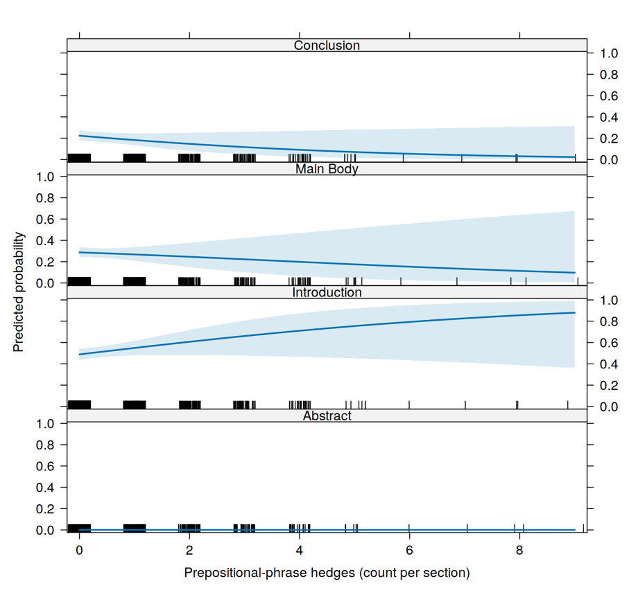{#fig-corpora_lab_1}

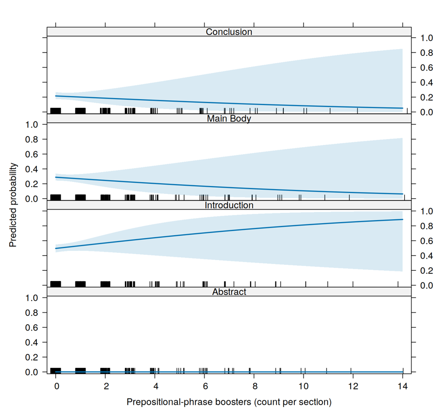{#fig-corpora_lab_2}

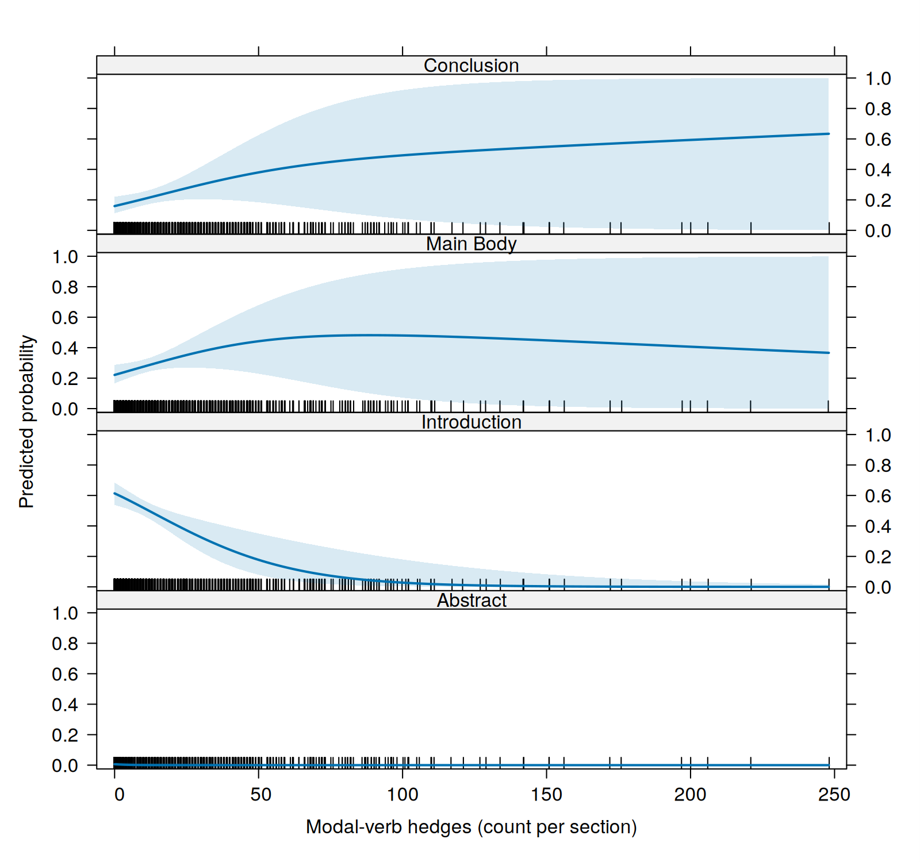{#fig-corpora_lab_3}

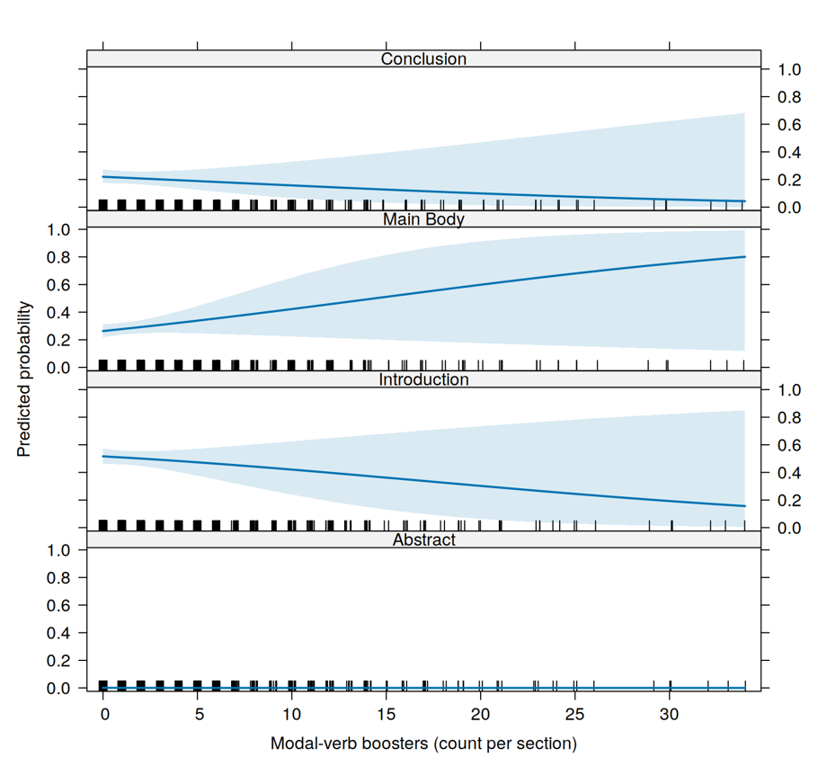{#fig-corpora_lab_4}

Например, с ростом предложных хеджей (см. рисунок @fig-corpora_lab_1) и предложных бустеров (см. рисунок @fig-corpora_lab_2) растёт вероятность того, что раздел является введением. Модальные глаголы-хеджи (см. рисунок @fig-corpora_lab_3) показывают наиболее контрастную картину: с увеличением их частоты вероятность принадлежности к введению резко падает, а вероятность того, что текст относится к заключению и основной части растёт. Модальные глаголы-бустеры (см. рисунок @fig-corpora_lab_4) ассоциированы с повышением вероятности принадлежности к основной части и снижением вероятности того, что текст является введением.

Полученные результаты уточняют существующие представления о вариативности позиции в научных статьях. Во-первых, вариативность зависит от формы: для хеджей секционные различия почти полностью обеспечиваются глаголами, тогда как именные, предложные и адъективные хеджи остаются стабильными. Бустеры, напротив, варьируются почти во всех формах. Во-вторых, аннотация и введение оказываются менее насыщенными маркерами позиции, чем основная часть, а заключение в большинстве областей --- наиболее насыщенным, прежде всего за счёт модальных глаголов-хеджей. В-третьих, при контроле длины секции маркеры позиции оказываются слабыми прокси для определения секции, что важно учитывать при разработке автоматических инструментов анализа академического текста.

Таким образом, проведенный количественный и качественный анализ показал, что выражение авторской позиции в научной статье распределено неравномерно и формо-специфично. Введение менее насыщены маркерами позиции, чем аргументативное ядро, а заключение в большинстве областей становится наиболее насыщенной секцией, прежде всего за счёт модальных глаголов-хеджей. Эти результаты вносят вклад в теоретическое описание жанра научной статьи и создают эмпирическую основу для обучения академическому письму и разработки инструментов автоматического анализа.

### Согласование в текстах носителей и неносителей английского языка

В профессиональной академической письменной речи вариативность согласования подлежащего и сказуемого по числу особенно заметна у существительных, у которых грамматическое и понятийное число расходятся: собирательных (*group*, *team*), неисчисляемых (*research*), существительных латинского происхождения с немаркированной формой множественного числа (*data*, *media*) и существительных на -s (*series*, *dynamics*). Одним из ключевых факторов, потенциально влияющих на выбор формы глагола, является языковой фон автора --- принадлежность к носителям (NS) или не-носителям (NNS) английского языка.

Анализ корпуса исследовательских статей (4,4 млн слов, 2022--2024 гг.) показал, что различия между NS и NNS носят преимущественно описательный характер и лишь в редких случаях достигают статистической значимости.

При собирательных существительных (*group*, *team*; 113 контекстов) носители демонстрировали несколько большую вариативность. В текстах NS доля множественного согласования оказалась выше, особенно в гуманитарных науках. Коэффициент φ для фактора «нативность» составил 0,151 (p = 0,1947), что соответствует слабому и незначимому эффекту (см. таблицу -@tbl-corpora_lab_8).

```{r}
#| echo: false
#| warning: false
#| message: false
#| label: tbl-corpora_lab_8
#| tbl-cap: "Собирательные существительные"


library(flextable)
library(officer)

dat <- data.frame(
  predictor = c(
    "Принадлежность к носителям\n(NS против NNS)",
    "Принадлежит (NS)",
    "Не принадлежит (NNS)",
    "Дисциплины (точные против\nсоциогуманитарных)",
    "Точные науки",
    "Социогуманитарные науки"
  ),
  plural = c(NA, 9, 2, NA, 3, 8),
  singular = c(NA, 58, 44, NA, 65, 37),
  phi = c(NA, 0.151, NA, NA, -0.221, NA),
  p_value = c(NA, 0.1947, NA, NA, 0.0251, NA),
  stringsAsFactors = FALSE
)

rule <- fp_border(color = "black", width = 0.6)

ft <- flextable(dat)

ft <- set_header_labels(
  ft,
  predictor = "Предиктор",
  plural = "мн.согл. (1)",
  singular = "ед. согл.\n(0)",
  phi = "Φ (phi)",
  p_value = "P-value"
)

# Fixed caption matching the source.
# Do not also add a Quarto tbl-cap for this version.

# Integer counts, with empty cells for missing values.
ft <- colformat_int(
  ft,
  j = c("plural", "singular"),
  big.mark = "",
  na_str = ""
)

# Preserve the precision shown in the source.
ft <- colformat_double(
  ft,
  j = "phi",
  digits = 3,
  decimal.mark = ".",
  big.mark = "",
  na_str = ""
)

ft <- colformat_double(
  ft,
  j = "p_value",
  digits = 4,
  decimal.mark = ".",
  big.mark = "",
  na_str = ""
)

# No font family or size is specified.
ft <- bold(ft, bold = FALSE, part = "all")
ft <- italic(ft, italic = FALSE, part = "all")

# Alignments.
ft <- align(
  ft,
  j = "predictor",
  align = "left",
  part = "all"
)

ft <- align(
  ft,
  j = c("plural", "singular", "phi", "p_value"),
  align = "center",
  part = "all"
)

ft <- valign(ft, valign = "top", part = "all")

# Cell spacing.
ft <- padding(
  ft,
  padding.top = 3,
  padding.bottom = 3,
  padding.left = 5,
  padding.right = 5,
  part = "all"
)

# Widths in inches; total width = 6.5 inches.
ft <- width(
  ft,
  j = 1:5,
  width = c(2.65, 1.10, 1.00, 0.85, 0.90)
)

ft <- set_table_properties(
  ft,
  layout = "fixed",
  align = "center",
  opts_word = list(
    split = FALSE,
    repeat_headers = TRUE
  ),
  opts_pdf = list(
    float = "none"
  )
)

# Horizontal rules only, matching the source.
ft <- border_remove(ft)

ft <- hline_top(ft, border = rule, part = "header")
ft <- hline_bottom(ft, border = rule, part = "header")
ft <- hline(ft, border = rule, part = "body")
ft <- hline_bottom(ft, border = rule, part = "body")

ft <- fix_border_issues(ft)

ft
```

Этот результат частично согласуется с данными [@Fernández-Pena2017], отмечавшей региональную и внутриязыковую вариативность согласования с собирательными существительными.

Существительное *research* (488 контекстов) почти всегда сочеталось с формой единственного числа. Единственные случаи множественного согласования отмечены в гуманитарных науках, преимущественно у NNS. Из-за крайне низкой частоты форм множественного числа полноценный статистический анализ факторов, включая нативность, провести не удалось.

Существительное *media* (19 контекстов, только гуманитарные науки) показало противоположные предпочтения: носители преимущественно использовали единственное число, неносители --- множественное. Это наблюдение согласуется с выводом [@Morallo2022] о «переклассификации» носителями как существительного единственного числа, но расходится с данными Лонгманской грамматики, где согласование по множественному числу считалось доминирующим [@Biber1999].

Наиболее частотным и информативным оказалось существительное *data* (847 контекстов). В гуманитарных науках доля согласования по единственному числу у NNS была выше, чем у NS (29 % против 25 %); аналогичная тенденция наблюдалась и в точных науках. Однако в итоговой логистической регрессионной модели фактор «нативность» не достиг значимости (оценка коэффициента −0,2730, p = 0,1496; см. таблицу -@tbl-corpora_lab_9). Доминирующим предиктором оказалась дисциплина, а не языковой фон автора.


| Значения        | Оценка  | Ст. ошибка | Z-value | Pr(\>    | z      |
|-----------------|---------|------------|---------|----------|--------|
| Свободный член  | -2.1494 | 0.4002     | -5.37   | \<0.0001 | \*\*\* |
| носитель=NS     | -0.2730 | 0.1895     | -1.44   | 0.1496   |        |
| дисциплина=bio  | -0.3385 | 0.5063     | -0.67   | 0.5038   |        |
| дисциплина=chem | 1.0531  | 0.5002     | 2.11    | 0.0353   | \*     |
| дисциплина=geo  | -0.9214 | 0.5332     | -1.73   | 0.0840   | .      |
| дисциплина=hist | 1.0365  | 0.5116     | 2.03    | 0.0428   | \*     |
| дисциплина=law  | 0.7717  | 0.4253     | 1.81    | 0.0696   | .      |
| дисциплина=ling | 0.8609  | 0.4223     | 2.04    | 0.0415   | \*     |
| дисциплина=lit  | 3.7232  | 0.8703     | 4.28    | \<0.0001 | \*\*\* |
| дисциплина=med  | 0.9935  | 0.4263     | 2.33    | 0.0198   | \*     |
| дисциплина=phil | 2.0402  | 0.8570     | 2.38    | 0.0173   | \*     |
| дисциплина=phys | 1.3788  | 0.5020     | 2.75    | 0.0060   | \*\*   |
| дисциплина=pol  | 0.3755  | 0.4810     | 0.78    | 0.4350   |        |
| пре-модальность | 0.4016  | 0.1069     | 3.76    | 0.0002   | \*\*\* |
| экзистивность   | 0.5484  | 0.1948     | 2.81    | 0.0049   | \*\*   |
| каузатив        | -1.5056 | 1.0338     | -1.46   | 0.1453   |        |
:Результаты финальной регрессионной модели {#tbl-corpora_lab_9}

Для существительных на -*s* (*series*, *dynamics*; 85 контекстов) картина также неоднородна. Носители чаще использовали единственное число с *series*, тогда как неносители --- с *dynamics*. Коэффициент φ для нативности составил всего 0,047 (p = 0,662), что указывает на полное отсутствие статистически значимой связи (см. таблицу -@tbl-corpora_lab_10).

```{r}
#| echo: false
#| warning: false
#| message: false
#| label: tbl-corpora_lab_10
#| tbl-cap: "Формы единственного числа, оканчивающиеся на -s"

library(flextable)
library(officer)

dat <- data.frame(
  predictor = c(
    "Принадлежность к носителям\n(NS против NNS)",
    "Принадлежит (NS)",
    "Не принадлежит (NNS)",
    "Дисциплины (точные против\nсоциогуманитарных)",
    "Точные науки",
    "Социогуманитарные науки"
  ),
  plural = c(NA, 24, 32, NA, 26, 30),
  singular = c(NA, 11, 18, NA, 22, 7),
  phi = c(NA, 0.047, NA, NA, 0.281, NA),
  p_value = c(NA, 0.662, NA, NA, 0.009, NA),
  stringsAsFactors = FALSE
)

rule <- fp_border(color = "black", width = 0.6)

ft <- flextable(dat)

ft <- set_header_labels(
  ft,
  predictor = "Предиктор",
  plural = "мн.согл.\n(1)",
  singular = "ед. согл. (0)",
  phi = "Φ (phi)",
  p_value = "P-value"
)

# Integer counts; missing values appear as blank cells.
ft <- colformat_int(
  ft,
  j = c("plural", "singular"),
  big.mark = "",
  na_str = ""
)

# Three decimal places for both statistical columns.
ft <- colformat_double(
  ft,
  j = c("phi", "p_value"),
  digits = 3,
  decimal.mark = ".",
  big.mark = "",
  na_str = ""
)

# Use existing flextable font defaults.
ft <- bold(ft, bold = FALSE, part = "all")
ft <- italic(ft, italic = FALSE, part = "all")

# Alignments.
ft <- align(
  ft,
  j = "predictor",
  align = "left",
  part = "all"
)

ft <- align(
  ft,
  j = c("plural", "singular", "phi", "p_value"),
  align = "center",
  part = "all"
)

ft <- valign(ft, valign = "top", part = "all")

# Cell spacing.
ft <- padding(
  ft,
  padding.top = 3,
  padding.bottom = 3,
  padding.left = 5,
  padding.right = 5,
  part = "all"
)

# Widths in inches; total width = 6.5 inches.
ft <- width(
  ft,
  j = 1:5,
  width = c(2.65, 1.00, 1.10, 0.85, 0.90)
)

ft <- set_table_properties(
  ft,
  layout = "fixed",
  align = "center",
  opts_word = list(
    split = FALSE,
    repeat_headers = TRUE
  ),
  opts_pdf = list(
    float = "none"
  )
)

# Horizontal rules only.
ft <- border_remove(ft)

ft <- hline_top(ft, border = rule, part = "header")
ft <- hline_bottom(ft, border = rule, part = "header")
ft <- hline(ft, border = rule, part = "body")
ft <- hline_bottom(ft, border = rule, part = "body")

ft <- fix_border_issues(ft)

ft
```

В целом результаты подтверждают наблюдения предыдущих исследований: носители чаще опираются на семантические и контекстуальные подсказки, тогда как неносители в большей степени ориентируются на формальные правила, усвоенные в ходе обучения [@Al-Shaer2005; @Tsang2017]. Вместе с тем в профессиональном академическом дискурсе, прошедшем редакторскую и рецензионную обработку, эти различия существенно сглаживаются. Дисциплинарные конвенции и синтаксическое окружение оказываются более сильными предикторами, чем языковой статус автора.

Таким образом, фактор нативности проявляется преимущественно на уровне тенденций и не является определяющим при выборе формы глагола в исследованных классах существительных.

### Различия между устным и письменным дискурсом изучающих английский язык

Материалом исследований послужили корпусы, собранные в 2025 году в ходе предыдущего этапа работ, а именно корпус устной речи, включающий защиты проектов ВКР на английском языке студентов НИУ ВШЭ --- Пермь образовательной программы «Иностранные языки и межкультурная коммуникация в бизнесе», и «зеркальный» корпус письменных работ этих же студентов.

#### Авторское присутствие в устных и письменных текстах на английском языке русскоговорящих студентов

Исследование авторского присутствия в английской академической речи русскоговорящих студентов опирается на сопоставимые корпусы проектных предложений и их устных защит (по 57 текстов в каждом подкорпусе). Анализ охватывал местоимения первого лица (*I*, *me*, *my*, *we*, *us*, *our*) и именную группу *the author*. Статистическая значимость различий оценивалась с помощью критерия хи-квадрат и точного теста Фишера; различия считались высокозначимыми при p ≤ 0,001.

Количественные результаты демонстрируют резкое преобладание средств авторского присутствия в устной речи. Наиболее показательные данные приведены в таблице -@tbl-corpora_lab_11.


```{r}
#| echo: false
#| warning: false
#| message: false
#| label: tbl-corpora_lab_11
#| tbl-cap: "Частотность употребления маркеров авторского присутствия в письменном и устном подкорпусах"

library(flextable)
library(officer)

dat <- data.frame(
  pronoun = c(
    "I", "Me", "My", "We", "Us", "Our", "The\nauthor"
  ),
  written_mentions = c(
    "25 / 0.2",
    "3 / 0.02",
    "23 / 0.17",
    "74 / 0.56",
    "43 / 0.33",
    "44 / 0.33",
    "4 / 0.03"
  ),
  written_works = c(7, 2, 7, 18, 20, 17, 2),
  spoken_mentions = c(
    "433 / 13.16",
    "13 / 0.4",
    "220 / 6.7",
    "116 / 3.53",
    "27 / 0.82",
    "46 / 1.4",
    "0"
  ),
  spoken_works = c(56, 12, 48, 26, 17, 16, 0),
  p_value = c(
    rep("≤ 0.001", 6),
    "0.59035"
  ),
  stringsAsFactors = FALSE
)

rule <- fp_border(color = "black", width = 0.6)

ft <- flextable(dat)

# Lower header row.
ft <- set_header_labels(
  ft,
  pronoun = "",
  written_mentions = "Число\nупоминаний/ nf",
  written_works = "Число работ\n(из 57)",
  spoken_mentions = "Число\nупоминаний/ nf",
  spoken_works = "Число работ\n(из 57)",
  p_value = "p-value"
)

# Upper header row:
# blank label column + two written columns +
# two spoken columns + blank p-value cell.
ft <- add_header_row(
  ft,
  values = c("", "Письменный", "Устный", ""),
  colwidths = c(1, 2, 2, 1),
  top = TRUE
)

# Preserve integer counts.
ft <- colformat_int(
  ft,
  j = c("written_works", "spoken_works"),
  big.mark = "",
  na_str = ""
)

# Use existing font defaults; bold headers only.
ft <- bold(ft, bold = FALSE, part = "all")
ft <- bold(ft, bold = TRUE, part = "header")

# Alignments.
ft <- align(ft, align = "center", part = "all")
ft <- align(
  ft,
  j = "pronoun",
  align = "left",
  part = "body"
)

ft <- valign(ft, valign = "top", part = "all")

# Cell spacing.
ft <- padding(
  ft,
  padding.top = 5,
  padding.bottom = 5,
  padding.left = 4,
  padding.right = 4,
  part = "all"
)

# Widths in inches; total width = 6.5 inches.
ft <- width(
  ft,
  j = 1:6,
  width = c(0.65, 1.40, 1.20, 1.40, 1.05, 0.80)
)

ft <- set_table_properties(
  ft,
  layout = "fixed",
  align = "center",
  opts_word = list(
    split = FALSE,
    repeat_headers = TRUE
  ),
  opts_pdf = list(
    float = "none"
  )
)

# Horizontal rules only.
ft <- border_remove(ft)

ft <- hline_top(ft, border = rule, part = "header")
ft <- hline(
  ft,
  i = 1,
  border = rule,
  part = "header"
)
ft <- hline_bottom(ft, border = rule, part = "header")

ft <- hline(ft, border = rule, part = "body")
ft <- hline_bottom(ft, border = rule, part = "body")

ft <- fix_border_issues(ft)

ft
```

Местоимение *I* в письменных текстах встречается лишь 25 раз (0,2 на тысячу) и только в семи работах, тогда как в устных выступлениях его частота достигает 433 случаев (13,16) и фиксируется у 56 из 57 студентов. Аналогичный контраст характерен для *my* (0,17 против 6,7) и *we* (0,56 против 3,53). Именная группа *the author* полностью отсутствует в устной речи, что объясняется коммуникативной ситуацией живого выступления.

Дополнительным подтверждением служит распределение «безличных» текстов: в письменном подкорпусе 16 студентов из 57 полностью избежали исследуемых маркеров, тогда как в устном подкорпусе ни одно выступление не обошлось без самоупоминаний. Эти различия статистически высокозначимы и напрямую связаны с характером двух форм коммуникации. Письменный текст допускает редактирование и минимизацию авторского присутствия, тогда как устная защита, обладая повышенной интерактивностью, делает полное устранение фигуры говорящего практически невозможным [@Biber1999].

Качественный анализ наиболее частотных кластеров с местоимением I в устной речи показывает, что самоупоминания преимущественно выполняют служебные функции. Доминируют конструкции организации дискурса (*I'm going to present, I would like to mention, I would like to start, I'm going to talk*) и коммуникативные формулы приглашения к вопросам (*I'm ready to answer, I'm happy to answer*). Ни одна из них не направлена на усиление авторской авторитетности или заявление о научном вкладе. Студенты активно используют местоимение первого лица, однако делают это механически, не реализуя в полной мере риторический потенциал самоупоминаний [@DontchevaNavrátilová2013].

Сопоставление с предыдущими исследованиями позволяет уточнить специфику русскоязычных учащихся. Низкая частотность маркеров авторского присутствия в письменных текстах согласуется с данными о склонности неносителей из культур с традицией обезличенного научного стиля избегать эксплицитного авторского присутствия [@Щемелева2013; @Walková2018; @Hryniuk2018]. Резкий рост частотности маркеров в устной речи свидетельствует о способности студентов адаптировать стратегии самопрезентации к требованиям ситуации. Эта адаптация, однако, остается поверхностной: маркеры появляются, но их функциональный репертуар остается узким и в значительной степени шаблонным.

Таким образом, полученные результаты показывают, что авторское присутствие в английской академической речи русскоговорящих студентов существенно зависит от канала коммуникации. В письменных текстах оно остаётся сдержанным и нередко минимальным, отражая влияние родной академической традиции и жанровых конвенций. В устной речи самоупоминания становятся практически обязательными, но используются преимущественно в организационных и коммуникативных целях, не работая на усиление убедительности и авторитетности позиции. Эти наблюдения подчеркивают необходимость целенаправленного обучения осознанному управлению авторским присутствием как в письменных, так и в устных академических жанрах.

#### Референциальная когерентность в письменной и устной академической речи русскоговорящих студентов

Анализ различий в реализации когерентности включал номинативную, глагольную и наречную анафору. Статистическая значимость различий оценивалась с помощью log-likelihood test (LL ≥ 3,84 при p \< 0,05; LL ≥ 6,63 при p \< 0,01) и показателя %DIFF.

Основные количественные результаты представлены в таблице -@tbl-corpora_lab_12.

```{r}
#| echo: false
#| warning: false
#| message: false
#| label: tbl-corpora_lab_12
#| tbl-cap: "Частотность анафорических средств в письменном и устном корпусах (на 1000 слов)"

library(flextable)
library(officer)

dat <- data.frame(
  category = c(
    rep("Личные местоимения", 2),
    rep("Указательные местоимения", 3),
    rep("Притяжательные\nприлагательные", 2),
    "Глагольная анафора",
    rep("Наречная анафора", 2)
  ),
  form = c(
    "they", "it",
    "this", "that", "these",
    "its", "their",
    "did",
    "here", "there"
  ),
  written = c(
    0.88, 0.01,
    5.18, 0.34, 1.76,
    1.95, 1.58,
    0.07,
    0.04, 0.02
  ),
  spoken = c(
    0.20, 0.13,
    9.38, 3.72, 2.90,
    0.82, 2.85,
    0.96,
    0.32, 0.36
  ),
  pct_diff = c(
    "−77.27", "+186.00",
    "+44.79", "+168.24", "+39.20",
    "−82.05", "+44.62",
    "+169.49",
    "+177.78", "+190.91"
  ),
  ll = c(
    "68.34***", "11.52***",
    "102.31***", "324.87***", "23.15***",
    "132.56***", "20.74***",
    "98.41***",
    "13.84***", "19.32***"
  ),
  stringsAsFactors = FALSE
)

rule <- fp_border(color = "black", width = 0.6)

ft <- flextable(dat)

ft <- set_header_labels(
  ft,
  category = "Категория",
  form = "Форма",
  written = "Письм.",
  spoken = "Устн.",
  pct_diff = "%DIFF",
  ll = "LL"
)

# Merge category cells across their corresponding forms.
for (rows in list(1:2, 3:5, 6:7, 9:10)) {
  ft <- merge_at(
    ft,
    i = rows,
    j = "category",
    part = "body"
  )
}

# Retain two decimal places, including trailing zeros.
ft <- colformat_double(
  ft,
  j = c("written", "spoken"),
  digits = 2,
  decimal.mark = ".",
  big.mark = ""
)

# Use existing font defaults; bold headers only.
ft <- bold(ft, bold = FALSE, part = "all")
ft <- bold(ft, bold = TRUE, part = "header")

# Text columns left-aligned.
ft <- align(
  ft,
  j = c("category", "form"),
  align = "left",
  part = "all"
)

# Numerical columns right-aligned.
ft <- align(
  ft,
  j = c("written", "spoken", "pct_diff", "ll"),
  align = "right",
  part = "body"
)

ft <- align(
  ft,
  j = c("written", "spoken", "pct_diff", "ll"),
  align = "center",
  part = "header"
)

# Category labels sit at the top of their merged cells.
ft <- valign(ft, valign = "top", part = "all")

# Cell spacing.
ft <- padding(
  ft,
  padding.top = 5,
  padding.bottom = 5,
  padding.left = 4,
  padding.right = 4,
  part = "all"
)

# Widths in inches; total width = 6.5 inches.
ft <- width(
  ft,
  j = 1:6,
  width = c(2.45, 0.70, 0.65, 0.65, 0.95, 1.10)
)

ft <- set_table_properties(
  ft,
  layout = "fixed",
  align = "center",
  opts_word = list(
    split = FALSE,
    repeat_headers = TRUE
  ),
  opts_pdf = list(
    float = "none"
  )
)

# Horizontal rules only.
ft <- border_remove(ft)

ft <- hline_top(ft, border = rule, part = "header")
ft <- hline_bottom(ft, border = rule, part = "header")

# Preserve the internal separators shown in the image.
ft <- hline(
  ft,
  i = c(2, 5, 8),
  border = rule,
  part = "body"
)

ft <- fix_border_issues(ft)

ft
```

Номинативная анафора в целом преобладает в письменной речи (в среднем 5,87 против 4,36 на 1000 слов). Особенно ярко это проявляется в использовании they (почти в четыре раза чаще в письменных текстах) и *its* (более чем вдвое чаще). Высокая частотность *its* напрямую связана с активным употреблением номинализаций, характерных для академического письма (*the model --- its accuracy*), которые формируют четкие референциальные цепи, необходимые при отсутствии интонации и жестов [@Charles2007].

Устная речь демонстрирует резкое преобладание контекстно-зависимых средств. Указательные местоимения *this* и особенно *that* встречаются значительно чаще (*that* --- в 11 раз). Глагольная анафора *did* почти исключительно характерна для устных выступлений (0,96 против 0,07), где она служит экономичной заменой глагольных групп и позволяет поддерживать темп речи. Наречная анафора *here* и *there* резко доминирует в устной модальности, что объясняется опорой на визуальный контекст во время презентации.

Эти различия отражают две стратегии построения связности. Письменный дискурс ориентирован на эксплицитность и однозначность: точные притяжательные и личные местоимения обеспечивают надежное отслеживание референтов на протяжении всего текста. Устная речь опирается на интерактивность, совместное внимание аудитории и ситуативный контекст, используя указательные слова, глагольные заместители и наречия как когнитивно менее затратные средства [@Biber1999; @Crompton2017]. Формы *he*, *she*, *him*, *her* встречаются крайне редко в обеих модальностях, что соответствует общей тенденции академического дискурса к деперсонализации.

Таким образом, гипотеза о наличии значимых различий в использовании средств референциальной когерентности между письменной и устной академической речью русскоязычных студентов подтверждена. Наблюдаемые паттерны представляют собой не недостаток компетенции, а функциональный выбор, обусловленный условиями коммуникации, жанровыми ожиданиями и когнитивными требованиями каждой модальности. Письменный текст требует плотных и однозначных референциальных цепей, тогда как устная презентация успешно использует контекстно-зависимые заместители, снижая когнитивную нагрузку говорящего.

### Диахроническая вариативность эпистемической позиции в аннотациях грантовых заявок

Изучение выражения авторской позиции, описанное в разделе -@sec-teaching_lab2, было продолжено на материале другого жанра --- аннотации заявки на научный грант. Этот жанр формируется под действием двух тенденций: общего роста продвигающего (промоционального) компонента в научном письме и специфических риторических условий грантового конкурса, в которых заявитель представляет не завершенное исследование, а проект, существующий пока только в виде обещания [@Mauranen1999; @Hyland2023]. Поскольку хеджи и бустеры способны делать утверждение более осторожным или, напротив, более категоричным, динамика их частотности позволяет проверить распространенное положение о том, что язык науки становится все менее осторожным и все более рекламным [@Millar2020; @HylandJiang2021].

Материалом исследования послужил корпус аннотаций поддержанных заявок, поданных в Национальный научный фонд США (NSF) с 1987 по 2024 г. Объем корпуса --- 99,4 млн слов; он представляет семь дирекций фонда, соответствующих крупным дисциплинарным группам: биологические науки (BIO), компьютерные и информационные науки (CSE), инженерные науки (ENG), науки о Земле (GEO), математические и физические науки (MPS), социальные, поведенческие и экономические науки (SBE), а также образование в области STEM (EDU). Выбор 1987 г. в качестве начальной точки обусловлен неполнотой и дисциплинарной несбалансированностью данных за более ранние годы. Аннотации извлекались из портала NSF и обрабатывались специально написанным скриптом на Python, который преобразовывал исходные файлы JSON в простой текст, отбирал только исследовательские гранты, удалял дубликаты и очищал данные от артефактов разметки.

Перечень анализируемых единиц был взят из работы [@Millar2026], посвященной эпистемической позиции в аннотациях медицинских статей: модальные глаголы (10 единиц), хеджи (69 единиц) и бустеры (57 единиц). Этот список опирается на приложение к [@Hyland2005B], достаточно полон и сопровождается процедурой снятия неоднозначности, что обеспечивает сопоставимость результатов. Модальные глаголы рассматривались как отдельная категория, поскольку они пересекают противопоставление уверенности и осторожности, а изменения в отдельном модальном глаголе интерпретируемы только на фоне модальной системы в целом. Для каждого года и каждого подкорпуса вычислялись нормализованные частоты (на миллион слов); направление и устойчивость изменений оценивались с помощью тау Кендалла, величина эффекта --- через коэффициент линейной регрессии и коэффициент детерминации R² [@HilpertGries2009]. Тренд считался устойчивым при \|тау\| \> 0,4 и p \< 0,01; дополнительно остатки регрессии проверялись на автокорреляцию по статистике Дарбина--Уотсона.

Результаты не подтверждают ожидаемого сдвига в сторону большей категоричности. В корпусе в целом частотность бустеров и хеджей снижается параллельно, причем более устойчивым оказывается тренд для бустеров (тау --0,66 против --0,51), тогда как среднегодовое снижение больше у хеджей. Модальные глаголы также демонстрируют падение суммарной частотности, которое почти целиком обеспечено высокочастотной формой *will*, однако ни категория в целом (тау --0,35), ни *will* в отдельности (тау --0,29) не удовлетворяют принятому критерию устойчивости, поэтому этот результат интерпретируется как значимая величина эффекта, а не как устойчивый тренд.

Дисциплинарный анализ показал, что изменения распределены неравномерно. Хотя по меньшей мере один устойчивый и статистически значимый тренд обнаружен в шести из семи дисциплинарных групп, их содержание различается: в BIO, SBE и GEO снижаются и бустеры, и хеджи, в MPS --- модальные глаголы, в CSE --- бустеры. Единственный рост, отвечающий критериям устойчивости, --- увеличение частотности бустеров приблизительно на 18 слов на миллион в год в образовании (EDU). Инженерные науки не дают ни одного тренда, проходящего порог, однако это не означает отсутствия изменений: хеджи здесь падают на 14,59 слова на миллион в год при тау --0,39, то есть лишь немного ниже порогового значения.

На уровне отдельных единиц картина оказывается более дифференцированной. Наиболее устойчивое снижение демонстрирует *should* (тау --0,94), причем во всем корпусе и в каждой из семи дисциплинарных групп; заметно падают также хедж *possible* и бустер *very*. Среди растущих единиц выделяется бустер *evidence* в подкорпусе образования (около 31 слова на миллион в год --- максимальный прирост в корпусе), а также *highlight* и *realize*, особенно в математических и физических науках. Из высокочастотных единиц устойчиво растет модальный глагол *can* (тау +0,70, около 23 слов на миллион в год), что зеркально дополняет падение *should*. Анализ чувствительности, при котором из списка удалялись десять наиболее многофункциональных бустеров, подтвердил устойчивость категориальных трендов в четырнадцати из шестнадцати проверенных сочетаний «категория --- дисциплина»; оба исключения касаются бустеров, тренд которых в EDU меняет знак (с +18,25 на --7,07), а в ENG из незначимого становится значимым (--15,76).

Полученные данные позволяют предложить интерпретацию, отличную от гипотезы о нарастающем «хайпе». Параллельное снижение бустеров и хеджей свидетельствует скорее о конвергенции --- общем сокращении эксплицитной маркировки эпистемической позиции, --- чем о смещении к одному из полюсов. Дополнительные подсчеты показывают, что продвигающие прилагательные (*novel*, *innovative*, *significant*) в большинстве дисциплин растут заметно и последовательно, тогда как самоупоминание устойчивого тренда в этом жанре не обнаруживает. Вероятно, работа по продвижению исследования перераспределяется от однословных хеджей и бустеров к оценочной лексике и способам рамочной подачи результата, что согласуется с наблюдениями на материале других жанров [@Yao2023]. Переход от *should* к *can*, в свою очередь, представляет собой перемещение между модальными сферами --- от деонтической оценки ожидаемого результата к динамическому обозначению возможностей проекта --- и соответствует установке современного грантового дискурса на осуществимость и практический эффект.

Таким образом, тезис о росте промоциональности научного письма не переносится автоматически на жанр грантовой аннотации и на подсистему эпистемической позиции. Изменения в этой области оказываются зависимыми от жанра и дисциплины, а эксплицитные маркеры уверенности и неуверенности частично уступают место средствам, выдвигающим на первый план возможности, охват и релевантность исследования, а не степень эпистемической приверженности.

### Отрицание в аннотациях грантовых заявок: частотность, динамика и функциональный профиль

Еще одним направлением работы на материале корпуса аннотаций NSF стало исследование отрицания. Отрицание диалогично по своей природе: отвергая некоторое положение, пишущий сначала вызывает к жизни альтернативу, а затем закрывает ее [@MartinWhite2005]. В отечественной когнитивной и функциональной лингвистике отрицание также описывается как реактивная, вторичная категория, которая действует на фоне предшествующего утверждения или ожидания и тем самым организует альтернативные мыслительные пространства [@Болдырев2011; @Падучева2013]. Благодаря этому отрицание способно обслуживать один из центральных риторических шагов заявки --- создание исследовательского пространства через указание на то, что еще не изучено или понято недостаточно [@Swales1990]. Вместе с тем отрицание в аннотациях грантовых заявок до сих пор не описывалось: существующие работы выполнены на материале аннотаций статей, разделов диссертаций и рецензий, то есть жанров, которые сообщают о завершенном исследовании [@JiangHyland2022; @SunCrosthwaite2022; @Yuan2025].

Корпус включает все аннотации поддержанных исследовательских заявок семи дирекций NSF за 1987--2024 гг.: 326 091 текст и 97,1 млн слов. Вслед за [@JiangHyland2022] анализировалось клаузальное, а не морфологическое отрицание, то есть отрицание, отвергающее целое пропозициональное содержание; поиск велся по тем же семнадцати маркерам (*not, no, few, little, never, neither, none, nor, nothing, no one, nowhere, nobody, seldom, rarely, hardly, scarcely, barely*) без учета регистра, причем *no one* отыскивалось до no во избежание двойного подсчета. Частоты нормализовались на 10000 слов для трендовой статистики и дополнительно на 1000 слов для сопоставления с предшествующими работами. Устойчивость тренда оценивалась по тем же критериям, что и в исследовании эпистемической позиции (\|τ\| ≥ 0,4 при p(τ) и p(β) \< 0,01).

Поскольку сплошная функциональная аннотация примерно 28 000 контекстов невыполнима, функциональный анализ проводился на стратифицированной случайной выборке из двух подкорпусов, определяющих общую динамику, --- BIO и SBE --- с ограничением в три строки конкорданса на ячейку «год × маркер»: 1318 и 1316 строк соответственно. Разметка выполнялась по межличностной модели отрицания [@JiangHyland2022], которая различает интерактивное измерение, организующее текст для читателя (Сравнение, Добавление, Следствие), и интеракционное измерение, передающее позицию автора (Хеджирование, Усиление, Аффект). Аннотирование проводилось вручную автором и ассистентом при согласии экспертов 96%; контексты, в которых искомые формы не выражали отрицания (например, *few* в составе *a few* или *NO* как обозначение оксида азота), помечались как посторонние и исключались, составив 5,8% в BIO и 5,4% в SBE.

Всего в корпусе выявлено 171 281 употребление отрицания, то есть 1,76 на 1000 слов. Это существенно ниже показателей, установленных для аннотаций научных статей (4,22; [@JiangHyland2022]), разделов об ограничениях в диссертациях (7,54; [@SunCrosthwaite2022]) и рецензий (8,46--9,57; [@Yuan2025]). Вероятное объяснение состоит в том, что жанр заявки предполагает более утвердительный способ самопрезентации, соответствующий его промоциональной направленности. Как и во всех предшествующих исследованиях, доминирует not (62,2% всех случаев, 1,10 на 1000 слов), за ним следуют *no* (0,21), *few* (0,18) и *little* (0,16). Дисциплинарные различия значительны: наиболее насыщен отрицанием подкорпус SBE (2,69 на 1000 слов), наименее --- EDU (1,12), промежуточное положение занимают CSE (2,02) и BIO (2,00). Лидерство социальных наук согласуется с наблюдением о большей плотности отрицания и метадискурсивных средств вовлечения в гуманитарных дисциплинах [@Zolfaghari2023], которое в отечественных работах связывается с выраженной аргументативностью этого типа дискурса [@Хутыз2018].

За 38 лет частотность отрицания значимо снизилась, однако при умеренной величине эффекта (тау --0,45, p \< 0,001; beta --0,098 на 10 000 слов в год; R² = 0,43): нормализованная частота упала на 29,1% --- с 1,88 на 1000 слов в 1987 г. до 1,34 в 2024 г. Дисциплинарный анализ показывает, что это снижение не является общекорпусным. Практически целиком оно обеспечено двумя группами: BIO (тау --0,67) и SBE (тау --0,74), где тренды устойчивы, высокозначимы и объясняют большую часть межгодовой дисперсии (R² выше 0,75). В SBE частотность отрицания снизилась на 46,8% (с 3,64 до 1,94 на 1000 слов), в BIO --- на 40,4% (с 2,45 до 1,46), тогда как в остальных пяти дирекциях изменения статистически незначимы. Снижение имеет широкий лексический охват: в SBE значимо падают десять из семнадцати маркеров, в BIO --- одиннадцать. Единственное последовательное исключение --- рост мягких отрицаний *rarely*, *hardly* и *scarcely*, отмеченный во всех семи дисциплинарных подкорпусах, что согласуется с наблюдением о сдвиге к смягченному отрицанию, сохраняющему критическое содержание, но снижающему категоричность [@JiangHyland2022].

Функциональный профиль отрицания в заявках противоположен профилю, установленному для аннотаций статей. В последних преобладало интерактивное измерение (70,2%), причем на организующее текст Следствие приходилось 41,7%, а Аффект был самой редкой функцией (1,96%). В аннотациях NSF преобладает интеракционное измерение (67,5% в BIO и 62,8% в SBE), а наиболее частой функцией оказывается именно Аффект (35,6% и 32,9%). Далее следуют Хеджирование (около 18% в обеих дисциплинах), Добавление (16--18%), Следствие (15--17%) и Усиление (12--14%); Сравнение редко (1,6--2,3% против 14,1% в аннотациях статей). Аффективное отрицание в этом жанре практически всегда обслуживает конструирование лакуны: оно отрицает существование, достаточность или ясность имеющихся исследований, открывая тем самым место для предлагаемого проекта. Повторяющейся формулой этой стратегии является *little / no / few + is known / understood / studied* («Morphological plasticity is little known among vertebrates»), что представляет собой вариант шага «выявление ниши» [@Swales1990] и сближает жанр заявки с введениями диссертаций [@SunCrosthwaite2022].

При заметном снижении общей частотности функциональный состав отрицания остается устойчивым. Разбиение выборки на четыре десятилетних интервала показывает, что доля интеракционного отрицания в BIO колеблется в пределах 64--70%, а доля Аффекта --- 34--36%; в SBE значения столь же стабильны (60--66% и 31--38%). Иными словами, аннотации в этих дисциплинах используют отрицание реже, но сохраняют его прежнее функциональное распределение. Это расходится с данными о функциональном перевзвешивании отрицания в аннотациях статей и может означать, что риторическая работа отрицания в заявке, прежде всего построение лакуны, настолько существенна для жанра, что его функциональная структура устойчива к изменениям. Само же снижение, ограниченное наиболее насыщенными отрицанием подкорпусами, допускает объяснение через регрессию к среднему: дисциплины с высокими показателями приблизились к умеренной норме физических и инженерных наук.

Итак, отрицание не является однородной характеристикой академического письма, а настраивается жанром и дисциплиной: те же маркеры, которые в аннотации статьи выполняют преимущественно текстоорганизующие функции, в аннотации заявки служат для оценки состояния области как недостаточного и обосновывают необходимость вмешательства. Для преподавания английского языка в целях научных исследований и публикаций это означает целесообразность работы с аффективным отрицанием как средством обозначения лакуны, а также с мягкими отрицаниями типа *rarely* и *seldom*, которые позволяют указать на пробел без категоричного отвержения.

### Маркеры важности в аннотациях научных статей, написанных человеком и сгенерированных ИИ

Третье направление примыкает к работе по созданию корпусов ИИ-сгенерированных текстов, описанной в разделе 1, и посвящено тому, в какой мере генеративный ИИ воспроизводит продвигающий компонент жанра аннотации научной статьи. Исследования последних лет фиксируют рост продвигающей лексики в научных текстах, объясняемый конкуренцией за внимание читателя, за финансирование и за публикационные возможности [@HylandJiang2021; @Millar2022]. Внутри этого класса средств особое место занимают маркеры важности --- «лексико-грамматические средства, эксплицитно обозначающие важность, релевантность или значимость сообщаемого» [@Deroey2015: 52]. Вопрос состоял в том, подчеркивает ли ИИ значимость исследования в той же мере, что и автор-человек, и различаются ли два типа текстов по частотности, распределению и лексическому оформлению этих маркеров.

Для исследования были составлены два параллельных корпуса. Корпус текстов, написанных человеком (HUMabs), включает 218 аннотаций научных статей, опубликованных в 32 ведущих журналах по восьми дисциплинам --- четырем точным и четырем гуманитарным --- в 2016--2020 гг., то есть до широкого распространения генеративных инструментов. Параллельный корпус (AIabs) был сгенерирован в августе 2025 г. с помощью Microsoft 365 Copilot Chat на базе GPT-4. Все статьи предварительно преобразовывались в простой текст, из которого удалялись имена авторов, исходная аннотация, список литературы и служебные разделы; каждый текст загружался в отдельный чат с запросом «Напиши аннотацию для подачи статьи в \[название журнала\]». Использовалась корпоративная лицензия с защитой данных, исключающая применение загруженных материалов и ответов для обучения моделей.

Список маркеров важности опирается на работу [@Wang2025], выполненную на корпусе презентаций Three Minute Thesis, и был дополнен по другим исследованиям продвигающей лексики [@Hyland2005; @Millar2022] и по тезаурусам. В список включались единицы, обозначающие именно важность, а не иные положительные свойства исследования, такие как новизна или полезность; единицы, не встретившиеся в корпусах, были удалены. Итоговый перечень насчитывает 72 единицы: 10 глаголов, 20 существительных, 32 прилагательных и 10 наречий. Группировка по частям речи соответствует трактовке маркеров важности как лексической реализации авторской позиции и позволяет сопоставлять типичные грамматические модели их употребления. Многозначные единицы (gravity, matter, stress, material, value, effect, influence, import, leading), способные выступать в качестве терминов, проверялись вручную в контексте, и неоценочные употребления исключались из подсчетов.

Сопоставление частот показало, что в ИИ-сгенерированных аннотациях маркеры важности встречаются почти на 45% чаще, чем в написанных человеком. Различие сосредоточено в прилагательных и наречиях, тогда как по существительным и глаголам значимых расхождений нет. Наиболее резкий контраст дают наречия: в AIabs они более чем втрое частотнее, чем в HUMabs; прилагательные встречаются примерно на две трети чаще. При раздельном анализе точных и гуманитарных наук значимые различия обнаруживаются только для прилагательных, наречий и совокупности маркеров. Наиболее показательно поведение наречий: в HUMabs они существенно частотнее в гуманитарных дисциплинах, чем в точных (1108 против 218 слов на миллион), тогда как в AIabs соответствующее различие меньше и статистически незначимо (2380 против 1646). Анализ распределения подтверждает тот же эффект сглаживания: коэффициент вариации в AIabs ниже, а доля аннотаций без маркеров важности неизменно меньше, то есть ИИ распределяет такие маркеры по текстам более равномерно.

На уровне отдельных единиц ИИ отдает предпочтение более специализированной и интенсифицированной лексике. Из единиц, присутствующих в обоих корпусах, наиболее переупотребляемы ИИ прилагательные significant и fundamental (в 14,6 и 6,4 раза чаще, чем у авторов-людей); только в AIabs встречаются principal, notably, pivotal и fundamentally. Напротив, семантически более широкие и менее категоричные important и main частотнее в HUMabs в 13,5 и 3,5 раза; единиц, встречающихся исключительно в корпусе человеческих текстов, не обнаружено. Контекстный анализ выявил две повторяющиеся модели. Первая --- наречие важности в начале предложения (notably, crucially), предписывающее читателю отнестись к утверждению как к примечательному еще до того, как оно сделано; в HUMabs такие употребления единичны и дисциплинарно локальны, в AIabs они частотнее и распределены по обеим дисциплинарным группам. Вторая модель --- накопление маркеров важности в пределах одного предложения: в AIabs насчитывается 92 предложения с двумя и более маркерами против 55 в HUMabs, причем в ИИ-корпусе они рассредоточены по 72 текстам против 42. Репертуар атрибутивных сочетаний также шире: восемь различных сочетаний «прилагательное + существительное важности» (fundamental importance, critical importance, significant influence и др.) против двух в корпусе человеческих текстов.

Таким образом, ИИ воспроизводит продвигающую функцию аннотации, но делает это более однородно, настойчиво и формульно: маркеры важности употребляются чаще, распределяются ровнее, сглаживая дисциплинарную вариативность, и оформляются повторяющимися оценочными конструкциями, представляющими исследование как более значимое, фундаментальное и следственно весомое. Различия между двумя типами текстов, следовательно, носят не только количественный, но и риторический характер. С практической точки зрения это означает, что черновики аннотаций, подготовленные с помощью генеративных инструментов, требуют внимательной авторской правки, направленной на устранение преувеличений и на сохранение дисциплинарных норм подачи значимости результата.

### От методов убеждения к прагматическим механизмам: анализ языка пропаганды в английском языке

Для того, чтобы сравнить риторические структуры, используемые студентами, изучающими английский язык, для мотивации свой точки зрения со структурами, встречающимися в текстах, исходно написанных в английском языке, было принято решение углубить анализ новостных текстов. Заметим. что новостные тексты могут использоваться как для бесстрастного изложения фактов, так и для изложения собственной точки зрения, излагающей сдвинутую позицию или несуществующие факты (фейковые новости). Помимо этого,в новостной повестке может стоять задача пропаганды определенных позиций, связанная с однобоким или неполным изложением фактов, замалчиванием части имеющейся риторики по выбранному вопросу.

В связи с этим исследовались два феномена. Первый из них --- стиль изложения фейковых новостей в англоязычных СМИ. Второй из них --- искажения в отображении материала для получения выгодного для одной из сторон отражения ситуации. По второму вопросу были выбраны хорватские Интернет-СМИ, освещающие вопрос глобального потепления в основном лишь с официальной точки зрения Евросоюза о необходимости реакции на него. Именно хорватский язык был выбран в связи с тем, что глубокое изучение только явлений английского языка может привести к смещению акцентов и нивелированию некоторых явлений, присущих другим языкам. Сравнение материалов двух языков может расширить область применения полученных выводов.

В дальнейшем собранный теоретический материал может быть использован для поиска подобных искажений в текстах эссе студентов, изучающих иностранные языки.

Итак, в первой части данного исследования рассматривался язык убеждения в особом типе фейковых новостей --- пропаганде, которая зачастую использует скрытые приемы, чтобы ввести людей в заблуждение. Пропаганда хорошо поддается прагматическому анализу: можно выявить механизмы, с помощью которых аудиторию склоняют к принятию определенной идеологии или картины мира. Наша цель --- систематически определить эти прагматические механизмы и языковые формы, в которых они воплощаются, используя корпус текстов Fakespeak-ENG. Здесь мы опираемся на существующую теоретическую модель убеждения, принимая ее за отправную точку для анализа текстов, и дополняем ее новым аналитическим уровнем, который уделяет более пристальное внимание собственно языковым средствам. Результаты показывают, что наиболее распространенными приемами убеждения в исследованных нами пропагандистских текстах являются использование эмоционально окрашенной лексики, апелляция к авторитету и апелляция к фактору времени; они характеризуются, соответственно, наличием слов с негативной эмоциональной окраской, глаголов со значением передачи информации и временных дейктических маркеров. Кроме того, необходимо подчеркнуть роль манипулятивных приемов: использования образных выражений, ложных импликатур и пресуппозиций, а также типографического выделения --- все это служит для более или менее тонкого воздействия на адресата. Детальный разбор этих языковых стратегий дополняет имеющиеся исследования языка фейковых новостей в целом и пропаганды в частности, а также имеет практическое значение для разработки систем автоматического обнаружения пропаганды и развития медиаграмотности.

В данном поисковом корпусном исследовании ставилась задача найти ответы на два исследовательских вопроса: во-первых, о частоте использования приемов убеждения в пропагандистских текстах на английском языке, а во-вторых --- о лингвистических формах и прагматических механизмах, лежащих в основе этих приемов. В рамках первого вопроса было выявлено 1018 фрагментов, содержащих приемы убеждения. При этом обнаружилось явное преобладание «манипулятивной лексики» и ее разновидности --- «эмоционально-оценочной лексики», что согласуется с результатами исследования Да Сан Мартино и соавторов [@DaSanMartino2019]. Частотность остальных приемов оказалась иной, чем в работе Да Сан Мартино и соавторов; отчасти это может быть связано с различиями в методах сбора данных: если их корпус формировался на основе репутации источников, то в нашем исследовании каждый новостной материал классифицировался как пропагандистский на основе строгих критериев (подробнее об ограничениях первого подхода см. в работе [@Põldvere2023]). Наш лингвистический анализ был сосредоточен на пяти наиболее часто встречающихся приемах --- помимо «эмоционально-оценочной лексики», к ним относятся «апелляция к авторитету», «апелляция к фактору времени», «посеивание сомнений» и «апелляция к страху или предрассудкам». Впрочем, в ходе дальнейшего обсуждения были отмечены схожие закономерности, характерные для остальных, менее распространенных приемов.

Отвечая на второй исследовательский вопрос, необходимо разграничивать эксплицитные (явные) и имплицитные (скрытые) лингвистические формы убеждения. С одной стороны, пропаганда обнаруживает сходство с другими видами недостоверной информации (фейковых новостей) --- дезинформацией и непреднамеренным искажением фактов (misinformation). Для них, как правило, характерны сильная эмоциональность, выражение оценочного отношения и авторской позиции, а также частое использование лексики, передающей эмоциональную окраску (см., например, @Markowitz2014; @Pérez-Rosas2018). В исследованных нами пропагандистских текстах эмоциональный фон был преимущественно негативным, что подтверждается примерами использования «эмоционально-оценочной лексики», а также ощущением безотлагательности, создаваемым с помощью временных дейктических маркеров (например, слова «сейчас» в рамках приема «апелляция к фактору времени»). Помимо лексических средств, выражающих эмоции и субъективность, выявлены ряд приемов убеждения, реализация которых зачастую опирается на использование определенных грамматических классов слов --- например, модальных глаголов в приеме «апелляция к фактору времени». В разделе 4 не упоминаются прилагательные, используемые для преувеличения (например, «буквально навоз»), глаголы в составе лозунгов (например, #FinishTheWall --- «завершите строительство стены»), а также существительные или именные группы, служащие для навешивания ярлыков (например, «доморощенный белый националистический террор»). В наших данных также встречаются другие явные языковые средства --- союзы и союзные слова, выражающие дискурсивные отношения; к ним относятся, в частности, условные конструкции, используемые в приемах, направленных на возбуждение страха или предрассудков (обычно они опираются на довольно ограниченный набор грамматических и лексических средств). В разделе 4 (см. дополнительные материалы в сноске 1) также не рассматриваются маркеры временных, причинных и уступительных отношений, характерные для таких приемов, как «указание на лицемерие» (для выражения уступки; ср.: «Они говорят о переменах, но купить боевое оружие по-прежнему проще, чем бутылку пива»).

С другой стороны, вполне ожидаемо, что пропаганда содержит множество более скрытых форм убеждения, поскольку ей свойственно скорее «умалчивать», чем «провозглашать». Выделим три основные группы прагматических механизмов и способов расширения значений, которые лежат в основе убеждающего воздействия в пропаганде: использование образных выражений, ложные импликатуры и пресуппозиции, а также типографическое выделение. Во-первых, эффективность образных выражений --- таких как метафора или гипербола --- в ситуациях, когда авторы избегают прямого обмана, может объясняться их промежуточным статусом: это уже не совсем правда, но еще и не откровенная ложь [@Claridge2018: 371]. Гипербола служит действенным механизмом преувеличения. Рассмотрим неопределенные местоимения в примере (ex-coprus_lab_1).

(@ex-coprus_lab_1) ... the Biden administration sent a clear signal that our border is open for **anyone** and **everyone** "...администрация Байдена послала четкий сигнал о том, что наша граница открыта для **всех** и **каждого**..."

Утверждая, что граница между США и Мексикой открыта «для всех и каждого», автор предоставляет слушателю возможность самому --- на основе контекста --- решить, как воспринимать это высказывание: как преувеличение или как ложь. При этом, если слушатель сделает неверный вывод, он рискует оказаться введенным в заблуждение. Кроме того, одна из причин привлекательности образных выражений заключается в их эмоциональном воздействии, которое «может оставить след, даже если мы отвергаем использованные слова как ложные» [@Claridge2018: 381], что усиливает их потенциал для введения в заблуждение.

Во-вторых, еще один эффективный способ намекнуть на ложность утверждения --- не высказывая ее прямо, --- это использование импликатур и пресуппозиций. K ним относится и «чрезмерное упрощение причинно-следственных связей» Обратимся к союзу «до того как» (before) в примере (ex-coprus_lab_2).

(@ex-coprus_lab_2) *До того как президент Байден вступил в должность, США доминировали в сфере производства энергоресурсов в мировом масштабе.*

В предложении (@ex-coprus_lab_2) союз «до того как» (before) по умолчанию воспринимается в своем временном значении («до наступления события p произошло событие q»). Однако при определенных условиях это временное значение может порождать так называемый «наведенный вывод» (invited inference) [@Traugott2002: 39] о наличии причинно-следственной связи между частями высказывания (то есть о том, что утрата США доминирующих позиций в энергетике произошла исключительно по вине Байдена). В данном случае временной союз «до» (before) позволяет использовать причинно-следственную связь в манипулятивных целях. Если автору укажут на это, он может заявить, что вовсе не собирался прямо обвинять Байдена, а лишь констатировал простой временной факт. В связи с этим мы согласны с [@АпресянОрлов2022: 92], которые отмечают, что «вводящие в заблуждение импликатуры нельзя считать ложью, поскольку они представляют собой не утверждения, а имплицитные допущения, которые можно опровергнуть (отменить)».

Подобная «отменяемость» не свойственна пресуппозициям. Тем не менее, на наш взгляд, это ничуть не снижает их эффективности в пропагандистских целях. Помимо стратеги «порождения сомнений» существует еще одна разновидность этого приема --- «искажение позиции», которая буквально изобилует ложными пресуппозициями и допущениями: реальный субъект подменяется вымышленным, чтобы исказить суть аргумента --- в данном случае мысли, желания, намерения, взгляды или действия третьего лица. Например, реакция на слова Берни Сандерса: «Когда ты белый, ты не знаешь, каково это --- быть бедным». Используя маркер пресуппозиции (глагол «перестать» --- \*stop\*), автор навязывает представление о Сандерсе как о человеке, который активно действует во вред американскому народу.

(ex-coprus_lab_3) **STOP DIVIDING** US. **STOP PITTING** US **AGAINST** EACH OTHER. "**ХВАТИТ РАЗДЕЛЯТЬ** НАС. **ХВАТИТ СТАЛКИВАТЬ** НАС ДРУГ С ДРУГОМ."

В данном случае пресуппозиция служит для навязывания определенного взгляда на кого-либо --- без открытой дискуссии или критической оценки, что вполне соответствует предвзятой природе пропаганды.

В-третьих, под типографическим выделением (см. @Maia2018) мы понимаем использование графических средств оформления текста для управления вниманием читателя. Может показаться неожиданным, что эти приемы не были включены в категорию явных средств, упомянутых выше; однако необходимо подчеркнуть, что интерпретация истинного значения типографических символов требует от читателя выполнения значительного объема логических выводов. Ранее было показано, например, как кавычки могут менять прагматическое значение слов --- как в случае с выражением «slip up» («оплошность»): без кавычек это слово вряд ли можно было бы классифицировать как пример эмоционально окрашенной лексики. Кроме того, в раньше не упоминалось использование прописных букв (для усиления эмоциональности в случаях преувеличения или использования «заряженной» лексики), а также знаков препинания (для создания эффекта запутывания, намеренной неопределенности или внесения неясности --- например, «ну и о чем это тебе говорит...»), цель которых --- вызвать у читателя замешательство или сомнение.

Разграничение явных и неявных средств убеждения, а также способность их распознавать, имеют важное значение для развития двух основных направлений борьбы с фейковыми новостями: автоматического обнаружения и повышения медиаграмотности. Явные маркеры относительно легко выявляются автоматическими методами, основанными на технологиях обработки естественного языка --- таких как анализ тональности, определение частей речи и синтаксический разбор. Да Сан-Мартино и соавторы [@DaSanMartino2019: 5643], опираясь на концепцию Пискорского и соавторов [@Piskorski2023], достигли F-меры (комплексного показателя точности и полноты) в 60,98%, используя векторные представления слов. Добавление в подобные модели заранее определенных лингвистических данных может значительно повысить точность их работы и, что немаловажно, их объяснительную способность --- за счет настройки модели на выявление связи между конкретными приемами убеждения и определенными языковыми средствами. Выводы, полученные в ходе данного исследования, могут служить основой для дальнейшей разработки моделей, предназначенных для обнаружения пропаганды. Однако выявленные в этом исследовании неявные сигналы требуют слишком много прагматических выводов, общих точек соприкосновения и знаний о мире для обработки современными алгоритмами. Даже такая, казалось бы, простая техника убеждения, как «Апелляция ко времени», редко упоминает свою ключевую концепцию --- ВРЕМЯ. Наши результаты будут полезны в программах повышения медиаграмотности и предотвращения дезинформации, направленных на развитие у аудитории лингвистической осведомленности, необходимой для распознавания и противодействия манипулятивным сообщениям, включая более неявные формы убеждения. Для достижения лучших результатов дополнительный лингвистический слой, выявленный в этом исследовании, может быть использован в сочетании с более сложными техниками убеждения, разработанными в работе [@Piskorski2023].

Таким образом, читатели могут сначала задаться вопросом: «Не представлен ли в тексте кто-либо в негативном свете?», а затем поискать маркеры пресуппозиций, которые могут несправедливо способствовать формированию такого образа (см. [@Németh2025]). Подобное внимание к деталям и к тому, как осуществляется манипуляция посредством языка, поможет нам лучше понять пропаганду, ее истинные цели и механизмы.

В части исследования, посвященного освещению климатического кризиса в хорватских интернет-СМИ, анализируются категории субъектности (agency) и новостной значимости (news values) в вербальных и визуальных компонентах хорватских интернет-новостей, посвященных климатическому кризису; рассматривается то, как именно в них представлено изменение климата. Изучение критериев новостной значимости, визуальное фреймирование и метафоры, связано с понятиями субъектности и ответственности. Кроме того, в работе прослеживается, как различные типы субъектности формируют новостную значимость --- как в метафорических, так и в неметафорических микроконтекстах.

Для достижения поставленных целей нами используется четыре теоретических подхода: модель транзитивности Халлидея и Маттиссена [@HallidayMatthiessen2014]; теорию концептуальной метафоры [@LakoffJohnson1980], с последующими дополнениями [@Forceville2008; @Steen2010; @Hart2017]; анализ новостной значимости [@BednarekCaple2017]; а также концепцию визуального фреймирования изменения климата [@ONeill2013].

Результаты исследования демонстрируют противоречивую картину. Хорватские интернет-СМИ преимущественно вызывают чувство тревоги, что подкрепляется такими критериями новостной значимости, как «воздействие» и «негативность», а также частым изображением человечества в роли «объекта воздействия» --- как в текстах, так и в визуальных материалах. Метафорическое фреймирование строится по четкой схеме: отдельные люди представлены как жертвы, противостоящие более сильным противникам, в то время как абстрактные сущности --- такие как климатический кризис или изменение климата --- изображаются как злонамеренные субъекты в рамках доминирующего сценария «войны». В новостных материалах крайне редко освещаются инициативы, способные укрепить ощущение собственной субъектности (способности к действию). В большинстве статей изменение климата подается как глобальная проблема, а в качестве иллюстраций используются изображения мест, далеких от Хорватии или лишь косвенно с ней связанных. В итоге формируется нарратив, который воспринимается как нечто отстраненное и недостаточно значимое для рядового читателя.

Наш анализ субъектности и новостных критериев --- как в метафорическом, так и в буквальном дискурсе о климатическом кризисе в хорватских интернет-СМИ --- позволил сделать следующие выводы.

Освещение изменения климата в хорватских онлайн-новостях отличается определенной непоследовательностью. Оно по большей части вызывает тревогу, что усиливается такими новостными критериями, как «воздействие» и «негативность» --- закономерность, выявленная Даль и Флоттум [@DahlFløttum2017] при изучении изданий The Guardian и Daily Mail. Кроме того, человечество в текстах и изображениях неизменно предстает в роли «объекта воздействия».

Метафорическое осмысление в текстовой части публикаций строится по следующей схеме: климатический кризис и изменение климата --- абстрактные сущности --- наделяются чертами злонамеренных субъектов в рамках доминирующего сценария «войны», где люди оказываются в положении жертв, противостоящих более сильному противнику. Подобная репрезентация отодвигает на второй план действия людей и их ответственность за возникновение кризиса. Другие метафоры (например, представление кризиса как объекта, поддающегося манипуляциям) также искажают понимание того, как можно противостоять этой проблеме. Изменение климата и климатический кризис крайне редко описываются как антропогенные явления; вместо этого в материалах люди --- и места их проживания --- чаще изображаются как пассивные жертвы, которым угрожают климатические процессы.

В большинстве статей изменение климата подается как глобальная проблема, иллюстрируемая изображениями мест, далеких от Хорватии. Поскольку такие новостные критерии, как «близость» и «созвучность», задействуются редко, угроза воспринимается как нечто отстраненное.

Лишь на немногих изображениях можно увидеть Адриатическое море или Хорватию, и лишь в единичных статьях Средиземноморье (частью которого является Хорватия) упоминается как «горячая точка» изменения климата. Недостаточное внимание к локальным, личностно-ориентированным историям свидетельствует о том, что позитивные действия и гражданская активность обычных людей остаются на периферии. В проанализированных нами материалах крайне редко отражались конкретные повседневные действия простых граждан; в новостях почти не освещались инициативы, способные укрепить у людей чувство собственной субъектности [@DeMeyer2020]. Эта закономерность согласуется с выводами Башич, Грубишич и Веселицы-Майхут [@Bašić2020], которые показали, что в 2018 году три хорватских интернет-ресурса представляли изменение климата как нечто расплывчатое и в значительной степени внешнее по отношению к стране. Она также перекликается с результатами исследования Калайджич и соавторов [@Kalajžić2022], согласно которым в 2019 году в хорватских онлайн-источниках преобладал сенсационный подход к освещению изменения климата, тогда как практические меры по смягчению его последствий или адаптации к ним со стороны рядовых граждан Хорватии обсуждались крайне редко.

Как было отмечено в предыдущих исследованиях, посвященных другим странам (например, [@Kramar2023]), в проанализированных нами материалах лишь в очень немногих текстах ответственность за климатическую катастрофу возлагается на конкретных субъектов --- например, правительства или корпорации. В текстах доминируют голоса представителей элиты --- политиков, ученых и сотрудников СМИ, --- которые фокусируются прежде всего на угрозах. Поскольку в таких материалах практически отсутствует элемент «персонализации», само повествование воспринимается как нечто далекое и, следовательно, недостаточно значимое для рядового читателя.

Метафорические представления климатического кризиса/изменения относительно редки в устных данных, и большинство из них условны. Наши выводы о вербальной образности согласуются с Башичем, Грубишичем и Веселикой-Майхутом [@Bašić2020: 19], которые сообщают, что «риторические стратегии, используемые для привлечения внимания читателей», были редки в их выборке хорватских онлайн-новостей за 2018 год. Аналогичная тенденция наблюдается и в наших данных, где образные представления также ограничены. Метафорических представлений в визуальных образах еще меньше. Несколько метафорических изображений намеренно составлены, отфотошоплены и появляются в основном в образовательных контекстах, намекая на их убедительный потенциал, однако в целом визуальные эффекты редко используют метафору для мотивации аудитории или стимулирования действий.

Ведущей идеей этого исследования является предположение о двунаправленной связи между дискурсом и социальным действием: дискурс может отражать социальное действие, но он также может формировать, легитимировать и мотивировать его. Основной теоретический вклад этого исследования заключается в применении лингвистических теорий для понимания того, как общественное восприятие экологического кризиса и социальные реакции на него формируются посредством вербальных и визуальных репрезентаций в средствах массовой информации. Кроме того, были добавлены новые категории к модели визуального оформления О'Нила, чтобы лучше отразить специфику хорватского повествования об изменении климата. Хотя эти дополнения отражают особенности конкретного национального контекста, новые категории могут быть применимы и в других национальных условиях.

Кроме того, применение теоретических основ, изложенных на протяжении всего исследования, дает более широкие эмпирические результаты за пределами хорватского контекста, в частности, повторяющееся конструирование человечества как жертвы в сценарии войны, символизирующей последствия изменения климата.

### Разметка и анализ ошибок интерференции в корпусе REALEC

#### Работа с разметкой

В текущем году была предложена новая система разметки ошибок интерференции в корпусе REALEC [@Kharlamova2026; @KharlamovaProskurina2026]. Система опирается на анализ языковой интерференции У. Вайнрайха [@Weinreich1979]. В версии, опубликованной на LREC 2026, она различает пять типов ошибок, за которыми стоит влияние русского языка.

- Copying Expression: дословный перевод русских выражений и коллокаций. В предложении *A big bath was prepared for every of us* слово в слово передано «для каждого из нас», хотя нужно *for everyone*.
- Synonyms: автор передаёт многозначное русское слово, которому в английском соответствуют разные лексемы, и выбирает не ту. В примере *The distance can be overcame by the train* на месте *cover* оказался *overcome*, потому что в русском оба глагола переводятся как «преодолеть».
- Tense Semantics: английское время выбрано под влиянием русской грамматической формы. При описании графиков русский язык допускает настоящее время для прошлых событий, отсюда *In 1999 the share decreases* вместо *decreased*; сюда же относится *will* в условных придаточных.
- Transliteration: русское слово, записанное латиницей, например *cassa* («касса») вместо *cashier*.
- Word Form Transmission: перенос грамматической категории из русского, как в *The primary cost was \$5 billions*, где множественное число пришло из сочетания «5 миллиардов долларов».

Каждый участник получил инструкцию по разметке предложений. Три аннотатора разметили 500 примеров, а в конце сверили метки, чтобы оценить согласие. Основную массу разметки составили метки Синоним, Копирование, Перенос глагола и Перенос существительного.. Остальные классы встречаются заметно реже: Ошибка выбора предлога набирает десятки примеров, а Ошибка произношения и Транслитерация единичны. По итогам разметки было рассчитано согласие аннотаторов: попарная каппа Коэна составила от 0,72 до 0,84 (см. рисунок -@fig-corpora_lab_5), что говорит о высокой согласованности.

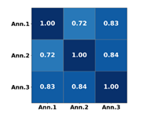{#fig-corpora_lab_5}


После этого рабочая группа рассмотрела и приняла предложение изменить классификацию ошибок: новая версия должна покрывать более широкий спектр случаев и годиться для разметки ошибок интерференции в других корпусах и на типологически более разнообразном материале. Главная идея состоит в том, чтобы развести ошибки по уровню: глагол и имя, отдельное слово, выражение целиком.

Глагол и имя

- **Verb-level morphology transmission**: перенос русской глагольной модели. Сюда входят временная семантика (в пятитеговой системе ей соответствовал класс Tense Semantics), форма глагола после *if* и остальные ошибки времени и глагольной формы.
- **Noun-level morphology transmission**: перенос русской именной модели. Сюда относятся номинализация того, что по-русски выражено глаголом, притяжательное *'s*, число (как в *\$5 billions*) и артикли.

Лексические ошибки

- **Transliteration** можно разделить на два класса. Real-world spelling errors дают существующее английское слово с другой семантикой: *fabrics* в значении «фабрики», *auditory* в значении «аудитория». Обычная транслитерация порождает несуществующее слово на русских корнях, вроде *pereferia* или *cassa*.
- **Synonyms** тоже можно разделить, на этот раз по направлению колексификации: одному английскому слову соответствует несколько русских или, наоборот, одному русскому слову несколько английских. В разметке это уже намечено как Synonyms 1 и Synonyms 2, но второй подкласс пока почти пуст, и границу между ними ещё предстоит провести на всём массиве.
- **Wrong preposition** объединяет все ошибки предлога: неверный, лишний или пропущенный предлог.

Ошибки выше уровня слова

- **Copying expression**: исправление нельзя свести к замене одного слова, менять приходится всё выражение. Таковы кальки *give use to society*, *stand on the current place* или *the most large number*.

#### Приложение с автоматической обратной связью: разработка и подготовка эксперимента

Было создано новое приложение для короткой обратной связи при тренировке навыков описания графиков. В данном приложении преподаватель создаёт задания на описание графиков, диаграмм и таблиц и приглашает студентов по коду, а студент пишет текст и сразу получает автоматическую обратную связь. Исправления порождает модель T5, которая использует сигнал детектора ошибок на основе ELECTRA [@Yuan2021]. Первая версия была разработана в ходе предыдущих этапов работ весной 2025 года; упражнения в ней подбирались из базы размеченных предложений REALEC. С августа по октябрь 2026 года приложение было глубоко переработано, чтобы его можно было использовать на реальных занятиях и в эксперименте.

Упражнения из базы уступили место практическим сессиям на собственных ошибках студента. Сначала студент переписывает предложение, пока оно не совпадёт с исправленным вариантом модели или преподавателя. Затем для каждого исправленного фрагмента он придумывает новое предложение, где этот фрагмент употреблён без ошибок (если фрагмент требовалось удалить, нужно сохранить структуру вокруг пропуска). Новое предложение проверяет та же модель, и найденные в нём ошибки встают в очередь следующих раундов. Сессию можно начать с предложения из своей работы, по заданию преподавателя или с собственного предложения, ошибки в котором студент разметил сам. В раундах с новым предложением модель DeepSeek подсказывает три примера, а если сервис недоступен, все работает и без них.

Подсветку ошибок строит разница между текстом студента и его исправлением, типизированная инструментом ERRANT, так что подсвечивается ровно то, что изменили модель или преподаватель. Все правки попадают в журнал ошибок, отдельно для заданий и для практики. Преподаватель правит исправления модели, ставит оценку от 0 до 10, отмечает предложения для практики, комментирует текст и видит статистику каждого студента: время на задания (учитывается только активное), оценки, практику и распределение типов ошибок по месяцам.

- Подготовка к эксперименту. При регистрации студент видит форму информированного согласия, а в профиле может указать возраст, пол, родной язык и уровень английского. Эксперимент сравнивает два формата домашней работы при обучении академическому письму: стандартный, по учебным пособиям, и с программой автоматической обратной связи. Учебные группы участвуют как контрольные или экспериментальные; в начале и в конце курса студенты пишут описание графика в программе, а после финального тестирования заполняют анкету. Данные студента, отказавшегося от участия, в анализ не попадают, хотя приложением он пользуется как обычно.
- Надёжность и развёртывание. Пакетная генерация исправлений ускорила анализ эссе вдвое без изменения результата, а ограничение числа потоков PyTorch подняло пропускную способность в 1,84 раза. Одновременно идёт не больше трёх анализов, до 60 работ ждут в очереди, а сверх этого студент получает вежливое сообщение о загруженности сервера. В контейнере с четырьмя ядрами 60 работ, отправленных одновременно, обработались за 82 секунды, а пока в очереди стояли 57 работ, обычные страницы открывались за 10 мс. Приложение работает в трёх Docker-контейнерах (nginx, приложение с моделями, PostgreSQL), для администраторов написана инструкцию по развёртыванию, ключевые сценарии покрыты автотестами. В октябре 2026 года эксперимент запущен, а платформа доступна по адресу [<u>https://langfeedback.fikl.ru/</u>](https://langfeedback.fikl.ru/).

#### Новая версия корпуса REALEC и его использование для автоматической коррекции ошибок

Была подготовлена новая версия корпуса REALEC с поиском на платформе ANNIS.

Сначала были проведены проверки, совместимы ли с данными REALEC внешние инструменты: конвертер annatto (CoNLL-U с GraphML) и система аннотирования INCEpTION. Пилотный прогон был проведен на «золотом» подкорпусе 2014--2019 годов с ручной разметкой: 6009 документов (1538512 токенов) прошли весь конвейер и загрузились в graphANNIS, причём число токенов в ANNIS точно совпало с ожидаемым. Именно на этом масштабе всплыли ошибки, невидимые на отдельных файлах: предложения, переходящие через границу абзаца, и пустые леммы. Нашлась и ошибка в таксономии: метки note и suggestion считались результатом автоматической разметки, хотя их вручную ставили аннотаторы. После исправления число ложных «автоматических» аннотаций в золотом подкорпусе снизилось с 4338 до одной. Затем юыл конвертирован весь корпус 2014--2020 годов. Данные 2020 года частично разметила нейросетевая модель Heptabot, которая делит ошибки на 6 укрупнённых типов, поэтому конвейер определяет происхождение разметки (ручная или автоматическая) для каждой аннотации отдельно, а не для файла целиком. Проверка подтвердила, что в 77,7% документов 2020 года оба вида разметки смешаны. Из 18 708 документов были намеренно исключены из конвертации 51 (0,27%), потому что границы разметки ошибок в них не совпадают с токенизацией: в 27 случаях размечена часть токена, в 24 у фрагмента вообще нет морфологического токена.

Был развернут поисковый движок graphANNIS и браузерный интерфейс ANNIS (korpling/ANNIS) и исправлены проблемы, найденные при практической работе с интерфейсом. Поиск по тегу ошибки возвращал почти вдвое больше совпадений, чем нужно (105879 вместо 53539), пробелы и метаданные отображались неверно, а неудачные визуализаторы заменены собственным HTML-визуализатором ошибок. Профилировщик указал на узкое место: стандартный запрос ANNIS на открытие документа выполнялся около 30 секунд. После добавления в разметку каждого токена идентификатор документа и дополнили исходный код ANNIS небольшим патчем документ стал открываться быстрее --- примерно за 0,03 секунды.

Была проведена очистка кода, написана документация по развертыванию и API, сделан Docker-образ, который опубликован Docker Hub. Система состоит из четырёх сервисов в Docker Compose: поискового движка graphANNIS, браузерного интерфейса ANNIS UI с двумя патчами, сервиса query-api на Flask, который выдает результаты поиска в удобном для чтения виде (полное предложение, вся разметка, исправления и комментарии аннотаторов), и обратного прокси Caddy с автоматическим HTTPS. Корпус распространяется отдельным Docker-образом, поэтому для установки на сервер достаточно двух команд, docker compose pull и docker compose up -d, без исходного кода, сборки и ручной настройки. Серверу нужно около 4 ГБ оперативной памяти и около 10 ГБ диска, а пересборка корпуса из исходных данных занимает менее часа на отдельной машине с 14 ГБ памяти.

Итоговый корпус включает 18 657 эссе 2014--2020 годов, 4 819 695 токенов и около 356 тысяч аннотаций ошибок, из них 234 421 ручная и 121 803 автоматические; документы сгруппированы в подкорпусы по годам. Веб-интерфейс служит только для поиска и просмотра, без редактирования. Пользователь может искать на языке AQL по словоформам, леммам и частям речи (UPOS и CLAWS5), по типу ошибки, по происхождению разметки и по сочетанию этих условий; фильтровать документы по метаданным (год, уровень CEFR, задание, тип работы, курс, IELTS, пол, факультет, дата); видеть цветную подсветку фрагментов с ошибками, где при наведении курсора появляется исправление; постранично просматривать документы целиком. Освоиться помогают вкладки «About» (о корпусе), «Error Types» (справочник типов ошибок с реальными примерами, который создается автоматически из таксономии) и «Example Queries».

Также была начата работа над адаптацией материалов из статьи «Grammar error diagnosis using graph convolutional networks with knowledge graph integration» J. Zhang и Y. Ma [@Zhang2026].

Данная статья предлагает диагностировать грамматические ошибки в английских текстах, объединив графовые свёрточные сети (GCN) с предметным графом грамматических знаний. Предложение представляется графом синтаксических зависимостей с дополнительными рёбрами между соседними словами, которые страхуют от ошибок парсера; признаки узлов дают эмбеддинги BERT, а три слоя GCN с остаточными связями и механизмом внимания распространяют информацию вдоль зависимостей.

Граф знаний (2 847 сущностей и 15 623 отношения) связывает грамматические понятия, типы ошибок, диагностические правила, стратегии исправления и учебные ресурсы отношениями вроде «нарушение понятия ведёт к ошибке» или «ошибка диагностируется правилом». Авторы собрали его из грамматик (в том числе Quirk et al. и Huddleston & Pullum) и руководства по разметке FCE и проверили силами трёх экспертов (каппа Флейса 0,81 для сущностей и 0,76 для отношений). Для каждого слова модель извлекает до пяти близких сущностей графа, объединяет их эмбеддинги TransE с признаками GCN и одновременно находит ошибочные токены и определяет тип ошибки. По данным авторов, модель с 12,8 млн параметров достигает F1 0,6484 на CoNLL-2014, 0,6719 на JFLEG и 0,6367 на BEA-2019 и опережает GECToR на CoNLL-2014 на 0,044; лучше всего она справляется с согласованием подлежащего и сказуемого и с временами глагола, хуже всего с коллокациями. Для образовательных задач подход интересен тем, что граф позволяет не только найти ошибку, но и объяснить её через нарушенное правило.

Работа над воспроизведением разделилась на несколько этапов. На первом этапе данные и были переведены в форматы, совместимые с исходным кодом экспериментов. Для полноценного воспроизведения потребовалось также восстановить составленные авторами графы знаний, и эту задачу осложнило отсутствие части исходных данных, без которых нельзя убедиться в воспроизводимости эксперимента. Дальше предстоит построить эмбеддинги для текстов корпуса REALEC, оценить качество по предложенным авторами метрикам и сравнить его с результатами на CoNLL-2014 и BEA-2019.

Также была решена задача обнаружения ошибок интерференции в эссе русскоязычных студентов и представляет RILEC, корпус из 18830 предложений, в котором экспертную разметку REALEC дополняют синтетические примеры.

Ядро корпуса составляет подкорпус REALEC-L1: 6086 предложений, в каждом из которых есть хотя бы одна ошибка интерференции. Чтобы расширить его, нами проведено испытание четырех способов генерации ошибок.

1) Генерация с оптимизацией PPO. Модель DistilGPT2, дообученная на REALEC, была оптимизирована для каждого типа ошибок, а вознаграждение выдавали бинарные классификаторы на основе RoBERTa, распознающие нужный тип. Ручная проверка показала, что с Tense Semantics и Transliteration генератор не справляется (не создаёт контекста для ошибочной формы глагола или выдаёт случайные наборы букв), поэтому способ дал 6547 примеров для трёх других типов.

2) Вставка ошибок по правилам. Слова в Tense Semantics преобразовывались в Present Simple глагол в сгенерированных предложениях с указанием года, а для Transliteration заменяли случайные существительные их транслитерацией из Google Translate. Так появились 1748 и 895 примеров.

3) Замены по образцу GECToR. Словари возможных ошибочных замен были собраны из исправлений REALEC-L1 и предсказаний XLM-RoBERTa и меняли по одному слову в правильных предложениях. Этот способ дал 5900 примеров.

4) Генерация с помощью LLM. Лучше всех переносил ошибки в новые контексты Claude 2 (38 удачных генераций из 40 по оценке эксперта), а для разметки лучше всех подошла Mistral (40 верных аннотаций из 40 в проверочной выборке); GPT-3.5 ошибочных предложений не породил вовсе. Из 800 предложений Claude 2, размеченных Mistral, в корпус вошли 794.

В итоге на каждый тип ошибок пришлось около 4000 предложений, а метрики разнообразия (Self-BLEU, MAUVE, новизна триграмм) показали, что синтетические данные обогащают исходное распределение. Классификатор (RoBERTa-base в конвейере классификации фрагментов spaCy) был оценен на тестовой части REALEC-L1. Модель, обученная на всём RILEC, достигла среднего F1 73,95 против 55,66 у базовой модели, обученной только на REALEC-L1. Лучше всего она распознаёт Transliteration (96,55) и Word Form Transmission (90,48), хуже всего Copying Expression (33,33) и Synonyms (69,39). Данные нейросетевой генерации оказались полезнее правиловых, хотя последних было больше. Ручная проверка с лингвистом подтвердила картину: на 100 тестовых предложениях модели на RILEC и на данных PPO достигли точности 0,73--0,74 против 0,66 у базовой, а на 70 случайных предложениях REALEC модель RILEC нашла 19 верных ошибок против 6. Корпус и лучшая модель выложены в открытый доступ.

На том же материале была проведена проверка гипотезы о том, сохраняется ли эффективность сигнала автоматического обнаружения грамматических ошибок (GED) для их исправления (GEC) при переходе к ресурсоэффективной архитектуре. Исходная работа [@Yuan2021] предполагает обучение двух полноразмерных энкодеров с нуля. Тогда как нами была проведена проверка, воспроизводится ли заявленный прирост с адаптерами LoRA поверх предобученных чекпойнтов на одной GPU.

Для этого были использованы данные корпуса REALEC. Его исходная разметка содержит более сорока категорий ошибок, и часть из них представлена слишком малым числом примеров для обучения модели. Поэтому нами использована двухфакторная схема: каждая правка получает тип операции (Missing, Replacement, Unnecessary) и тип ошибки из двенадцати категорий (по мотивам системы ERRANT). Исходные теги преобразованы в новую схему автоматически и детерминированно, так что дополнительная разметка не понадобилась.

Было установлено, что, во-первых, операция и тип ошибки варьируются независимо друг от друга: ошибка в артикле может быть пропуском, заменой или лишним элементом. Полное пространство меток, таким образом, представляет собой направленный ациклический граф, а не дерево, и в обучающей выборке встречаются все 36 возможных сочетаний. Во-вторых, размеченные интервалы перекрываются: 27 511 токенов обучающей выборки покрыты более чем одной аннотацией, максимум пятью одновременно, поэтому задача детекции ошибок поставлена как многометочная (multi-label) классификацию.

Распределение по классам осталось сильно несбалансированным даже после объединения категорий. Мы отказались от генерации синтетических данных, поскольку она могла исказить естественный профиль ошибок.

Базовым решением для проверки качества детекции послужила ELECTRA-base с плоским классификационным слоем, обученная раздельно на трёх уровнях детализации (бинарный, операции, типы ошибок); это воспроизведение решения Yuan et al. (2021). Наше решение сочетает DeBERTa-v3-large с LoRA и сеть когерентной иерархической многометочной классификации (C-HMCNN), которая обеспечивает структурную согласованность предсказаний по построению. Ни в одном запуске иерархия не нарушилась.

Проведено сравнение трех подходов к несбалансированности классов: функцию потерь со взвешиванием по эффективному числу примеров, перенос порогов принятия решения и раздельное обучение представления и классификатора. Лучший результат дало раздельное обучение: 0,624 F0.5 при бинарном обнаружении против 0,608 у переноса порогов и 0,596 у взвешенной функции потерь. По макроусреднённой метрике разрыв заметно больше (0,270 против 0,078 и 0,147 соответственно), и это отражает различие в сохранении редких типов ошибок. Все три системы превзошли базовую (0,541--0,551) и лучше перенеслись на набор MultiGED-2023.

В части, посвящённой исправлению ошибок, проверено четыре способа передачи сигнала обнаружения в модель исправления: без сигнала, сериализацию меток в виде строки (по [@Yuan2021]), выровненную передачу наиболее вероятной метки и выровненную передачу полного распределения. Прирост дал только последний вариант.

Далее были последовательно вносены архитектурные изменения: постепенное введение сигнала (annealing), поэлементную функцию гейта, совместное обучение адаптеров и параметров слияния, обогащение декодера информацией о локализованных ошибках. Наилучшая конфигурация достигла 0,5913.

На этой конфигурации было проведено контролируемое сравнение по двум факторам: наличию сигнала обнаружения и выбору исходного чекпойнта (t5-base против модели, предобученной на cLang-8). Сигнал обнаружения дал прирост 0,059 F0.5 для t5-base и 0,048 для предобученного варианта, что сопоставимо с 0,030, заявленными в исходной работе для существенно более дорогой архитектуры. Предобучение на cLang-8 преимуществ не дало.

Замена предсказанных меток эталонными повысила качество исправления до 0,7113 F0.5. Значит, архитектура способна извлечь из сигнала значительно больше, чем обеспечивает реальный детектор, и ограничивает её именно качество обнаружения, а не механизм передачи сигнала.

Для количественной оценки зависимость, была проведена серия запусков, в которых с вероятностью α подменялись предсказанные метки эталонными и напрямую измерялось качество получившегося сигнала. Зависимость оказалась приблизительно линейной с небольшой выпуклостью: последовательные приращения качества обнаружения дают растущую отдачу, от +0,030 до +0,048. Следовательно, порога, который детектор должен преодолеть, не существует, но наибольшие выигрыши сосредоточены вблизи эталонного качества, то есть там, где улучшение даётся труднее всего.

Основные сравнения проводились на нескольких случайных инициализациях. В контролируемом сравнении три запуска дали 0,6240, 0,6280 и 0,6327 с сигналом обнаружения против 0,5648, 0,5669 и 0,5665 без него. Диапазоны не пересекаются, парная разность составляет 0,0622 при 95-процентном доверительном интервале \[0,0532; 0,0712\].

### Подходы к автоматической оценке связности текста в эссе на английском языке (без использования больших языковых моделей)

Связность дискурса играет ключевую роль при оценке письменных работ учащихся, особенно в контексте изучения второго языка. На сегодняшний день не существует общепризнанной системы автоматической оценки связности текста, опирающейся на лингвистические принципы. В данном исследовании поставлены три цели: во-первых, представлена новая система аннотирования, основанная на лингвистических критериях и предназначенная для автоматической оценки связности текстов учащихся; она учитывает как локальную, так и глобальную связность. Во-вторых, исследуется возможность создания модели оценки связности, опирающейся на лингвистические параметры и использующей аннотации, полученные с помощью больших языковых моделей (LLM). В-третьих, предлагается методология, в которой применяются вычислительно менее затратные методы (не требующие использования LLM) для аппроксимации результатов аннотирования, выполненного LLM, что позволяет снизить зависимость от последних.

На основе корпуса письменных работ на английском языке (REALEC) были обучены несколько моделей --- от традиционных алгоритмов машинного обучения (логистическая регрессия, деревья решений, градиентный бустинг) до языковых моделей на базе архитектуры энкодера (BERT, RoBERTa, ModernBERT). Обучение проводилось по четырем аспектам связности: соответствие тезису, грамматическая правильность, а также связность внутри сегмента (с учетом синтаксических и семантических характеристик). По всем четырем аспектам лучшие модели показали F1-меру в диапазоне 0,77--0,91 (в сравнении с разметкой, выполненной LLM). Эти результаты сопоставимы с базовыми показателями самих LLM, однако достигаются при значительно меньших вычислительных затратах и обеспечивают детерминированные и интерпретируемые результаты. Предложенный подход может найти применение в системах автоматической оценки письменных работ, на платформах для онлайн-обучения и в средах для проведения образовательного тестирования, хотя его внедрение потребует дополнительной проверки на основе оценок экспертов-людей.

Для оценки эффективности автоматической оценки связности (когерентности) текстов, написанных на втором языке (L2), --- методах, которые были бы доступны и опирались на лингвистические принципы, был применен многомерный подход к разметке набора данных, состоящего из 3000 предложений из корпуса REALEC, с помощью модели DeepSeek-V3. Основная цель заключалась в том, чтобы выяснить, можно ли эффективно воспроизвести аннотации, созданные LLM, с помощью вычислительно менее затратных методов --- традиционного машинного обучения и оптимизированных моделей BERT. Исследование показало, что можно «дистиллировать» закономерности аннотирования в детерминированные модели, пригодные для локального развертывания. Следует отметить, что полученные модели аппроксимируют логику аннотирования самой LLM, а не непосредственно человеческие суждения о связности текста. Насколько точно эти аннотации отражают реальное качество связности, зависит от точности исходной LLM, которая была проверена на ограниченной выборке.

Для каждого из аспектов связности в ходе экспериментов было выявлено несколько оптимальных конфигураций, что указывает на отсутствие универсального метода моделирования, который был бы лучшим во всех случаях. Для первого аспекта («Связь с тезисом») наилучшие результаты показал традиционный подход машинного обучения с использованием векторизации TF-IDF и градиентного бустинга (F1-мера составила 0,92). Это говорит о том, что при оценке глобальной связности LLM часто опирается на специфические лексические пересечения, которые можно эффективно выявить с помощью методов извлечения признаков. Напротив, для второго аспекта («Грамматическая правильность») потребовалась более сложная архитектура --- RoBERTa (F1-мера --- 0,91). Это подтверждает гипотезу о том, что для воспроизведения способности LLM обнаруживать нестандартные ошибки, характерные для текстов на втором языке, необходимо глубокое контекстное понимание, обеспечиваемое обучаемыми трансформерными моделями; более простые методы извлечения признаков оказались неспособны уловить подобные тонкости. Стратегия на основе эмбеддингов (E5) в сочетании с логистической регрессией показала наилучшие результаты для третьего измерения (синтаксическая связность) (F1=0,81), в то время как использование TF-IDF вместе с логистической регрессией обеспечило лучшие результаты (F1=0,77) для четвертого измерения (семантическая связность).

Полученные результаты значимы, поскольку они демонстрируют работоспособный «гибридный» подход к автоматизированной оценке письменных работ, который заслуживает дальнейшей проверки. В ходе проекта показано, что можно успешно перенести принципы аннотирования, используемые в коммерческих больших языковых моделях (LLM), на более компактные модели с открытым исходным кодом --- причем без существенной потери согласованности с исходной LLM. Это открывает для образовательных учреждений возможность использовать инструменты оценки связности текста, работающие в автономном режиме или на менее мощном оборудовании, что позволяет обеспечить конфиденциальность данных и снизить зависимость от сторонних API-сервисов. Тем не менее, внедрение таких решений в учебный процесс требует дополнительной проверки на основе экспертных оценок специалистов-людей, чтобы подтвердить, что метки, полученные от LLM, соответствуют педагогически значимым критериям связности текста. Кроме того, проблема интерпретируемости, часто присущая нейросетевым подходам, была решена благодаря анализу значимости признаков и экспериментам с «замораживанием» слоев нейросети. Это позволило наглядно показать, как различные аспекты связности опираются на конкретные текстовые характеристики --- например, было выявлено, что при оценке тезиса с помощью модели BERT признак «последний аргумент» является избыточным.

Итак, в ходе выполнения проекта был адаптирован подход Хиггинса и соавторов (2004) для анализа как глобальной, так и локальной связности при помощи конкретизации понятия «связь с тезисом» через теги дискурсивных сегментов, а также разделив «связность внутри сегмента» на синтаксическую и семантическую составляющие (ответ на первый исследовательский вопрос --- RQ1). Хотя нельзя утверждать, что созданная система в точности моделирует человеческое восприятие связности, предложенная схема аннотирования опирается на лингвистические принципы. В сочетании с разметкой, выполненной LLM, она позволяет в автоматическом режиме присваивать тексту оценки по отдельным параметрам. Значения F1-меры (от 0,77 до 0,92 по разным параметрам) подтверждают (ответ на второй вопрос --- RQ2), что доступные методы машинного обучения способны с высокой точностью воспроизводить логику аннотирования, свойственную LLM. Наконец, наш анализ показал, что для решения третьей задачи (RQ3) не существует единственной оптимальной стратегии моделирования. Наиболее стабильные результаты демонстрирует модульная система, в которой для оценки синтаксической и семантической связности используются регрессионные модели, для оценки связи с тезисом --- градиентный бустинг, а для анализа грамматики --- модель RoBERTa.

Преодоление разрыва между лингвистической теорией и компьютерными методами оценки имеет решающее значение для предоставления учащимся содержательной обратной связи. В данном исследовании предложена методология для масштабируемого и конфиденциального приближенного аннотирования связности текста, которая сочетает в себе эффективность традиционного машинного обучения с глубиной аннотирования, выполняемого большими языковыми моделями (LLM). Вопрос о том, в какой мере эта методология позволяет формировать педагогически обоснованную обратную связь, остается открытым. Исследование данного вопроса рассматривается его как приоритетное направление для будущих исследований.

## Грамматические ошибки сквозь призму моделей

Отдельное исследование было посвящено тому, как большие языковые модели исправляют сложные грамматические ошибки в академических учебных текстах на русском языке. В отличие от традиционных GEC-систем, которые руководствуются принципом минимального исправления, большие языковые модели (LLM) часто применяют генеративные стратегии переписывания, которые могут улучшить восприятие текста, однако появляется риск гиперкоррекции структуры и семантических изменений. В работе был представлен новый экспертный бенчмарк, основанный на русском учебном корпусе из 3,1 млн слов, и продемонстрирована оценочная система, аннотированная по типу ошибки и уровню сложности. Авторы предлагают систему оценивания, основанную на экспертных суждениях и сочетающую количественный анализ, исследование изменения структуры и слепое попарное сравнение. Результаты выявляют баланс между минимальными исправлениями и генеративным подходом LLM. Это оказывает прямое влияние на оценивание, так как референсные метрики могут недооценивать структурную гиперкоррекцию и не учитывать разницу в подходах к исправлению.

### Фольклорный текст как особый узус

Позиционный глагол «сидеть» развивает целый ряд значений, в том числе ‘находиться где-л. длительное время’ по Малому академическому словарю, которое, согласно современным исследованиям, в XI-XVII вв. в варианте ‘пребывать, находиться где-л.’ отмечалось значительно чаще, чем в современном языке. Представляется, что именно это значение легло в основу многих устойчивых употреблений, в т.ч. в пословицах и поговорках («сидеть в девках», «сидеть на бобах» и др.) и наблюдается в фольклорных текстах. Наблюдения над собранным корпусом фольклорных обрядовых и необрядовых текстов показали, что действие «сидеть» редко оказывается значимым, этот глагол достаточно редко фигурирует в фольклорных текстах (в необрядовых песнях, по результатам нашего анализа, всего в 5% текстов), однако использование этого глагола всегда не случайно, оно маркирует определенную ситуацию. Соответственно, в обрядах действие «сидеть» тоже может выступать как маркированное, предписанное традицией. Целью было исследовать условия, при которых употребляется глагол «сидеть», семантику этого глагола и действие в фольклоре. Авторы опирались на этнолингвистические методы, рассматривали обряд как семиотический комплекс и своего рода «текст» на многих языках и предполагали, что изучение семантики и прагматики глагола и действия «сидеть» в фольклоре позволит уточнить и расширить научные представления о глаголе и концепте «сидеть» как в традиционной культуре, так и в языке.

Было предложено описание семантики и прагматики действия «сидеть» в нескольких русских обрядах (во вьюнишном (свадебном) обряде, в обряде отправки в дорогу) и исследованы функции сидения в необрядовых лирических и обрядовых песнях и выявлены направления развития семантики глагола «сидеть» в русской традиционной культуре. Для анализа был собран корпус описаний обрядов, сделанных в Костромской и Нижегородской областях, интервью с жителями Костромской области и Московского региона; источниками послужили опубликованные работы и экспедиционные данные фольклорного архива НИУ ВШЭ. Кроме того, был составлен корпус необрядовых и обрядовых песен, в тексте которых содержится глагол сидеть.

В качестве семантической доминанты глагола «сидеть» выступает значение фиксированного положения, неизменного, неподвижного состояния. При этом особенностью русского «сидеть» (в сравнении с нидерландским» оказывается положение в некотором локусе, который концептуализируется как среда, а «сидение» --- как погружение в среду.

В мифологических текстах действие по глаголу «сидеть» входит в оппозицию с действиями и глаголами «стоять» и «лежать» (по признаку положения в пространстве) и «ходить» по признаку движения или его отсутствия. Касаясь семантики «сидения» в мифологических текстах, В.Н. Топоров отмечает, что сидение ассоциируется в них с семенем, зерном, которое сидит в земле, т.е. с началом жизни, потенциалом роста.

В славянской традиционной культуре сидение –-- это неотъемлемая часть праздничного застолья. Оно связывается с совместным пребыванием, пребыванием внутри своей социальной среды –-- семьи, рода, деревенской общины, в том числе живых и умерших родственников (особенно во время поминальной или праздничной трапезы). Во Владимирской области фиксируется свадебный термин «сидение»: так называли гуляние и застолье в доме у невесты накануне свадьбы –-- то есть накануне накануне решающего события: поездки невесты и жениха к венцу.

При этом обрядовая традиция противопоставляет сидящих за свадебным столом совместно родственников –-- и не приглашенных на свадьбу жителей деревни или случайных людей, которых называли «глядельцы». Они приходят посмотреть на свадьбу и их тоже угощают –-- но у порога, стоя (они не могут сидеть за столом во время праздника, поскольку не включены в родовую общность).

В традиции костромских деревень Макарьевского района (Юрово, Большие Рымы) сидение обнаруживается как маркированное действие во вьюнишном обряде. Вьюнишный обряд, или окликание молодых –-- величание молодоженов в воскресенье после Пасхи (Радошно воскресенье, Красная горка и др.) замужними или даже пожилыми жителями села –-- совершалось как символ включения молодой пары в сельскую общину, завершение свадьбы как обряда перехода и окончательное формирование новой семьи. В традиции названных деревень, как показывают экспедиционные (архивные) данные, во время прихода окликальщиков молодожены должны были сидеть. Окликающие ходили вокруг них и пели вьюнишную песню. Затем окликавшие садились за стол, родители молодоженов и сами молодожены угощали их.

Круговой обход в этом обряде символизировал закрепление определенного состояния, выделение круга своих, сохранение молодой семьи. Однако примечательно, что молодые должны были сидеть в присутствии старших, пожилых и уважаемых жителей села. Семантика обряда свидетельствует о том, что сидение было принципиально важно, оно обозначало то состояние, в котором молодые должны были закрепиться в ходе обряда. Очевидно, что это совместное пребывание внутри семьи, рода.

Отправление в дорогу повсеместно осмысливается как кризисная ситуация, поскольку путешествие связывалось с опасностью, требовало выхода из освоенного пространства дома и деревни. Поэтому отправление в дорогу ритуализовано. В разных традициях принят различный набор апотропейных действий, среди которых, вероятно, одно из самых распространенных –-- обряд «посидеть на дорожку». Обряд предполагает, что все, кто отправляется в путь и кто присутствует в доме непосредственно перед отправкой в одном пространстве (не в разных помещениях) должны сесть и некоторое время находиться сидя, вместе, в молчании. Представляется, что молчание, которое нередко маркирует переход в другое состояние, служит оберегом перед вхождением в чужое пространство, здесь, помимо этого, поддерживает статическое положение участников, обозначая отсутствие всякого действия, в том числе вербального. Учитывая семантику «сидения» как фиксированного положения внутри определенного локуса (это семантическая доминанта глагола «сидеть»), обряд фиксирует закрепленность человека в пространстве дома и рода, его связь с домом и семьей, но самое примечательное то, что это делается непосредственно перед выходом из своего пространства в чужое. Таким образом, нарочитое сидение маркирует и закрепляет связь человека с домом и семьей –-- и отмечает границу пребывания дома перед отправкой в дорогу.

В связи с этим А.Б. Мороз указывает, что на Севере обычай посидеть на дорожку связан с традицией застолья, поскольку отправляющийся в путь обычно выходил в дорогу прямо из-за стола, где вместе с ним собиралась вся семья.

Заметим, однако, что устойчивость и широкое распространение обряда в настоящее время вне всякого застолья говорят о том, что сидение имеет здесь собственные функции и это обусловлено семантикой этого действия.

В народной песне «сидеть» всегда употребляется в прямом значении –-- физического действия. Представляется неслучайным тот факт, что глагол не отмечен в конкордансах и словарях языка фольклора, поскольку глагол называет обыденное действие и, казалось бы, не обладает символической нагруженностью.

Как уже говорилось, глагол на удивление редко встречается в текстах песен. Из 400 песен собранного корпуса глагол фигурировал в 21 тексте (т.е. в 5% от всех песен). Примечательно, что пребывание в одном месте –-- это значение характерно для «сидеть» –-- описывается в песнях другими глаголами: гулять, ходить по терему и др.

Анализ песенного материала позволил выделить контексты, в которых употребляется глагол. Среди них преобладают любовные и свадебные.

Совместное сидение как форма ухаживания, общения молодых (ср. термины молодежные «посиделки», «поседки»). Сидят рядом или против друг друга невеста с женихом («Ты садись подле меня –-- будешь верная жена» (Гор. № 21), «Не садися против меня… Люди скажут –-- любишь меня» (Гор. № 23), «Вы не сказывайте в доме матерям, что который со которою сидел, что который со которой говорил» (Гор. №193), «Куда поприсести живу рыбу чистити? Сяду-поприсяду к зеленому саду, мил не обойдет, посадит в саночки» (Гор. №261). Вариантом того же контекста представляется и сидение чечетки-лебедки, которую посадили за решеточку, где она родила семь дочерей и сына № 176)

Одинокое сидение в ожидании замужества: сидит невеста в ожидании жениха (№ 145 сидит и прядет; № 230, 254 –-- сидит у окна, также песня «Сидела Катюшенька день до вечера (вар: в светлой горенке) одна» [Соб., т. 7]. Также сидят в девушках (Гор. № 283). Ср. в подблюдной песне: «У окошка сижу, долги нитки вожу. Я еще посижу, я еще повожу» (девушка ждет замужества).

Сидящим может представляться и жених: Старый и ровня сидят во беседе, тревожат сердце девушки (Гор. № 168). Ср.: в игровой песне «Сидит олень» (Гор. № 115) парень-олень выбирает невесту.

Сидит птица на дереве, кусте, траве (Гор. № 39, 93). В некоторых песнях птица явным образом символизирует девушку (Гор. 270, 218).

Сидение может знаменовать начало нового состояния: «сядем и поедем домой» (Гор. 245), «сядем и споем» (Гор. 390).

Подобную же функцию, как кажется, сидение выполняет в новой балладе «Морячка»: «На берегу сидит девица, она платок шелками шьет»: далее начинается развитие сюжета.

Встречаются и устоявшиеся в языке употребления в других значениях: «сажать на корабль» и «сесть на корабль», «сажать хлеб на лопату» и в печь (вероятно, тоже связанные с семантикой смены/начала состояния).

Таким образом, в народных песнях сидение обозначает совместное пребывание девушки и парня, жениха и невесты, семьи или пребывания в ожидании (обычно замужества), а также состояние непосредственно накануне изменений, начала действия («Сидела Катюшенька», «Морячка»), само начало нового состояния (сядем и поедем, сядем и споем).

Специальное упоминание сидения встречается в тех случаях, когда нужно либо маркировать статическое положение перед началом изменений, указать на переход в другое состояние, либо выделить отсутствие изменений в ситуации, в которой изменения ожидались.

Таким образом, в рассмотренных жанрах фольклора действие и глагол «сидеть» опираются на общую семантическую доминанту этого глагола –-- неизменное, постоянное пребывание внутри определенного локуса и на этом основании развивают семантику пребывания в определенном состоянии (которая, впрочем, наблюдается и в обыденном языке, ср. «они еще сидят работают») и принадлежности к определенной общности. Прагматика сидения в фольклорных текстах включает фиксацию стабильного состояния и маркирование перехода. Глагол и действие становятся обязательными, если персонаж только что пережил изменения и необходимо закрепиться в определенном положении, общности (молодые в свадебном обряде) или персонажу предстоят изменения и необходимо сохранить связь с исходным положением, общностью (девушка на выданье, девушка-героиня песенного сюжета, человек, отправляющийся в дорогу). Конкретные функции такого маркирования с помощью глагола и действия «сидеть» различны в разных жанрах.

## Русский учебный корпус

В отчетном году исследования были продолжены в трех направлениях, связанных с анализом лексических и макроструктурных характеристик русскоязычных и англоязычных текстов, а также с сопоставлением языковых стратегий человека и больших языковых моделей.

Первое направление продолжает начатое в предыдущем отчетном периоде исследование замечаемости и исправляемости лексических ошибок в Русском учебном корпусе (RLC). В текущем году акцент был перенесен с влияния дополнительных ошибок в контексте на сопоставление стратегий людей и языковой модели, а также на количественную оценку факторов, определяющих обнаружение и точное исправление лексической ошибки.

Второе направление посвящено макроструктурному анализу академических текстов стандартных и нестандартных носителей русского и английского языков с использованием концептуальных графов.

Третье направление объединяет два взаимосвязанных эксперимента по изучению лексической приемлемости и предсказуемости: исследование восприятия несуществующих дериватов и сопоставление человеческих cloze-норм с вероятностными распределениями токенов в таких дериватах у больших языковых моделей.

### Влияние корпусных метрик на замечаемость и исправляемость лексических ошибок

В рамках направления было продолжено исследование факторов, влияющих на обнаружение и исправление лексических ошибок. В отличие от предыдущего этапа, где основное внимание уделялось влиянию дополнительных ошибок в предложении и различиям между типами лексических нарушений, в текущем году был проведен сравнительный анализ поведения непрофессиональных аннотаторов и языковой модели.

Материалом послужили те же 32 стимульных предложения с лексическими ошибками из Русского учебного корпуса, для которых экспертами ранее был сформирован «золотой стандарт» исправления. В новом анализе использовались данные 89 непрофессиональных аннотаторов и ответы модели YandexGPT 5.1 Pro. Для модели было получено 384 наблюдения при четырех значениях температуры и трех повторных запусках. В качестве предикторов рассматривались сила коллокационной связи LogDice, семантическая близость ошибочной единицы и исправления по word2vec, часть речи и паронимия. Статистический анализ включал смешанные логистические регрессии, корреляцию Спирмена и расчет энтропии Шеннона.

Сравнение людей и модели выявило принципиально разные профили выполнения задания. Непрофессиональные аннотаторы значительно чаще обнаруживали лексическую ошибку: доля замеченных ошибок составила 75% у людей и 52% у модели. Однако при условии, что ошибка уже была обнаружена, модель YandexGPT чаще предлагала исправление, совпадающее с экспертным «золотым стандартом»: 77% против 67% у людей.

Корпусные и семантические показатели по-разному связаны с двумя этапами обработки ошибки. Сила коллокационной связи LogDice на уровне тенденции повышала вероятность обнаружения ошибки людьми, но снижала ее у модели. Семантическая близость не показала значимого влияния на сам факт обнаружения ошибки, однако оказалась одним из ключевых предикторов точного исправления как у людей, так и у YandexGPT. Таким образом, замечаемость и исправляемость представляют собой связанные, но не тождественные процессы и могут определяться разными характеристиками контекста.

Дополнительно была проверена гипотеза об утомлении аннотаторов по мере заполнения формы. Она не подтвердилась: к концу задания вероятность обнаружения ошибки, напротив, возрастала. Этот результат интерпретируется как эффект «разогрева», при котором участники постепенно адаптируются к задаче и начинают лучше распознавать целевой тип нарушения.

Анализ вариативности ответов показал еще одно отличие между человеком и моделью. В zero-shot режиме YandexGPT демонстрировала полную детерминированность: энтропия ответов была равна нулю. У людей энтропия варьировалась от 0 до 2.10, отражая естественное разнообразие языковой интуиции и стратегий исправления. Расширенные результаты исследования были представлены в рамках международных конференций.

### Макроструктурный анализ академических текстов с помощью концептуальных графов

Работа посвящена сравнению макроструктурных характеристик академической письменной речи стандартных и нестандартных носителей русского и английского языков. Основной целью стало создание интерпретируемого метода построения концептуальных графов текста и выявление связей между традиционными корпусными показателями и параметрами сложных сетей.

Исследование проводилось на материале четырех сопоставимых корпусов академических текстов: русскоязычных и англоязычных текстов, написанных стандартными и нестандартными носителями. Выборка была сбалансирована: каждый подкорпус включал 1000 текстов со средней длиной около 390 слов.

В работе был реализован основанный на правилах алгоритм построения концептуальных графов без использования нейронных сетей. Пайплайн включал морфологическую и синтаксическую разметку, а также алгоритм разрешения местоименной анафоры для восстановления кореферентных связей. Вершинами графа выступали именные группы, а ребрами –-- предикативные, атрибутивные и пространственные отношения.

Для каждого текста вычислялись две группы показателей. К классическим корпусным метрикам относились средняя длина слова, type-token ratio (TTR) и показатели коллокационной связанности. Графовое представление описывалось с помощью ассортативности, плотности, показателей центральности и характеристик кратчайших путей. Для сопоставления метрик применялись корреляционный анализ, методы снижения размерности и кластеризация.

Кластерный анализ показал, что на продвинутом этапе освоения языка тексты нестандартных носителей достигают уровня макроструктурной когерентности, который по исследованным сетевым параметрам практически не отличается от текстов стандартных носителей. Этот результат показывает, что различия между группами могут сохраняться на локальном лексико-грамматическом уровне, но существенно сокращаться на уровне глобальной организации академического текста. Промежуточные результаты исследования были представлены на 10-м Колмогоровском семинаре.

### Градуальность лексической приемлемости и предсказуемости: сравнительное исследование трех групп носителей русского языка (Л1, Л2, языковые модели)

Третье направление объединяет два эксперимента, посвященных вероятностной природе лексической обработки. В первом исследовании проверялось, является ли граница между существующими и несуществующими производными словами категориальной или градуальной. Во втором оценивалась возможность использовать распределения больших языковых моделей в качестве приближения к трудоемко собираемым человеческим cloze-нормам.

#### Восприятие несуществующих дериватов

Материалом первого исследования послужили деривационные ошибки из Русского учебного корпуса –-- прежде всего образования с продуктивными суффиксами -ость, -ание и -ация, –-- а также псевдослова, сгенерированные моделью Llama-3.1-8B на основе предложений из Russian Sentence Corpus. Всего использовалось 144 стимула.

В экспериментах участвовали носители русского языка разных возрастных групп, включая школьников 11–-17 лет и взрослых, а также 28 изучающих русский как иностранный на уровнях B1–-B2. Носители выполняли задание на нахождение и исправление деривационных ошибок, L2-участники –-- задачу лексического решения. Для сопоставления с человеческими оценками рассчитывалась нормализованная surprisal-метрика для моделей ruGPT3-large, mGPT, ruBERT и XLM-RoBERTa.

Результаты подтверждают градуальный характер границы между существующим и несуществующим словом (чрезвычайно низкочастотным и не зарегистрированном в словарях). Носители языка оценивали одни и те же формы неодинаково: например, дериват \*транспортация (ср. общеупотребительный транспортировка) приняли около половины участников –-- 600 из 1280. Точность обнаружения несуществующих дериватов возрастала с возрастом и языковым опытом (ρ = 0.429, p < 0.001). Кроме того, обнаружен положительный эффект частоты корректной основы (ρ = 0.499) и отрицательный эффект длины слова (ρ = −0.408).

Поведение изучающих русский язык заметно отличалось от поведения носителей. Была обнаружена инверсия чувствительности к деривационным суффиксам: дериваты на -ость, которые носители пропускали чаще, L2-участники отвергали увереннее всего (47.2% корректных негативных оценок), тогда как дериваты на -ание чаще казались существующими (26.2% корректных негативных оценок). Это указывает на различия в структуре морфологической чувствительности у носителей и изучающих язык.

Большинство исследованных моделей также оказалось чувствительно к морфологическим аномалиям: нормализованный эффект составил +0.78 для ruGPT3-large, +0.65 для mGPT и +0.70 для XLM-RoBERTa. Исключением стал ruBERT (−-2.57). Анализ показал, что такое поведение ruBERT связано с особенностями токенизации. В целом, оценки, данные моделью, оказались ближе к интуиции носителей, чем к поведению L2-участников, а способ токенизации оказался критически важным фактором при оценке surprisal и порождении словоформ. Исследование было представлено на конференциях «Русский язык в многоязычном мире 2026» и 22nd International Morphology Meeting.

### Сопоставление человеческих cloze-норм и вероятностных распределений LLM

Второе исследование было посвящено вопросу возможности замены трудоемкого сбора cloze-норм предсказаниями больших языковых моделей. В отличие от работ, сопоставляющих только наиболее вероятное продолжение контекста, здесь сравнивались полные вероятностные распределения на трех уровнях: лексическом, морфосинтаксическом и семантическом.

Исследование проведено на материале 144 предложений из Russian Sentence Corpus. Человеческая норма предсказуемости рассчитывалась по 6705 ответам; в зависимости от контекста участники давали от 1 до 63 уникальных продолжений. Целевые слова были сбалансированы по длине, частотности и части речи. В качестве моделей использовались GPT-4o-mini в zero-shot режиме через API и Llama 3.1 8B при локальном запуске. Для восстановления полного распределения был реализован модифицированный beam search без отсечения: ветви расширялись до границы слова или глубины в восемь токенов, после чего выполнялись дедупликация и фильтрация по критерию is\_russian.

На уровне вероятности целевого слова GPT-4o-mini демонстрировала высокое соответствие человеческим нормам: корреляция Пирсона составила r = 0.881 (p < 0.001), корреляция Спирмена --- ρ = 0.755. Для Llama соответствующие показатели были существенно ниже: r = 0.423 и ρ = 0.594.

На лексическом уровне модели демонстрировали разные профили покрытия человеческих ответов. Перекрытие с моделью GPT быстро выходило на плато и составляло около 25% уже при k = 20. Перекрытие с Llama росло более медленно и монотонно, достигая 49% при k = 400. Лемматизированное перекрытие у обеих моделей превышало поверхностное, что показывает существенный вклад морфологической вариативности в расхождение между человеком и моделью.

На морфосинтаксическом уровне GPT в 69% контекстов предсказывала наиболее ожидаемую людьми часть речи. Особенно высокими были корреляции распределений для предлогов (r = 0.83) и творительного (r = 0.846) и предложного (r = 0.832) падежей. Llama в целом уступала GPT, но лучше воспроизводила распределение временных форм глагола (0.429 против 0.256).

На семантическом уровне центроидное сходство для top-100 составляло 0.70 у GPT и 0.37 у Llama. GPT характеризовалась относительно высокой точностью (Precision = 0.60) при умеренной полноте (Recall = 0.39), тогда как Llama давала более широкий охват человеческих вариантов (Recall = 0.49), но крайне низкую точность (Precision = 0.04).

Анализ контекстной энтропии показал, что степень открытости контекста существенно влияет на качество приближения поведения модели к поведению человека. В наиболее закрытых контекстах (Q1) GPT достигала плато уже при k = 10, а Llama показывала там свои лучшие результаты (overlap = 0.584 при k = 100). В наиболее открытых контекстах (Q4) перекрытие распределения человеческих ответов и вероятностного распределения токенов у моделей оставалось низким для обеих выбранных LLM. Таким образом, GPT-4o-mini в целом существенно ближе к человеческим cloze-нормам, чем Llama 3.1 8B, однако ни одна из моделей не воспроизводит в полной мере семантическое разнообразие человеческих предсказаний.

В совокупности результаты отчетного года показывают, что большие языковые модели способны достаточно точно воспроизводить отдельные аспекты человеческой языковой интуиции, однако степень совпадения зависит от уровня анализа и типа задачи. В исправлении уже обнаруженной лексической ошибки модель может превосходить непрофессиональных аннотаторов, а при предсказании продолжения контекста GPT-4o-mini хорошо воспроизводит вероятности наиболее ожидаемых ответов. Вместе с тем человеческие ответы характеризуются большей вариативностью, а поведение изучающих русский язык может систематически отличаться как от носителей, так и от языковых моделей. Параллельно анализ концептуальных графов показывает, что на продвинутом уровне владения языком различия между стандартными и нестандартными носителями существенно сокращаются на уровне глобальной структуры академического текста.

## Методы компьютерной лингвистики в разработке аддитивных технологий распознавания речи и генерации текстовых данных для носителей русского языка с расстройствами речи

### Бенчмарк для оценки качества русскоязычных моделей автоматического распознавания речи (ASR) в задаче распознавания речи пациентов с афазией

В 2025 году в рамках данного проекта был создан датасет RuAphasiaBank[^RuAphasiaBank], в котором представлены 5 из 7 типов афазий по А.Р. Лурии, три степени тяжести заболевания (легкая афазия, средняя и тяжелая), а также разные типы речи (монологи, диалоги, пересказы текстов, чтение текстов и слогов) у более, чем 70 носителей русского языка (женщин и мужчин) от 26 до 80 лет. Более детальные характеристики датасета описаны в статье [@kolmogorova2026services]. Датасет объединяет аудиозаписи и их эталонные расшифровки, проверенные 3-мя лингвистам.

[^RuAphasiaBank]: RuAphasiaBank : база данных фонограмм речи пациентов с афазией: № 2025623465 / А. В. Колмогорова, Е. В. Явшиц, М. О. Сергеева, А. Х. Сугян; правообладатель: Федеральное государственное автономное образовательное учреждение высшего образования «Национальный исследовательский университет „Высшая школа экономики»» (RU). --- Зарегистрировано в Реестре баз данных 22 авг. 2025 г. --- Заявка № 2025623048 от 08 июля 2025 г. --- Электрон. ресурс.

В отчетном периоде на датасете RuAphasiaBank проведено систематическое сравнение метрик качества распознавания афазической речи шести ASR-систем для русского языка [@kolmogorova2026shorten]. В результате проведенных экспериментов решены 2 взаимосвязанные задачи:

1.  Создан бенчмарк для оценки качества русскоязычных моделей (далее –-- ASR-модели) в задаче распознавания речи пациентов с афазией.

2.  Проведен лингвистический анализ коммуникативных искажений ASR-моделей для афазической речи.

В сравнительный анализ в рамках бенчмарка были включены 6 моделей ASR, в документации которых указано, что при их обучении использовались данные на русском языке и что модель предназначена в том числе для анализа данных на русском языке: GigaAM, T-One, Yandex SpeechKit, Any2text, Charla, Speech2Text. Основной методологией стала оценка качества распознавания при помощи стандартных метрик WER (Word Error Rate) [@morris2004] и CER (Character Error Rate) [@thennal2024], а также подсчета долей удалений, вставок и замен на выборках а) разных типов афазий, б) разных степеней выраженности нарушений, в) разных типов речи.

Сравнение значений WER при распознавании записей речи пациентов с разными типами афазий демонстрирует @fig-spb-01, что наиболее успешные по данной метрике модели меняются в зависимости от типа афазии, а аутсайдер неизменен –-- это Yandex SpeechKit, хотя и его поведение нестабильно: в случае семантической афазии лидируют замены, а при сенсорной –-- удаления. GigaAM показывает наилучшие значения WER при комплексной моторной, семантической и сенсомоторной афазии, но при этом, так же, как и аутсайдер, предпочитает удалять непонятое.

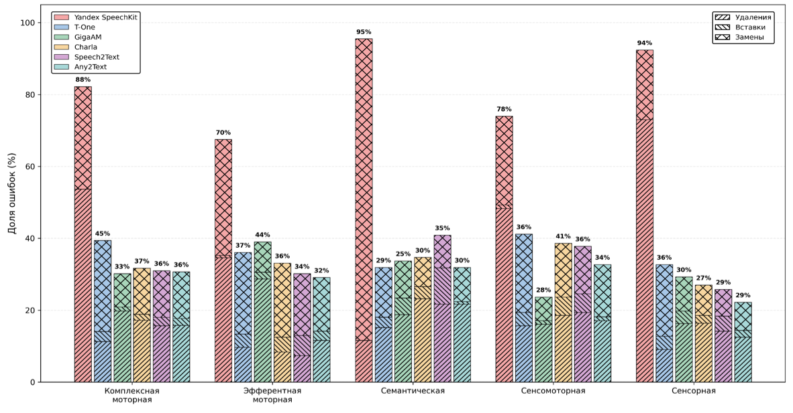{#fig-spb-01}

Поскольку в датасете представлены записи и нейротипичных информантов (монолог и диалог), то при анализе результатов обработки записей с разной степенью выраженности речевого нарушения заметен четкий градиент: все модели показывают рост WER от нейротипичных записей к тяжелой афазии. Исключение –-- Yandex SpeechKit.

Если мы обратимся к сравнению по типам речи, медианные значения WER для всех моделей, за исключением Yandex SpeechKit, на уровне слов демонстрируют ожидаемую тенденцию: самые низкие показатели ошибок наблюдаются при распознавании нейротипичных записей, тогда как самые высокие –-- при обработке пересказов у пациентов с афазией (далее –-- ПА).

Выявлено три различные стратегии моделей при распознавании речи в условиях неопределенности, в нашем случае --- при обработке афазической речи. Yandex SpeechKit использует «паническое укорачивание» –-- агрессивное сжатие распознанного текста по сравнению с оригиналом. T-One старается сохранить лексическое наполнение в ущерб точности на уровне символов. GigaAM, Any2Text и Charla демонстрируют «стабильную» стратегию, при которой длина выходного текста практически не зависит от снижения качества речевых данных (например, при усугублении грубости речевого нарушения у говорящего). Speech2Text занимает промежуточное положение: его стратегия укорачивания ухудшает распознавание почти во всех условиях, кроме лёгкой афазии и монологов. Формально по профилю ошибок GigaAM тяготеет к стратегии панического укорачивания (высокая доля удалений при минимальных вставках и заменах), однако, в отличие от Yandex SpeechKit, это укорачивание не разрушает распознавание: GigaAM сохраняет лучший общий WER и наибольшую устойчивость по всем условиям, что сближает её со стабильной стратегией Any2Text и Charla. Итоговые значения метрик представлены в таблице -@tbl-spb-01.

|  |  |  |  |  |  |  |
|----|----|----|----|----|----|----|
| Модель ASR | Yandex SpeechKit | T-One | GigaAM | Charla | Speech2Text | Any2Text |
| Пациенты с афазией |  |  |  |  |  |  |
| WER | 88% | 43% | 32% | 37% | 35% | 34% |
| CER | 69% | 23% | 21% | 23% | 23% | 23% |
| Нейротипичные информанты |  |  |  |  |  |  |
| WER | 89% | 28% | 17% | 21% | 17% | 20% |
| CER | 72% | 15% | 11% | 13% | 10% | 13% |

: Агрегированные метрики WER и CER, полученные на фонограммах датасета RuAphasiaBank  {#tbl-spb-01}

Оценка с помощью формальных метрик WER и CER, а также с помощью подсчета долей вставок, удалений и замен от общего количества изменений в выходных транскриптах по сравнению с эталонными расшифровками продемонстрировала как общее низкое качество распознавания, так и наличие специфической стратегии реагирования каждой из моделей на ситуацию стресс-теста.

Результаты бенчмарка ASR-моделей нуждаются в лингвистическом и социально-этическом анализе для определения того, как именно искажается речь пациента при автоматическом распознавании его речи. Для этого введено понятие коммуникативной предвзятости ASR-моделей (communicative bias) --- это свойство системы, при котором в условиях неопределенности (атипичная речь, шум, паузы) модель заполняет лакуны на основе паттернов, усвоенных из своих обучающих данных, а не на основе актуального коммуникативного намерения говорящего, что приводит к систематическому искажению воспринимаемого коммуникативного стиля пользователя-говорящего. В результате лингвистического анализа корпуса транскриптов от ASR-моделей мы описали специфику коммуникативной предвзятости каждой из моделей, использованных для бенчмарка.

Качественный анализ транскриптов позволил обнаружить тот факт, что каждая из моделей, совершая вставки, замены и удаления, определенным образом «навязывает» атипичному говорящему некоторый коммуникативный образ, который изначально не был ему присущ: от коммуниканта, тяготеющего к просторечию, до говорящего, имеющего когнитивные нарушения или демонстрирующего агрессию в поведении. Выявленный феномен коммуникативной предвзятости моделей создает определенные риски при их использовании пациентами с афазией для получения услуг и информации в тех учреждениях, для взаимодействия с которыми обычно используются технологии распознавания речи.

### Разработка мультимодального фреймворка для классификации степени тяжести афазии у носителей русского языка

Следующее направление работы в рамках отчетного проекта связано с задачей автоматической классификации степени тяжести речевого нарушения у пациентов с афазией: нейротипичные (норма), лёгкая степень, умеренная степень, тяжёлая степень.

В рамках отчетного периода проекта работа велась на основе датасета RuAphasiaBank [@kolmogorova2026multimodal].

В отчетном периоде было предложено применить дуально-эмбеддинговый мультимодальный фреймворк, объединяющий комплементарные представления речи –-- моторно-акустическое (на основе эмбеддингов `wav2vec` 2.0) и когнитивно-лингвистическое (на основе энкодера `Whisper`) –-- посредством раннего слияния признаков (фузирования) с последующей классификацией методом градиентного бустинга ``XGBoost`` в схеме кросс-валидации, независимой от диктора. Для совместного анализа как низкоуровневых моторно-речевых нарушений, так и высокоуровневых когнитивно-лингвистических дефицитов, связанных с афазией, для каждой речевой записи были построены два комплементарных представления, соответствующих акустико-моторному и семантико-лингвистическому измерениям нарушения. Акустическое представление было получено путем извлечения 768-мерного эмбеддинга из последнего скрытого слоя предобученной модели `wav2vec 2.0 Base` [@baevski2020]. Эти эмбеддинги, в первую очередь, кодируют независимые от языка свойства речевого сигнала, такие как стабильность артикуляции, просодический контроль, темп речи и временная регулярность. Данные признаки особенно информативны для обнаружения моторно-речевых нарушений, которые часто сопровождают средние и тяжелые формы афазии. Параллельно строилось семантическое представление путем подачи тех же записей в энкодер модели `Whisper Large` [@radford2022] и извлечения 1280-мерного эмбеддинга. На основе двух указанных модальностей были оценены три конфигурации модели. Базовая модель только с акустическими признаками использует классификатор ``XGBoost`` [@chen2016], обученный исключительно на эмбеддингах `wav2vec` 2.0 и ориентированный на моторно-речевые характеристики. Базовая модель только с семантическими признаками использует ту же архитектуру классификатора, но работает исключительно на эмбеддингах энкодера Whisper, фокусируясь на когнитивно-лингвистических нарушениях. Наконец, мультимодальная модель слияния объединяет оба представления посредством раннего слияния путем конкатенации акустического и семантического векторов признаков в единый высокоразмерный вход: X_combined = \[X_acoustic; X_semantic\]. Это объединенное представление затем используется в качестве входа для классификатора ``XGBoost``. Все модели обучались и оценивались на одном и том же корпусе из 186 записей от 90 уникальных дикторов. Чтобы приблизиться к реалистичному сценарию клинического внедрения, была применена групповая 5-фолдовая кросс-валидация, где идентификатор диктора использовался в качестве группирующей переменной. Следовательно, все записи, произведенные данным пациентом, назначались либо в тренировочное, либо в тестовое множество в каждом фолде, но никогда в оба. Степень тяжести афазии кодировалась как порядковая переменная с четырьмя уровнями (нейротипичный, легкий, средний, тяжелый). Поскольку метки образовывали упорядоченную шкалу, а не набор независимых категорий, в качестве основной метрики оценки использовалась средняя абсолютная ошибка (MAE) между истинными и предсказанными уровнями тяжести, в дополнение к стандартным метрикам классификации.

Для смягчения дисбаланса классов во всех трех моделях применяется обучение с весами классов путем присвоения образцам весов, обратно пропорциональных частоте классов.

Сначала было проведено сравнение конфигураций моделей по общей точности предсказания степени тяжести. Во всех наборах признаков `XGBoost` стабильно превосходит бейзлайны Random Forest (оцененные в предварительных экспериментах) и достигает более низкого MAE с уменьшенной дисперсией по фолдам. Среди унимодальных настроек семантические признаки, полученные из Whisper, превосходят чисто акустические представления, что свидетельствует о том, что лексическая и структурная информация особенно информативна для оценки тяжести. Однако наилучшие показатели качества достигаются мультимодальной моделью слияния с ``XGBoost`` (MAE = 0,431), улучшая оба унимодальных бейзлайна `XGBoost` (0,452 для Whisper и 0,569 для `wav2vec` 2.0). Для Random Forest, напротив, слияние не дает улучшения: наименьший MAE получается с признаками Whisper (0,457), в то время как объединенный набор признаков достигает 0,484.

Результаты показывают, что семантические признаки Whisper сами по себе являются более сильным предиктором тяжести афазии, чем акустические признаки `wav2vec` 2.0. Однако объединение обеих модальностей дает дополнительный прирост, подтверждая гипотезу о комплементарности акустических и семантических представлений.

Для лучшего понимания поведения модели по клиническим подтипам был проведен дальнейший анализ ошибок предсказания, стратифицированный по типу афазии (см. @fig-spb-02). Частота ошибок существенно различается между диагностическими категориями: наименьший MAE наблюдается для нейротипичных говорящих и тотальной афазии, более высокие значения ошибки –-- для сенсорной и семантической афазии. Эти паттерны согласуются с клиническими ожиданиями.

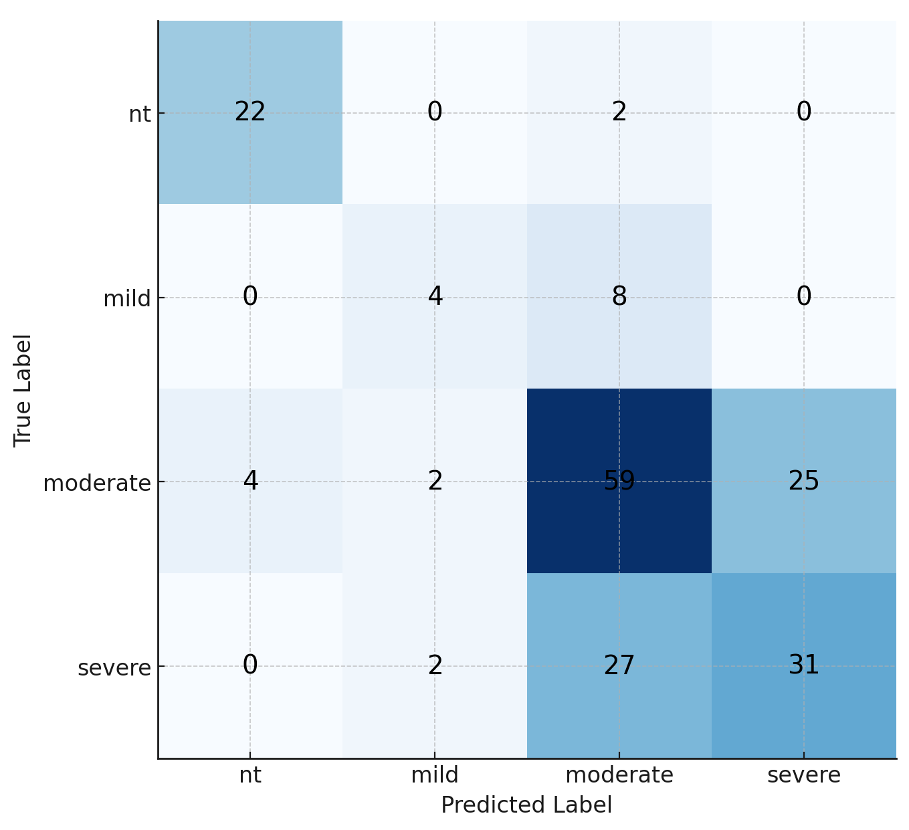{#fig-spb-02}

В таблице -@tbl-spb-02 представлены точность, полнота и F1-мера по классам для модели слияния. Метрика качества наиболее высока для классов нейротипичных дикторов (F1 = 0,88) и страдающих афазией средней степени тяжести (F1 = 0,63), которые хорошо представлены в корпусе (24 и 90 записей соответственно). В отличие от них, категория легкой степени афазии остается основным узким местом (F1 = 0,40): большинство ошибок соответствуют смешению со средней степенью тяжести. Это указывает на то, что модель надежно обнаруживает нарушения, но испытывает трудности с различением ранних или тонких дефицитов от более выраженных случаев при недостатке размеченных примеров. Класс тяжелой степени нарушения показывает F1 = 0,53 для 60 записей, что также отражает сложность точного разграничения тяжелой и средней степени.

|                        |           |        |          |                     |
|------------------------|-----------|--------|----------|---------------------|
| Класс                  | Precision | Recall | F1-Score | Количество примеров |
| Нейротипичные          | 0.85      | 0.92   | 0.88     | 24                  |
| Легкая степень афазии  | 0.50      | 0.33   | 0.40     | 12                  |
| Средняя степень афазии | 0.61      | 0.66   | 0.63     | 90                  |
| Тяжелая степень афазии | 0.55      | 0.52   | 0.53     | 60                  |
| Взвешенное среднее     | 0.62      | 0.62   | 0.62     | 186                 |

: Оценка эффективности модели классификации на основе слияния признаков»  {#tbl-spb-02}

Матрица ошибок модели слияния (см. @fig-spb-02) выявляет два клинически важных паттерна. Во-первых, система ведет себя как надежный инструмент скрининга: ни один пациент с тяжелой степенью не был ошибочно классифицирован как здоровый представитель контрольной группы, и только два здоровых диктора были ошибочно отмечены как пациенты с речевой патологией. Эта асимметрия говорит о том, что модель консервативна в отношении ложноотрицательных результатов на тяжелом конце спектра, что предпочтительно в контексте скрининга. Во-вторых, основным узким местом качества модели является категория легкой степени афазии, которая достигает F1 = 0,40 всего при 12 примерах. Большинство ошибок для этого класса соответствуют ошибочной классификации легкой степени как средней, что указывает на то, что модель надежно обнаруживает наличие нарушения, но с трудом отделяет тонкие случаи от более выраженных дефицитов при недостатке размеченных данных.

Прямое сравнение полученных метрик, в частности, F1 в диапазоне от 40% до 88% с результатами предыдущих исследований, сообщавших о F1 = 78–97% [@wagner2023], [@nivedha2023], [@qin2020], должно учитывать ключевые методологические различия в исследованиях. В то время как цитируемые работы решали более узкие задачи –-- такие как классификация на три типа афазии или бинарная классификация тяжести (тяжелая vs. легкая) –-- на корпусах других языков, текущее исследование является первым, которое решает комплексную задачу мультиклассовой классификации на русскоязычном речевом корпусе. Это закономерно увеличивает сложность задачи и объясняет несколько более низкие абсолютные значения качества классификации.

Результаты показывают, что раннее слияние акустических эмбеддингов `wav2vec` 2.0 с семантическими представлениями на основе Whisper позволяет более комплексно моделировать патологическую речь, совместно захватывая ее моторно-акустические и когнитивно-лингвистические измерения. Предложенный мультимодальный подход продемонстрировал робастность, приемлемое качество работы и превысил базовый уровень классификации, особенно в различении средней афазии от других уровней тяжести.

### Автоматическое упрощение текстов для пациентов с афазией: «меньше значит больше»

В рамках отчетного периода было проведено исследование, посвященное разработке и клинической валидации методики автоматического упрощения текстов для пациентов с афазией. Целью работы стала оценка эффективности использования больших языковых моделей (LLM) для многоуровневого упрощения текстов на русском языке. Исследование сфокусировалось на пациентах с комплексной моторной афазией, составляющих большинство (67%) в партнерском нейрореабилитационном центре. Специалистами (логопедами) были разработаны правила упрощения для трех уровней тяжести нарушения: легкого, легкого-среднего и среднего (в соответствии со шкалой Л.И. Вассермана [@vasserman1997]. На основе этих правил был создан параллельный корпус, включающий 134 текста (1010 предложений), отобранных с учетом читательских предпочтений целевой возрастной группы (55--65 лет) [@kolmogorova2023]. Восемь аннотаторов-филологов создали по три эталонные упрощенные версии для каждого предложения. Для автоматизации процесса применялась стратегия few-shot prompting (обучение на нескольких примерах) с использованием четырех LLM. Лучшие результаты по итогам ручного скрининга показали модели Llama Storm и Gemma.

Анализ лингвистических метрик (ASL, TTR, FRE GL, SMOG) показал, что few-shot prompting позволяет моделям генерировать тексты, близкие по сложности к эталонным версиям, созданным людьми. Модели продемонстрировали способность сохранять градиент сложности между уровнями. Оценка BERTScore [@zhang2020] подтвердила высокую семантическую близость автоматически упрощенных текстов к эталонам (значения 0.76--0.81), что свидетельствует о сохранении смысла оригинала.

Коллекция автоматически упрощенных текстов была валидирована с участием 12 пациентов с комплексной моторной афазией. Сравнение с «золотым стандартом» (текстами из классических логопедических пособий [@bein1962] показало, что автоматические тексты не уступают им по объективным метрикам сложности. Интересный результат был получен при оценке субъективных ощущений пациентов. Несмотря на то, что автоматические тексты были оценены как более сложные для чтения (p=0.010), они получили более высокие оценки по параметру «интересность». Это указывает на то, что использование персонализированного контента (из газет и журналов, интересных пациенту) может повышать мотивацию к чтению, даже если текст кажется сложнее стандартного учебного материала.

Исследование подтвердило гипотезу о том, что промпт-инжиниринг в режиме few-shot является эффективным и менее ресурсоемким методом по сравнению с дообучением моделей (fine-tuning), которое в условиях ограниченного корпуса показало неудовлетворительные результаты.

Разработанная методика позволяет создавать репозитории текстовых стимулов, стратифицированных по типу нарушения и уровню тяжести, что открывает новые возможности для персонализации речевой терапии. Дальнейшая работа будет направлена на расширение выборки пациентов для повышения статистической мощности и refinement критериев для третьего уровня упрощения.

## Методы автоматического анализа эмоций в текстовых данных на русском языке

### Разработка процедуры эмоциональной разметки читательских рецензий на книги

В рамках направления по разработке алгоритмов автоматического анализа эмоций в устных и письменных текстах на данном этапе проекта в качестве материала были рассмотрены тексты не изученного нами ранее домена –-- тексты книжных рецензий массовых читателей, размещенные на тематических онлайн-площадках. Автоматический анализ эмоциональной составляющей рецензий на литературные произведения позволит описать когнитивные особенности восприятия читателями текстов разных жанров, эпох, тематики.

Цель исследования заключалась в разработке системы эмоциональной разметки текстов рецензий, которая, с одной стороны, наиболее полно отражает эмоции, выраженные автором текста, с другой –-- является пригодной для дальнейшей автоматизации (LLM разметка).

Были решены следующие задачи: выработка критериев отбора материала для датасета с партнером и заказчиком исследования --- ООО «Живая библиотека»; предобработка полученных от заказчика данных; обзор существующих систем эмоциональной разметки; анализ лингвистических особенностей выражения эмоций в текстах рецензий; разработка системы эмоциональной разметки и составление списка эмоциональных маркеров (тегов), выбор из нескольких альтернативных вариантов; ручная разметка тестового набора рецензий, оценка согласованности нескольких разметчиков.

От партнера-заказчика данного исследования были получены данные –-- тексты рецензий читателей, размещенные на портале [livelib.ru](http://livelib.ru) в объеме 1 129 573 рецензий. После предобработки в датасет вошло 884 056 рецензий. Из общего объема были отобраны две тестовые выборки --- 56 и 300 текстов –-- в качестве образцов для апробации различных подходов к разметке эмоций.

Корпус текстов представляет собой яркий пример пользовательской (читательской) интернет-рецензии с доминированием субъективно-эмоционального начала. Лексика и синтаксис подчинены задаче выразить личное впечатление и воздействовать на выбор других потенциальных читателей литературного произведения, которому посвящена рецензия. Тематический диапазон широк, но фокус смещен на эмоциональное восприятие, а не на объективный литературоведческий анализ.

Среди тематических фокусов выделяются сюжет и его динамика («сюжет захватывающий», «сюжет провисает», «динамично», «затянуто»); персонажи, их правдоподобие, глубина, симпатия/антипатия («герои картонные», «персонажи живые», «героиня раздражала»); авторский стиль и язык («слог лёгкий», «язык витиеватый», «простой язык», «богатый язык»); общее эмоциональное воздействие («книга вызвала восторг», «оставила равнодушным», «довела до слез»); сравнение с другими произведениями (литературой, кино) («напоминает „Игру Эндера”», «как в бразильском сериале», «отсылки к Властелину колец»); социальные и философские проблемы, поднятые в книге («буллинг», «инклюзия», «экология», «рабство», «война», «смысл жизни»); личный читательский опыт («я такое не люблю», «это не мой автор», «перечитаю ещё раз»).

На этапе разработки системы разметки первой задачей было формирование списка эмоциональных меток, которые будут описывать эмоции в рецензиях. Этот процесс проходил итеративно: сначала 7 участников рабочей группы проанализировали тестовую выборку из 56 рецензий и составили индивидуальные списки из эмоций, которые, по их мнению, встречались в текстах. Затем эти списки анализировались и сравнивались: были выявлены эмоции, которые использовали все разметчики, половина из них, а также индивидуальные теги. Далее все теги объединялись в синонимические ряды (см. @fig-spb-03). Для каждого разметчика (id1 –-- id7) маркировалось, использовал ли он данный тег.

Следующим шагом стал анализ семантических различий тегов внутри синонимических групп и выявление эмоций, наиболее релевантных в контексте описания аффективных впечатлений от литературного произведения. На основе такого анализа был составлен список из 35, а затем 26 тегов, которые и были использованы для тестирования различных схем разметки.

Анализ текстов рецензий позволил заметить, что большинство из них содержит 5 тематических фокусов, а именно описание сюжета/содержания, описание героев, комментарии о стиле автора, впечатления от автора как от личности и описание собственного субъективного впечатления от прочитанного. Именно с этими аспектами книги связан эмоциональный отклик читателя.

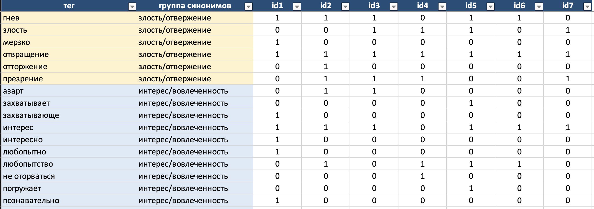{#fig-spb-03}

Принимая во внимание эту особенность исследуемого материала, мы предложили для текстов рецензий аспектно-ориентированную разметку эмоций. Подобный подход разрабатывается в рамках задачи анализа тональности и подразумевает извлечение пар «позитивная/негативная оценка» –-- «объект оценки». Наш подход подразумевает оценку 5 фиксированных аспектов --- сюжет (содержание), герои, авторский стиль, позиция автора, субъективные впечатления –-- и присвоение каждому из аспектов эмоциональных меток, которые показывают, во-первых, эмоцию, которую читатель испытал и выразил в своей рецензии, во-вторых, источник этой эмоции.

Разметка любых данных как правило выполняется несколькими аннотаторами, после чего их мнения усредняются и выводится эталон разметки. Разметка эмоций субъективна. Индивидуальность обработки эмоциональной окраски текста может приводить к тому, что один разметчик выделяет эмоциональный тег, а другой разметчик нет. Это не может автоматически считаться ошибкой. Для учета вариативности восприятия эмоциональной составляющей рецензии предложено агрегировать теги, расставленные разными разметчиками, присваивая тегам «веса» в зависимости от того, какая доля из всех размечающих их выбрала. Так, тег, который выбрали 3 разметчика из 3, будет иметь наибольший вес, в то время как индивидуальные выборы –наименьший.

На основе предложенной системы была проведена краудсорс-разметка выборки из 300 рецензий. Были отобраны рецензии на книги 20 наиболее представленных в датасете жанров (по 15 на жанр) длиной от 100 до 300 слов. В половине рецензий книге был присвоен рейтинг от 0 до 5 звезд, в половине –-- от 6 до 10. Была сформулирована подробная инструкция для разметчиков. В разметке приняли участие 3 разметчика.

Подсчет согласованности для подобного рода задачи представляет сложность в силу большого количества классов эмоций (у нас –-- 26), возможности выбора нескольких классов для одного текста, а также деления по аспектам. В связи с этим нами предлагается формула, которая позволит измерить согласованность конкретно в нашей задаче.

Формула построена на следующей логике: согласованным выбором тега считается его постановка хотя бы 2 из 3 разметчиков. Индивидуальные выборы тегов считаются рассогласованным выбором. Для каждой рецензии и каждого аспекта были рассчитаны:

::: {#eq-spb_conlab1}

T = 3U + 2M + S –-- суммарное число «голосов» аннотаторов за эмоции в аспекте.

U –-- число эмоций, выбранных 3 разметчиками --- полное единогласие.

M –-- число эмоций, выбранных 2 разметчиками –-- частичное согласие / большинство.

S –-- число эмоций, выбранных 1 разметчиком –-- индивидуальный выбор / расхождение.

:::

На основе этих параметров был рассчитан коэффициент agreement_vote_share = (3U + 2M) / T, который показывает долю тегов, которые не являются одиночными (то есть выбраны 2 или 3 разметчиками). Распределение этого показателя по аспектам представлено в таблице -@tbl-spb-03.

Можно заметить (см. таблицу -@tbl-spb-03), что 50–85% тегов были выбраны 2 или 3 разметчиками, что говорит о хорошей согласованности с учетом сильной вариативности поставленной задачи. Наибольшая согласованность наблюдается в аспекте «позиция автора». Это может быть обусловлено более редким обращением рецензентов к этой тематике и, соответственно, более редким выделением ее как источника эмоционального впечатления разметчиками –-- из 6220 тегов, поставленных тремя разметчиками, только 947 пришлось на аспект «позиция автора» (15,2%), в то время как в аспекте c наименьшей согласованностью («субъективные впечатления») количество выборов было наибольшим –-- 1547 тегов. Снижение согласованности при повышении множественности выбора является предсказуемым, однако в то же время указывает на необходимость доработки формулы подсчета согласованности в части чувствительности к общему количеству тегов.

|  |  |  |
|----|----|----|
| аспект | agreement_vote_share | T (общее кол-во тегов в аспекте) |
| герои | 0,628 | 1403 |
| сюжет | 0,563 | 1237 |
| позиция автора | 0,852 | 947 |
| авторский стиль | 0,642 | 1086 |
| субъективные впечатления | 0,51 | 1547 |

: Метрика agreement_vote_share и индекс T, рассчитанные для 5 аспектов разметки на выборке из 300 рецензий {#tbl-spb-03}

Таким образом, разработана система разметки эмоций в текстах рецензий, созданы формулы оценивания качества разметки и номенклатура кастомзированных именно под данную задачу тегов.

### Экспериментальное сравнение качества автоматического детектирования эмоций на основе данных корпуса устной речи молодежи и студентов (КУРС)

В исследованиях, проводимых в 2026 году на материале Корпуса устной речи молодежи и студентов (КУРС), особое внимание уделялось возможностям и ограничениям автоматического выявления эмоциональной составляющей спонтанного речевого общения. В повседневной устной речи выражение эмоций тесно связано с текущей коммуникативной ситуацией, то есть является контекстно обусловленным. При этом реплика может одновременно содержать оценку обсуждаемого события, выражать отношение к собеседнику и выполнять некоторую функцию в поддержании речевого взаимодействия. В связи с этим положительная или отрицательная тональность отдельных слов не может рассматриваться как непосредственный показатель эмоционального состояния говорящего.

Проведены эксперименты по сравнению автоматической и экспертной разметки эмоций и тональности в репликах говорящих (на основе текстовых расшифровок устной спонтанной речи, представленных как часть корпуса КУРС). Объем исследовательской выборки составляет 326527 словоупотреблений (26137 реплик), полученных в результате автоматического распознавания речи в 226 макроэпизодах общей длительностью в 80 часов. Реплики были аннотированы по следующей схеме: для каждой реплики независимо от контекста соседних реплик оценивалась выраженность шести эмоций --- отвращения, радости, грусти, удивления, страха и злости --- по шкале от 0 до 2 (0 --- эмоция не выражена, 1 --- выражена слабо, 2 --- наиболее выраженная эмоция). Дополнительно каждой реплике присваивалась оценка сентимента по шкале от −2 до 2, отражающей общую эмоциональную окраску реплики: от очень негативной до очень позитивной, включая нейтральную (0).

В результате апробированы 4 модели, две из которых предполагают классификацию по эмоциям (RuBERT-base-cased-russian-emotion-detection с fine-tuning при помощи датасетов cedr и переведенного на русский GoEmotions), 2 –-- по сентименту (RuBERT-base-cased для сентимент-анализа и Dostoevsky (Social network model)). Автоматически назначенные моделями лейблы были сравнены с выполненной вручную аннотацией тремя людьми, чтобы оценить таким образом качество предсказания. В качестве метрик использовались accuracy, precision, recall и F1. Результаты сравнения с эталонным датасетом приведены в таблицах -@tbl-spb-04 и -@tbl-spb-05.

|              |           |        |        |        |          |        |
|--------------|-----------|--------|--------|--------|----------|--------|
|              | precision |        | recall |        | f1-score |        |
|              | cedr      | ru-go  | cedr   | ru-go  | cedr     | ru-go  |
| joy          | 0.3008    | 0.2805 | 0.5208 | 0.0262 | 0.3814   | 0.0480 |
| sadness      | 0.0914    | 0.3929 | 0.4227 | 0.0284 | 0.1503   | 0.0529 |
| disgust      | \-        | 0.2632 | \-     | 0.0187 | \-       | 0.0348 |
| surprise     | 0.4237    | 0.1863 | 0.3062 | 0.0219 | 0.3555   | 0.0391 |
| fear         | 0.0569    | 0.3333 | 0.5578 | 0.0272 | 0.1033   | 0.0503 |
| anger        | 0.2070    | 0.0769 | 0.2063 | 0.0081 | 0.2066   | 0.0148 |
| neutral      | 0.7864    | 0.7327 | 0.6523 | 0.9780 | 0.7131   | 0.8378 |
| macro avg    | 0.3110    | 0.3237 | 0.4443 | 0.1584 | 0.3183   | 0.1540 |
| weighted avg | 0.6653    | 0.5942 | 0.5745 | 0.7179 | 0.6088   | 0.6209 |

: Качество эмоциональной разметки реплик моделями seara/rubert-base-cased-russian-emotion-detection-ru-go-emotions и seara/rubert-base-cased-russian-emotion-detection-cedr {#tbl-spb-04}

|              |            |        |            |        |            |        |
|--------------|------------|--------|------------|--------|------------|--------|
|              | precision  |        | recall     |        | f1-score   |        |
|              | dostoevsky | rubert | dostoevsky | rubert | dostoevsky | rubert |
| negative     | 0.3748     | 0.2186 | 0.2680     | 0.6497 | 0.3125     | 0.3271 |
| neutral      | 0.8408     | 0.8745 | 0.8950     | 0.6571 | 0.8670     | 0.7504 |
| positive     | 0.4371     | 0.5176 | 0.3638     | 0.3653 | 0.3971     | 0.4283 |
| macro avg    | 0.5509     | 0.5369 | 0.5089     | 0.5574 | 0.5255     | 0.5020 |
| weighted avg | 0.7448     | 0.7619 | 0.7672     | 0.6254 | 0.7540     | 0.6680 |

: Качество определения тональности реплик трехклассовыми моделями blancherfort/rubert-base-cased-sentiment и Dostoevsky {#tbl-spb-05}

Сравнение результатов показывает, что модели для сентимент-анализа значительно лучше воспроизводят эталонную разметку, чем модель распознавания эмоций. Для моделей сентимент-анализа был получен macro F1-score от 0.502 до 0.525, тогда как для моделей детекции эмоций этот показатель варьировался в пределах 0.154--0.318. Вероятной причиной является более высокая субъективность и неоднозначность выделения конкретных эмоциональных категорий по сравнению с определением общей тональности высказывания. Кроме того, качество модели ru_go_emotions могло снизиться в связи с необходимостью агрегировать исходный 28-классовый список тегов до ограниченного набора категорий, используемого в исследуемом корпусе.

### Словарь эмоциональной лексики XX века rEmoRSe

На основе опыта эмоционального аннотирования Корпуса русского рассказа была составлена теоретическая база для подготовки к публикации словаря эмоциональной лексики XX века –-- rEmoRSe.

Осуществлено сравнение словаря, полученного на основе Корпуса русского рассказа, с другими представительные ресурсами для русского языка –-- RuSentiLex [@lukashevich2016] и PolSentiLex [@koltsova2020], КартаСловСент {kulagin2021}, переводным лексиконом NRC EmoLex (Russian) [@mohammad2013]. Сравнение структуры словарей показывает существенные различия как в объёме словарей, так и в соотношении тональных категорий (см. таблицу -@tbl-spb-06). Самым крупным по количеству единиц является словарь КартаСловСент, ориентированный на максимальное покрытие и включающий, как и PolSentiLex, также и нейтральную лексику. Остальные словари содержат в основном эмоционально окрашенную лексику, однако для rEmoRSe явно выделяется класс смешанных оценок (mixed) –-- в исходных списках такие слова имели несколько разных тегов, то есть меняли свою эмоциональность в зависимости от значения или контекста. В дальнейшем анализе нейтральный класс был проинтерпретирован как маркер отсутствия оценочного значения и, в отличие от смешанного, не учитывался.

На первом этапе производилась оценка лексической схожести разных словарей с использованием коэффициента Жаккара: 1) по леммам, 2) по леммам и тегам (то есть совпадением считалось наличие у слова одинаковых тегов в сравниваемых словарях). Чем ближе значение к 1, тем больше совпадение между двумя множествами, и наоборот. Согласно рисунку -@fig-spb-04, наиболее близкими по составу как с учетом полярности, так и без являются КартаСловСент и RuSentiLex (J ≈ 0,32 и 0,31 соответственно). Высокие показатели также наблюдаются для КартаСловСент и rEmoRSe (J ≈ 0,23), однако при учете тональности согласованность снижается (J ≈ 0,18).

|                      |      |       |       |       |       |
|----------------------|------|-------|-------|-------|-------|
| Теги Словарь         | POS  | NEG   | NEUT  | mixed | Итого |
| КартаСловСент        | 6215 | 11863 | 28049 | –--     | 46127 |
| NRC EmoLex (Russian) | 1726 | 2337  | 0     | 129   | 4192  |
| rEmoRSe              | 4318 | 6678  | 0     | 2251  | 13247 |
| RuSentiLex           | 2638 | 7669  | 153   | 318   | 10778 |
| PolSentiLex          | 855  | 1826  | 4864  | –--     | 7545  |

: Распределение однословных единиц тональных словарей по категориям {#tbl-spb-06}

В целом результаты показывают, что словари имеют относительно низкую степень пересечения, что подтверждает наличие значительного количества специфической для каждого ресурса лексики. При этом снижение коэффициентов при переходе к сравнению «лемма + тег» может объясняться методологическими различиями в принципах присвоения тональных категорий, на которые было указано ранее. Так, RuSentiLex демонстрирует наиболее стабильное пересечение с другими ресурсами, в то время как PolSentiLex –-- наименьшее. Интересно, что NRC EmoLex (Russian) тоже не обнаруживает выраженной близости ни к одному из словарей, что, возможно, объясняется тем, что он является переводным с английского.

Наиболее высокий показатель уникальности демонстрируют rEmoRSe и КартаСловСент. Для rEmoRSe (46,36%) таким образом подтверждаются особенности реализации эмоциональности в художественном дискурсе, а для КартаСловСент (40,78%) –-- специфичность ассоциативного определения эмоциональности лексемы. Значительно меньше уникальной лексики представлено в RuSentiLex (26%), NRC EmoLex (Russian) (24,69%) и PolSentiLex (11,45%), что является интересным результатом, поскольку сильного сходства с другими словарями для последних двух замечено не было. Это может говорить о скорее точечном и равномерном характере пересечений сразу с несколькими словарями.

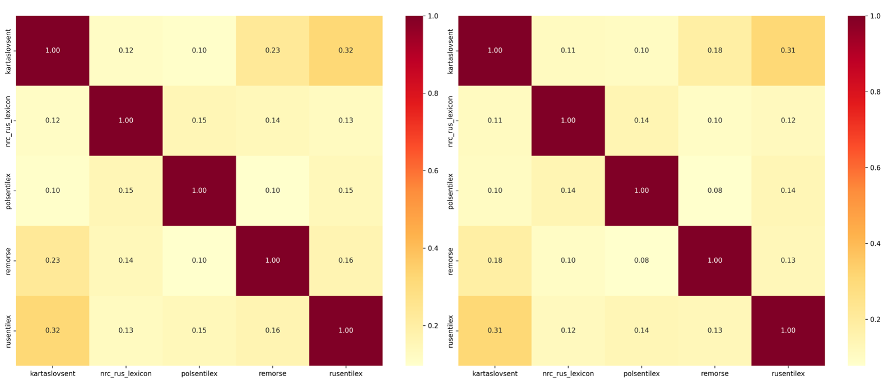{#fig-spb-04}

Перейдем к результатам морфологического анализа. В объединенном датасете (без учета тегов и с удалением дубликатов) наиболее представленными частями речи оказались существительные (NOUN) (41,5%), глаголы-инфинитивы (INFN) (33,3%), прилагательные (ADJF) (18,9%) и наречия (ADVB) (4,7%). Такое распределение позволяет сделать вывод о том, что тональная лексика русского языка представлена главным образом не, как могло ожидаться, словами, непосредственно описывающими качества объектов (прилагательными, наречиями), но обозначениями действий, предметов и явлений.

При этом выделяются и индивидуальные различия между словарями. Интересно, что PolSentiLex, ориентированный на анализ социальных медиа, содержит больше прилагательных, а rEmoRSe –-- глаголов. Так, распределение частей речи следующее: КартаСловСент –-- NOUN (43,28%) → INFN (37,47%) → ADJF (17,03%); NRC EmoLex –-- NOUN (54,29%) → ADJF (25,07%) → INFN (18,03%); PolSentiLex –-- ADJF (48,71%) → NOUN (30,1%) → INFN (17,53%); rEmoRSe –-- INFN (38,42%) → NOUN (30,87%) → ADJF (20,46%); RuSentiLex –-- NOUN (48,12%) → ADJF (26,12%) → INFN (23,69%). Анализ морфологического состава уникальных единиц подтверждает эту тенденцию.

Наличие информации о тональности также позволяет установить вклад частей речи в выражение той или иной оценочности. На этом этапе, чтобы рассмотреть более «чистую» полярность, мы удалили «конфликтные» лексемы, которые имели отличный тональный тег хотя бы в одном другом словаре. Критерий χ² выявил статистически значимые различия в распределении частей речи между словарями (χ²(16) = 337,20, p \<0,001) с небольшим размером эффекта (Cramer’s V ≈ 0,126). При этом анализ стандартизованных остатков (standardized residuals) (см. @fig-spb-05) показал, что наиболее выраженная связь с полярностью обнаружена для инфинитивов. Полученные значения (SR = 7,57 для отрицательной и SR = −11,22 для положительной) свидетельствуют о том, что отрицательная тональность в эмоциональных словарях существенно чаще репрезентируется глагольной лексикой. Вместе с тем положительная оценка сильнее ассоциирована с наречиями (SR = 7,69) и прилагательными (SR = 3,67).

Наконец, мы предприняли попытку оценить «эмоциональное ядро» русского языка, отфильтровав только ту лексику, которая встречается во всех словарях одновременно и не является «смешанной» или нейтральной с точки зрения тональности. Таких единиц оказалось 480, и в основном это существительные и прилагательные (по 44,8%), инфинитивы составляют только 10,4%. Что касается направления полярности, то в «ядре» отрицательная лексика (268 вхождений) преобладает над положительной (120), причем выражена эта тенденция вне зависимости от части речи (например, распределение для существительных имеет следующее выражение –-- 26% vs. 10,4%, для прилагательных –-- 22,1% vs. 13,5%.

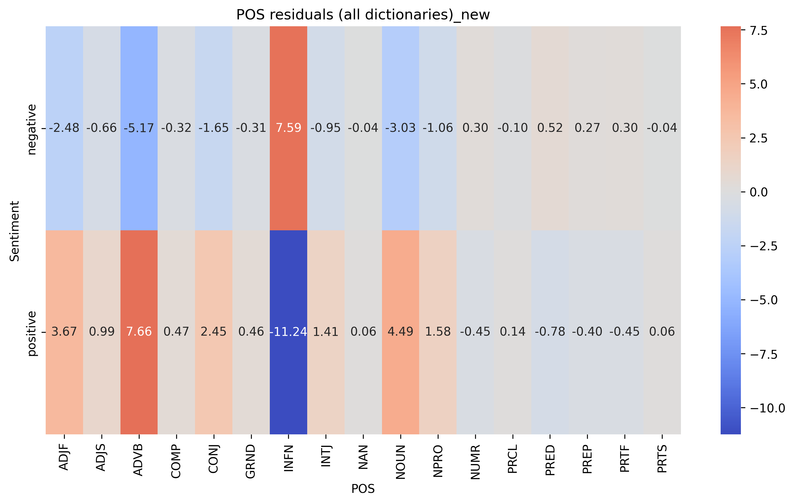{#fig-spb-05}

Проведенный анализ показал, что тональные словари русского языка представляют собой неоднородные ресурсы, и, несмотря на общность задачи, они демонстрируют ограниченное пересечение. Морфологический анализ в свою очередь позволяет отметить, что существенную роль в выражении оценки играют существительные и глаголы. При этом как на сходимость составов словарей, так и на частеречные распределения оказывает влияние предметная ориентация словаря. Кроме того, «эмоциональное ядро», некоторый устойчивый слой тональной лексики русского языка, который мы попытались выявить путем сопоставления словарей, сравнительно мало и негативно.

## Цифровая ревитализация казымского диалекта хантыйского языка

В рамках проекта был разработан инструмент для ревитализации казымского диалекта хантыйского языка.

Ревитализация малоресурсного языка связана с расширением сфер его использования и изменением отношения сообщества к родному языку [@grenoble2006]. Одним из ее ключевых условий является межпоколенческая передача языка в семье. Для казымского диалекта хантыйского языка актуальна задача включения аутентичных фольклорных материалов в доступные цифровые форматы, поддерживающие совместные занятия взрослых и детей. В исследовании была использована концепция языкового гнезда, предполагающая передачу языка и культурных практик детям через взаимодействие со старшими носителями [@hinton1994].

Целью исследования было разработать образовательный чат-бот на основе фольклорных сказок казымских хантов и оценить его потенциал как инструмента ревитализации языка. В социолингвистическом эксперименте проверялось, сопровождается ли взаимодействие с фольклорными текстами в мультимодальной среде изменением отношения представителей хантыйского сообщества к родному языку и его изучению.

Материалом послужил корпус, предоставленный Обско-угорским институтом прикладных исследований и разработок ХМАО Югры. В корпус вошли 19 аутентичных сказок на казымском диалекте с русскими переводами, всего 38 текстов. Объем на хантыйском языке составил 6151 токен, русском –-- 6257 токенов; продолжительность озвучки сказок носителем языка[^audio] –-- 83,85 минуты. Тематический анализ текстов выявил несколько лексических групп (лексику традиционного быта, природопользования, родства и т. д.), что в дальнейшем позволило автоматизировать тематическую классификацию лексических единиц по мере добавления новых текстов для чтения.

[^audio]: Аудиоматериалы, использованные в чат-боте, были предварительно обработаны с целью анонимизации: записи не содержат персональных данных, позволяющих прямо или косвенно идентифицировать диктора.

Был разработан Telegram-бот «Моњщәӈ бот» с модулями чтения, аудирования, лексики, грамматики, культурных комментариев, алфавита и тестирования. Параллельное представление хантыйского текста и русского перевода обеспечивало языковую опору для понимания сказки [@ertugruloglu2023]. Для каждой сказки были подготовлены словарик, грамматические справки и тест из 8 закрытых заданий. Всего создано 19 тестов, включавших в общей сложности 152 вопроса. Пользователь мог повторять попытки до правильного ответа и отслеживать прохождение сказок. Общий лингвистический модуль объединил тематическую лексику, грамматический справочник и алфавит из 29 графем с аудиосопровождением.

Для систематизации лексики была применена автоматическая тематическая классификация на основе векторных представлений слов и оценено ее качество по F1. Качество тематической классификации лексики различалось по категориям. Наиболее высокие значения F1 получены для групп «Числа и количества» (1,00), «Цвета и формы» (0,96) и «Растения» (0,92); наиболее низкие значения для «Рыбалка и охота» (0,40), «Люди и семья» (0,46), «Дом и быт» (0,56). Ограничения классификации были связаны с небольшим объемом обучающих данных и возможностью отнесения слова к нескольким тематическим группам.

В качестве методологической основы для исследования субъективной витальности языка был использован экспериментальный дизайн, предложенный О. В. Фельде и Т. Н. Журавель –-- техника незаконченных предложений [@felde2012], сопоставление ответов до и после работы с ботом и автоматический анализ их эмоциональной тональности.

В эксперименте участвовало 13 женщин, проживающих в ХМАО и идентифицирующих себя с хантыйским этносом. Семь участниц относились к возрастной группе 18–30 лет, три –-- 31–40 год; остальные –-- к группам старше 40 лет. Две участницы старше 40 лет указали свободное владение хантыйским языком. Остальные оценили владение языком на 1–2 балла по пятибалльной шкале. Десять участниц младше 41 года были обучающимися и/или преподавателями вузов и школ.

Сбор ответов осуществлялся через онлайн форму. Ссылка распространялась адресно. Сначала респондентам предлагалось завершить три предложения: «В настоящее время хантыйский язык…», «В будущем хантыйский язык…», «Изучать хантыйский язык –-- это…». Затем происходил переход в чат-бот по ссылке и взаимодействие с продуктом без ограничения времени. После взаимодействия с ботом респонденты повторно завершали те же предложения. На заключительном этапе респонденты сообщали свой пол, возраст, род деятельности и уровень владения языком.

Для автоматического определения тональности ответов была использована модель Llama 3.3 70B Versatile. Модели предлагалось классифицировать каждое высказывание как positive, negative или neutral. Дополнительно в той же группе было проведено пользовательское тестирование: респонденты оценивали удобство использования и готовность рекомендовать бот по шкале от 1 до 5, отмечали понравившиеся элементы и предлагали улучшения.

Результаты: у 10 из 13 участниц зафиксирован сдвиг языковых установок от отрицательных или нейтральных оценок к положительным после тестирования чат-бота. В ответах на каждый из трех стимулов после работы с ботом увеличилось число высказываний, классифицированных как положительные (fig-06). У молодых респондентов с низким уровнем владения языка формулировки об изучении языка как сложной, но необходимой деятельности сменялись оценками «интересно» и «очень интересно». Динамика не была одинаковой для всех: у двух респондентов суждения о настоящем и будущем языка не изменились, а у одного оценка будущего стала более пессимистичной.

Средняя оценка удобства использования составила 4,62 из 5, готовности рекомендовать бот –-- 4,77 из 5. Старшие участницы со свободным владением языком выделяли грамматические упражнения, а студентки с низким уровнем владения –-- культурологические материалы. Эти ответы показали востребованность разных компонентов ресурса в зависимости от языкового опыта пользователя.

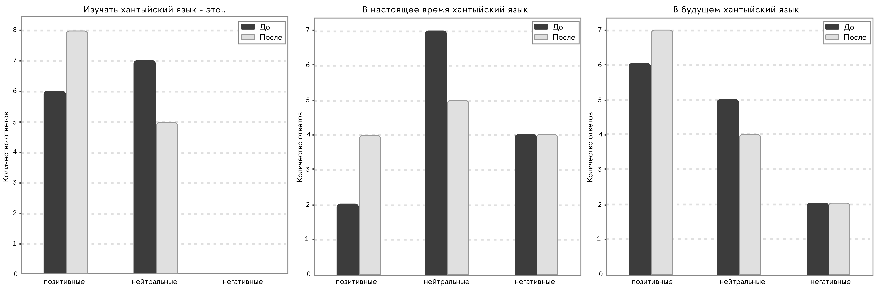{#fig-spb-06}

Апробация выявила положительную динамику отношения к языку у большинства участниц, однако малая, исключительно женская выборка и отсутствие контрольной группы ограничивают обобщение результатов. Исследование не устанавливало прирост языковой компетенции или устойчивость изменений во времени; полученные данные характеризуют непосредственную реакцию на взаимодействие с ресурсом.

## Компьютерные лингвистические технологии в музейном пространстве

### Методы тематического моделирования для анализа пользовательского опыта посетителей музеев

В рамках отчетного периода были продолжены исследования, связанные с анализом опыта посетителей объектов Владимиро-Суздальского музея-заповедника (далее –-- ВСМЗ). Экспертный анализ материала позволил выявить политематический характер пользовательского опыта, что послужило основанием для последующей работы.

Основой взаимодействия Лаборатории языковой конвергенции и ВСМЗ послужил договор о научном сотрудничестве, подразумевавший решение нескольких прикладных задач, связанных с выявлением составляющих мнения посетителей объектов музейной институции. Эта задача была успешно выполнена, и дальнейшая работа была произведена в исследовательском ключе. Особый интерес вызван разнообразием языковых конструкций и широтой охвата аудитории по различным демографическим характеристикам. Кроме того, существует проблема недостаточной исследованности отзывов на культурные институции в противовес отзывам на коммерческие товары и услуги, такие как рестораны, отели, магазины, книги, фильмы и др. [@candrea2025].

Цель данного направления исследований заключалась в описании пользовательского опыта посетителей музеев с использованием компьютерных методов, в частности тематического моделирования, аспектного сентимент-анализа и извлечения именованных сущностей.

Материалом является корпус (датасет) отзывов, собранных в ходе предыдущего этапа работы [@kolmogorova2025]. В общей сложности материал включает 18 737 текстов отзывов о 17 локациях ВСМЗ за период с 2020 по 2026 гг. Корпус несбалансирован по объектам и по годам, однако это не оказывает негативного влияния на полученные результаты, так как в ходе исследования мы используем относительные значения с поправкой на количество отзывов, а также в некоторых случаях изучаем общий пользовательский нарратив.

Основным методом выступило тематическое моделирование, реализованное в трех актуальных парадигмах: с применением латентного размещения Дирихле (LDA), BERTopic и большой языковой модели (Topic GPT).

Мы протестировали каждый из подходов на материале корпуса отзывов и выявили их сильные и слабые стороны для нашей задачи. Наилучшие по выбранным нами метрикам результаты показали LDA и Topic GPT, BERTopic оказался менее эффективен, что может объясняться сложной структурой исходных данных. Наилучшую интерпретируемость тем предоставляет Topic GPT, в то время как LDA требует наименьшего количества вычислительных ресурсов. Тем не менее, LDA обрабатывает данные только после препроцессинга (лемматизация, удаление стоп-слов, знаков препинания), в то время как BERTopic и Topic GPT, напротив, используют всю имеющуюся текстовую информацию для формирования тем.

Использованные методы выявили от 24 до 36 тем, при этом наибольшее количество тем сформулировал BERTopic (36), а наименьшее –-- Topic GPT (24), LDA определил 25 тем. Темы оказались связаны как с конкретными наиболее превалирующими в датасете локациями (например, Суздальский Кремль), так и с определенными наиболее часто вербализуемыми переживаниями (интерес к экскурсиям, размеры музеев и экспозиций, образовательная ценность, негативная оценка стоимости посещения и др.). Так, выявляются содержательные (основанные на объективной информации) и оценочные (связанные с субъективным восприятием, эмоциональностью) темы.

Дальнейшие эксперименты были проведены с применением алгоритма LDA, поскольку он обеспечивает баланс между качеством и вычислительными затратами. Развитием проекта стало изучение «палимпсеста памяти», актуализированного в языковом материале через рассуждения посетителей об исторической ценности экспозиций и построек сквозь века и годы, о роли исторических деятелей и связи прошлого с современностью, в том числе о проблемах культурного наследия.

Применение тематического моделирования в комплексе с другими вычислительными методами, такими как аспектный сентимент-анализ, количественно-качественный анализ и критический дискурс-анализ, позволили выявить три режима артикуляции памяти: символический (память как атмосфера и переживание), нарративный (память как знание и переосмысление исторических сюжетов) и аффективный (память как конфликт, реализующийся в негативной солидарности и «враждебном гостеприимстве»).

Реализация режимов связана в том числе с соотношением именованных сущностей в текстах отзывов на тот или иной объект ВСМЗ (см. @fig-spb-07).

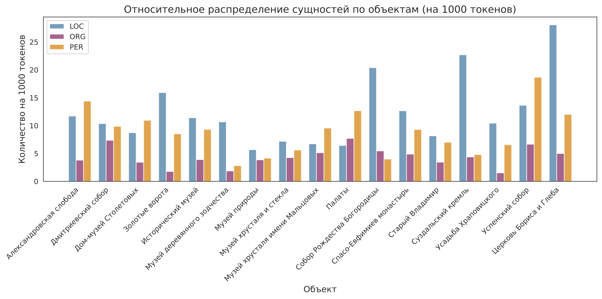{#fig-spb-07}

Распределение трех типов сущностей в отзывах по локациям демонстрирует, что посетители склонны при обсуждении одних музейных объектов использовать нарративизацию (доминирование антропонимов: *На территории монастыря похоронен князь Дмитрий Пожарский, который спас нас от Смуты!!!),* а в отзывах на другие –-- символизацию (доминирование топонимов: *Спасо-Евфимьев монастырь* –-- *место, которое является концентрацией всего того, что укладывается в понятие «Русь»*). Например, антропонимы доминируют в отзывах на такие локации, как Успенский собор, Палаты, музей хрусталя и стекла им. Мальцовых, Дом-музей Столетовых, Александровская слобода. Топонимы превалируют при обсуждении посетителями Золотых ворот, Исторического музея, Музея деревянного зодчества и др.

Аффективный режим реализует конфликт между символическим и/или нарративным слоями памяти и коммерческой реальностью музея-заповедника, и именно здесь возникают контексты негативной солидарности, где посетитель музея выступает не клиентом учреждения культуры, а хозяином, отчужденным от «своего» места (*Музей потерял душевность, превратясь в чисто коммерческий проект; Позор! Настоящая торговая лавка! А то, что здесь творится --- уму непостижимо, и это в цитадели христианства на Руси!*).

Таким образом, в ходе реализации проекта за отчетный период были проведены эксперименты с использованием трех методов тематического моделирования, определены их сильные и слабые стороны. Дальнейшие исследования были посвящены реализации выбранного метода (LDA) для успешной обработки политематичного языкового материала и формулирования тех специфических аспектов дискурса памяти, которые находят отражение в отзывах посетителей объектов ВСМЗ.

### Перцептивность и интерпретативность в описаниях картин, созданных людьми и мультимодальными языковыми моделями

Цель работы –-- выявить, как различаются человеческие и созданные мультимодальными языковыми моделями (VLM) описания картин с точки зрения соотношения перцептивной лексики, фиксирующей наблюдаемые признаки изображения, и интерпретативной лексики, выражающей выводы, оценки и приписывание смысла [@miklashevsky2018; @panofsky1939; @apresjan2004].

Исследование основано на корпусе описаний произведений искусства, включающем тексты людей и моделей[^rid] (по 2706). Использовались модели: Gemma-3-27b, Qwen3-VL-30B-Instruct, Yandex VLM (YandexResearch Team). Из описаний были автоматически извлечены семантически информативные ключевые слова вместе с локальным контекстом; наиболее общие предикаты, например «изображён» и «находится», исключались. Всего сформировано около 190 тыс. пар «ключевое слово –-- контекст».

[^rid]: База данных текстовых описаний и векторных представлений картин из Цифровой коллекции Государственного Эрмитажа. Колмогорова А.В., Налобина П.А.. Свидетельство о регистрации базы данных RU 2025622931, 09.07.2025. Заявка №2025622539 от 11.06.2025. Заявитель и правообладатель Федеральное государственное автономное образовательное учреждение высшего образования "Национальный исследовательский университет "Высшая школа экономики" (RU).

Лексические единицы распределялись по двум основным классам: перцептивному и интерпретативному. Для более подробного сравнения было выделено по 10 подтипов перцептивной и интерпретативной лексики, отражающих разные объекты наблюдения и способы интерпретации. Разметка полного корпуса выполнялась с помощью Mistral Small 3.2 24B; предварительная экспертная проверка и сопоставление нескольких моделей по метрикам согласованности использовались для оценки пригодности этой разметки для статистического анализа [@sokolova2009; @krippendorff2004]. Эти процедуры важны как методическая основа, но основной предмет эксперимента заключается в представлении различий между самими описаниями.

Интерпретативная лексика. Наиболее заметное различие связано с долей интерпретативной лексики. В человеческих описаниях 90,5% размеченных единиц относятся к перцептивному типу и 9,5% –-- к интерпретативному (см. @fig-spb-08). В описаниях, созданных моделями, перцептивная лексика составляет 64,3%, а интерпретативная –-- 35,6%. Таким образом, доля интерпретативной лексики в модельных описаниях примерно в 3,7 раза выше, чем в человеческих.

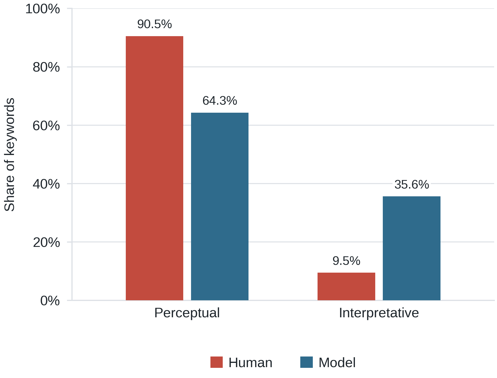{#fig-spb-08}

При этом модели не просто чаще интерпретируют изображение, у них также отличается и характер интерпретации. В человеческих описаниях среди интерпретативных единиц чаще встречаются подтипы, связанные с социальными ролями (например, *военный в форме, дворянка с детьми*), религия (*возвышается распятие*), статусные маркеры (*золотые эполеты*, *дорогая перевязь*) и деятельность (*рисует картину, вышивает у окна*). Это свидетельствует о внимании информантов к изображенным людям, их общественному положению, культурному контексту и действиям.

В описаниях от модели интерпретативная лексика чаще связана с художественными свойствами (*образец позднего классицизма*), настроением (*дышит торжественностью*), деятельностью и эстетической оценкой (*поражает красотой*). Иными словами, модели чаще формулируют обобщённые характеристики художественного впечатления, тогда как люди чаще опираются на социальные и культурные прочтения изображённого. Данные тенденции описывают распределения в исследованном корпусе и не означают, что каждый текст обязательно следует такому шаблону.

Перцептивная лексика. В перцептивной части профили людей и моделей в целом сходны: в обоих случаях часто упоминаются цвет, свойства людей, предметы и элементы пейзажа (см. @fig-spb-09). Это показывает, что модели способны воспроизводить базовый слой описания видимого содержания картины. Однако акценты различаются: люди чаще обращают внимание на детали одежды, а модели относительно чаще выделяют предметы и элементы ландшафта или природы.

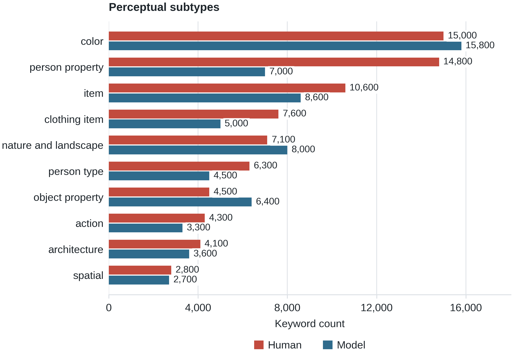{#fig-spb-09}

Сложные случаи на границе наблюдения и интерпретации

Разграничение двух типов лексики зависит не только от самого слова, но и от контекста. Например, выражение «детская мазня» несёт имплицитное значение неопытности, поэтому слово «детская» может функционировать интерпретативно; «золотые погоны» могут выступать не просто описанием предмета одежды, но и статусным маркером. Такие случаи показывают, что переход от описания видимого к интерпретации связан с прагматическим и культурным смыслом контекста. Также необходимо отметить, что согласие экспертов и качество автоматической классификации снижались на более трудных примерах (производилась разметка трудности от 0 до 2, где 0 –-- пример легкий для анализа, 2–очень трудный), особенно при определении подтипов.

Главное различие между человеческими и модельными описаниями заключается не в наличии или отсутствии интерпретации, а в её относительной частоте и содержании. Люди преимущественно описывают воспринимаемые признаки изображения и реже используют интерпретативную лексику; модели чаще переходят к оценке художественных свойств и эмоционального впечатления. При этом обе группы описаний сохраняют сходный базовый перцептивный слой, хотя распределяют внимание между деталями неодинаково.

Результаты позволяют рассматривать описания VLM не как прямую замену человеческим описаниям, а как тексты с собственным профилем внимания и интерпретации. При использовании подтипов следует учитывать, что их классификация менее устойчива, чем бинарное различение перцептивного и интерпретативного, особенно в пограничных контекстах.

## Дополнение Корпуса русского рассказа

В отчетном периоде работа над Корпусом русского рассказа XX века была сосредоточена на расширении базы текстов и их многоуровневого аннотирования, а также подготовке ресурса Корпус-1000 к размещению в открытом доступе на сайте.

В 2026 году обработано 182 текста по сегментации речи автора и персонажей.

Выполнен эмоциональный анализ 241 текста. Разметка включает общую оценку рассказа и оценки выраженности шести эмоций: радости, грусти, отвращения, удивления, гнева и страха. Числовые оценки сопровождаются комментариями о восприятии произведений, их событий и персонажей. Собранные материалы позволяют сопоставлять эмоциональные характеристики рассказов и учитывать читательское восприятие при изучении художественной прозы.

Проведена тематическая разметка 51 текста. Аннотация включает характеристику повествования и композиции, описание содержания произведений и выделение тематических признаков.

Получено 89 документов, описывающих результаты работы по подготовке биографических материалов, проведен поиск сведений о 21 авторе. Подготовленные материалы включают структурированные таблицы, биографические сведения и ссылки на источники.

Найдено 63 новых рассказа для расширения основного корпуса и корпуса эмигрантской прозы. Начата работа по разметке найденных текстов.

Проведена инвентаризация материалов разметки, биографических карточек и результатов проектной работы. Сформированы реестры файлов и навигационный каталог из 76 ссылок на ресурсы разных этапов развития корпуса. Систематизированы материалы учебных практик и студенческих проектов, что позволило упорядочить результаты по видам выполненных работ.

При создании корпуса художественных текстов и подготовке его к открытой публикации необходимо учитывать не только исследовательские задачи, но и правовые ограничения, связанные с использованием произведений, охраняемых авторским правом, поэтому одним из приоритетных направлений работы стала проверка правового статуса текстов Корпуса-1000, который готовится к публикации, и определение условий их представления на сайте. Результаты оформлены в виде памятки.

Проверен правовой статус текстов Корпуса-1000. Для каждого из 1000 рассказов корпуса (1901–2000 гг., по одному рассказу каждого автора) по библиографическим источникам был установлен год смерти автора, и на его основе определен статус публикации. Год смерти удалось установить для 618 авторов. Публиковать полностью можно 272 рассказа (27,2%), 655 (65,5%) пока охраняются, статус 73 текстов (7,3%) определить не удалось. Неопределенный статус связан прежде всего с малоизвестными авторами, о которых нет биографических сведений. Для 69 из 73 таких авторов год смерти не найден, 27 известны только по фамилии и инициалам. Эти тексты требуют дополнительной проверки, в том числе с учетом нормы о псевдонимах.

Для обеспечения исследовательского доступа ко всем текстам предложено использовать модель, принятую в Национальном корпусе русского языка (НКРЯ): произведения, охраняемые авторским правом, будут представлены в режиме конкорданса –-- с выдачей отдельных фрагментов в ограниченном контексте, метаданных (автор, название, год, источник издания) и доступной разметки без предоставления полного текста для чтения и скачивания.

Помимо этого, на материале корпуса были решены и некоторые исследовательские задачи.

Задача автоматического извлечения информации о героях художественных произведений находится на пересечении нескольких дисциплин: компьютерной лингвистики, литературоведения и искусственного интеллекта. В цифровых исследованиях эта проблема приобретает прикладное измерение: некоторые подходы фиксируют только «агентных» персонажей (тех, кто говорит или действует), другие –-- всех упоминаемых фигур, включая эпизодических. В результате разметка зависит не только от возможностей алгоритма, но и от принятой исследовательской интерпретации.

На материале 30 рассказов 1900--1930 гг. было проведено сравнение экспертной разметки персонажей [@sherstinova2023] с двумя сценариями использования LLM: алгоритмом на базе DeepSeek и обработкой текстов через интерфейс ChatGPT-5. Целью эксперимента стала оценка применимости больших языковых моделей (БЯМ) в задаче извлечения информации о персонаже и выявление зон устойчивости/уязвимости по видам атрибутов. Кроме того, полученные результаты дополнительно рассматриваются как основание для сопоставления ручной и автоматической разметки с точки зрения различий в «интерпретации» персонажа и в критериях отнесения упоминаемых фигур к этой категории как таковой.

Общий пайплайн анализа включал:

-   подготовку и предварительную проверку текстов;
-   формулировку запросов (промптов) с перечнем характеристик персонажей (имя/упоминание персонажа, полное имя, пол, возраст, профессия (общая и частная), семейное положение, социальное происхождение, авторская характеристика, статус (главный/второстепенный));
-   применение LLM для получения структурированных данных;
-   сопоставление результатов с вручную размеченным опорным датасетом;
-   первичный анализ извлеченных данных.

В результате работы были получены две таблицы с автоматически обработанными персонажами. Эти данные в дальнейшем были сопоставлены с опорным датасетом, что позволило провести сравнительный анализ качества извлечения и выявить различия в полноте, точности и детализации заполнения характеристик. ChatGPT-5 показал более высокую полноту (0,964 против 0,837 у DeepSeek), но и большую долю перегенерации (37% против 15%). В датасете на основе ручной разметки выделено 138 персонажей, DeepSeek извлек 126, ChatGPT-5 199.

Анализ полученных датасетов показал, что наиболее надежно модели определяют пол и базовые социальные роли персонажей. Возраст, профессия и социальное происхождение извлекаются неполно или слишком обобщенно. Часть «лишних» персонажей при этом составляют эпизодические фигуры, которые эксперты не включали в разметку. Это говорит о том, что расхождения отражают не только ошибки моделей, но и разные границы самой категории «персонаж» при ручной и автоматической разметке. Полученные результаты показывают, что LLM могут существенно ускорить аннотирование персонажей во всем корпусе при условии явно заданных критериев включения и последующей экспертной проверки.

Литературные тексты занимают особое место в информационном поле как современности, так и прошлого, что делает их уникальным объектом для изучения изменений, происходивших в историко-культурном пространстве определенной эпохи. Внимания заслуживают не только трансформации, затрагивающие различные уровни языковой реальности, но также и те, что происходят непосредственно в художественном мире произведения. Целью другого исследования стало рассмотрение «звукового ландшафта» малой прозы XX века. В контексте интермедиальной проблематики [@wolf2015], в нашем фокусе оказывается диегетический звук –-- звук, который слышится персонажами произведения, то есть ««физически» воспроизводится и «непосредственно» воспринимается именно <в этом художественном мире>» [@delazari2023].

Материалом выступает Корпус русского рассказа [@sherstinova2023], а именно его аннотированная выборка, которая включает 240 рассказов, написанных в период с 1901 по 2000 гг. Предложенная разметка направлена на выполнение поставленных задач: так, были выделены 19192 леммы (7039 лексических типов), которые соответствуют различным лексемам звучания и маркерам контекста и интенсивности некоторых аудиособытий. Разработанная классификация позволила выделить следующие звуковые категории: естественные «человеческие» звуки, слова, вводящие прямую речь или характеризующие манеру говорения, звуки природы, звуки шума, механические звуки и, наконец, звуки музыки.

В рамках этой работы нас в первую очередь интересует последняя категория, представленная лексическими маркерами, которые денотируют музыкальные элементы повествования (такие как, например, пение, игра на музыкальных инструментах, выстукивание ритма и т. д.), а также разнообразие этих фрагментов как таковое. Полученные результаты демонстрируют, что в процентном соотношении звуками музыки представлено 1,85% от общего количества лексики, размеченной как относящейся к диегетическому звуку. При этом если обратить внимание на разнообразие выражений музыкального, то насчитывается 201 лексический тип с наиболее частотными леммами –-- петь (7,02%), музыка (6,46%), песня (6,18%), играть (4,49%), звук (3,65%), запеть (3,09%), голос (2,25%), мелодия (1,97%), напевать (1,69%), пение (1,40%). Прослеживаются и упоминания музыкальных инструментов (труба, гармония, скрипка, фортепиано, барабаны, баян, труба, флейта, ксилофон, контрабас и др.), а также бытовых электронных устройств и их атрибутов (пластинка, магнитофон, радио, радиола и др.).

Музыкальное в художественном тексте усматривается в трех планах выражения: лексические маркеры звучащей музыки (разметка диегетического звука), песенные вставные фрагменты и упоминания музыкальных произведений и исторических личностей. Указание на преимущественно скаузированную человеком музыкальность намечает одно из направлений исследования: продуктивным кажется рассмотрение и самих песенных фрагментов (в тех рассказах, где они представлены) с их последующей тематической характеристикой.

## Корпус устной речи молодежи и студентов

Корпус устной речи молодёжи и студентов (КУРС) –-- проект, «направленный на создание мультимедийного языкового ресурса, предназначенного для изучения русского языка повседневного общения на материале живой неподготовленной устной речи, которую мы используем в бытовой и профессиональной коммуникации» [@sherstinova2024]. КУРС основан на методике непрерывной записи речи, разработанной для корпуса «Один речевой день» (ОРД), запись которого велась с 2007 по 2016 год [@asinovsky2009].

В рамках создания ресурса первоочередной задачей остаётся увеличение объёма корпуса. За отчётный период корпус пополнился 402 часами исходных записей, и их общий объём достиг 2272,5 часов (прирост 22% к уровню прошлого года). К записи присоединились 32 новых информанта –-- 8 женщин и 24 мужчины (99 часов и 303 часа новых звукозаписей соответственно), всего в корпусе теперь 183 участника. В 2026 году продолжилась работа по сокращению гендерного дисбаланса: доля мужчин выросла с 23,2% до 32,2%.

Среди новых данных 8 полных речевых дней (записи от 8 часов без перерывов в течение одного дня) и 3 неполных –-- записей одного дня с перерывами или длительностью от 5 до 8 часов. Все остальные записи представляют собой записи отдельных эпизодов. Один новый информант в среднем предоставил 12 часов записей (медиана –-- 10 часов), что соответствует одному речевому дню. Самый большой вклад за год –-- 42 часа, самый маленький –-- 41 минута.

Средний возраст новых информантов –-- 22,5 лет; для большинства из них родной язык –-- русский. Среди новых информантов также есть один билингв, чьим родным языком, помимо русского, является болгарский. Студенты НИУ ВШЭ составляют 50% новых участников, из которых 39% приходится на филологов и лингвистов; среди остальных –-- востоковеды (16,67%), политологи и социологи (по 11,11%), историки и менеджеры (по 5,56%). 18,75% новых информантов являются студентами СПбГУ (когнитивные исследователи, историки и психологи). Среди остальных информантов –-- представители финансовой сферы, искусства и педагогики.

Статистика прироста корпуса в 2026 году представлена в таблице -@tbl-spb-07. Быстрому росту открытой части корпуса препятствует то, что большая часть записей –-- частные разговоры, и каждая из них перед публикацией требует внимания эксперта. Все материалы проходят обязательную анонимизацию; фрагменты, которые сами информанты отметили как конфиденциальные, в открытый доступ не передаются. Аудиозаписи корпуса не публикуются.

|  |  |  |  |
|----|----|----|----|
|  | 2026 | прирост 2026 | итог |
| количество информантов | 32 | 22% | 183 |
| женщины | 8 | 7% | 124 |
| мужчины | 24 | 69% | 59 |
| количество исходно записанных часов | 402 | 22% | 2272 |
| количество сегментированных часов | 213 | 22% | 957 |
| объём чистой речи, ч | 209 | 28% | 736 |
| количество макроэпизодов | 524 | 30% | 1760 |
| количество информантов (сегментация) | 52 | 42% | 125 |
| количество расшифрованных часов | 150 | 54% | 280 |
| количество расшифрованных эпизодов | 384 | 52% | 735 |
| количество токенов в автоматических расшифровках | 690 537 | 53% | 1 312 823 |

: Таблица 7 –-- Прирост Корпуса устной речи молодёжи и студентов за 2026 год {#tbl-spb-07}

В 2026 году оценена возможность ускорить анонимизацию с помощью инструментов распознавания именованных сущностей: формализована методика анонимизации, подготовлена машинно-читаемая спецификация: категория, триггер, формат замены, исключения, собраны данные для бенчмарка (тестирования) решения на основе уже имеющихся анонимизированных данных КУРС, отобраны кандидаты-сервисы NER: Natasha/SlovNet, spaCy (ru_core_news_lg), DeepPavlov, GLiNER, LLM API (для массовой разметки вычислительно затратно, но пригодно для генерации замен и трудных случаев), рассчитаны метрики полноты и точности.

Главный вывод по результатам тестирования: все рассмотренные инструменты по отдельности не могут использоваться для анонимизации без участия эксперта: наивысшее значение полноты, 0,856 для Natasha означает, что примерно каждое седьмое имя (138 из 957) пропускается, а каждый пропуск –-- потенциальная утечка персональных данных. Точность \~0,83 означает, что около 17% обнаружений –-- ложные срабатывания, т. е. при автоматической замене без проверки пострадала бы исследовательская ценность корпуса. Рекомендуемый пайплайн представляет собой последовательность следующих действий: подготовка словаря/регулярных выражений (обсценная лексика, номера) → NER → подготовка и учет правил (отображение категорий, фильтр знаменитостей) → слой замен (фиксированные словари, генератор новых имён, программно поддерживаемая согласованность внутри эпизода) → экспертная проверка только маркированных/сомнительных фрагментов.

Новое направление работы в 2026 году –-- морфологическая разметка устной речи. На выборке из КУРС (176 реплик, 2476 токенов) с ручной эталонной разметкой сравнены пять распространённых парсеров для русского языка: MyStem, pymorphy, Natasha, spaCy и Stanza. Наиболее устойчивые результаты показали Stanza и MyStem (точность определения части речи около 80%), у pymorphy и spaCy она около 55%; точность лемматизации большинства инструментов –-- 62–68%. Глаголы, существительные, предлоги и местоимения определяются надёжно, тогда как междометия, частицы и дискурсивные маркеры распознаются лишь в 12–49% случаев: модели, обученные на письменных текстах, трактуют такие единицы, как «а», «угу», «блин», по нормам кодифицированного языка, и формально корректная разметка оказывается неверной для устного дискурса. Таким образом, ни один из готовых инструментов не обеспечивает достаточной точности; на основе вручную размеченного подкорпуса КУРС ведётся адаптация морфологической разметки к спонтанной речи, результаты которой планируется встроить в поиск на сайте корпуса.

Также в отчетном году проводилось исследование эмоционально-оценочной лексики с использованием словарного подхода. Принципиальная особенность КУРС состоит в том, что его материал отражает не экспериментально вызванные эмоции, а естественное повседневное взаимодействие: беседы с друзьями и родственниками, общение в университете, разговоры в общественных местах, речь, обращенную к домашним животным или к самому себе. Благодаря метаданным макроэпизодов можно сопоставлять лексические показатели с социальными ролями участников и условиями коммуникации. В основу серии исследований легли экспертно выверенные расшифровки 135 макроэпизодов общей длительностью 59,75 часа (281 638 словоупотреблений, речь 79 говорящих). Таким образом, анализ проводился на достаточно большом массиве спонтанной студенческой речи.

Для выделения положительно и отрицательно окрашенных слов был апробирован воспроизводимый словарный подход. В качестве реферативного словаря был использован объединенный лексикон, в который вошли единицы из RuSentiLex, PolSentiLex и KartaSlovSent: после устранения дублей он содержал 19117 лемм. Однако первоначальный автоматический поиск показал, что в верхней части частотного списка появляются слова, оценочность которых в устном дискурсе неочевидна или сильно зависит от контекста, например «знать», «думать», «можно». Поэтому для уточнения состава реферативного словаря было решено учитывать представленность единицы в нескольких источниках и согласованность оценок ее тональности экспертами. В частности, слова с противоречивыми оценками полярности, нейтральные и неопределенные единицы было решено не включать; в окончательный исследовательский словарь вошли 9233 леммы.

Полученные частотные списки обнаружили содержательную асимметрию положительной и отрицательной оценки. Из 8436 выделенных словоупотреблений 4474 (53,0%) имели позитивную словарную полярность, 3962 (47,0%) –-- негативную. Напротив, на уровне словарного разнообразия доминировал негатив: 923 уникальные леммы против 492 позитивных. Оказалось, что положительное ядро образуют в первую очередь слова, связанные с пониманием, одобрением, благодарностью и межличностной близостью: «понимать», «понять», «хороший», «нравиться», «спасибо», «любовь», «дружить». Негативная часть включает общеоценочные слова с отрицательным значением («плохой», «ужасный», «бред»), обозначения неприятных состояний («бояться», «устать», «грустно»), а также экспрессивную, сниженную и обсценную лексику.

Для изучения ситуативной вариативности были сопоставлены шесть коммуникативных ролей: подруга, друг, однокурсник, дочь в общении с родителями, владелец домашнего животного и говорящий «сам с собой». Наиболее высокой относительная частота эмоционально-оценочной лексики оказалась в речи, обращенной к животным (4,46% всех словоупотреблений), далее следуют разговоры однокурсников (3,33%), друзей-мужчин (3,30%) и подруг (3,09%). Соотношение позитивных и негативных слов при этом было иным: в общении с однокурсниками позитивные единицы составляли 56,0%, с родителями –-- 55,6%, с животными –-- 53,6%, а в разговорах подруг и друзей –-- 49,7% и 47,9% соответственно. Статистический анализ подтвердил связь роли с полярностью (χ²(5) = 25,06; p \< 0,001), хотя величина эффекта была небольшой (V Крамера = 0,069).

Качественный анализ частотных списков помог уточнить смысл выявленных различий. Общение подруг включает лексику, отражающую проявление дружбы, поддержки и отношений, но также и эмоционально насыщенные оценки межличностных проблем; в разговорах друзей-мужчин значительная часть негативных слов относится к фильмам, играм и другим обсуждаемым сюжетам. Для общения с однокурсниками характерны оценки учебных материалов и обсуждаемых произведений, а также слова, связанные с сотрудничеством и взаимопомощью. В разговорах дочерей с родителями заметны семантические группы заботы, понимания, тревоги, болезни и запретов. Речь, обращенная к животным, насыщена ласковыми обращениями и похвалой, тогда как негативные единицы зачастую сопровождают реакцию на конкретное поведение питомца. В речи же, обращенной к себе, позитивные слова могут выполнять функцию самоподдержки, а негативные –-- фиксировать усталость или ошибку.

Дополнительно была исследована возможная связь лексической тональности с полом говорящего. Эта работа опиралась на другую подвыборку: 88 макроэпизодов продолжительностью 42,5 часа, 26 629 реплик с указанным полом говорящего и 167 928 словоупотреблений. Женская часть составила 122 924 слова, мужская –-- 45 004 слова. Выделено 5084 эмоционально-оценочных словоупотребления, или 2,97% женской и 3,18% мужской речи. Соотношение позитивных и негативных единиц в обеих группах оказалось практически одинаковым, статистически значимой связи с полом не выявлено.

Проведенное исследование показало, что перспективной является задача создания специализированного словаря эмоционально-оценочной лексики повседневной речи и сопоставление словарной разметки с экспертными характеристиками ситуаций, уже проаннотированными в КУРС.

### Эвенский как иностранный: асинхронный онлайн-курс уровня pre-A1

В 2026 году по запросу языковых активистов сёл Эссо и Анавгай (Камчатка) разрабатывается асинхронный онлайн-курс быстринского диалекта эвенского языка.

В настоящее время литературный эвенский язык изучается только в начальных классах Анавгайской СОШ (2 ак. часа в неделю); для изучения быстринского диалекта никаких материалов не существует.

Разрабатываемый курс предназначен для самостоятельных занятий взрослых обучающихся и на данном этапе состоит из 12 уроков, размещённых на платформе ProgressMe. Курс разрабатывается согласно стандартам Common European Framework of Reference for Languages (CEFR) для уровня pre-A1, объём изучаемой лексики --- около 500 словоформ.

Лексикон курса включает наиболее частотные глаголы, существительные и прилагательные, вопросительные слова, фразы вежливости, наречия оценки, формы кратких ответов на простой вопрос, личные и указательные местоимения.

В грамматический раздел курса включены императивы, спряжение глаголов в прошедшем времени, спряжение глагола *bi*- 'быть' в настоящем времени, назывные предложения, винительный, локативный и директивный падежи существительных, наиболее простые посессивные конструкции, наиболее частотные формы глагола отрицания *e-* 'не быть, не делать', базовая сочинительная конструкция с частицей *dA-* 'и, тоже'. В курсе также даётся представление о базовом порядке слов в простом предложении.

Для тренировки слухового восприятия в курс включено большое количество заданий на аудирование. Все задания озвучены L1 носителями быстринского диалекта эвенского языка. Аудиоматериал был собран в апреле-мае 2026 года в рамках полевой работы по проекту «Языки и культуры Камчатки: экспедиция в Быстринский район Камчатского края», поддержанного программой «Открываем Россию заново», расшифрован и обработан в период с июня по сентябрь 2026 года. Всего обработано около четырёх часов аудиозаписей.

В настоящее время (октябрь-ноябрь 2026 года) проводится первичная апробация курса. В фокус-группу включено 12 человек: 4 языковых активиста из сёл Эссо и Анавгай, 4 жителя европейской части России, схожих по профилю с целевой аудиторией курса, 4 человека, профессионально работающих с языком (преподаватели иностранных языков, переводчики, лингвисты). Результаты апробации ожидаются к началу декабря 2026 года.

## Семантическая асимметрия Цели и Источника: квантитативный подход

Исследование было посвящена разработке и апробации формулы для оценки семантической асимметрии Цели и Источника.

Семантическая асимметрия определяется через нейтрализацию пространственных значений ([@ikegami1987] и [@bourdin1997] среди прочих). При такой асимметрии в зоне Цели используется больше средств для кодирования различных топологических отношений ([in, on, under]{.smallcaps} и т. п.). В зоне Источника, напротив, топологические отношения в большей степени нейтрализованы, поскольку для их выражения используется меньше средств. Например, в грузинском языке при выражении цели локализации [at, in, on, behind]{.smallcaps} и [front]{.smallcaps} кодируются разными, не совпадающими между собой средствами. Для выражения источника используется только одно нейтральное средство, не различающее топологические отношения.

Исследования семантической асимметрии Цели и Источника преимущественно носят качественный характер: выводы о наличии или отсутствии асимметрии, как правило, не подкрепляются количественными данными. Количественные оценки, в свою очередь, чаще всего посвящены частотности тех или иных пространственных конструкций. Качественный подход оправдан при анализе пространственных систем с небольшим числом средств (например, грузинской) или отдельных фрагментов пространственных систем. Однако, во многих языках пространственные системы включают несколько слоёв с разной степенью грамматикализации --- падежи, реляционные имена и адлоги. При этом одну и ту же комбинацию локализации и ориентации могут кодировать несколько средств. В результате исследователь сталкивается со сложными многоуровневыми системами с многочисленными частичными пересечениями. Такие системы трудно визуально оценить на предмет асимметрии, а результаты подобной оценки сложно сопоставлять с данными других языков --- необходим количественный подход к оценке.

Структура входных данных едина для всех оцениваемых языков. Данные представлены в виде матриц: строки соответствуют значениям локализации, столбцы --- значениям ориентации, а в ячейках указаны множества пространственных выражений, кодирующих соответствующие сочетания локализации и ориентации. Метод предназначен для анализа систем, в которых пространственное значение --- локализация и ориентация --- кодируется вне глагола (satellite-framed систем).

Семантическую асимметрию, то есть более высокую степень различения топологических отношений, можно формализовать как меньшее попарное сходство множеств средств, кодирующих эти отношения в зоне Цели, по сравнению с зоной Источника. Каждое топологическое отношение (*A* и *B*) в зоне Цели представляется в виде множества средств, которые его кодируют. Для оценки сходства двух множеств локализаций используется формула Best-Match Average (*BMA*) (-@eq-arctic1).

::: {#eq-arctic1} 

$$
\operatorname{BMA}(A,B)=\frac{\frac{1}{|A|}\sum_{a\in A}\max_{b\in B}\operatorname{sim}(a,b)+\frac{1}{|B|}\sum_{b\in B}\max_{a\in A}\operatorname{sim}(b,a)}{2}
$$

:::

Для каждого средства *a*, кодирующего локализацию *A*, определяется сходство с наиболее похожим на него средством *b*, кодирующим локализацию *B*. Затем полученные максимальные значения сходства нормализуются. В качестве меры сходства используется индекс Жаккара: *J(a,b) = \|a ∩ b\| / \|a ∪ b\|*. Например, финские выражения *luo-ta* и *viere-s-tä* имеют один общий маркер *ta* (с учётом фонологических чередований), поэтому *J* = 1/4. Затем расчёт выполняется в обратном направлении: для каждого *b ∈ B* определяется сходство *J(b,a)* с наиболее похожим средством *a ∈ A*, после чего значения также нормализуются. Поскольку направление сравнения имеет значение и два слагаемых в числителе могут различаться, вычисляется их среднее. Благодаря этому итоговая мера *BMA* является симметричной.

Аналогичный расчёт проводится для зоны Источника. Таким образом, для каждой ориентации --- Цели и Источника --- вычисляются попарные сходства между всеми локализациями. Чтобы оценить асимметрию языковой системы в целом, усредняются разности между попарными сходствами в зонах Источника и Цели.

::: {#eq-arctic2} 
$$
\operatorname{Asym}(\text{goal},\text{source})=\frac{\sum_{i=1}^{n}(\operatorname{BMA}_{\text{source},i}-\operatorname{BMA}_{\text{goal},i})}{n}
$$
::: 

Если значение *Asym* положительно, это свидетельствует в пользу гипотезы о семантической асимметрии. Если *Asym* равно нулю, система считается симметричной.

Формула *BMA* корректно обрабатывает предельные случаи --- полное совпадение и полное различие средств. Значение *BMA* монотонно возрастает по мере увеличения числа совпадающих средств.

С помощью предложенной формулы была оценена асимметрия Цели и Источника в пространственных системах 17 языков Северной Евразии. Пространственные системы языков выборки морфологически симметричны: для Цели и Источника используются разные пространственные падежи, а реляционные имена, основы которых обозначают топологические отношения, изменяются по этим падежам. Однако результаты показывают, что даже в морфологически симметричных системах может наблюдаться значительная семантическая асимметрия. Иными словами, морфологически симметричные средства по-разному соотносятся с семантической сеткой локализаций и ориентаций в зонах Цели и Источника. Следовательно, морфологическая симметрия средств кодирования Цели и Источника не обязательно предполагает семантическую симметрию. Выявить это позволяет предложенная формула.

По результатам исследования был представлен устный доклад на конференции «Association for Linguistic Typology 16th biannual conference (ALT-2026)», готовится статья к публикации.

## Разработка ресурсов, которые служат данными для формальных моделей языковых явлений

### Генератор деревьев

В отчётном периоде разработан веб-инструмент для построения и визуализации синтаксических деревьев, применяемых в работах по формальному синтаксису и семантике. Инструмент призван устранить нетривиальную техническую задачу ручной вёрстки диаграмм со сложными передвижениями и семантическими формулами. Ключевые возможности: двустороннее редактирование в реальном времени с мгновенной синхронизацией текстового кода и визуального интерфейса; автоматическое композициональное вычисление значений узлов по правилам композициональной семантики, что удобно при проверке формально-семантических дериваций; широкий выбор вариантов отображения синтаксических передвижений и стрелок между позициями; гибкая кастомизация форматирования всех элементов дерева (шрифты, отступы, стили ветвей и узлов); экспорт в векторных и растровых форматах (SVG, PNG, PDF) и генерация кода для вставки в LaTeX. Инструмент доступен по адресу: [https://interprole.github.io/tree/](https://interprole.github.io/tree/).

### База данных «Типология согласовательных систем»

В 2026 г. создана бета-версия «База данных согласовательных систем». Она предназначена для систематического описания морфосинтаксического согласования в языках мира и их сравнительного анализа. База имеет двухуровневую структуру: языки на верхнем уровне, конструкции и типы согласования --- на нижнем. Для каждого параметра предусмотрены значение, пояснение, пример, источник и комментарий об обязательности или спорности явления. База фиксирует типы согласования, синтаксические конфигурации, категории контролёра и мишени, а также языковые ограничения и исключения. Учитываются десятки параметров: согласование с подлежащим, объектом, дистантное, внутри именной группы, по числу, роду, лицу и др. Помимо бинарных значений хранятся описания, примеры и пометки о вариативности. Пополнять базу можно через веб-форму. Зарегистрирована как Результат интеллектуальной деятельности (рег. номер № 125021902611-8).

### Корпус хантыйского языка

Был преобразован и выложен в открытый доступ на платформу Tsakorpus (разработанную Т. Архангельским, <https://tsakorpus.readthedocs.io/>) корпус казымского хантыйского. Он представляет собой базу данных, содержащую образцы речи носителей казымского диалекта хантыйского языка. База данных состоит из записей спонтанной речи жителей с. Казым. Тексты получены от 28 носителей языка. Корпус содержит 85 отглоссированных текстов разных жанров (автобиографии, случаи из жизни, фольклор), собранных и отглоссированных в полевых исследованиях с 2018 по 2024 гг., что соответствует примерно 20 тыс. токенам.